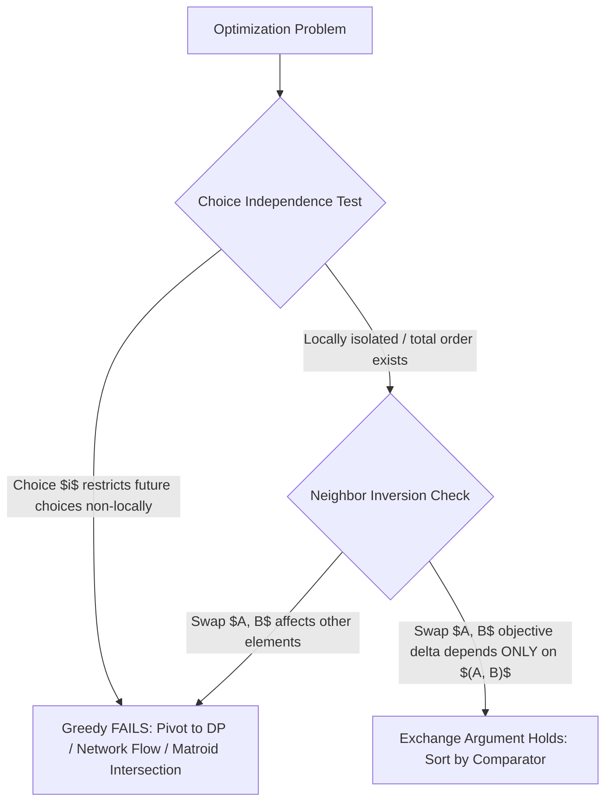
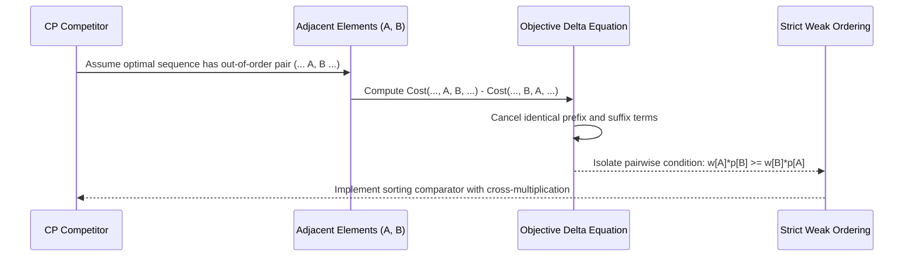
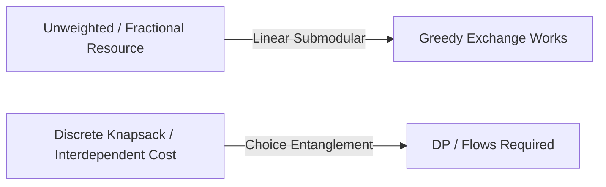

# Greedy Foundations, Proof Paradigms & The Exchange Argument

> **Section:** §19 Greedy Fundamentals & Invariants  
> **Phase:** Phase 1 — Range Queries & Sweeps  
> **Contest ROI:** S-tier | **Rating Range:** 1400–2400 | **Frequency:** Very Common  
> **Prerequisites:** Sorting algorithms, Strict Weak Ordering, Binary Search on Monotonic Predicates, Basic Dynamic Programming

---

## 1. Contest Payoff & Why It Matters

Greedy algorithms are among the most deceptive topics in competitive programming. At lower ratings (1200–1600), greedy problems appear intuitive; at candidate master and master levels (1900–2400+), intuition without formal proof is the single greatest cause of wrong answers, wasted time, and failed contest ratings.

Mastery of this domain grants three decisive contest advantages:
1. **The Exchange Argument Blueprint:** A rigorous, mechanical proof technique that eliminates guesswork and verifies whether a proposed sorting order is globally optimal in under 3 minutes.
2. **Failure Identification:** The ability to immediately identify *non-local dependencies* and *choice entanglement*, allowing you to abandon false greedy paths and pivot to Dynamic Programming, Matroids, or Network Flows before burning contest time.
3. **Greedy Feasibility Predicates:** Pairing greedy decision-making with binary search over the answer ($O(N \log V)$), converting complex constrained optimization into simple verification sweeps.

---

## 2. Theoretical Deep-Dive & Mathematical Mechanics

### Overview

A greedy algorithm constructs a solution step-by-step, making the locally optimal choice at each stage under the assumption that local optimality guarantees global optimality. For a greedy approach to yield an optimal solution, the problem structure must satisfy two fundamental mathematical pillars:
1. **Greedy Choice Property:** A globally optimal solution can be arrived at by making a locally optimal choice without needing to reconsider or backtrack.
2. **Optimal Substructure:** An optimal solution to the overall problem contains within it optimal solutions to its subproblems.

When these properties hold, problems exhibit a matroidal or polymatroidal geometry. When they fail—typically because a choice consumed resources that constrain future steps in a non-linear or non-additive manner—greedy degenerates into a heuristic, requiring DP, min-cost flow, or branch-and-bound.



### Fundamental Theorems & Invariants

#### Theorem 1 (The Adjacent Exchange Theorem)
Let $S = (x_1, x_2, \dots, x_n)$ be an ordered sequence of elements forming a candidate solution, and let $f(S)$ be a scalar objective function. Suppose there exists a strict weak ordering $\prec$ such that for any adjacent inversion where $x_i \succ x_{i+1}$, swapping them strictly improves or maintains the objective:
$$f(\dots, x_{i+1}, x_i, \dots) \le f(\dots, x_i, x_{i+1}, \dots) \quad (\text{for minimization})$$
Then the sequence sorted according to $\prec$ is globally optimal.

*Proof Mechanism:* Any permutation can be transformed into the sorted permutation via a finite sequence of adjacent swaps (equivalent to Bubble Sort). If every swap of an inversion decreases (or maintains) the cost, the sorted sequence must have minimal cost.

#### Theorem 2 (Smith's Rule for Single-Machine Scheduling)
Given $n$ jobs, each with processing time $p_i > 0$ and weight $w_i > 0$, to be processed on a single machine without preemption. The completion time of job $i$ scheduled at position $k$ is $C_k = \sum_{j=1}^k p_{(j)}$. To minimize the sum of weighted completion times:
$$\min \sum_{k=1}^n w_{(k)} C_k$$
It is strictly optimal to process jobs in descending order of the ratio $\frac{w_i}{p_i}$ (or equivalently, ascending order of $\frac{p_i}{w_i}$).

### Algorithmic Execution Blueprint



1. **Setup Adjacent Inversion:** Consider an arbitrary optimal permutation $P = (\dots, A, B, \dots)$ where $A$ immediately precedes $B$, but $A$ and $B$ violate the proposed sorting criterion.
2. **Compute Objective Delta:** Form the alternative permutation $P' = (\dots, B, A, \dots)$ by swapping $A$ and $B$.
3. **Cancel Invariant Invariants:** Elements preceding $A$ finish at the exact same times in both $P$ and $P'. Elements succeeding $B$ begin at $T_{\text{prefix}} + p_A + p_B$ in both configurations, so their completion times are completely unchanged.
4. **Isolate Local Delta:** The difference in objective $\Delta = \text{Cost}(P') - \text{Cost}(P)$ depends exclusively on $A$ and $B$. Solve $\Delta \le 0$ to derive the comparator.
5. **Enforce Strict Weak Ordering:** Verify irreflexivity ($x \not\prec x$), asymmetry, and transitivity ($x \prec y \land y \prec z \implies x \prec z$).

### Closed-Form Invariant Equations

For Smith's Rule:
$$\text{Cost}(A \text{ before } B) = w_A (T + p_A) + w_B (T + p_A + p_B)$$
$$\text{Cost}(B \text{ before } A) = w_B (T + p_B) + w_A (T + p_B + p_A)$$
Subtracting yields the local delta:
$$\Delta = \text{Cost}(A \text{ before } B) - \text{Cost}(B \text{ before } A) = w_B p_A - w_A p_B$$
To minimize cost, we require $\Delta \le 0 \iff w_B p_A \le w_A p_B \iff \frac{w_A}{p_A} \ge \frac{w_B}{p_B}$.

$$\text{Cross-Multiplication Comparator}: \quad A \prec B \iff w_A \cdot p_B > w_B \cdot p_A$$

### Structural Edge Cases & Assumptions

- **Zero Values:** If $p_i = 0$ or $w_i = 0$, floating-point division $\frac{w_i}{p_i}$ results in division-by-zero or precision degradation. Always use integer cross-multiplication $w_A p_B > w_B p_A$.
- **Strict Weak Ordering Violation:** If using `std::sort` in C++, returning `true` when two elements are equal causes undefined behavior (segmentation faults due to out-of-bounds pointer walk). Comparators must return `false` for identical elements ($a \not\prec a$).
- **Non-Local State Mutation:** If choosing $A$ alters the internal processing time or cost of remaining jobs non-additively (e.g. dependent job precedence graphs or nonlinear resource degradation), the pairwise exchange argument fails and requires Dynamic Programming on DAGs or Branch & Bound.

---

## 3. Core Intuition & Problem Framing

A helpful mental model for the exchange argument is **Bubble Sort Inversion Elimination**:
Imagine you claim a specific order $\pi^*$ is optimal. Suppose a skeptic hands you a distinct optimal order $\pi$. Because $\pi \neq \pi^*$, $\pi$ must contain at least one adjacent pair of elements $(A, B)$ where $A$ precedes $B$ in $\pi$ but $B$ precedes $A$ in $\pi^*$.
If you can prove that swapping this single adjacent pair $(A, B)$ cannot worsen the total score, you can repeatedly apply adjacent swaps—reducing the number of inversions by 1 each time—until $\pi$ transforms into your proposed $\pi^*$, with the total score never degrading. Thus, your proposed order is guaranteed to be optimal.

---

## 4. Proof Sketches & Recurrences

### Huffman Coding: "Deepen the Light, Shallow the Heavy"
Consider building an optimal prefix-free binary tree for symbols with frequencies $f_1 \le f_2 \le \dots \le f_n$. The cost is $\sum f_i \cdot d_i$, where $d_i$ is the depth of symbol $i$.
- *Lemma:* The two symbols with the lowest frequencies $f_1, f_2$ must be siblings at maximum depth in an optimal tree.
- *Proof:* If they are not at the maximum depth, let $x, y$ be siblings at maximum depth. Swapping $f_1$ with $x$ and $f_2$ with $y$ cannot increase the cost, because $(f_x - f_1)(d_x - d_1) \ge 0$.
- *Recurrence:* Merge $f_1$ and $f_2$ into a composite node with weight $f_1 + f_2$. By induction, the problem on $n$ symbols reduces to an optimal tree on $n - 1$ symbols. Total merge cost is maintained via a priority queue in $O(N \log N)$.

### When Greedy Fails: The Choice Independence Test
Consider the 0-1 Knapsack problem with capacity $W = 5$ and items:
- Item 1: Value $v_1 = 6$, Weight $w_1 = 2$ (Ratio $3.0$)
- Item 2: Value $v_2 = 10$, Weight $w_2 = 3$ (Ratio $3.33$)
- Item 3: Value $v_3 = 12$, Weight $w_3 = 4$ (Ratio $3.0$)

Greedy picks Item 2 (weight 3, value 10). Remaining capacity is 2, so it picks Item 1 (weight 2, value 6), achieving total value $16$.
However, if $W = 6$, items $(v=10, w=5)$ [ratio 2] and two items $(v=6, w=3)$ [ratio 2]: Greedy picks $(10, 5)$ leaving 1 capacity, total value 10, whereas the two items give $6 + 6 = 12$.
The reason greedy fails is that capacity is discrete and non-divisible: an item's choice consumes space in a non-substitutable way.



---

## 5. Contest-Ready Implementation Templates

### Operational Complexity Reference
- **Smith's Rule Sorting:** Time $O(N \log N)$, Space $O(N)$
- **Huffman / Merge Priority Queue:** Time $O(N \log N)$, Space $O(N)$
- **Binary Search on Greedy Predicate:** Time $O(N \log(\text{Range}))$, Space $O(1)$
- **DP Fallback (Weighted Interval Scheduling):** Time $O(N \log N)$, Space $O(N)$

---

### C++17 Implementation Template

```cpp
#include <bits/stdc++.h>
using namespace std;

namespace GreedyFoundations {

// 1. Smith's Rule for Weighted Completion Times
struct Job {
    int id;
    long long weight;
    long long time;
};

// Strict Weak Ordering via Cross-Multiplication
bool compareJobs(const Job& a, const Job& b) {
    long long lhs = a.weight * b.time;
    long long rhs = b.weight * a.time;
    if (lhs != rhs) {
        return lhs > rhs;
    }
    return a.id < b.id;
}

long long solveSmithRule(vector<Job>& jobs) {
    sort(jobs.begin(), jobs.end(), compareJobs);
    long long current_time = 0;
    long long total_weighted_time = 0;
    for (const auto& job : jobs) {
        current_time += job.time;
        total_weighted_time += job.weight * current_time;
    }
    return total_weighted_time;
}

// 2. Binary Search on Greedy Feasibility Predicate (e.g. Median Maximization)
long long maximizeMedian(vector<long long> a, long long k) {
    sort(a.begin(), a.end());
    int n = a.size();
    int mid = n / 2;

    auto check = [&](long long target) -> bool {
        long long ops_needed = 0;
        for (int i = mid; i < n; ++i) {
            if (a[i] < target) {
                ops_needed += (target - a[i]);
                if (ops_needed > k) return false;
            }
        }
        return ops_needed <= k;
    };

    long long low = a[mid], high = a[mid] + k, best = low;
    while (low <= high) {
        long long m = low + (high - low) / 2;
        if (check(m)) {
            best = m;
            low = m + 1;
        } else {
            high = m - 1;
        }
    }
    return best;
}

// 3. Fallback: Weighted Interval Scheduling via DP + Binary Search
struct Interval {
    long long start, end, weight;
};

long long solveWeightedIntervals(vector<Interval>& intervals) {
    sort(intervals.begin(), intervals.end(), [](const Interval& a, const Interval& b) {
        return a.end < b.end;
    });

    int n = intervals.size();
    vector<long long> end_times(n);
    for (int i = 0; i < n; ++i) end_times[i] = intervals[i].end;

    vector<long long> dp(n + 1, 0);
    for (int i = 1; i <= n; ++i) {
        long long skip = dp[i - 1];
        auto it = upper_bound(end_times.begin(), end_times.begin() + (i - 1), intervals[i - 1].start);
        int last_idx = distance(end_times.begin(), it);
        long long take = intervals[i - 1].weight + dp[last_idx];
        dp[i] = max(skip, take);
    }
    return dp[n];
}

} // namespace GreedyFoundations
```

---

### Python 3 Implementation Template

```python
import sys
from functools import cmp_to_key
from bisect import bisect_right
import heapq

# 1. Smith's Rule with Cross-Multiplication
class Job:
    __slots__ = ("id", "weight", "time")
    def __init__(self, id_: int, weight: int, time: int):
        self.id = id_
        self.weight = weight
        self.time = time

def solve_smith_rule(jobs: list[Job]) -> int:
    def compare(a: Job, b: Job) -> int:
        lhs = a.weight * b.time
        rhs = b.weight * a.time
        if lhs > rhs:
            return -1
        elif lhs < rhs:
            return 1
        return -1 if a.id < b.id else (1 if a.id > b.id else 0)

    jobs.sort(key=cmp_to_key(compare))
    curr_time = 0
    total_weighted_time = 0
    for j in jobs:
        curr_time += j.time
        total_weighted_time += j.weight * curr_time
    return total_weighted_time

# 2. Binary Search on Greedy Feasibility Predicate (Median Maximization)
def maximize_median(a: list[int], k: int) -> int:
    a.sort()
    n = len(a)
    mid = n // 2
    relevant = a[mid:]

    def check(target: int) -> bool:
        ops = 0
        for val in relevant:
            if val < target:
                ops += target - val
                if ops > k:
                    return False
        return ops <= k

    low = a[mid]
    high = a[mid] + k
    ans = low
    while low <= high:
        m = (low + high) // 2
        if check(m):
            ans = m
            low = m + 1
        else:
            high = m - 1
    return ans

# 3. Huffman Merge Cost Pattern (Stick Merging)
def huffman_merge_cost(weights: list[int]) -> int:
    heapq.heapify(weights)
    total_cost = 0
    while len(weights) > 1:
        w1 = heapq.heappop(weights)
        w2 = heapq.heappop(weights)
        cost = w1 + w2
        total_cost += cost
        heapq.heappush(weights, cost)
    return total_cost

# 4. Fallback: Weighted Interval Scheduling DP
def solve_weighted_intervals(intervals: list[tuple[int, int, int]]) -> int:
    intervals.sort(key=lambda x: x[1])
    n = len(intervals)
    ends = [inv[1] for inv in intervals]
    dp = [0] * (n + 1)

    for i in range(1, n + 1):
        s_i, e_i, w_i = intervals[i - 1]
        skip = dp[i - 1]
        j = bisect_right(ends, s_i, 0, i - 1)
        take = w_i + dp[j]
        dp[i] = max(skip, take)
    return dp[n]
```

---

## 6. Recognition Trigger Signals & Heuristics

1. **Permutation / Ordering Optimization:** If the problem asks for an ordering of $N$ items to minimize cumulative sum or bottleneck delay, immediate trigger: **Adjacent Exchange Argument**.
2. **Ratio Comparisons:** If items have two competing scalar parameters (e.g., gain vs loss, weight vs time, probability vs cost), formulate the swap equation; it will almost always yield a ratio condition ($w_i / p_i$).
3. **Threshold / Feasibility Monotonicity:** If the query is "maximize minimum $X$" or "minimize operations to reach threshold", decouple the decision by binary searching on $X$ and verifying via a single greedy pass.
4. **Greedy Traps:** If elements have weights and cannot be freely reordered (e.g. general subsegment sums, non-divisible knapsack), abort greedy and build a DP table.

---

## 7. Contest WA / TLE / RE Traps

- **Floating Point Comparator Error:** Doing `return (double)w1/p1 > (double)w2/p2` loses precision on 64-bit integers and causes false sortings. Always cross-multiply: `w1 * p2 > w2 * p1`.
- **Strict Weak Ordering RE:** In C++ `std::sort`, writing `return a.val >= b.val` violates `cmp(x, x) == false`. This leads to out-of-bounds memory corruption and runtime errors on large inputs.
- **Ignoring Transitivity:** If $A \prec B$ and $B \prec C$ does not imply $A \prec C$, the comparator is invalid and `std::sort` will produce an arbitrary sequence. Always verify cycle-freedom.
- **Premature Greedy in Weighted Problems:** Assuming unweighted greedy interval scheduling (sort by end time) works for weighted intervals. It fails completely; weighted intervals require DP ($O(N \log N)$).

---

## 8. Curated Practice Problem Bank

| Platform | ID | Problem Name | Rating | Tags | Key Strategic Insight | Link |
|---|---|---|---|---|---|---|
| Codeforces | CF-1203E | Boxers | 1200 | Greedy, Sorting | Process elements ascending; greedily move each boxer to $x-1$, then $x$, then $x+1$. | [Solve Problem](https://codeforces.com/contest/1203/problem/E) |
| Codeforces | CF-1201C | Maximum Median | 1400 | Binary Search, Greedy | Sort array; binary search on target median; verify greedy cost on upper half. | [Solve Problem](https://codeforces.com/contest/1201/problem/C) |
| Codeforces | CF-1157C2 | Increasing Subsequence | 1700 | Two Pointers, Greedy | Two-pointer greedy pick; on tie, compute strictly longer run on both sides. | [Solve Problem](https://codeforces.com/contest/1157/problem/C2) |
| Codeforces | CF-1526C2 | Potions (Hard Version) | 1600 | Regret Heap, Greedy | Optimistically drink potion; if health drops $< 0$, refund the most toxic potion. | [Solve Problem](https://codeforces.com/contest/1526/problem/C2) |
| CSES | CSES-1629 | Movie Festival | 1200 | Greedy, Intervals | Sort by ending time; select next non-overlapping interval (Greedy Stays Ahead). | [Solve Problem](https://cses.fi/problemset/task/1629) |
| AtCoder | ABC-131D | Megalomania | 1300 | Exchange Argument | Sort jobs by deadline ascending (Smith's rule variant for feasibility). | [Solve Problem](https://atcoder.jp/contests/abc131/tasks/abc131_d) |

---

## 9. External Theory & Deep-Dive References

- **[Codeforces Tutorial]** [Errichto: Greedy Exchange Arguments & Sorting Criteria](https://codeforces.com/blog/entry/66734)
- **[Algorithm Design (Kleinberg & Tardos)]** Chapter 4: Greedy Algorithms (Interval Scheduling, Stays-Ahead, Exchange Arguments)
- **[USACO Guide]** [Silver: Introduction to Greedy Sorting](https://usaco.guide/silver/greedy-sorting)

---

## 10. Algorithmic Variants & Advanced Extensions

- **Two-Dimensional Tie-Breaking:** When ratio comparisons yield equality ($w_i p_j = w_j p_i$), introduce a strict tie-breaker (e.g. index $i < j$ or secondary parameter) to maintain determinism.
- **Multi-Machine Dispatching:** For $M > 1$ machines, simple ratio sorting does not yield exact optimality (NP-hard partition problem), but yields 4/3-approximation algorithms (Graham's List Scheduling / LPT).
- **Greedy with Oracle Lookahead:** Using a dynamic data structure (Segment Tree or Fenwick Tree) as an oracle to evaluate greedy step feasibility in $O(\log N)$ time.

---

## 11. Typical Problem Archetypes

1. **The Single-Resource Scheduler:** $N$ tasks competing for a single processor with varying durations, deadlines, and penalties. Apply adjacent exchange to find the invariant sorting metric.
2. **Bottleneck Capacity Maximizer:** Maximizing minimum survival time or fuel across an expedition. Sort candidate resources by consumption rate or threshold.
3. **Lexicographical String / Array Reconstruction:** Building the smallest sequence subject to frequency or reachability constraints.

---

## 12. Recognition & Identification Drills

1. *Scenario:* You are given $N$ files of size $S_i$. Compressing two files of sizes $A$ and $B$ takes time $A + B$ and produces a file of size $A + B$.  
   *Diagnosis:* Huffman Merge Pattern. Min-heap, repeatedly combine two smallest ($O(N \log N)$).
2. *Scenario:* You are given $N$ quests. Quest $i$ requires $R_i$ experience to attempt and grants $G_i$ experience.  
   *Diagnosis:* Partitioned exchange argument. Partition into $G_i \ge 0$ (sort by requirement $R_i$) and $G_i < 0$ (sort by $R_i + G_i$ descending).
3. *Scenario:* You need to select intervals to maximize total weight, where intervals overlap arbitrarily and weights are positive integers.  
   *Diagnosis:* Greedy fails due to non-uniform weights. Use Weighted Interval Scheduling DP ($O(N \log N)$).

---

## 13. Fast-Lookup Cheat Sheet

- **Exchange Argument Step:** Compare $(\dots, A, B, \dots)$ vs $(\dots, B, A, \dots)$. Cross-multiply, cancel common terms, isolate comparator.
- **Strict Weak Ordering Rule:** `cmp(a, a)` MUST evaluate to `false`. Always use strict inequality (`<` or `>`), never `<=` or `>=`.
- **Smith's Rule:** Minimize $\sum w_i C_i \implies$ sort by $\frac{w_i}{p_i}$ descending $\implies w_A p_B > w_B p_A$.
- **Median Maximizer:** Binary search the answer $X \in [A_{\min}, A_{\max} + K]$; greedy check takes $O(N)$ by summing $\max(0, X - A_i)$.
