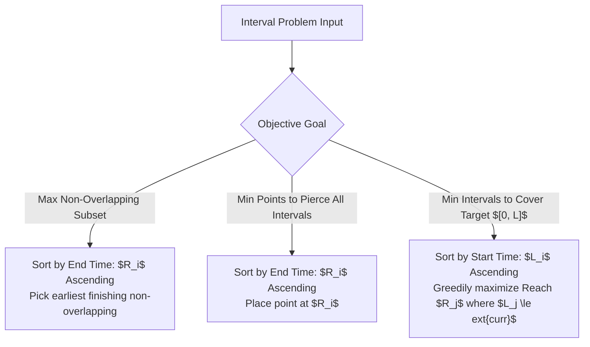
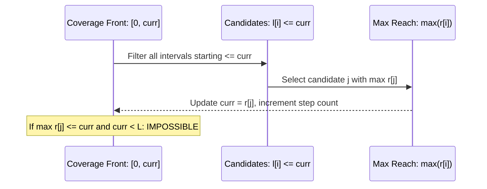

# Interval Scheduling, Coverage & Lexicographical Greedy

> **Section:** §19 Greedy Fundamentals & Invariants  
> **Phase:** Phase 1 — Range Queries & Sweeps  
> **Contest ROI:** S-tier | **Rating Range:** 1300–2100 | **Frequency:** Very Common  
> **Prerequisites:** Sorting by multiple keys, Two-pointer techniques, String hashing basics

---

## 1. Contest Payoff & Why It Matters

Interval problems and lexicographical greedy optimizations are recurring patterns on Codeforces (Div. 2 C/D, Div. 1 A) and ICPC regionals.
Mastery provides:
1. **The "Greedy Stays Ahead" Proof Paradigm:** A structural inductive argument that guarantees correctness without brute-force search.
2. **Three Canonical Interval Archetypes:** Instant identification between *Disjoint Selection* (sort by end time), *Interval Piercing* (sort by end time), and *Segment Coverage* (sort by start time, maximize reach).
3. **Tie-Breaking Acceleration:** Resolving lexicographical ambiguity using two-pointer scans and rolling hashes, reducing $O(N^2)$ naive string comparisons to $O(N \log N)$ or $O(N)$.

---

## 2. Theoretical Deep-Dive & Mathematical Mechanics

### Overview

In interval optimization, we are given a set of $N$ intervals $\mathcal{I} = \{[l_i, r_i]\}_{i=1}^N$. We classify interval problems into three fundamental archetypes based on their objective and sorting direction:



### Fundamental Theorems & Invariants

#### Theorem 1 (Greedy Stays Ahead for Interval Scheduling)
Let $G = (g_1, g_2, \dots, g_k)$ be the sequence of intervals selected by the earliest-finish-time greedy algorithm, sorted such that $r(g_1) \le r(g_2) \le \dots \le r(g_k)$. Let $O = (o_1, o_2, \dots, o_m)$ be any valid non-overlapping set of intervals sorted by start time.
Then for all $1 \le i \le k$, we have:
$$r(g_i) \le r(o_i)$$
Consequently, $k \ge m$, meaning the greedy solution is globally optimal.

*Proof by Induction:*
- **Base Case ($i = 1$):** By definition, the greedy algorithm selects an interval with the minimal finishing time among all available candidates. Hence, $r(g_1) \le r(o_1)$.
- **Inductive Step:** Assume $r(g_{i-1}) \le r(o_{i-1})$. Since $O$ is a disjoint set, $l(o_i) \ge r(o_{i-1})$.
  Because $r(g_{i-1}) \le r(o_{i-1})$, it follows that $l(o_i) \ge r(g_{i-1})$.
  Thus, interval $o_i$ was a valid candidate available to the greedy algorithm when selecting $g_i$.
  Since greedy chose $g_i$ to minimize finishing time among all available candidates, $r(g_i) \le r(o_i)$.
- **Conclusion:** If $m > k$, interval $o_{k+1}$ would be validly available after $g_k$, allowing greedy to select at least $k + 1$ intervals, a contradiction. Hence $k = m$.

#### Theorem 2 (Segment Coverage Invariant)
To cover a continuous target interval $[0, L]$ with the minimum number of intervals:
Given current covered prefix $[0, 	ext{curr}]$, all available intervals with $l_i \le 	ext{curr}$ can extend the coverage. To minimize the total interval count, the optimal choice is strictly the candidate that maximizes $r_i$.



---

## 3. Core Intuition & Problem Framing

### Lexicographical Greedy & The Reachability Test
When building a sequence of characters or numbers to be **lexicographically smallest**, the greedy rule is:
> At each step, choose the smallest possible value that still permits a valid completion.

If there is a tie between choosing from two endpoints (e.g. deque or string reversal problems like *Best Cow Line*), comparing only the immediate characters is insufficient. If $S[	ext{left}] == S[	ext{right}]$, look ahead into the string: compare the substring starting at `left` with the reversed substring ending at `right`. The side whose forward run is lexicographically smaller should be consumed first.

---

## 4. Proof Sketches & Recurrences

### Minimum Interval Piercing Points
Given $N$ intervals, find the minimum number of points such that every interval contains at least one point.
- **Algorithm:** Sort intervals by right endpoint $r_i$ ascending.
- **Greedy Choice:** Place a point at $p = r_1$. Discard all intervals that contain $p$ (i.e. all $j$ where $l_j \le p \le r_j$). Repeat on the remaining intervals.
- **Proof:** Interval 1 must be covered. To cover interval 1 while maximizing the probability of covering other intervals, the point must be placed as far right as possible within interval 1, which is exactly $r_1$. Any point $x < r_1$ covers a subset of intervals covered by $r_1$ that begin before $x$. Therefore, placing at $r_1$ is strictly dominant.

---

## 5. Contest-Ready Implementation Templates

### Operational Complexity Reference
- **Interval Scheduling (Max Disjoint):** Time $O(N \log N)$, Space $O(N)$
- **Continuous Segment Coverage $[0, L]$:** Time $O(N \log N)$, Space $O(1)$ auxiliary
- **Lexicographical String (Two-Pointer):** Time $O(N^2)$ direct slicing, $O(N)$ with Rolling Hash / Suffix Array

---

### C++17 Implementation Template

```cpp
#include <bits/stdc++.h>
using namespace std;

namespace IntervalAndLexicographical {

struct Interval {
    long long l, r;
    int id;
};

// 1. Maximum Disjoint Intervals (Activity Selection)
int maxDisjointIntervals(vector<Interval>& intervals) {
    sort(intervals.begin(), intervals.end(), [](const Interval& a, const Interval& b) {
        if (a.r != b.r) return a.r < b.r;
        return a.l < b.l;
    });

    int count = 0;
    long long last_end = -4e18;

    for (const auto& inv : intervals) {
        if (inv.l >= last_end) {
            count++;
            last_end = inv.r;
        }
    }
    return count;
}

// 2. Minimum Intervals to Cover Target Range [0, L]
int minIntervalsToCover(vector<Interval>& intervals, long long L) {
    sort(intervals.begin(), intervals.end(), [](const Interval& a, const Interval& b) {
        if (a.l != b.l) return a.l < b.l;
        return a.r > b.r;
    });

    int n = intervals.size();
    long long curr_reach = 0;
    int count = 0;
    int i = 0;

    while (curr_reach < L) {
        long long best_reach = curr_reach;
        while (i < n && intervals[i].l <= curr_reach) {
            best_reach = max(best_reach, intervals[i].r);
            i++;
        }

        if (best_reach == curr_reach) {
            return -1;
        }

        curr_reach = best_reach;
        count++;
    }
    return count;
}

// 3. Lexicographically Smallest Sequence with Lookahead (Best Cow Line pattern)
string lexicographicallySmallestString(const string& s) {
    int n = s.size();
    int left = 0, right = n - 1;
    string result = "";
    result.reserve(n);

    while (left <= right) {
        bool choose_left = false;
        for (int i = 0; left + i <= right - i; ++i) {
            if (s[left + i] < s[right - i]) {
                choose_left = true;
                break;
            } else if (s[left + i] > s[right - i]) {
                choose_left = false;
                break;
            }
        }

        if (choose_left) {
            result.push_back(s[left++]);
        } else {
            result.push_back(s[right--]);
        }
    }
    return result;
}

} // namespace IntervalAndLexicographical
```

---

### Python 3 Implementation Template

```python
import sys

# 1. Maximum Disjoint Intervals
def max_disjoint_intervals(intervals: list[tuple[int, int]]) -> int:
    intervals.sort(key=lambda x: x[1])
    count = 0
    last_end = -float('inf')
    
    for start, end in intervals:
        if start >= last_end:
            count += 1
            last_end = end
    return count

# 2. Continuous Segment Coverage [0, L]
def min_intervals_to_cover(intervals: list[tuple[int, int]], L: int) -> int:
    intervals.sort(key=lambda x: (x[0], -x[1]))
    n = len(intervals)
    curr_reach = 0
    count = 0
    i = 0
    
    while curr_reach < L:
        best_reach = curr_reach
        while i < n and intervals[i][0] <= curr_reach:
            if intervals[i][1] > best_reach:
                best_reach = intervals[i][1]
            i += 1
            
        if best_reach == curr_reach:
            return -1
            
        curr_reach = best_reach
        count += 1
        
    return count

# 3. Lexicographical Greedy with Tie-Breaker Lookahead
def solve_best_cow_line(s: str) -> str:
    left = 0
    right = len(s) - 1
    res = []
    
    while left <= right:
        if s[left:right+1] <= s[left:right+1][::-1]:
            res.append(s[left])
            left += 1
        else:
            res.append(s[right])
            right -= 1
            
    return "".join(res)
```

---

## 6. Recognition Trigger Signals & Heuristics

1. **"Select maximum number of non-overlapping events":** Sort by right endpoint ($r_i$ ascending). Greedy Stays Ahead holds.
2. **"Find minimum number of sensors / guards to cover all intervals":** Sort by right endpoint ($r_i$ ascending). Place sensor at $r_i$.
3. **"Completely tile / cover segment $[A, B]$ with minimum resources":** Sort by left endpoint ($l_i$ ascending). Greedily pick the maximum right reach among available intervals starting $\le 	ext{curr}$.
4. **"Construct lexicographically smallest permutation or string":** At each index, pick the smallest available candidate that maintains validity. If symmetry or two-pointer choice occurs, use forward lookahead or tie-breaker comparisons.

---

## 7. Contest WA / TLE / RE Traps

- **Sorting by Left Endpoint in Activity Selection:** Classic bug is sorting disjoint intervals by $l_i$ ascending. Counterexample: `[1, 100], [2, 3], [4, 5]`. Always sort by $r_i$ ascending.
- **Strict vs Non-Strict Overlap:** Check whether touching endpoints are permitted: `start >= last_end` vs `start > last_end`.
- **Segment Coverage Gap Detection:** Forgetting to check `best_reach == curr_reach` leads to infinite loops when reaching $L$ is impossible.
- **$O(N^2)$ Slicing TLE in Python:** For $N > 10^5$, slicing causes TLE. Use Double Hashing with binary search on LCP to compare substrings in $O(\log N)$ time.

---

## 8. Curated Practice Problem Bank

| Platform | ID | Problem Name | Rating | Tags | Key Strategic Insight | Link |
|---|---|---|---|---|---|---|
| CSES | CSES-1629 | Movie Festival | 1200 | Greedy, Intervals | Classic maximum disjoint intervals. Sort by finish time. | [Solve Problem](https://cses.fi/problemset/task/1629) |
| Codeforces | CF-1029B | Creating the Contest | 1200 | Greedy, Two Pointers | Maintain longest valid run satisfying $a[i] \le 2 \cdot a[i-1]$. | [Solve Problem](https://codeforces.com/contest/1029/problem/B) |
| USACO | USACO-363 | Best Cow Line | 1500 | Greedy, Two Pointers | Lexicographical two-pointer with lookahead tie-breaking. | [Solve Problem](https://usaco.org/index.php?page=viewproblem2&cpid=363) |
| Codeforces | CF-1157C2 | Increasing Subsequence (hard) | 1700 | Greedy, Deque | Greedy pick smaller end; if tied, simulate max run on both sides. | [Solve Problem](https://codeforces.com/contest/1157/problem/C2) |
| Codeforces | CF-1249D2 | Too Many Segments (hard) | 1900 | Greedy, Sweep Line | Sweep left to right. When overlap $> K$, greedily drop interval with max $R$. | [Solve Problem](https://codeforces.com/contest/1249/problem/D2) |
| AtCoder | ABC-214E | Packing Under Range Regulations | 2000 | Greedy, Priority Queue | Intervals as slots: sweep coordinates, greedily pick interval with smallest $R_i$. | [Solve Problem](https://atcoder.jp/contests/abc214/tasks/abc214_e) |

---

## 9. External Theory & Deep-Dive References

- **[USACO Guide]** [Silver: Greedy Algorithms with Sorting](https://usaco.guide/silver/greedy-sorting)
- **[Introduction to Algorithms (CLRS)]** Chapter 16.1: An activity-selection problem
- **[CP-Algorithms]** [Schedule events with minimum resource usage](https://cp-algorithms.com/)

---

## 10. Algorithmic Variants & Advanced Extensions

- **$K$-Capacity Interval Scheduling:** Assigning intervals to $K$ machines using priority queue of ending times.
- **Dropping Excess Overlaps (CF 1249D2):** When at most $K$ intervals can cover any coordinate, sweep and drop the interval with maximum $R$ upon violation.

---

## 11. Typical Problem Archetypes

1. **Activity Selection:** Maximize mutually compatible tasks on 1 machine $\implies$ sort by $R_i$.
2. **Point Piercing / Dart Board:** Pierce all target segments with minimum arrows $\implies$ sort by $R_i$, shoot at $R_i$.
3. **Bridge / Coverage Construction:** Cover road $[0, L]$ with minimum street lights $\implies$ sort by $L_i$, maximize $R_i$ reach.
4. **Lexicographical Deque Drainage:** Drain elements from left or right to make output string smallest $\implies$ lookahead string comparison.

---

## 12. Recognition & Identification Drills

1. *Scenario:* You are given $N$ intervals. You must select the minimum number of intervals such that every integer from $1$ to $M$ is covered.  
   *Diagnosis:* Continuous Segment Coverage. Sort by $L_i$ ascending; greedily maximize $R_i$ among reachable intervals.
2. *Scenario:* You have $N$ meetings. What is the minimum number of conference rooms needed so that no two meetings overlap in the same room?  
   *Diagnosis:* Interval Coloring / Sweep Line. Min-heap of ending times.
3. *Scenario:* A string $S$ is given. You can delete at most $K$ digits to make the resulting number as small as possible.  
   *Diagnosis:* Monotonic stack lexicographical greedy.

---

## 13. Fast-Lookup Cheat Sheet

- **Max Disjoint Intervals:** Sort by $R_i$ ascending. Iterate; if $L_i \ge 	ext{last\_}R$, pick and set $	ext{last\_}R = R_i$.
- **Min Piercing Points:** Sort by $R_i$ ascending. Place point at $R_i$; skip all subsequent intervals where $L_j \le R_i$.
- **Min Coverage of $[0, L]$:** Sort by $L_i$ ascending. While $	ext{reach} < L$, find $\max R_j$ among all $L_j \le 	ext{reach}$. If $\max R_j \le 	ext{reach}$, abort.
- **Lexicographical Tie:** If $S[	ext{left}] == S[	ext{right}]$, compare forward string with reverse string.
