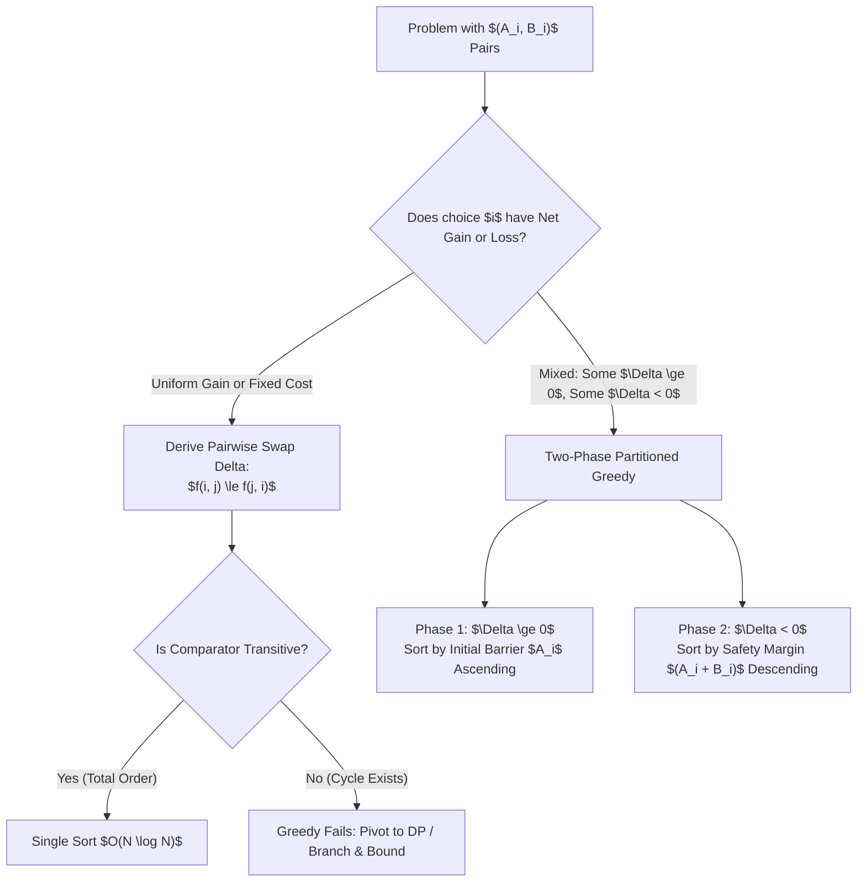
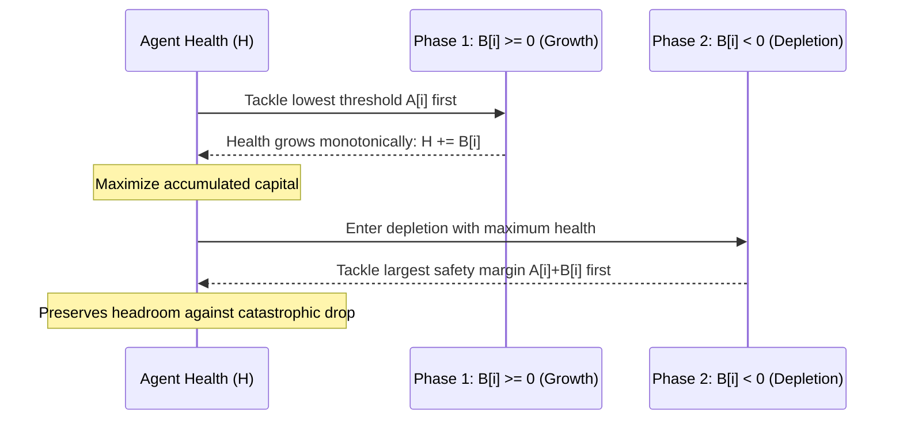

# Sorting Criteria, Custom Comparators & Partitioned Greedy

> **Section:** §19 Greedy Fundamentals & Invariants  
> **Phase:** Phase 1 — Range Queries & Sweeps  
> **Contest ROI:** S-tier | **Rating Range:** 1500–2300 | **Frequency:** Common  
> **Prerequisites:** Exchange arguments, Strict Weak Ordering, `std::sort` comparator mechanics, `functools.cmp_to_key`

---

## 1. Contest Payoff & Why It Matters

In competitive programming, many greedy problems cannot be solved by simply sorting by a single obvious attribute like weight or deadline. Instead, the optimal ordering is dictated by an algebraic interaction between multiple parameters (e.g. $A_i \cdot B_j - A_j \cdot B_i$), or requires **partitioning elements into distinct directional regimes** before sorting each regime with completely different criteria.

Mastering this topic guarantees:
1. **Deriving Non-Trivial Comparators:** Solving complex multi-variable ordering problems mechanically via algebraic neighbor swaps.
2. **The Two-Phase Partition Paradigm:** Conquering resource-accumulation problems (like the RPG "Monster Problem") where items either grant net profit or net loss, recognizing why single-comparator sorting fails mathematically.
3. **Robust Transitivity Hygiene:** Eliminating insidious runtime errors (`SIGSEGV` in C++) caused by non-transitive or non-strict comparators.

---

## 2. Theoretical Deep-Dive & Mathematical Mechanics

### Overview

When an ordering $\pi$ of $N$ items dictates the final score or feasibility, we evaluate the cost difference between adjacent elements $i$ and $j$. If the condition for $i$ to precede $j$ depends *only* on the parameters of $i$ and $j$ and forms a strict weak order, the problem can be solved in $O(N \log N)$ by sorting.

However, if the system undergoes a regime change—such as a player's resource pool transitioning from monotonically growing to monotonically shrinking—a single total order does not exist across the entire set. In such cases, the universe of items must be partitioned into disjoint subsets, each governed by its own independent sorting invariant.



### Fundamental Theorems & Invariants

#### Theorem 1 (The Concatenation Comparator & Transitivity)
Given strings $S_1, S_2, \dots, S_n$, we wish to concatenate them to form the lexicographically largest (or smallest) string.
Define the binary relation $\prec$ by:
$$S_i \prec S_j \iff S_i + S_j < S_j + S_i$$
Then $\prec$ is a strict weak ordering (specifically, it is irreflexive, asymmetric, and transitive). Sorting strings under $\prec$ yields the globally optimal concatenation.

*Proof of Transitivity:*
Let strings be interpreted as numbers in base $B$ with lengths $|x|, |y|, |z|$.
Then $x + y$ corresponds to $x \cdot B^{|y|} + y$.
The relation $x + y > y + x$ is equivalent to:
$$x \cdot B^{|y|} + y > y \cdot B^{|x|} + x \iff x(B^{|y|} - 1) > y(B^{|x|} - 1) \iff rac{x}{B^{|x|} - 1} > rac{y}{B^{|y|} - 1}$$
Because each string maps to a real scalar value $\phi(x) = rac{x}{B^{|x|} - 1}$, the relation is a total ordering induced by standard inequality on real numbers. Transitivity holds unconditionally.

#### Theorem 2 (The Two-Phase Resource Partition Principle)
In a resource survival problem, an agent starts with health $H$. Encountering task $i$ requires minimum health $A_i$ and applies delta $B_i$ (so $H \ge A_i$ is required, and after completion $H \leftarrow H + B_i$).
To determine if all tasks can be completed:
1. Partition tasks into two sets:
   $$\mathcal{P}^+ = \{i \mid B_i \ge 0\}, \quad \mathcal{P}^- = \{i \mid B_i < 0\}$$
2. **Phase 1 ($\mathcal{P}^+$):** Process all tasks in $\mathcal{P}^+$ before any task in $\mathcal{P}^-$. Within $\mathcal{P}^+$, sort in ascending order of required barrier $A_i$:
   $$i \prec j \iff A_i < A_j$$
3. **Phase 2 ($\mathcal{P}^-$):** Within $\mathcal{P}^-$, sort in descending order of $A_i + B_i$:
   $$i \prec j \iff A_i + B_i > A_j + B_j$$



*Proof for Phase 1:*
In $\mathcal{P}^+$, every completed task increases or maintains health ($B_i \ge 0$). Completing task $i$ only makes it easier to complete subsequent tasks. To unlock tasks that require higher barriers, we should greedily complete the task with the lowest requirement $A_i$ first.

*Proof for Phase 2:*
In $\mathcal{P}^-$, every completed task decreases health ($B_i < 0$). Consider two adjacent tasks $i$ and $j$.
If we execute $i$ then $j$, the initial health $H$ before these two tasks must satisfy:
$$H \ge A_i \quad 	ext{and} \quad H + B_i \ge A_j \iff H \ge \max(A_i, A_j - B_i)$$
If we execute $j$ then $i$, the requirement is:
$$H \ge \max(A_j, A_i - B_j)$$
We prefer $i$ then $j$ if and only if:
$$\max(A_i, A_j - B_i) \le \max(A_j, A_i - B_j)$$
Adding $B_i + B_j$ (which is negative) and simplifying:
Since $B_i < 0$, $A_j - B_i > A_j$. Thus the condition simplifies to:
$$A_j - B_i \le A_i - B_j \iff A_j + B_j \le A_i + B_i \iff A_i + B_i \ge A_j + B_j$$
Thus, sorting descending by $A_i + B_i$ strictly minimizes the necessary health at every adjacent step.

---

## 3. Core Intuition & Problem Framing

### Why One Sort Fails
Why can we not merge $\mathcal{P}^+$ and $\mathcal{P}^-$ into a single comparator?
Consider the condition $\max(A_i, A_j - B_i) \le \max(A_j, A_i - B_j)$.
- When $B_i \ge 0$ and $B_j < 0$: $A_i$ is relatively small, while $A_j - B_i$ is much larger because $B_i \ge 0$ while $-B_j > 0$.
The relation between a positive-delta item and a negative-delta item depends on the absolute value of $H$, not just the pairwise attributes! A positive-delta item should **always** be performed before a negative-delta item because positive items expand the reachable set, whereas negative items shrink it. Mixing them into `std::sort` violates transitivity, leading to cycles: $X \prec Y$, $Y \prec Z$, but $Z \prec X$.

---

## 4. Proof Sketches & Recurrences

### The Cross-Multiplication Algebra
When minimizing $\sum C_i$ with cost function interaction:
$$	ext{Cost}(i 	ext{ then } j) = lpha_i + eta_i \cdot \gamma_j$$
$$	ext{Cost}(j 	ext{ then } i) = lpha_j + eta_j \cdot \gamma_i$$
The adjacent exchange delta is:
$$\Delta = (lpha_i + eta_i \cdot \gamma_j) - (lpha_j + eta_j \cdot \gamma_i)$$
If $lpha_i = lpha_j$, we isolate $eta_i \cdot \gamma_j \le eta_j \cdot \gamma_i \iff rac{eta_i}{\gamma_i} \le rac{eta_j}{\gamma_j}$.
Always compute the sorting key using cross-multiplication:
`lhs = beta[i] * gamma[j]`, `rhs = beta[j] * gamma[i]`.

---

## 5. Contest-Ready Implementation Templates

### Operational Complexity Reference
- **Concatenation Sorting:** Time $O(N \log N \cdot L)$, Space $O(N \cdot L)$ where $L$ is max string length.
- **Two-Phase Partitioned Greedy:** Time $O(N \log N)$, Space $O(N)$ auxiliary.
- **Custom Comparator via Cross-Multiplication:** Time $O(N \log N)$, Space $O(1)$ auxiliary.

---

### C++17 Implementation Template

```cpp
#include <bits/stdc++.h>
using namespace std;

namespace CustomComparatorsAndPartition {

// 1. Concatenation Sorting ("Largest Number")
string largestConcatenatedNumber(vector<string>& nums) {
    sort(nums.begin(), nums.end(), [](const string& a, const string& b) {
        return a + b > b + a;
    });

    if (nums.empty() || nums[0] == "0") return "0";

    string result = "";
    for (const auto& s : nums) result += s;
    return result;
}

// 2. Two-Phase Partitioned Greedy (The Monster / RPG Problem)
struct Quest {
    int id;
    long long req;  // A_i: Health required to attempt
    long long gain; // B_i: Net health delta (can be negative)
};

bool solveMonsterGame(vector<Quest>& quests, long long initial_health) {
    vector<Quest> pos;
    vector<Quest> neg;

    for (const auto& q : quests) {
        if (q.gain >= 0) {
            pos.push_back(q);
        } else {
            neg.push_back(q);
        }
    }

    // Phase 1: Net positive gain. Sort by requirement ascending.
    sort(pos.begin(), pos.end(), [](const Quest& a, const Quest& b) {
        if (a.req != b.req) return a.req < b.req;
        return a.gain > b.gain;
    });

    // Phase 2: Net negative gain. Sort by (req + gain) descending.
    sort(neg.begin(), neg.end(), [](const Quest& a, const Quest& b) {
        long long sum_a = a.req + a.gain;
        long long sum_b = b.req + b.gain;
        if (sum_a != sum_b) return sum_a > sum_b;
        return a.req > b.req;
    });

    long long current_health = initial_health;

    for (const auto& q : pos) {
        if (current_health < q.req) return false;
        current_health += q.gain;
    }

    for (const auto& q : neg) {
        if (current_health < q.req) return false;
        current_health += q.gain;
        if (current_health < 0) return false;
    }

    return true;
}

// 3. Generic Cross-Multiplication Ratio Comparator
struct Item {
    long long x, y;
};

void sortItemsByCrossMultiplication(vector<Item>& items) {
    sort(items.begin(), items.end(), [](const Item& a, const Item& b) {
        long long lhs = a.x * b.y;
        long long rhs = b.x * a.y;
        return lhs < rhs;
    });
}

} // namespace CustomComparatorsAndPartition
```

---

### Python 3 Implementation Template

```python
import sys
from functools import cmp_to_key

# 1. Concatenation Sorting ("Largest Number")
def largest_number(nums: list[int]) -> str:
    str_nums = [str(x) for x in nums]
    
    def compare(a: str, b: str) -> int:
        if a + b > b + a:
            return -1
        elif a + b < b + a:
            return 1
        return 0
        
    str_nums.sort(key=cmp_to_key(compare))
    result = "".join(str_nums)
    return "0" if result[0] == "0" else result

# 2. Two-Phase Partitioned Greedy (RPG Quests)
class Quest:
    __slots__ = ("req", "gain", "id")
    def __init__(self, req: int, gain: int, id_: int):
        self.req = req
        self.gain = gain
        self.id = id_

def solve_monster_game(quests: list[Quest], initial_health: int) -> bool:
    pos = [q for q in quests if q.gain >= 0]
    neg = [q for q in quests if q.gain < 0]
    
    pos.sort(key=lambda q: (q.req, -q.gain))
    neg.sort(key=lambda q: (-(q.req + q.gain), -q.req))
    
    curr = initial_health
    for q in pos:
        if curr < q.req:
            return False
        curr += q.gain
        
    for q in neg:
        if curr < q.req:
            return False
        curr += q.gain
        if curr < 0:
            return False
            
    return True

# 3. Cross-Multiplication Rule with cmp_to_key
def sort_jobs_cross_mult(jobs: list[tuple[int, int]]) -> list[tuple[int, int]]:
    def compare(a, b):
        lhs = a[0] * b[1]
        rhs = b[0] * a[1]
        if lhs > rhs:
            return -1
        elif lhs < rhs:
            return 1
        return 0

    return sorted(jobs, key=cmp_to_key(compare))
```

---

## 6. Recognition Trigger Signals & Heuristics

1. **String / Permutation Concatenation:** "Form the smallest/largest concatenated string or number." Use the adjacent concatenation test: $A + B$ vs $B + A$.
2. **Asymmetric Resource Requirements:** Tasks have both a prerequisite threshold ($A_i$) and an impact ($\Delta_i$). If $\Delta_i$ can be either positive or negative, immediately partition into $\Delta \ge 0$ and $\Delta < 0$.
3. **Multi-Parameter Exchange Equations:** When calculating the effect of adjacent elements, if cross terms like $A_i B_j$ arise, isolate coefficients to deduce the ratio metric.

---

## 7. Contest WA / TLE / RE Traps

- **C++ Strict Weak Ordering Crash:** In C++ `std::sort`, returning `true` when two elements are equivalent violates irreflexivity ($x \prec x$ must be false). This causes internal quicksort partitioners to walk off the ends of the vector, producing unexpected `SIGSEGV`.
- **Mixing Positive and Negative Items in a Single Sort:** Attempting to sort all quests with a single comparator like `a.req + a.gain > b.req + b.gain`. This comparator fails transitivity when comparing a positive item to a negative item, resulting in bogus orderings.
- **Python `cmp_to_key` Overhead:** `cmp_to_key` invokes a Python function wrapper for every comparison ($O(N \log N)$ calls). For $N \ge 2 \cdot 10^5$, this can cause TLE in Python. Where possible, transform the comparison into a direct tuple key: `key=lambda x: (x.req, ...)`.

---

## 8. Curated Practice Problem Bank

| Platform | ID | Problem Name | Rating | Tags | Key Strategic Insight | Link |
|---|---|---|---|---|---|---|
| LeetCode | LC-179 | Largest Number | Medium | Sorting, Strings | Sort strings by $A + B > B + A$. Transitive total order. | [Solve Problem](https://leetcode.com/problems/largest-number/) |
| Codeforces | CF-1203F1 | Complete the Projects (easy) | 1800 | Greedy, Two-Phase Partition | Partition into $\Delta \ge 0$ (sort by req) and $\Delta < 0$ (sort by req + delta). | [Solve Problem](https://codeforces.com/contest/1203/problem/F1) |
| Codeforces | CF-1203F2 | Complete the Projects (hard) | 2100 | Greedy + DP, Knapsack | Phase 1 greedy; Phase 2 knapsack DP using the sorted order from F1. | [Solve Problem](https://codeforces.com/contest/1203/problem/F2) |
| AtCoder | ABC-219C | Neo-lexicographic Ordering | 1000 | Custom Comparators | Map custom alphabet to 0..25; sort by translated rank. | [Solve Problem](https://atcoder.jp/contests/abc219/tasks/abc219_c) |
| CSES | CSES-1621 | Distinct Numbers | 1000 | Sorting, Strict Weak Order | Clean sorting invariants and deduplication. | [Solve Problem](https://cses.fi/problemset/task/1621) |

---

## 9. External Theory & Deep-Dive References

- **[Codeforces Tutorial]** [Errichto: Custom Comparators and Two-Phase Greedy](https://codeforces.com/blog/entry/66734)
- **[Codeforces Editorial]** [CF Round 579 Div 3: Complete the Projects](https://codeforces.com/blog/entry/69108)
- **[CppReference]** [Strict Weak Ordering Requirements for `std::sort`](https://en.cppreference.com/w/cpp/named_req/Compare)

---

## 10. Algorithmic Variants & Advanced Extensions

- **Partitioned Greedy with Subset Selection (Knapsack DP on Sorted Items):** If you are not required to complete *all* negative projects, but want to maximize the count of completed projects (as in CF 1203F2):
  1. Greedily complete all feasible positive projects.
  2. Sort the negative projects using the Phase 2 comparator ($A_i + B_i$ descending).
  3. Run 0-1 Knapsack DP where $DP[j]$ is the maximum remaining health after completing $j$ projects. Because the items are pre-sorted in the only valid relative order, the DP state transitions are guaranteed to be optimal!

---

## 11. Typical Problem Archetypes

1. **Concatenation Extremum:** Assemble tokens or digit blocks into an extremum number $\implies A+B$ vs $B+A$.
2. **Two-Phase Adventure / RPG:** Gaining resources and expending resources against level-gated obstacles $\implies$ partition by sign of delta.
3. **Multi-Attribute Priority Dispatch:** Optimizing response times or fuel burns with non-linear penalties $\implies$ derive cross-multiplication invariant.

---

## 12. Recognition & Identification Drills

1. *Scenario:* You need to concatenate words so the resulting dictionary word is lexicographically smallest.  
   *Diagnosis:* Concatenation sort. Comparator `a + b < b + a`.
2. *Scenario:* You have $N$ machines that produce power (+watts) and $M$ machines that consume power (-watts), each requiring a minimum baseline power to start.  
   *Diagnosis:* Two-phase partitioned greedy. Positive machines sorted by `req` ascending; negative machines sorted by `req + delta` descending.
3. *Scenario:* Comparator $A \prec B$ is true if $A$ beats $B$ in rock-paper-scissors.  
   *Diagnosis:* Non-transitive cycle ($R \prec P \prec S \prec R$). Cannot use `std::sort`.

---

## 13. Fast-Lookup Cheat Sheet

- **Concatenation Comparator:** `a + b > b + a` (descending) or `a + b < b + a` (ascending).
- **Two-Phase Partition:**
  - $\Delta \ge 0$: Sort by $A_i$ (requirement) ascending.
  - $\Delta < 0$: Sort by $A_i + \Delta_i$ descending.
- **Cross-Multiplication:** For ratios $w_A / p_A > w_B / p_B$, compute $w_A \cdot p_B > w_B \cdot p_A$.
- **Strict Weak Ordering Guard:** Never write `<=` or `>=` inside `std::sort` lambda; always use strict `<` or `>`.
