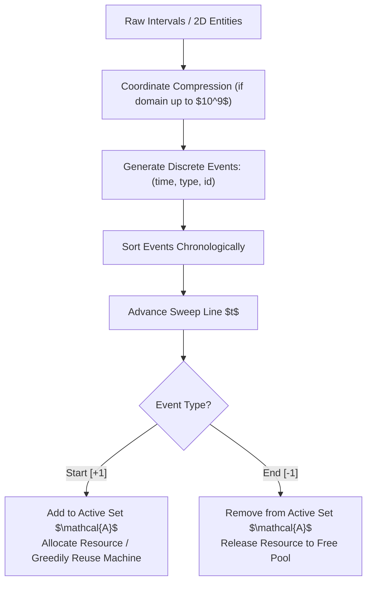
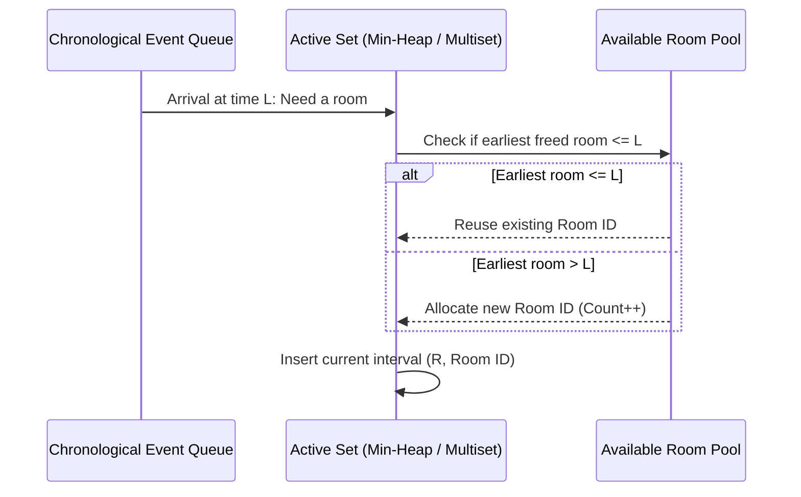

# Sweep-Line Invariants, Active Sets & Constructive Greedy

> **Section:** §19 Greedy Fundamentals & Invariants  
> **Phase:** Phase 1 — Range Queries & Sweeps  
> **Contest ROI:** S-tier | **Rating Range:** 1400–2200 | **Frequency:** Very Common  
> **Prerequisites:** Event Sorting, Coordinate Compression, Priority Queues / Balanced BSTs, 2D Grid Parity

---

## 1. Contest Payoff & Why It Matters

Sweep-line algorithms and constructive greedy methods turn dynamic spatial or multi-variable problems into disciplined, sequential event streams.
Mastery gives you:
1. **Dimensional Reduction:** Transforming complex 2D geometric and interval overlap questions into 1D point queries over an evolving *Active Set*.
2. **Resource-Optimal Allocation:** Solving interval coloring, meeting room scheduling, and capacity bottleneck problems in $O(N \log N)$.
3. **Constructive Invariant Design:** The ability to construct valid combinatorial matrices, graphs, and permutations by strictly maintaining parity, snake traversals, and degree invariants.

---

## 2. Theoretical Deep-Dive & Mathematical Mechanics

### Overview

The Sweep-Line paradigm converts static geometric entities into a temporal sequence of discrete events:
- **Arrival Events:** An interval starts, entering the system.
- **Departure Events:** An interval ends, relinquishing its resource.

At any instant of sweep time $t$, the state of the system is encapsulated in an **Active Set** $\mathcal{A}(t)$. As the sweep-line advances, greedy choices are made based exclusively on the current contents of $\mathcal{A}(t)$.



### Fundamental Theorems & Invariants

#### Theorem 1 (Dilworth's Theorem for Interval Graphs — Meeting Rooms Invariant)
The minimum number of rooms (or color classes) required to schedule $N$ intervals such that no two overlapping intervals share the same room is equal to the **maximum clique size** of the interval graph, which is precisely the maximum number of mutually overlapping intervals at any single point in time:
$$\chi(G) = \omega(G) = \max_{t} |\mathcal{A}(t)|$$

*Greedy Invariant:* Maintaining a min-heap of room availability times allows the greedy assignment of intervals to rooms in $O(N \log N)$, guaranteeing both minimal room count and zero overlap.

#### Theorem 2 (The Bipartite Grid Parity Invariant)
On a 2D grid with dimensions $R \times C$, color cell $(r, c)$ with parity $(r + c) \pmod 2$.
Any step (up, down, left, right) strictly alternates parity:
$$\text{Parity}(r_1, c_1) \neq \text{Parity}(r_2, c_2) \iff |r_1 - r_2| + |c_1 - c_2| = 1$$
Consequently, any closed Hamiltonian cycle on a grid requires $|V_{\text{even}}| = |V_{\text{odd}}|$, which is possible if and only if $R \cdot C$ is even. For construction problems requiring continuous traversals without self-intersections, a **Snake Traversal** alternates direction along rows, preserving contiguous adjacency.



---

## 3. Core Intuition & Problem Framing

### Coordinate Compression: Shrinking Infinite Real Space
In competitive programming, coordinates $x_i, y_i$ often range up to $10^9$, making direct array indexing impossible. However, $N$ intervals define at most $2N$ distinct coordinates of interest.
By collecting all endpoints, removing duplicates, and sorting, we establish a bijection:
$$\phi: \{x_1, \dots, x_{2N}\} \to \{0, 1, \dots, M-1\} \quad \text{where } M \le 2N$$
The topological ordering is preserved ($x_i < x_j \iff \phi(x_i) < \phi(x_j)$), enabling the deployment of Fenwick trees, Segment trees, and difference arrays.

### Constructive Greedy: The "Checklist Method"
In constructive problems ("Build a grid / graph satisfying conditions $C_1, \dots, C_k$"):
1. Identify the most constrained global invariant (e.g. degrees, parity, sum).
2. Establish a canonical layout (e.g. Snake traversal, diagonal filling, spiraling).
3. Fill cells greedily from small to large or along the snake, verifying that each placement preserves invariant feasibility for all remaining cells.

---

## 4. Proof Sketches & Recurrences

### Greedy Room Reuse with Min-Heap
Let intervals be sorted by start time: $I_1, I_2, \dots, I_N$.
Maintain a min-heap storing the end times of active rooms.
- For interval $I_k = [l_k, r_k]$:
  If the top of the heap has $\text{end\_time} \le l_k$, that room is currently idle. We pop it, update its end time to $r_k$, and push it back.
  If the top of the heap has $\text{end\_time} > l_k$, all currently open rooms are occupied at time $l_k$. Therefore, at least $\text{heap.size}() + 1$ rooms are mathematically required. We allocate a new room with end time $r_k$.
- *Proof:* Because intervals are sorted by start time, any room with $\text{end\_time} \le l_k$ will never be needed by any earlier interval. Reusing the room with the earliest end time leaves rooms with later end times available for other requests, preserving maximal flexibility.

---

## 5. Contest-Ready Implementation Templates

### Operational Complexity Reference
- **Meeting Rooms / Interval Coloring:** Time $O(N \log N)$, Space $O(N)$
- **Coordinate Compression:** Time $O(N \log N)$, Space $O(N)$
- **Snake Grid Traversal:** Time $O(R \cdot C)$, Space $O(R \cdot C)$

---

### C++17 Implementation Template

```cpp
#include <bits/stdc++.h>
using namespace std;

namespace SweepAndConstructive {

// 1. Meeting Rooms II / Interval Coloring
struct Interval {
    int id;
    long long l, r;
};

struct RoomAllocation {
    int total_rooms;
    vector<int> room_assigned;
};

RoomAllocation solveMeetingRooms(vector<Interval>& intervals) {
    int n = intervals.size();
    vector<int> order(n);
    iota(order.begin(), order.end(), 0);
    sort(order.begin(), order.end(), [&](int i, int j) {
        if (intervals[i].l != intervals[j].l) return intervals[i].l < intervals[j].l;
        return intervals[i].r < intervals[j].r;
    });

    priority_queue<pair<long long, int>, vector<pair<long long, int>>, greater<>> pq;
    vector<int> assigned(n, 0);
    int room_counter = 0;

    for (int idx : order) {
        long long start = intervals[idx].l;
        long long end = intervals[idx].r;

        if (!pq.empty() && pq.top().first <= start) {
            auto [freed_time, room_id] = pq.top();
            pq.pop();
            assigned[intervals[idx].id] = room_id;
            pq.push({end, room_id});
        } else {
            room_counter++;
            assigned[intervals[idx].id] = room_counter;
            pq.push({end, room_counter});
        }
    }

    return {room_counter, assigned};
}

// 2. Coordinate Compression Utility
class CoordinateCompressor {
    vector<long long> coords;
    bool built = false;
public:
    void add(long long x) { coords.push_back(x); }

    void build() {
        sort(coords.begin(), coords.end());
        coords.erase(unique(coords.begin(), coords.end()), coords.end());
        built = true;
    }

    int get(long long x) const {
        return lower_bound(coords.begin(), coords.end(), x) - coords.begin();
    }

    int size() const { return coords.size(); }
    long long original(int rank) const { return coords[rank]; }
};

// 3. Constructive Snake Traversal on Grid
vector<pair<int, int>> generateSnakeTraversal(int R, int C) {
    vector<pair<int, int>> path;
    path.reserve(R * C);

    for (int r = 0; r < R; ++r) {
        if (r % 2 == 0) {
            for (int c = 0; c < C; ++c) path.push_back({r, c});
        } else {
            for (int c = C - 1; c >= 0; --c) path.push_back({r, c});
        }
    }
    return path;
}

} // namespace SweepAndConstructive
```

---

### Python 3 Implementation Template

```python
import sys
import heapq

# 1. Meeting Rooms / Interval Coloring Invariant
def solve_meeting_rooms(intervals: list[tuple[int, int, int]]) -> tuple[int, list[int]]:
    intervals.sort(key=lambda x: (x[0], x[1]))
    n = len(intervals)
    assigned = [0] * n
    room_counter = 0
    pq = []
    
    for start, end, orig_id in intervals:
        if pq and pq[0][0] <= start:
            freed_time, room_id = heapq.heappop(pq)
            assigned[orig_id] = room_id
            heapq.heappush(pq, (end, room_id))
        else:
            room_counter += 1
            assigned[orig_id] = room_counter
            heapq.heappush(pq, (end, room_counter))
            
    return room_counter, assigned

# 2. Coordinate Compression
class CoordinateCompressor:
    def __init__(self, raw_coords: list[int]):
        self.coords = sorted(list(set(raw_coords)))
        self.mapping = {x: i for i, x in enumerate(self.coords)}
        
    def get(self, x: int) -> int:
        return self.mapping[x]
        
    def original(self, rank: int) -> int:
        return self.coords[rank]
        
    def __len__(self) -> int:
        return len(self.coords)

# 3. Snake Grid Construction Pattern
def build_snake_grid(R: int, C: int, values: list[int]) -> list[list[int]]:
    grid = [[0] * C for _ in range(R)]
    val_idx = 0
    
    for r in range(R):
        cols = range(C) if r % 2 == 0 else range(C - 1, -1, -1)
        for c in cols:
            if val_idx < len(values):
                grid[r][c] = values[val_idx]
                val_idx += 1
    return grid
```

---

## 6. Recognition Trigger Signals & Heuristics

1. **"Find minimum rooms, tracks, or resources to avoid overlap":** Dilworth interval graph coloring. Sort by start time, maintain end times in a min-heap.
2. **"Coordinates span up to $10^9$, but queries/elements $N \le 2 \cdot 10^5$":** Coordinate compression is mandatory before Fenwick/SegTree range updates.
3. **"Fill grid such that adjacent cells differ by at most/least $K$":** Constructive parity/snake. A snake traversal guarantees that cell $k$ and cell $k+1$ are always Manhattan adjacent.

---

## 7. Contest WA / TLE / RE Traps

- **Event Ordering Tie-Breaking:** When intervals touch at endpoints (e.g. $[1, 5]$ and $[5, 10]$):
  - If sharing an endpoint is allowed: process **End Events (-1)** before **Start Events (+1)** at the same coordinate $x$.
  - If sharing an endpoint is forbidden (instant conflict): process **Start Events (+1)** before **End Events (-1)**.
- **Off-by-One in Coordinate Compression Intervals:** When compressing interval endpoints $[L_i, R_i]$, sometimes you must also insert $R_i + 1$ into the compressor to preserve gaps between non-touching intervals.
- **Snake Direction Flip Bug:** Forgetting to alternate columns on odd rows (`C - 1 down to 0`), accidentally producing a cylindrical wrap-around instead of a planar snake.

---

## 8. Curated Practice Problem Bank

| Platform | ID | Problem Name | Rating | Tags | Key Strategic Insight | Link |
|---|---|---|---|---|---|---|
| CSES | CSES-1164 | Room Allocation | 1400 | Greedy, Min-Heap, Sweep | Classic interval coloring: sort by start time, min-heap for room reuse. | [Solve Problem](https://cses.fi/problemset/task/1164) |
| CSES | CSES-1619 | Restaurant Customers | 1100 | Sweep Line, Prefix Sums | Event sorting (+1 arrival, -1 departure); track running prefix max. | [Solve Problem](https://cses.fi/problemset/task/1619) |
| Codeforces | CF-1366D | Two Divisors | 1600 | Number Theory, Greedy | Construct coprime divisors using smallest prime factors. | [Solve Problem](https://codeforces.com/contest/1366/problem/D) |
| Codeforces | CF-1108E2 | Array and Segments (hard) | 2000 | Sweep Line, Segment Tree | Sweep across array points; maintain active set of excluded intervals. | [Solve Problem](https://codeforces.com/contest/1108/problem/E2) |
| AtCoder | ABC-221D | Online Games | 1200 | Coordinate Compression, Sweep | Event delta sweep across days to count exact concurrent players. | [Solve Problem](https://atcoder.jp/contests/abc221/tasks/abc221_d) |

---

## 9. External Theory & Deep-Dive References

- **[USACO Guide]** [Silver: Sweep-Line Algorithms & Event Processing](https://usaco.guide/silver/sweep-line)
- **[TopCoder Tutorial]** [Line Sweep Algorithms: Theory and Practice](https://www.topcoder.com/thrive/articles/Line%20Sweep%20Algorithms)
- **[CP-Algorithms]** [Finding intersections with sweep line](https://cp-algorithms.com/geometry/intersecting_segments.html)

---

## 10. Algorithmic Variants & Advanced Extensions

- **2D Sweep with Persistent Trees:** When queries ask for the number of active intervals in a 2D bounding box $[x_1, x_2] \times [y_1, y_2]$, sweep along $x$ and persist the Segment Tree along $y$, converting 2D queries into $O(\log N)$ range queries.
- **Bipartite Matching on Interval Graphs:** Because interval graphs are chordal and perfect, maximum weight independent set and coloring are solvable greedily without general maximum flow algorithms.

---

## 11. Typical Problem Archetypes

1. **Capacity Peak Detector:** Count max concurrent visitors $\implies$ event sweep with $+1 / -1$ deltas.
2. **Resource Reuser:** Assign tasks to minimum physical machines $\implies$ sort by start time, priority queue of end times.
3. **Snake Grid Constructor:** Connect all grid cells in a contiguous path without crossing $\implies$ snake serpentine path.

---

## 12. Recognition & Identification Drills

1. *Scenario:* You are given $N$ intervals. You need to assign each to one of $K$ colors so that no two intersecting intervals share a color.  
   *Diagnosis:* Interval graph coloring. Min-heap of available colors.
2. *Scenario:* You have $N$ points in 2D with coordinates up to $10^9$. You must count pairs $(i, j)$ with $x_i < x_j$ and $y_i < y_j$.  
   *Diagnosis:* 2D point dominance. Coordinate compress $y$, sort by $x$ ascending, query Fenwick tree over $y$.
3. *Scenario:* Construct a permutation of $1 \dots N$ where $|P_i - P_{i+1}| \ge 2$ for all $i$.  
   *Diagnosis:* Constructive parity split. Place all evens $2, 4, 6 \dots$, then all odds $1, 3, 5 \dots$.

---

## 13. Fast-Lookup Cheat Sheet

- **Interval Coloring Invariant:** Sort by start time. Min-heap of `(end_time, room_id)`. If `heap.top().end_time <= start`, reuse room; else create new room.
- **Sweep Event Structure:** `tuple(time, event_type, id)`. If endpoints touch cleanly, process departures before arrivals.
- **Coordinate Compression Boilerplate:** `coords = sorted(set(raw)); mapping = {x: i for i, x in enumerate(coords)}`.
- **Grid Parity Rule:** Cell $(r, c)$ has color $(r + c) \pmod 2$. Adjacent steps always change color.
