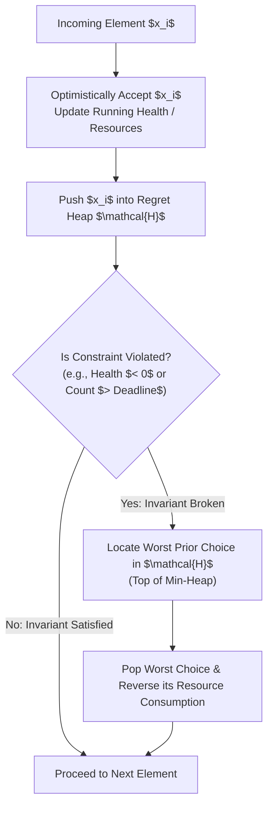
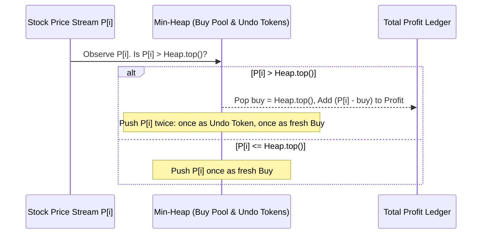

# Priority Queue Regret & Buy-Now-Refund-Later Heuristics

> **Section:** §19 Greedy Fundamentals & Invariants  
> **Phase:** Phase 1 — Range Queries & Sweeps  
> **Contest ROI:** S-tier | **Rating Range:** 1600–2400 | **Frequency:** Common  
> **Prerequisites:** Priority Queues (`std::priority_queue` / `heapq`), Exchange Arguments, Invariant Design

---

## 1. Contest Payoff & Why It Matters

Standard greedy algorithms fail when a decision made early prevents a vastly superior choice later. The classical solution was dynamic programming, which often scales as $O(N^2)$ or $O(N \cdot W)$—too slow for $N = 2 \cdot 10^5$.

The **Priority Queue Regret (Undo Heap)** technique bridges this gap. It enables an algorithm to make choices *optimistically* and later *refund or substitute* sub-optimal choices in $O(\log N)$ time, achieving an optimal $O(N \log N)$ running time.
Mastering this paradigm unlocks:
1. **The "Buy Now, Refund Later" Invariant:** Turning NP-hard-looking sequential constraints into simple priority queue pops.
2. **The "Two-Push" Stock Trading Strategy:** Decomposing complex transaction-matching problems into virtual buys and sells.
3. **The Gateway to Convex Optimization:** Understanding the mechanics of regret heaps provides the direct bridge to **Slope Trick** and **WQS Binary Search**.

---

## 2. Theoretical Deep-Dive & Mathematical Mechanics

### Overview

In many sequential optimization problems, decisions are irreversible under standard greedy frameworks. If taking item $i$ later causes constraint violation, standard greedy is stuck.

The **Regret Paradigm** modifies the greedy protocol:
1. **Optimistic Commitment:** Accept every candidate item greedily as long as possible.
2. **Active Pool Maintenance:** Maintain all accepted items inside a priority queue configured to expose the **worst** accepted choice at the top (min-heap of benefits or max-heap of costs).
3. **Retrospective Eviction:** The moment a constraint is violated, locate the single worst accepted choice in the priority queue, pop it, and reverse its effect on the constraint.



### Fundamental Theorems & Invariants

#### Theorem 1 (The Potions Problem Invariant — Maximum Non-Negative Prefix Sum Subset)
Given an array $A = (a_1, a_2, \dots, a_n)$, find the maximum size subset of indices $S \subseteq \{1, \dots, n\}$ such that for all prefixes $1 \le k \le n$, the cumulative sum of chosen elements satisfies:
$$\sum_{i \in S, i \le k} a_i \ge 0$$
*Algorithm:*
Iterate $i$ from $1$ to $n$. Add $a_i$ to running sum $H$. If $a_i < 0$, insert $a_i$ into min-heap $\mathcal{H}$.
If $H < 0$:
$$\text{worst} = \mathcal{H}.\text{top}(), \quad \mathcal{H}.\text{pop}(), \quad H \leftarrow H - \text{worst}$$
*Proof of Optimality:*
Suppose at step $k$, health $H$ drops below 0. We must discard at least one chosen element with index $\le k$. Discarding any chosen element $x$ restores health by $|x|$ and reduces the count of chosen elements by 1.
To maximize future survivability, we should maximize the health restored per discarded element. Thus, we must pick the element $x \in \mathcal{H}$ with maximum $|x|$ (i.e. minimum algebraic value $x$).
Since $x$ had already contributed to the prefix sum before step $k$, removing it strictly increases all prefix sums from the position of $x$ up to $k$ by $|x|$, restoring feasibility without altering the validity of any choice prior to $x$. Hence, the greedy regret choice is globally optimal.

#### Theorem 2 (The Two-Push Stock Trading Invariant)
Given daily stock prices $P_1, P_2, \dots, P_n$. You may buy and sell shares with no transaction fee. Maximize total profit.
*Algorithm:*
Maintain a min-heap $\mathcal{H}$ of buying opportunities. For day $i$ with price $P_i$:
- If $\mathcal{H}$ is not empty and $P_i > \mathcal{H}.\text{top}()$:
  $$\text{buy} = \mathcal{H}.\text{pop}()$$
  $$\text{profit} \leftarrow \text{profit} + (P_i - \text{buy})$$
  Push $P_i$ into $\mathcal{H}$ (Undo Token: allows a future higher price $P_j$ to claim $P_j - P_i$).
  Push $P_i$ into $\mathcal{H}$ (Normal Buy Opportunity: allows buying at $P_i$ for a future price $P_j$).
- Else:
  Push $P_i$ into $\mathcal{H}$ (Normal Buy Opportunity).



*Algebraic Justification of the Undo Token:*
If a share was bought at $P_a$ and sold at $P_i$, the profit realized is $P_i - P_a$.
If on a subsequent day $j > i$ the price rises to $P_j > P_i$, it would have been superior to pair $P_a$ with $P_j$, realizing $P_j - P_a$.
Notice that:
$$(P_j - P_a) = (P_i - P_a) + (P_j - P_i)$$
By pushing $P_i$ into the heap, if day $j$ pops $P_i$, the ledger receives $(P_j - P_i)$. Summed with the previously banked $(P_i - P_a)$, the net result is $(P_j - P_a)$—effectively transferring the original buy to the higher peak while incurring zero penalty!

---

## 3. Core Intuition & Problem Framing

Think of the regret heap as an **insurance policy with instant cashback**:
In classical greedy, you must be 100% certain before taking an action. In regret greedy, you take every marginally positive action immediately. You store your decisions in an insurance ledger (priority queue). When bankruptcy looms (constraint violation), you file an insurance claim on your single worst past mistake, instantly recovering the maximal possible budget.

---

## 4. Proof Sketches & Recurrences

### Job Scheduling with Deadlines (Unit Time Tasks)
Given $N$ jobs with deadlines $d_i$ and profits $w_i$, each requiring 1 unit of time.
- Sort jobs by deadline ascending: $d_1 \le d_2 \le \dots \le d_N$.
- Maintain accepted jobs in a min-heap keyed by profit $w_i$.
- For job $i$:
  Push $w_i$ to heap.
  If $\text{heap.size}() > d_i$:
    Pop the job with minimal profit from the heap.
- *Proof:* Because jobs are sorted by deadline, at time $d_i$, we can schedule at most $d_i$ jobs from $\{1, \dots, i\}$. If we have accepted $d_i + 1$ jobs, one must be dropped. Dropping the job with minimum profit leaves the remaining $d_i$ jobs having maximum possible total profit. By matroid theory, the greedy regret sequence produces the maximum weight independent set.

---

## 5. Contest-Ready Implementation Templates

### Operational Complexity Reference
- **Potions Problem (Undo Min-Heap):** Time $O(N \log N)$, Space $O(N)$
- **Job Scheduling with Deadlines:** Time $O(N \log N)$, Space $O(N)$
- **Stock Trading (Two-Push Strategy):** Time $O(N \log N)$, Space $O(N)$

---

### C++17 Implementation Template

```cpp
#include <bits/stdc++.h>
using namespace std;

namespace RegretGreedy {

// 1. Potions (Hard Version) — CF 1526C2
int solvePotions(const vector<long long>& a) {
    long long health = 0;
    priority_queue<long long, vector<long long>, greater<long long>> pq;

    for (long long val : a) {
        health += val;
        if (val < 0) {
            pq.push(val);
        }

        if (health < 0) {
            long long worst = pq.top();
            pq.pop();
            health -= worst;
        }
    }

    int non_neg_count = 0;
    for (long long val : a) if (val >= 0) non_neg_count++;
    return non_neg_count + (int)pq.size();
}

// 2. Job Scheduling with Deadlines (Unit Time Tasks)
struct Job {
    int id;
    long long deadline;
    long long profit;
};

long long solveJobScheduling(vector<Job>& jobs) {
    sort(jobs.begin(), jobs.end(), [](const Job& a, const Job& b) {
        return a.deadline < b.deadline;
    });

    priority_queue<long long, vector<long long>, greater<long long>> pq;
    long long total_profit = 0;

    for (const auto& job : jobs) {
        pq.push(job.profit);
        total_profit += job.profit;

        if ((long long)pq.size() > job.deadline) {
            total_profit -= pq.top();
            pq.pop();
        }
    }

    return total_profit;
}

// 3. Stock Trading Buy-Sell with Undo (CF 865D / Two-Push Strategy)
long long maxStockProfit(const vector<long long>& prices) {
    priority_queue<long long, vector<long long>, greater<long long>> pq;
    long long total_profit = 0;

    for (long long price : prices) {
        if (!pq.empty() && price > pq.top()) {
            long long buy_price = pq.top();
            pq.pop();
            total_profit += (price - buy_price);
            pq.push(price);
        }
        pq.push(price);
    }

    return total_profit;
}

} // namespace RegretGreedy
```

---

### Python 3 Implementation Template

```python
import sys
import heapq

# 1. Potions (Hard Version) — CF 1526C2
def solve_potions(a: list[int]) -> int:
    health = 0
    pq = []
    drunk_count = 0
    
    for val in a:
        health += val
        drunk_count += 1
        if val < 0:
            heapq.heappush(pq, val)
            
        if health < 0:
            worst = heapq.heappop(pq)
            health -= worst
            drunk_count -= 1
            
    return drunk_count

# 2. Optimal Job Scheduling with Deadlines
def solve_job_scheduling(jobs: list[tuple[int, int]]) -> int:
    jobs.sort(key=lambda x: x[0])
    pq = []
    total_profit = 0
    
    for deadline, profit in jobs:
        heapq.heappush(pq, profit)
        total_profit += profit
        
        if len(pq) > deadline:
            worst = heapq.heappop(pq)
            total_profit -= worst
            
    return total_profit

# 3. Stock Trading Buy/Sell with Undo (Two-Push Strategy)
def solve_stock_trading(prices: list[int]) -> int:
    pq = []
    total_profit = 0
    
    for price in prices:
        if pq and price > pq[0]:
            buy_price = heapq.heappop(pq)
            total_profit += price - buy_price
            heapq.heappush(pq, price)
        heapq.heappush(pq, price)
        
    return total_profit
```

---

## 6. Recognition Trigger Signals & Heuristics

1. **"Sequential process where budget/health cannot drop below 0":** Potions archetype. Drink everything; regret worst negatives via min-heap.
2. **"Deadlines with unit execution time, maximize profit":** Sort by deadline; maintain chosen profits in a min-heap; evict if heap size exceeds current deadline.
3. **"Match buys and sells over a timeline to maximize profit":** Two-push regret heap. If $P_i > \text{top}$, claim profit and push $P_i$ twice.
4. **"Dynamic constraint prevents greedy, but cost of undoing any element is independent":** Undo priority queue pattern.

---

## 7. Contest WA / TLE / RE Traps

- **Sorting Jobs by Profit Instead of Deadline:** In deadline scheduling, sorting by profit descending and placing greedily in the latest available slot with a DSU runs in $O(N \alpha(N))$, but requires $D \le N$. When deadlines are up to $10^9$, that DSU approach fails. The regret heap on deadlines ascending runs in $O(N \log N)$ regardless of deadline magnitude.
- **Forgetting the Undo Token in Stock Trading:** If you push $P_i$ only once, you miss the opportunity to chain transactions. The undo token allows upgrading the sell to a higher peak.
- **Negating Min-Heap in Python:** In Python, `heapq` is a min-heap. To store negative numbers and evict the most negative, push the negative number directly!

---

## 8. Curated Practice Problem Bank

| Platform | ID | Problem Name | Rating | Tags | Key Strategic Insight | Link |
|---|---|---|---|---|---|---|
| Codeforces | CF-1526C2 | Potions (Hard Version) | 1600 | Regret Heap, Greedy | Optimistically drink; pop most negative potion when health $< 0$. | [Solve Problem](https://codeforces.com/contest/1526/problem/C2) |
| Codeforces | CF-865D | Buy Low Sell High | 2400 | Regret Heap, Slope Trick | The canonical two-push stock trading regret problem. | [Solve Problem](https://codeforces.com/contest/865/problem/D) |
| Codeforces | CF-730I | Olympiad in Programming | 2200 | Greedy, Regret Heap, Flows | Two categories of assignments; maintain regret transitions with heaps. | [Solve Problem](https://codeforces.com/contest/730/problem/I) |
| CSES | CSES-1164 | Room Allocation | 1400 | Priority Queue, Sweep | Active resource recycling using priority queue invariants. | [Solve Problem](https://cses.fi/problemset/task/1164) |
| AtCoder | ABC-249F | Ignore Operations | 1700 | Regret Heap, Reverse Sweep | Work backwards from end; regret negative addition operations via max-heap. | [Solve Problem](https://atcoder.jp/contests/abc249/tasks/abc249_f) |

---

## 9. External Theory & Deep-Dive References

- **[Codeforces Tutorial]** [CF 1526C2: Potions Editorial & Regret Heaps](https://codeforces.com/blog/entry/91230)
- **[USACO Guide]** [Gold: Priority Queue Regret / Undo Heaps](https://usaco.guide/gold/pq-regret)
- **[Codeforces Blog]** [Stock Buy & Sell (CF 865D) and its connection to Slope Trick](https://codeforces.com/blog/entry/77298)

---

## 10. Algorithmic Variants & Advanced Extensions

- **Reverse Regret (Working Backwards):** In problems like ABC-249F, operations include "set $x = V$" and "add $x += V$". By sweeping backwards from the final state, any "set" operation fixes the baseline, and you regret the most negative additions using a heap of past additions.
- **Bi-Directional Regret (CF 730I):** When allocating $P$ programmers and $S$ athletes, swapping a student from programmer to athlete while promoting a fresh athlete can be managed using three priority queues tracking swap incentives.

---

## 11. Typical Problem Archetypes

1. **Survival with Poison / Penalties:** Drink potions / absorb damage $\implies$ min-heap of negative impacts.
2. **Deadline Profit Maximizer:** Unit jobs with deadlines $\implies$ sort by deadline, min-heap of accepted profits.
3. **Continuous Stock Market:** Buy and sell with replacement $\implies$ two-push regret heap.

---

## 12. Recognition & Identification Drills

1. *Scenario:* You are driving a car across a desert. There are gas stations along the road, each with limited fuel. You want to reach the destination with minimum stops.  
   *Diagnosis:* Standard greedy max-heap. When out of fuel, regret not stopping at the highest-capacity station previously passed.
2. *Scenario:* You play an RPG where defeating monster $i$ costs $C_i$ gold and earns $X_i$ XP. You want to maximize XP without debt.  
   *Diagnosis:* Potions variant. Take monsters optimistically; refund highest-cost monster if debt occurs.
3. *Scenario:* You can execute at most $K$ operations, but each operation can undo a previously committed action.  
   *Diagnosis:* Regret queue with capacity bounded by $K$.

---

## 13. Fast-Lookup Cheat Sheet

- **Potions Invariant:** `health += a[i]`. If `health < 0`: `health -= pq.pop()`.
- **Deadline Job Invariant:** Sort by deadline. `pq.push(profit)`. If `len(pq) > deadline`: `pq.pop()`.
- **Two-Push Stock Rule:** If `price > pq.top()`: `profit += price - pq.pop()`, `pq.push(price)`. Then always `pq.push(price)`.
- **When to Use:** Online sequential decisions with discrete, independent penalties and strict capacity bounds.
