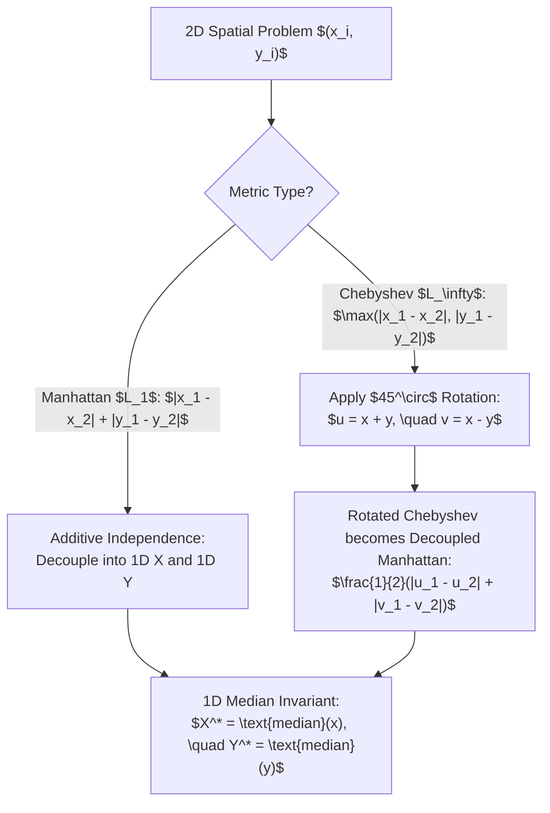

# Axis Decoupling, Median Invariants & 1D/2D Sweeps

> **Section:** §19 Greedy Fundamentals & Invariants  
> **Phase:** Phase 1 — Range Queries & Sweeps  
> **Contest ROI:** S-tier | **Rating Range:** 1400–2200 | **Frequency:** Common  
> **Prerequisites:** Sorting, Binary Search, Two Heaps Pattern, Manhattan & Chebyshev Metrics

---

## 1. Contest Payoff & Why It Matters

In high-dimensional geometric and cost-minimization problems, the curse of dimensionality often obscures simple, elegant solutions.
Mastery of this topic delivers:
1. **The Additive Independence Principle:** Instantly decoupling 2D grid and spatial problems into two completely independent 1D problems, dropping complexity from $O(N^2)$ to $O(N \log N)$.
2. **The Median Invariant:** Proving why the median strictly minimizes total absolute deviation $\sum |x_i - c|$, and extending this to **Weighted Medians**.
3. **The Chebyshev $\leftrightarrow$ Manhattan Coordinate Rotation:** Converting $L_\infty$ distance into $L_1$ distance via a $45^\circ$ algebraic coordinate shift.
4. **Dynamic Sliding Window Median:** Maintaining medians and absolute deviations dynamically in $O(\log K)$ per insertion/deletion via a balanced Two-Heap engine.

---

## 2. Theoretical Deep-Dive & Mathematical Mechanics

### Overview

When an objective function decomposes as a separable sum over coordinate axes:
$$F(X, Y) = \sum_{i=1}^N \left( |x_i - X| + |y_i - Y| \right) = \sum_{i=1}^N |x_i - X| + \sum_{i=1}^N |y_i - Y| = f(X) + g(Y)$$
The optimal point $(X^*, Y^*)$ can be obtained by optimizing $f(X)$ over $x$-coordinates alone and $g(Y)$ over $y$-coordinates alone.



### Fundamental Theorems & Invariants

#### Theorem 1 (The 1D Median Invariant for $L_1$ Minimization)
Given real numbers $x_1 \le x_2 \le \dots \le x_n$, the scalar $c$ that minimizes the total absolute distance:
$$f(c) = \sum_{i=1}^n |x_i - c|$$
is the median of the set:
- If $n$ is odd, the unique optimal choice is $c = x_{(n+1)/2}$.
- If $n$ is even, any point $c \in [x_{n/2}, x_{n/2 + 1}]$ achieves the identical minimum cost.

*Proof via Subgradient Analysis:*
The derivative (subgradient) of $f(c)$ with respect to $c$ for $c \notin \{x_1, \dots, x_n\}$ is:
$$f'''(c) = \sum_{i=1}^n \text{sgn}(c - x_i) = |\{i \mid x_i < c\}| - |\{i \mid x_i > c\}|$$
- When $c < x_{\text{median}}$, more points lie to the right than to the left, so $f'''(c) < 0$. Moving $c$ to the right strictly decreases $f(c)$.
- When $c > x_{\text{median}}$, more points lie to the left than to the right, so $f'''(c) > 0$. Moving $c$ to the left strictly decreases $f(c)$.
- At $c = x_{\text{median}}$, $f'''(c) = 0$. Hence, the median is the global minimum.

#### Theorem 2 (The Weighted Median Invariant)
Given points $x_1 \le x_2 \le \dots \le x_n$ with positive weights $w_i > 0$, to minimize:
$$f_w(c) = \sum_{i=1}^n w_i |x_i - c|$$
The minimum occurs at the point $x_k$ such that the cumulative weight first crosses half of the total weight:
$$\sum_{i=1}^{k-1} w_i < \frac{1}{2} \sum_{i=1}^n w_i \quad \text{and} \quad \sum_{i=1}^k w_i \ge \frac{1}{2} \sum_{i=1}^n w_i$$

#### Theorem 3 (The Chebyshev to Manhattan Transformation)
For any two points $P_1 = (x_1, y_1)$ and $P_2 = (x_2, y_2)$:
$$\max(|x_1 - x_2|, |y_1 - y_2|) = \frac{1}{2} \left( |(x_1 + y_1) - (x_2 + y_2)| + |(x_1 - y_1) - (x_2 - y_2)| \right)$$
*Definition of Coordinate Transform:*
$$u = x + y, \quad v = x - y \iff x = \frac{u + v}{2}, \quad y = \frac{u - v}{2}$$
Under this transformation, the Chebyshev distance in $(x, y)$ space equals half the Manhattan distance in $(u, v)$ space:
$$d_\infty(P_1, P_2) = \frac{1}{2} d_1((u_1, v_1), (u_2, v_2)) = \frac{1}{2} \left( |u_1 - u_2| + |v_1 - v_2| \right)$$

---

## 3. Core Intuition & Problem Framing

### The Tug-of-War Analogy
Imagine $n$ people standing along a line at coordinates $x_i$, all pulling on a central meeting tent at coordinate $c$ with ropes of unit tension.
- If $c$ is placed to the left of the median, more people are pulling to the right than to the left. The net force pulls the tent rightward.
- If $c$ is placed to the right of the median, the net force pulls the tent leftward.
- Equilibrium is achieved only when an equal number of people pull in both directions—which occurs precisely at the **median**.

---

## 4. Proof Sketches & Recurrences

### Dynamic Two-Heap Median Invariant
To maintain the running median of a data stream:
- Partition elements into two heaps:
  - `max_heap` $\mathcal{L}$: stores the smaller half of elements.
  - `min_heap` $\mathcal{R}$: stores the larger half of elements.
- **Invariants:**
  1. $\max(\mathcal{L}) \le \min(\mathcal{R})$ at all times.
  2. Size Balance: $|\mathcal{L}| \in \{|\mathcal{R}|, |\mathcal{R}| + 1\}$.
- **Median Extraction:**
  - If $|\mathcal{L}| > |\mathcal{R}|$, the median is $\mathcal{L}.\text{top}()$.
  - If $|\mathcal{L}| == |\mathcal{R}|$, the median is $\frac{\mathcal{L}.\text{top}() + \mathcal{R}.\text{top}()}{2}$ (or $\mathcal{L}.\text{top}()$ for lower median).
- Maintaining cumulative sums $S_\mathcal{L} = \sum_{x \in \mathcal{L}} x$ and $S_\mathcal{R} = \sum_{x \in \mathcal{R}} x$ allows computing $\sum |x_i - \text{median}|$ in $O(1)$:
$$\text{Cost} = (|\mathcal{L}| \cdot \text{median} - S_\mathcal{L}) + (S_\mathcal{R} - |\mathcal{R}| \cdot \text{median})$$

---

## 5. Contest-Ready Implementation Templates

### Operational Complexity Reference
- **2D Manhattan Meeting Point:** Time $O(N \log N)$, Space $O(N)$
- **Weighted Median:** Time $O(N \log N)$, Space $O(N)$
- **Dynamic Two-Heap Median:** Time $O(\log N)$ per insertion/deletion, $O(1)$ query, Space $O(N)$
- **Prefix-Suffix Sweep Arrays:** Time $O(N)$, Space $O(N)$

---

### C++17 Implementation Template

```cpp
#include <bits/stdc++.h>
using namespace std;

namespace DecoupledMedians {

struct Point {
    long long x, y;
};

pair<Point, long long> optimalManhattanMeetingPoint(vector<Point>& points) {
    int n = points.size();
    vector<long long> xs(n), ys(n);
    for (int i = 0; i < n; ++i) {
        xs[i] = points[i].x;
        ys[i] = points[i].y;
    }

    sort(xs.begin(), xs.end());
    sort(ys.begin(), ys.end());

    long long opt_x = xs[n / 2];
    long long opt_y = ys[n / 2];

    long long total_dist = 0;
    for (int i = 0; i < n; ++i) {
        total_dist += abs(points[i].x - opt_x) + abs(points[i].y - opt_y);
    }

    return {{opt_x, opt_y}, total_dist};
}

class DynamicMedian {
    priority_queue<long long> max_heap;
    priority_queue<long long, vector<long long>, greater<long long>> min_heap;
    long long sum_left = 0;
    long long sum_right = 0;

public:
    void insert(long long x) {
        if (max_heap.empty() || x <= max_heap.top()) {
            max_heap.push(x);
            sum_left += x;
        } else {
            min_heap.push(x);
            sum_right += x;
        }
        rebalance();
    }

    void rebalance() {
        while (max_heap.size() > min_heap.size() + 1) {
            long long val = max_heap.top();
            max_heap.pop();
            sum_left -= val;
            min_heap.push(val);
            sum_right += val;
        }
        while (min_heap.size() > max_heap.size()) {
            long long val = min_heap.top();
            min_heap.pop();
            sum_right -= val;
            max_heap.push(val);
            sum_left += val;
        }
    }

    long long getMedian() const {
        return max_heap.top();
    }

    long long getTotalCost() const {
        long long med = getMedian();
        long long left_cost = (long long)max_heap.size() * med - sum_left;
        long long right_cost = sum_right - (long long)min_heap.size() * med;
        return left_cost + right_cost;
    }
};

long long maxChebyshevDistance(vector<Point>& points) {
    long long min_u = 4e18, max_u = -4e18;
    long long min_v = 4e18, max_v = -4e18;

    for (const auto& p : points) {
        long long u = p.x + p.y;
        long long v = p.x - p.y;
        min_u = min(min_u, u);
        max_u = max(max_u, u);
        min_v = min(min_v, v);
        max_v = max(max_v, v);
    }

    return max(max_u - min_u, max_v - min_v);
}

} // namespace DecoupledMedians
```

---

### Python 3 Implementation Template

```python
import sys
import heapq

# 1. 2D Optimal Manhattan Meeting Point
def solve_2d_meeting_point(points: list[tuple[int, int]]) -> tuple[tuple[int, int], int]:
    xs = sorted([p[0] for p in points])
    ys = sorted([p[1] for p in points])
    n = len(points)
    
    med_x = xs[n // 2]
    med_y = ys[n // 2]
    
    total_dist = sum(abs(p[0] - med_x) + abs(p[1] - med_y) for p in points)
    return (med_x, med_y), total_dist

# 2. Dynamic Two-Heap Median with Absolute Cost Maintenance
class DynamicMedian:
    def __init__(self):
        self.max_heap = []
        self.min_heap = []
        self.sum_left = 0
        self.sum_right = 0
        
    def insert(self, x: int):
        if not self.max_heap or x <= -self.max_heap[0]:
            heapq.heappush(self.max_heap, -x)
            self.sum_left += x
        else:
            heapq.heappush(self.min_heap, x)
            self.sum_right += x
        self._rebalance()
        
    def _rebalance(self):
        while len(self.max_heap) > len(self.min_heap) + 1:
            val = -heapq.heappop(self.max_heap)
            self.sum_left -= val
            heapq.heappush(self.min_heap, val)
            self.sum_right += val
            
        while len(self.min_heap) > len(self.max_heap):
            val = heapq.heappop(self.min_heap)
            self.sum_right -= val
            heapq.heappush(self.max_heap, -val)
            self.sum_left += val
            
    def get_median(self) -> int:
        return -self.max_heap[0]
        
    def get_total_cost(self) -> int:
        med = self.get_median()
        left_cost = len(self.max_heap) * med - self.sum_left
        right_cost = self.sum_right - len(self.min_heap) * med
        return left_cost + right_cost

# 3. Prefix-Suffix Sweep Middle-Man Toolkit
def prefix_suffix_excluding_one(arr: list[int]) -> list[int]:
    import math
    n = len(arr)
    pref = [0] * (n + 1)
    suff = [0] * (n + 1)
    
    for i in range(n):
        pref[i + 1] = math.gcd(pref[i], arr[i])
    for i in range(n - 1, -1, -1):
        suff[i] = math.gcd(suff[i + 1], arr[i])
        
    best_without = [math.gcd(pref[i], suff[i + 1]) for i in range(n)]
    return best_without
```

---

## 6. Recognition Trigger Signals & Heuristics

1. **"Minimize sum of distances $|x_i - X| + |y_i - Y|$ on a grid":** Axis decoupling. Sort $X$ and $Y$ independently, find their medians.
2. **"Minimize maximum distance $\max(|x_i - x_j|, |y_i - y_j|)$ between any pair":** Chebyshev metric. Apply $45^\circ$ rotation $(u=x+y, v=x-y)$, find $\max(\Delta u, \Delta v)$.
3. **"Sliding window of size $K$, continuously output median / cost":** Balanced two heaps with lazy deletion, or Fenwick tree over coordinate-compressed ranks.
4. **"Answer queries where exactly one element $i$ is removed":** Prefix-suffix middle-man precomputation.

---

## 7. Contest WA / TLE / RE Traps

- **Integer Division in Rotated Chebyshev:** When rotating $(u, v) = (x+y, x-y)$, the distance is $\frac{1}{2}(|u_1 - u_2| + |v_1 - v_2|)$. If you forget the $\frac{1}{2}$ factor, your distances are doubled.
- **Even $N$ Median Off-by-One:** When $N$ is even, any point between $x_{N/2}$ and $x_{N/2 + 1}$ gives the same cost. However, if the target must be an integer, picking $x_{N/2}$ is always optimal and safe.
- **Two Heaps Desynchronization:** Forgetting to update `sum_left` and `sum_right` during heap rebalancing causes silent WA in total cost queries.

---

## 8. Curated Practice Problem Bank

| Platform | ID | Problem Name | Rating | Tags | Key Strategic Insight | Link |
|---|---|---|---|---|---|---|
| CSES | CSES-1074 | Stick Lengths | 1000 | Sorting, Median Invariant | Sort array; pick median element; sum absolute differences. | [Solve Problem](https://cses.fi/problemset/task/1074) |
| CSES | CSES-1076 | Sliding Window Median | 1400 | Two Heaps, PBDS | Maintain running median over window of size $K$. | [Solve Problem](https://cses.fi/problemset/task/1076) |
| CSES | CSES-1077 | Sliding Window Cost | 1500 | Two Heaps, Math | Two heaps tracking sum of elements to query $\sum |x_i - \text{med}|$. | [Solve Problem](https://cses.fi/problemset/task/1077) |
| Codeforces | CF-1486B | Eastern Exhibition | 1400 | Geometry, Decoupling, Median | Decouple 2D Manhattan; count valid optimal medians in $[x_{n/2}, x_{n/2+1}]$. | [Solve Problem](https://codeforces.com/contest/1486/problem/B) |
| AtCoder | ABC-178E | Dist Max | 1400 | Chebyshev, Coordinate Rotation | Maximize $|x_i - x_j| + |y_i - y_j|$ by rotating to Chebyshev axes. | [Solve Problem](https://atcoder.jp/contests/abc178/tasks/abc178_e) |

---

## 9. External Theory & Deep-Dive References

- **[CP-Algorithms]** [Manhattan and Chebyshev Distance Transformations](https://cp-algorithms.com/)
- **[USACO Guide]** [Silver: More Operations on Sorted Sets](https://usaco.guide/silver/more-ops)
- **[Wikipedia]** [Chebyshev Distance and Isometric Rotation](https://en.wikipedia.org/wiki/Chebyshev_distance)

---

## 10. Algorithmic Variants & Advanced Extensions

- **Weighted Median on Trees:** Find a vertex $v$ that minimizes $\sum w_u \cdot \text{dist}(u, v)$. The optimal vertex is the **weighted centroid** of the tree.
- **Higher Dimensions ($K$-Dimensions):** For any $L_1$ metric in $\mathbb{R}^d$, the optimal meeting point is the Cartesian product of the 1D medians: $(\text{med}(x_1), \text{med}(x_2), \dots, \text{med}(x_d))$.

---

## 11. Typical Problem Archetypes

1. **Warehouse Location:** Place a logistics hub to minimize total truck delivery distance $\implies$ Manhattan 2D median.
2. **Maximum Spread:** Find pair of points with maximum Manhattan distance $\implies$ rotate coordinates, track $\max(u) - \min(u)$ and $\max(v) - \min(v)$.
3. **Equalize Array:** Minimize operations to make all array elements equal $\implies$ sort and choose median.

---

## 12. Recognition & Identification Drills

1. *Scenario:* You have $N$ points in 2D. You must select an existing point that minimizes sum of Manhattan distances.  
   *Diagnosis:* Find the true median $(X^*, Y^*)$, then find the nearest existing point or check candidates.
2. *Scenario:* Maximize $|x_i - x_j| + |y_i - y_j|$ over all pairs $(i, j)$.  
   *Diagnosis:* Reverse rotation. Rewrite as $\max((x_i + y_i) - (x_j + y_j), (x_i - y_i) - (x_j - y_j))$. Track min and max of $x+y$ and $x-y$.
3. *Scenario:* You need the median of elements in a sliding window of size $K$.  
   *Diagnosis:* Two heaps with lazy deletion, or GNU C++ PBDS.

---

## 13. Fast-Lookup Cheat Sheet

- **1D Median Minimizer:** $\min_c \sum |x_i - c| \implies c = x_{N/2}$.
- **Manhattan to Chebyshev:** $|x_1 - x_2| + |y_1 - y_2| = \max(|u_1 - u_2|, |v_1 - v_2|)$ where $u = x+y, v = x-y$.
- **Chebyshev to Manhattan:** $\max(|x_1 - x_2|, |y_1 - y_2|) = \frac{1}{2}(|u_1 - u_2| + |v_1 - v_2|)$.
- **Dynamic Cost Formula:** $\text{Cost} = (|\mathcal{L}| \cdot \text{med} - S_\mathcal{L}) + (S_\mathcal{R} - |\mathcal{R}| \cdot \text{med})$.
