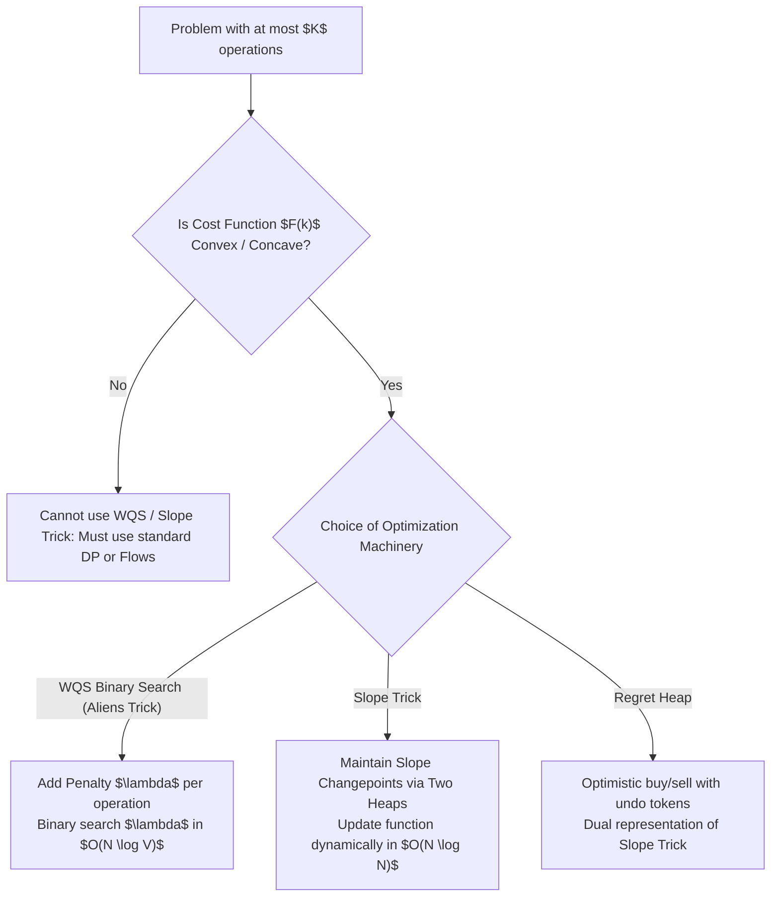
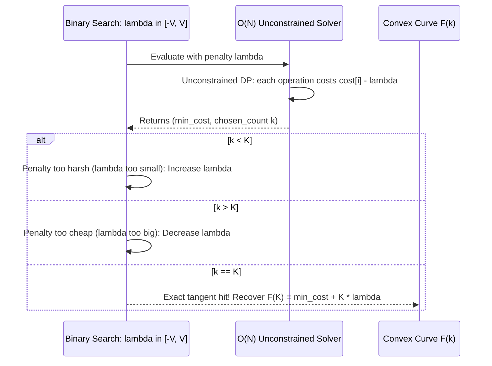

# Convex Optimization, Slope Trick & WQS Binary Search

> **Section:** §19 Greedy Fundamentals & Invariants  
> **Phase:** Phase 1 — Range Queries & Sweeps  
> **Contest ROI:** A-tier | **Rating Range:** 2000–2800 | **Frequency:** Occasional (Grandmaster Weapon)  
> **Prerequisites:** Priority Queues, Binary Search, Dynamic Programming, Discrete Convexity

---

## 1. Contest Payoff & Why It Matters

At the 2000–2800 rating frontier, standard DP solutions that run in $O(N \cdot K)$ are deliberately bottlenecked by tight time limits where $N, K \le 2 \cdot 10^5$.
Mastery of this topic grants:
1. **WQS Binary Search (Aliens Trick):** Eliminating the $K$ dimension entirely, transforming an $O(N \cdot K)$ DP into an unconstrained $O(N \log(\text{Range}))$ binary search via Lagrangian penalty relaxation.
2. **The Slope Trick Engine:** Maintaining an entire continuous convex piecewise-linear function using two priority queues, supporting function additions, infimal convolutions, and prefix-minimum squashes in $O(\log N)$ time.
3. **The Geometric Triad Synthesis:** Recognizing that **Regret Heaps**, **Slope Trick**, and **WQS Binary Search** are three perspectives of the exact same mathematical phenomenon: **Convex Duality**.

---

## 2. Theoretical Deep-Dive & Mathematical Mechanics

### Overview

A real-valued discrete function $F(k)$ defined on integers is **convex** if its second discrete difference is non-negative:
$$\Delta^2 F(k) = F(k+1) - 2F(k) + F(k-1) \ge 0 \iff F(k+1) - F(k) \ge F(k) - F(k-1)$$
This means each additional unit of resource yields non-decreasing marginal cost (or diminishing marginal returns).



### Fundamental Theorems & Invariants

#### Theorem 1 (Lagrangian Relaxation & The WQS Binary Search Theorem)
Let $F(k)$ be the minimum cost of achieving a goal using *exactly* $k$ operations. If $F(k)$ is strictly convex, consider the penalized objective function with penalty parameter $\lambda$:
$$g(\lambda) = \min_{k} \big( F(k) - \lambda \cdot k \big)$$
Geometrically, $g(\lambda)$ represents the $y$-intercept of the supporting tangent line of slope $\lambda$ to the convex curve $(k, F(k))$.
1. For any fixed $\lambda$, $g(\lambda)$ can be found in $O(N)$ time by running an unconstrained optimization where each operation incurs an additional penalty of $-\lambda$.
2. Because $F(k)$ is convex, the optimal operation count $k^*(\lambda)$ is monotonically non-decreasing with respect to $\lambda$.
3. We can binary search for $\lambda^* \in [-V, V]$ such that the unconstrained solver selects exactly $k^*(\lambda^*) = K$.
4. The true constrained optimum is recovered by:
$$F(K) = g(\lambda^*) + K \cdot \lambda^*$$



#### Theorem 2 (The Slope Trick Two-Heap Representation)
Any continuous, piecewise-linear convex function $f(x)$ whose slopes are all integers can be uniquely characterized by:
1. The minimum value $y_{\min} = \min_{x} f(x)$.
2. An interval $[L_{\min}, R_{\min}]$ where the slope is 0.
3. A multiset $\mathcal{L}$ of points where the slope increases by 1 (for $x \le L_{\min}$).
4. A multiset $\mathcal{R}$ of points where the slope increases by 1 (for $x \ge R_{\min}$).

*Data Structure:*
- $\mathcal{L}$ is stored in a **Max-Heap** (top is $L_{\min}$).
- $\mathcal{R}$ is stored in a **Min-Heap** (top is $R_{\min}$).

---

## 3. Core Intuition & Problem Framing

### Slope Trick Operation Mechanics

When adding $|x - a|$ to $f(x)$:
- **Case 1 ($a < L_{\min}$):** The changepoint lies in the negative slope region. The minimum value increases by $L_{\min} - a$. The point $a$ is added twice to $\mathcal{L}$, and the previous peak $L_{\min}$ is popped and transferred to $\mathcal{R}$ to restore balance.
- **Case 2 ($a > R_{\min}$):** The changepoint lies in the positive slope region. The minimum value increases by $a - R_{\min}$. The point $a$ is added twice to $\mathcal{R}$, and the smallest point in $\mathcal{R}$ is transferred to $\mathcal{L}$.
- **Case 3 ($L_{\min} \le a \le R_{\min}$):** $a$ falls within the optimal flat basin. The minimum value $y_{\min}$ is unchanged. $a$ is pushed once into $\mathcal{L}$ and once into $\mathcal{R}$.

### The Prefix Minimum Transformation: $f(x) \leftarrow \min_{y \le x} f(y)$
In problems where you can choose any $y \le x$ (e.g. non-decreasing sequence construction $A_1 \le A_2 \le \dots \le A_N$ as in CF 713C):
For all $x > R_{\min}$, the prefix minimum clamps the function to $y_{\min}$.
*Slope Trick Execution:* Simply **clear the entire min-heap $\mathcal{R}$**! All slopes $> 0$ are flattened to 0.

---

## 4. Proof Sketches & Recurrences

### Handling Collinear Segments in WQS (Linear Interpolation / LIP)
What happens if multiple values of $k$ have the exact same marginal cost, creating a flat facet on the lower convex hull of $F$?
Then for that critical slope $\lambda^*$, the unconstrained solver will find multiple optimal solutions with different operation counts $k_{\min} \le K \le k_{\max}$.
- *Rule:* Always prefer either the maximum or minimum number of operations during tie-breaking.
- If we prefer maximum operations: binary search finds the smallest integer $\lambda$ such that $k^*(\lambda) \ge K$.
- By linear interpolation along the flat segment, the formula:
$$F(K) = g(\lambda^*) + K \cdot \lambda^*$$
remains **exact**, because on a straight line segment, the tangent touches every point $(k, F(k))$ simultaneously!

---

## 5. Contest-Ready Implementation Templates

### Operational Complexity Reference
- **WQS Binary Search (Aliens Trick):** Time $O(N \log(\text{Range}))$, Space $O(N)$
- **Slope Trick (Two Heaps):** Time $O(N \log N)$, Space $O(N)$
- **Regret Heap Dual:** Time $O(N \log N)$, Space $O(N)$

---

### C++17 Implementation Template

```cpp
#include <bits/stdc++.h>
using namespace std;

namespace ConvexOptimization {

class SlopeTrick {
    priority_queue<long long> L;
    priority_queue<long long, vector<long long>, greater<long long>> R;
    long long min_val = 0;
    long long tag_L = 0;
    long long tag_R = 0;

public:
    long long getMin() const { return min_val; }

    void addAbs(long long a) {
        if (!L.empty() && a < L.top() + tag_L) {
            long long l_top = L.top() + tag_L;
            min_val += l_top - a;
            L.pop();
            L.push(a - tag_L);
            L.push(a - tag_L);
            R.push(l_top - tag_R);
        } else if (!R.empty() && a > R.top() + tag_R) {
            long long r_top = R.top() + tag_R;
            min_val += a - r_top;
            R.pop();
            R.push(a - tag_R);
            R.push(a - tag_R);
            L.push(r_top - tag_L);
        } else {
            L.push(a - tag_L);
            R.push(a - tag_R);
        }
    }

    void addReluRight(long long a) {
        if (!L.empty() && a < L.top() + tag_L) {
            long long l_top = L.top() + tag_L;
            min_val += l_top - a;
            L.pop();
            L.push(a - tag_L);
            R.push(l_top - tag_R);
        } else {
            R.push(a - tag_R);
        }
    }

    void shift(long long c) {
        tag_L += c;
        tag_R += c;
    }

    void prefixMin() {
        while (!R.empty()) R.pop();
    }
};

struct WQSResult {
    long long cost;
    int count;
};

WQSResult solveUnconstrained(const vector<long long>& a, long long lambda) {
    int n = a.size();
    vector<pair<long long, int>> dp(n + 1, {4e18, 0});
    dp[0] = {0, 0};

    for (int i = 1; i <= n; ++i) {
        long long current_val = a[i - 1];
        long long cost_take = dp[i - 1].first + current_val - lambda;
        int count_take = dp[i - 1].second + 1;

        if (cost_take < dp[i].first || (cost_take == dp[i].first && count_take < dp[i].second)) {
            dp[i] = {cost_take, count_take};
        }
    }
    return {dp[n].first, dp[n].second};
}

long long solveWQS(const vector<long long>& a, int K) {
    long long low = 0, high = 2e9;
    long long best_lambda = 0;

    while (low <= high) {
        long long mid = low + (high - low) / 2;
        WQSResult res = solveUnconstrained(a, mid);
        if (res.count <= K) {
            best_lambda = mid;
            low = mid + 1;
        } else {
            high = mid - 1;
        }
    }

    WQSResult optimal_res = solveUnconstrained(a, best_lambda);
    return optimal_res.cost + (long long)K * best_lambda;
}

} // namespace ConvexOptimization
```

---

### Python 3 Implementation Template

```python
import sys
import heapq

# 1. Slope Trick Full Class
class SlopeTrick:
    def __init__(self):
        self.L = []
        self.R = []
        self.min_val = 0
        self.tag_L = 0
        self.tag_R = 0
        
    def add_abs(self, a: int):
        l_top = -self.L[0] + self.tag_L if self.L else -float('inf')
        r_top = self.R[0] + self.tag_R if self.R else float('inf')
        
        if self.L and a < l_top:
            self.min_val += l_top - a
            heapq.heappop(self.L)
            heapq.heappush(self.L, -(a - self.tag_L))
            heapq.heappush(self.L, -(a - self.tag_L))
            heapq.heappush(self.R, l_top - self.tag_R)
        elif self.R and a > r_top:
            self.min_val += a - r_top
            heapq.heappop(self.R)
            heapq.heappush(self.R, a - self.tag_R)
            heapq.heappush(self.R, a - self.tag_R)
            heapq.heappush(self.L, -(r_top - self.tag_L))
        else:
            heapq.heappush(self.L, -(a - self.tag_L))
            heapq.heappush(self.R, a - self.tag_R)
            
    def prefix_min(self):
        self.R.clear()
        
    def shift(self, c: int):
        self.tag_L += c
        self.tag_R += c

# 2. Three-Way Synthesis: Solving CF 865D Stock Trading Three Ways
def solve_stock_regret(prices: list[int]) -> int:
    pq = []
    profit = 0
    for p in prices:
        if pq and p > pq[0]:
            buy = heapq.heappop(pq)
            profit += p - buy
            heapq.heappush(pq, p)
        heapq.heappush(pq, p)
    return profit

def solve_stock_slope_trick(prices: list[int]) -> int:
    st = SlopeTrick()
    for p in prices:
        st.add_abs(p)
        st.prefix_min()
    return st.min_val
```

---

## 6. Recognition Trigger Signals & Heuristics

1. **"At most $K$ operations" with $K \le N \le 2 \cdot 10^5$:** WQS Binary Search. Check if plotting optimal cost vs $k$ produces a convex curve.
2. **"Make array non-decreasing with $\min \sum |A_i - B_i|$" (CF 713C):** Slope Trick. Add $|x - A_i|$, apply `prefix_min()`.
3. **"Continuous function is sum of absolute distances and ReLU penalties":** Slope Trick two-heap representation.

---

## 7. Contest WA / TLE / RE Traps

- **Non-Convexity Trap:** Applying WQS binary search when $F(k)$ is not convex. If the problem has fixed activation fees or non-concave returns, WQS will miss the optimal tangent point.
- **WQS Binary Search Direction Inversion:** In minimization problems, increasing penalty $\lambda$ encourages fewer operations. In maximization problems, increasing reward $\lambda$ encourages more operations.
- **Forgetting Linear Interpolation in Integer Arithmetic:** When $K$ falls on a flat facet of the convex hull, the unconstrained solver will jump over $K$. The binary search must stop when the slope interval contains the target, and evaluate the recovery formula at $K$.

---

## 8. Curated Practice Problem Bank

| Platform | ID | Problem Name | Rating | Tags | Key Strategic Insight | Link |
|---|---|---|---|---|---|---|
| Codeforces | CF-713C | Sonya and Problem Wihtout a Legend | 2300 | Slope Trick, DP | Strict to non-decreasing reduction $A_i' = A_i - i$; Slope trick prefix min. | [Solve Problem](https://codeforces.com/contest/713/problem/C) |
| Codeforces | CF-865D | Buy Low Sell High | 2400 | Slope Trick, Regret Heap | Dual representation: two-push regret heap is equivalent to slope trick. | [Solve Problem](https://codeforces.com/contest/865/problem/D) |
| IOI | IOI-2016 | Aliens | 2800 | WQS Binary Search, CHT | The namesake of the Aliens Trick. Convex penalty binary search + CHT. | [Solve Problem](https://oj.uz/problem/view/IOI16_aliens) |
| Codeforces | CF-1270G | Subset with Zero Sum | 2600 | Functional Graph, Invariants | Structural invariant on directed functional graph cycle detection. | [Solve Problem](https://codeforces.com/contest/1270/problem/G) |
| AtCoder | ABC-217H | Snaketoy | 2800 | Slope Trick, Deque | 2D dynamic slope trick with time-expanding slope transitions. | [Solve Problem](https://atcoder.jp/contests/abc217/tasks/abc217_h) |

---

## 9. External Theory & Deep-Dive References

- **[Codeforces Tutorial]** [Slope Trick Explained: From Basics to Advanced](https://codeforces.com/blog/entry/77298)
- **[Codeforces Tutorial]** [The Aliens Trick / WQS Binary Search Comprehensive Guide](https://codeforces.com/blog/entry/67634)
- **[IOI 2016 Aliens Solution]** [Official IOI 2016 Aliens Analysis](https://ioinformatics.org/files/ioi2016solutions.pdf)

---

## 10. Algorithmic Variants & Advanced Extensions

- **Slope Trick with Non-Unit Slopes:** When $|x - a|$ is multiplied by integer weight $w_i$, push $a$ with multiplicity $w_i$. If $w_i$ is large ($10^9$), maintain intervals in a `std::map<long long, long long>` storing `(changepoint, slope_delta)`.
- **Higher Dimensions: Discrete Convex Analysis:** Extending slope trick to trees via submodular function minimization and mergeable balanced heaps.

---

## 11. Typical Problem Archetypes

1. **Constrained Subarray Split:** Partition into exactly $K$ segments with convex cost $\implies$ WQS Binary Search.
2. **Optimal Monotone Sequence:** Minimize $\sum |A_i - B_i|$ with $B_1 \le B_2 \le \dots \le B_N \implies$ Slope trick with `prefix_min`.
3. **Transaction Market:** Buy and sell with transaction limits $\implies$ WQS binary search on trade count or two-push regret heap.

---

## 12. Recognition & Identification Drills

1. *Scenario:* You need to choose exactly $K$ disjoint subsegments of an array to maximize total sum. $N \le 2 \cdot 10^5, K \le N$.  
   *Diagnosis:* WQS Binary Search. Each chosen segment incurs penalty $\lambda$. Unconstrained problem solved via Kadane'''s in $O(N)$.
2. *Scenario:* You are given $A_1, \dots, A_N$. You want to find non-decreasing $B_1 \le \dots \le B_N$ minimizing $\sum |A_i - B_i|$.  
   *Diagnosis:* Slope trick. Maintain left changepoint heap; pop when $A_i < \text{top}$.
3. *Scenario:* A graph has red and blue edges. Find a spanning tree with exactly $K$ red edges of minimum weight.  
   *Diagnosis:* WQS Binary Search on red edge weight bonus $\lambda$. Matroid exchange property guarantees strict convexity.

---

## 13. Fast-Lookup Cheat Sheet

- **WQS Formula:** $F(K) = \min_x (f(x) - \lambda^* \cdot \text{count}(x)) + K \cdot \lambda^*$.
- **Slope Trick Representation:** Max-heap $\mathcal{L}$ ($x \le L_{\min}$), Min-heap $\mathcal{R}$ ($x \ge R_{\min}$), offset tags $\text{tag}_L, \text{tag}_R$.
- **Prefix Min Rule:** `R.clear()`. Drops all slopes $> 0$ to 0.
- **Stock Dual:** Regret heap pushing twice $\equiv$ Slope trick adding absolute value and prefix min.
