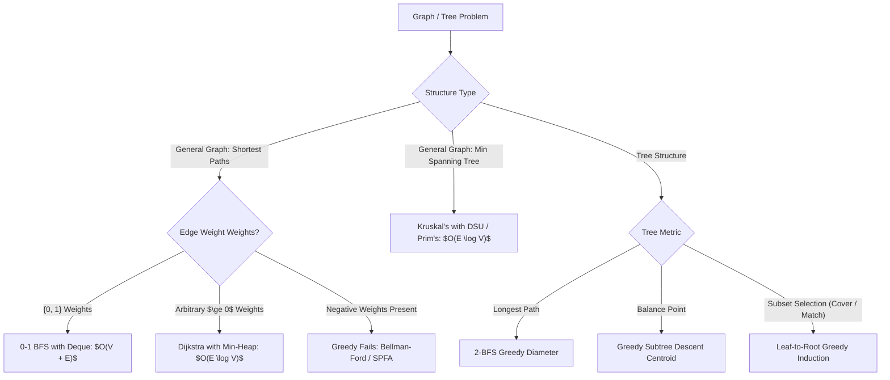
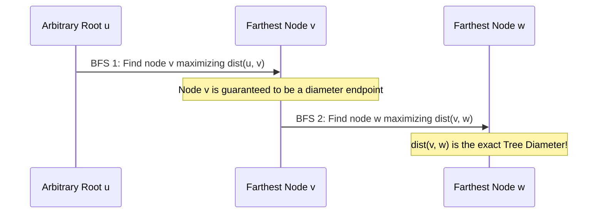

# Greedy on Graphs & Trees

> **Section:** §19 Greedy Fundamentals & Invariants  
> **Phase:** Phase 1 — Range Queries & Sweeps  
> **Contest ROI:** S-tier | **Rating Range:** 1400–2300 | **Frequency:** Very Common  
> **Prerequisites:** Graph representations (Adjacency lists), BFS/DFS, Disjoint Set Union (DSU), Priority Queues

---

## 1. Contest Payoff & Why It Matters

Graph theory and tree algorithms are deeply rooted in greedy choices. The most celebrated algorithms in computer science—**Dijkstra's Shortest Path**, **Kruskal's & Prim's MST**, and **2-BFS Tree Diameter**—are pure greedy algorithms whose correctness is guaranteed by underlying matroidal and topological invariants.
Mastery gives you:
1. **The Frontier Invariant:** Recognizing why Dijkstra works strictly with non-negative edges, and implementing **0-1 BFS** to compute shortest paths in linear $O(V + E)$ time.
2. **The Cut and Cycle Properties:** Proving correctness for Minimum Spanning Trees and DSU-based clusterings.
3. **Tree Extremum Locators:** Finding the **Tree Diameter** in 2 BFS passes and the **Tree Centroid** via greedy subtree descent.
4. **Leaf-to-Root Tree DP:** Solving independent set, vertex cover, and edge matching on trees greedily from the leaves upward.

---

## 2. Theoretical Deep-Dive & Mathematical Mechanics

### Overview

When a graph or tree exhibits topological acyclicity or non-negative weight monotonicity, local decisions become globally optimal.



### Fundamental Theorems & Invariants

#### Theorem 1 (Correctness of Dijkstra's Algorithm via the Non-Negative Frontier Invariant)
In a directed graph with edge weights $w(u, v) \ge 0$, when a vertex $u$ is extracted from the priority queue with minimal tentative distance $d[u]$, $d[u]$ is **strictly equal to the true shortest path distance** $\delta(s, u)$.

*Proof by Contradiction:*
Let $u$ be the first vertex popped from the priority queue such that $d[u] > \delta(s, u)$.
Consider the true shortest path from $s$ to $u$: $P = (s = v_0, v_1, \dots, v_k = u)$.
Let $v_i$ be the first unvisited vertex along $P$, and let $v_{i-1}$ be its visited predecessor.
Since $v_{i-1}$ was visited earlier and relaxed, $d[v_i] = \delta(s, v_i)$.
Because all edge weights are non-negative:
$$\delta(s, v_i) \le \delta(s, u) < d[u]$$
Therefore, $d[v_i] < d[u]$.
This implies that $v_i$ must have had a smaller distance key in the priority queue than $u$.
Consequently, the priority queue would have extracted $v_i$ before $u$, contradicting the assumption that $u$ was extracted first. Thus, $d[u] = \delta(s, u)$.

#### Theorem 2 (The Cut Property for Minimum Spanning Trees)
Let $G = (V, E)$ be a connected graph, and let $S \subset V$ define a cut $(S, V \setminus S)$.
If edge $e = (u, v)$ is the strictly lightest edge crossing the cut $(u \in S, v \in V \setminus S)$, then $e$ **must belong to every Minimum Spanning Tree** of $G$.

*Proof by Exchange:*
Suppose an MST $T$ does not contain $e$. Adding $e$ to $T$ creates a unique cycle $C$. Because $u \in S$ and $v \in V \setminus S$, the cycle must cross the cut at least once more via an edge $e''' \neq e$.
Removing $e'''$ breaks the cycle and restores a spanning tree $T''' = T \cup \{e\} \setminus \{e'''\}$.
The weight change is $w(T''') = w(T) + w(e) - w(e''').$
Since $e$ is the strictly lightest edge crossing the cut, $w(e) < w(e'''),$ so $w(T''') < w(T)$, contradicting the optimality of $T$. Hence, $e \in T$.

#### Theorem 3 (The 2-BFS Tree Diameter Invariant)
On any unweighted or positive-edge weighted tree:
1. From an arbitrary vertex $u \in V$, the vertex $v$ that maximizes $\text{dist}(u, v)$ is an endpoint of a diameter.
2. From vertex $v$, the vertex $w$ that maximizes $\text{dist}(v, w)$ is the opposite endpoint of the diameter, and $\text{dist}(v, w) = \text{Diameter}(T)$.



---

## 3. Core Intuition & Problem Framing

### The Tree Centroid: The Center of Mass
A centroid of a tree with $N$ vertices is a node $C$ whose removal splits the tree into components, none of which has size $> \lfloor N/2 \rfloor$.
*Greedy Finding Procedure:*
Root the tree arbitrarily. Compute subtree sizes $sz[u]$.
Start at root. Look at all children $v$ of $u$.
- If there exists a child $v$ with $sz[v] > N/2$, greedily move down to $v$.
- If all children have $sz[v] \le N/2$, then $u$ is a centroid!
Because $sz[v]$ decreases strictly as we move down, this greedy descent terminates at a centroid in at most $O(\text{height}) \le O(N)$ steps.

### Leaf-to-Root Greedy Induction
Trees are bipartite and acyclic. A leaf $L$ is attached to only one neighbor: its parent $P$.
- For **Minimum Vertex Cover:** To cover edge $(L, P)$, we must pick either $L$ or $P$. Picking $P$ is strictly better or equal to picking $L$, because $P$ can also cover other edges incident to $P$, whereas $L$ covers only $(L, P)$. Hence, **never pick a leaf; always greedily pick its parent**.

---

## 4. Proof Sketches & Recurrences

### 0-1 BFS Correctness via Deque Monotonicity
In a graph with weights in $\{0, 1\}$, when relaxing an edge $(u, v)$ from current node $u$ with distance $d[u]$:
- If $w(u, v) = 0$, $d[v] = d[u]$. Push $v$ to the **front** of the deque.
- If $w(u, v) = 1$, $d[v] = d[u] + 1$. Push $v$ to the **back** of the deque.
*Invariant:* The deque always contains elements with at most two distinct distance values: $\{D, D+1\}$. The front is always $D$. Pushing weight-0 edges to the front preserves the monotonic sorted order, eliminating heap overhead ($O(V + E)$ time).

---

## 5. Contest-Ready Implementation Templates

### Operational Complexity Reference
- **State-Space Dijkstra:** Time $O(E \log V)$, Space $O(V)$
- **Kruskal's MST with DSU:** Time $O(E \log E)$, Space $O(V + E)$
- **2-BFS Tree Diameter & Centroid:** Time $O(V)$, Space $O(V)$
- **Bipartite / Weighted DSU:** Time $O(\alpha(N))$ amortized per operation

---

### C++17 Implementation Template

```cpp
#include <bits/stdc++.h>
using namespace std;

namespace GraphTreeGreedy {

struct Edge {
    int to;
    long long weight;
};

vector<long long> dijkstra(int n, int start_node, const vector<vector<Edge>>& adj) {
    vector<long long> dist(n + 1, 4e18);
    priority_queue<pair<long long, int>, vector<pair<long long, int>>, greater<>> pq;

    dist[start_node] = 0;
    pq.push({0, start_node});

    while (!pq.empty()) {
        auto [d, u] = pq.top();
        pq.pop();

        if (d > dist[u]) continue;

        for (const auto& edge : adj[u]) {
            if (dist[u] + edge.weight < dist[edge.to]) {
                dist[edge.to] = dist[u] + edge.weight;
                pq.push({dist[edge.to], edge.to});
            }
        }
    }
    return dist;
}

struct KruskalEdge {
    int u, v;
    long long weight;
    bool operator<(const KruskalEdge& other) const {
        return weight < other.weight;
    }
};

class DSU {
    vector<int> parent, rank;
public:
    DSU(int n) : parent(n + 1), rank(n + 1, 0) {
        iota(parent.begin(), parent.end(), 0);
    }
    int find(int i) {
        return parent[i] == i ? i : parent[i] = find(parent[i]);
    }
    bool unite(int i, int j) {
        int root_i = find(i), root_j = find(j);
        if (root_i == root_j) return false;
        if (rank[root_i] < rank[root_j]) swap(root_i, root_j);
        parent[root_j] = root_i;
        if (rank[root_i] == rank[root_j]) rank[root_i]++;
        return true;
    }
};

long long kruskalMST(int n, vector<KruskalEdge>& edges) {
    sort(edges.begin(), edges.end());
    DSU dsu(n);
    long long mst_weight = 0;
    int edges_count = 0;

    for (const auto& e : edges) {
        if (dsu.unite(e.u, e.v)) {
            mst_weight += e.weight;
            edges_count++;
            if (edges_count == n - 1) break;
        }
    }
    return edges_count == n - 1 ? mst_weight : -1;
}

pair<int, int> bfsFarthest(int start_node, int n, const vector<vector<int>>& adj) {
    vector<int> dist(n + 1, -1);
    queue<int> q;
    dist[start_node] = 0;
    q.push(start_node);

    int farthest_node = start_node;
    while (!q.empty()) {
        int u = q.front();
        q.pop();
        if (dist[u] > dist[farthest_node]) farthest_node = u;
        for (int v : adj[u]) {
            if (dist[v] == -1) {
                dist[v] = dist[u] + 1;
                q.push(v);
            }
        }
    }
    return {farthest_node, dist[farthest_node]};
}

int getTreeDiameter(int n, const vector<vector<int>>& adj) {
    auto [v1, _] = bfsFarthest(1, n, adj);
    auto [v2, diameter] = bfsFarthest(v1, n, adj);
    return diameter;
}

int findCentroid(int root, int n, const vector<vector<int>>& adj) {
    vector<int> sz(n + 1, 0);
    function<void(int, int)> dfs_size = [&](int u, int p) {
        sz[u] = 1;
        for (int v : adj[u]) {
            if (v != p) {
                dfs_size(v, u);
                sz[u] += sz[v];
            }
        }
    };
    dfs_size(root, 0);

    int curr = root, parent = 0;
    while (true) {
        int heavy_child = 0;
        for (int v : adj[curr]) {
            if (v != parent && sz[v] > n / 2) {
                heavy_child = v;
                break;
            }
        }
        if (!heavy_child) return curr;
        parent = curr;
        curr = heavy_child;
    }
}

class BipartiteDSU {
    vector<int> parent, parity;
public:
    BipartiteDSU(int n) : parent(n + 1), parity(n + 1, 0) {
        iota(parent.begin(), parent.end(), 0);
    }
    int find(int i) {
        if (parent[i] == i) return i;
        int p = parent[i];
        parent[i] = find(parent[i]);
        parity[i] ^= parity[p];
        return parent[i];
    }
    bool addConstraint(int u, int v, int target_parity) {
        int root_u = find(u), root_v = find(v);
        if (root_u == root_v) {
            return (parity[u] ^ parity[v]) == target_parity;
        }
        parent[root_u] = root_v;
        parity[root_u] = parity[u] ^ parity[v] ^ target_parity;
        return true;
    }
};

} // namespace GraphTreeGreedy
```

---

### Python 3 Implementation Template

```python
import sys
from collections import deque
import heapq

# 1. Dijkstra with Heapq
def dijkstra(n: int, start: int, adj: dict[int, list[tuple[int, int]]]) -> list[int]:
    dist = [float('inf')] * (n + 1)
    dist[start] = 0
    pq = [(0, start)]
    
    while pq:
        d, u = heapq.heappop(pq)
        if d > dist[u]:
            continue
            
        for v, w in adj.get(u, []):
            if dist[u] + w < dist[v]:
                dist[v] = dist[u] + w
                heapq.heappush(pq, (dist[v], v))
                
    return dist

# 2. Kruskal's MST with DSU
class DSU:
    def __init__(self, n: int):
        self.parent = list(range(n + 1))
        self.rank = [0] * (n + 1)
        
    def find(self, i: int) -> int:
        if self.parent[i] == i:
            return i
        self.parent[i] = self.find(self.parent[i])
        return self.parent[i]
        
    def union(self, i: int, j: int) -> bool:
        ri, rj = self.find(i), self.find(j)
        if ri == rj:
            return False
        if self.rank[ri] < self.rank[rj]:
            ri, rj = rj, ri
        self.parent[rj] = ri
        if self.rank[ri] == self.rank[rj]:
            self.rank[ri] += 1
        return True

def kruskal(n: int, edges: list[tuple[int, int, int]]) -> int:
    edges.sort(key=lambda x: x[2])
    dsu = DSU(n)
    mst_cost = 0
    count = 0
    
    for u, v, w in edges:
        if dsu.union(u, v):
            mst_cost += w
            count += 1
            if count == n - 1:
                break
    return mst_cost if count == n - 1 else -1

# 3. Tree Diameter (2-BFS) and Centroid
def tree_diameter_and_centroid(n: int, adj: dict[int, list[int]]) -> tuple[int, int]:
    def bfs(start: int) -> tuple[int, int]:
        dist = [-1] * (n + 1)
        dist[start] = 0
        q = deque([start])
        farthest = start
        while q:
            u = q.popleft()
            if dist[u] > dist[farthest]:
                farthest = u
            for v in adj.get(u, []):
                if dist[v] == -1:
                    dist[v] = dist[u] + 1
                    q.append(v)
        return farthest, dist[farthest]

    u, _ = bfs(1)
    v, diameter = bfs(u)

    sz = [0] * (n + 1)
    def dfs_sz(node: int, par: int):
        sz[node] = 1
        for nxt in adj.get(node, []):
            if nxt != par:
                dfs_sz(nxt, node)
                sz[node] += sz[nxt]
    dfs_sz(1, 0)

    curr, par = 1, 0
    while True:
        heavy = 0
        for nxt in adj.get(curr, []):
            if nxt != par and sz[nxt] > n // 2:
                heavy = nxt
                break
        if not heavy:
            centroid = curr
            break
        par = curr
        curr = heavy

    return diameter, centroid
```

---

## 6. Recognition Trigger Signals & Heuristics

1. **"Find shortest path in weighted graph where all weights $\ge 0$":** Dijkstra's algorithm ($O(E \log V)$).
2. **"Graph edge weights are exclusively 0 or 1":** 0-1 BFS via `std::deque` in $O(V + E)$ time.
3. **"Connect all cities with minimum cable cost":** Kruskal's algorithm with DSU.
4. **"Find two most distant nodes in a tree":** 2-BFS tree diameter.
5. **"Divide and conquer on a tree":** Centroid decomposition.

---

## 7. Contest WA / TLE / RE Traps

- **Negative Edges in Dijkstra:** Dijkstra cannot handle negative edges; an extracted node's distance is assumed final. A negative edge later invalidates that assumption.
- **Forgetting the Stale Distance Check:** Without `if (d > dist[u]) continue;`, Dijkstra processes duplicate nodes, causing TLE.
- **Tree Diameter on Directed / Disconnected Graphs:** 2-BFS only works on undirected connected trees.

---

## 8. Curated Practice Problem Bank

| Platform | ID | Problem Name | Rating | Tags | Key Strategic Insight | Link |
|---|---|---|---|---|---|---|
| CSES | CSES-1671 | Shortest Routes I | 1200 | Graphs, Dijkstra | Standard non-negative shortest path template. | [Solve Problem](https://cses.fi/problemset/task/1671) |
| CSES | CSES-1675 | Road Reparation | 1200 | Graphs, MST, Kruskal | Standard Kruskal's with DSU. | [Solve Problem](https://cses.fi/problemset/task/1675) |
| CSES | CSES-1131 | Tree Diameter | 1300 | Trees, 2-BFS | 2-BFS greedy diameter on undirected tree. | [Solve Problem](https://cses.fi/problemset/task/1131) |
| CSES | CSES-2079 | Finding a Centroid | 1400 | Trees, Centroid | Greedy subtree size descent to locate balance point. | [Solve Problem](https://cses.fi/problemset/task/2079) |
| Codeforces | CF-1063B | Labyrinth | 1800 | 0-1 BFS, Deque | Grid shortest path tracking left/right step limits via 0-1 BFS. | [Solve Problem](https://codeforces.com/contest/1063/problem/B) |
| Codeforces | CF-888G | Xor-MST | 2300 | Boruvka, Trie, Greedy | Boruvka's MST on Binary Trie; divide and conquer bitwise greedy. | [Solve Problem](https://codeforces.com/contest/888/problem/G) |

---

## 9. External Theory & Deep-Dive References

- **[CP-Algorithms]** [Dijkstra on Sparse Graphs](https://cp-algorithms.com/graph/dijkstra_sparse.html)
- **[USACO Guide]** [Silver: Tree Diameter & Centroid](https://usaco.guide/silver/tree-stats)
- **[Introduction to Algorithms (CLRS)]** Chapter 23: Minimum Spanning Trees (Cut & Cycle Properties)

---

## 10. Algorithmic Variants & Advanced Extensions

- **Boruvka's MST Algorithm:** In each phase, every connected component simultaneously finds its cheapest outgoing edge, contracting the graph in $O(E \log V)$ time. Ideal for implicit graphs (like XOR-MST with Binary Tries).
- **Multi-Source Dijkstra:** Push all starting source nodes into the priority queue at distance 0 initially. The shortest distance to *any* source is calculated in a single pass.

---

## 11. Typical Problem Archetypes

1. **Shortest Highway Route:** Single-source shortest path with positive weights $\implies$ Dijkstra.
2. **Backbone Infrastructure:** Minimum cost connectivity $\implies$ Kruskal's MST.
3. **Longest Network Latency:** Tree diameter via 2-BFS.
4. **Tree Balance Optimization:** Centroid location.

---

## 12. Recognition & Identification Drills

1. *Scenario:* You need to find the shortest path on a grid where turning costs 0 and moving forward costs 1.  
   *Diagnosis:* 0-1 BFS with `std::deque`.
2. *Scenario:* You need to find a node in a tree that minimizes the maximum distance to any other node.  
   *Diagnosis:* The tree center, located at the midpoint of the diameter.
3. *Scenario:* You have $N$ points in 2D. The cost between $(i, j)$ is $|x_i - x_j| + |y_i - y_j|$. Find MST.  
   *Diagnosis:* Manhattan MST. Only $O(N)$ candidate edges are needed (sweep in 8 octants), followed by Kruskal's.

---

## 13. Fast-Lookup Cheat Sheet

- **Dijkstra Invariant:** Non-negative weights guarantee popped nodes are final. Guard with `if (d > dist[u]) continue;`.
- **0-1 BFS Rule:** Edge weight 0 $\implies$ `push_front`; Edge weight 1 $\implies$ `push_back`.
- **2-BFS Diameter:** $\text{Farthest}(u) \to v$; $\text{Farthest}(v) \to w$; $\text{Diameter} = \text{dist}(v, w)$.
- **Centroid Rule:** Move to any child with $sz[v] > N/2$. If none, current node is the centroid.
