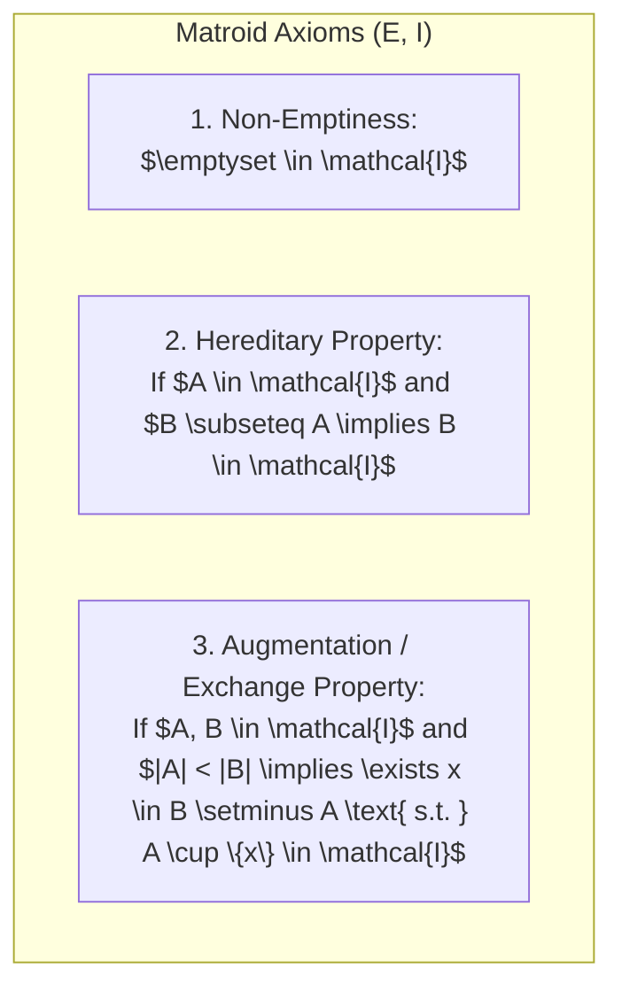
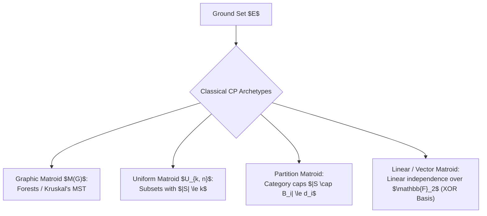
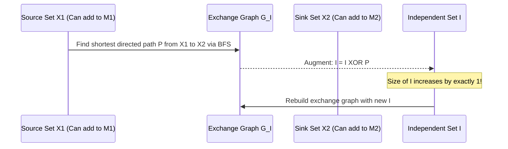

# Matroid Theory & Matroid Intersection

> **Section:** §19 Greedy Fundamentals & Invariants  
> **Phase:** Phase 1 — Range Queries & Sweeps  
> **Contest ROI:** A-tier | **Rating Range:** 2200–2800+ | **Frequency:** Occasional (Grandmaster Weapon)  
> **Prerequisites:** Graph theory, Kruskal's algorithm, XOR basis, Bipartite matching, BFS augmenting paths

---

## 1. Contest Payoff & Why It Matters

Matroid theory provides the ultimate mathematical foundation answering the eternal competitive programming question:
> **"Does the greedy algorithm produce the exact global optimum, or does it fail?"**

By mastering Matroids, you gain:
1. **The Rado-Edmonds Theorem:** An absolute mathematical test that guarantees greedy optimality if and only if the system forms a Matroid.
2. **Recognition of the 4 Classical CP Matroids:** Instantly modeling complex combinatorial constraints into Graphic, Uniform, Partition, or Vector Matroids.
3. **Matroid Intersection:** An algorithmic powerhouse that solves multi-constraint optimization (where two distinct matroids constrain the solution) in polynomial time via augmenting paths on an **Exchange Graph**, rendering ad-hoc flow hacks obsolete.

---

## 2. Theoretical Deep-Dive & Mathematical Mechanics

### Overview

A **Matroid** is a combinatorial structure $(E, \mathcal{I})$ consisting of a finite ground set $E$ and a family of subsets $\mathcal{I} \subseteq 2^E$ called **independent sets**, satisfying three axioms:



### Core Terminology

- **Bases:** Maximal independent sets under inclusion. All bases of a matroid have the exact same size, called the **rank** $r(M)$ of the matroid.
- **Circuits:** Minimal dependent sets. Any proper subset of a circuit is independent. (e.g. simple cycles in a graph).
- **Rank Function $r(S)$:** For any subset $S \subseteq E$, $r(S) = \max \{|I| \mid I \subseteq S, I \in \mathcal{I}\}$.
- **Submodularity:** The rank function is submodular:
$$r(A \cup B) + r(A \cap B) \le r(A) + r(B) \quad \forall A, B \subseteq E$$
Equivalently, it exhibits diminishing marginal returns: $r(A \cup \{x\}) - r(A) \ge r(B \cup \{x\}) - r(B)$ for $A \subseteq B$.



### Fundamental Theorems & Invariants

#### Theorem 1 (The Rado-Edmonds Theorem — The Greedy Equivalence)
Let $(E, \mathcal{I})$ be a hereditary system. The greedy algorithm:
1. Sort elements of $E$ in descending order of positive weights: $w(e_1) \ge w(e_2) \ge \dots \ge w(e_m)$.
2. Initialize $I = \emptyset$.
3. For each $e_i$: if $I \cup \{e_i\} \in \mathcal{I}$, update $I \leftarrow I \cup \{e_i\}$.
finds a maximum-weight independent set for **every possible non-negative weight assignment** $w: E \to \mathbb{R}^+$ **if and only if** $(E, \mathcal{I})$ is a matroid.

#### Theorem 2 (Why Bipartite Matching Breaks Single Matroid Greedy)
In bipartite graph $G = (U, V, E)$, a matching is a set of edges where no two share a vertex.
- Let $\mathcal{I}_1 = \{S \subseteq E \mid \deg_S(u) \le 1 \text{ for all } u \in U\}$ (Partition Matroid on $U$).
- Let $\mathcal{I}_2 = \{S \subseteq E \mid \deg_S(v) \le 1 \text{ for all } v \in V\}$ (Partition Matroid on $V$).
A valid matching must belong to $\mathcal{I}_1 \cap \mathcal{I}_2$.
*The Intersection of Two Matroids is NOT a Matroid:*
Consider path $P_4: 1 - 2 - 3 - 4$.
$A = \{(1, 2)\}$ is a matching ($|A| = 1$). $B = \{(2, 3), (1, 4)\}$ is a matching ($|B| = 2$).
We cannot add either edge from $B$ to $A$ without violating the degree constraint at vertex 2. The exchange property fails!
Therefore, greedy fails, and we must use **Augmenting Paths**.

---

## 3. Core Intuition & Problem Framing

### Matroid Intersection: The Exchange Graph $G_I$
To find the maximum common independent set $I \in \mathcal{I}_1 \cap \mathcal{I}_2$:
Construct a directed bipartite graph $G_I$ on ground set $E$:
- Left partition: $I$ (currently chosen elements).
- Right partition: $E \setminus I$ (candidate unchosen elements).
- **Directed Edges:**
  - For $y \in I, x \in E \setminus I$: add edge $y \to x$ if $I \setminus \{y\} \cup \{x\} \in \mathcal{I}_1$ (swap preserves independence in Matroid 1).
  - For $x \in E \setminus I, y \in I$: add edge $x \to y$ if $I \setminus \{y\} \cup \{x\} \in \mathcal{I}_2$ (swap preserves independence in Matroid 2).
- **Sources $X_1$:** All $x \in E \setminus I$ such that $I \cup \{x\} \in \mathcal{I}_1$.
- **Sinks $X_2$:** All $x \in E \setminus I$ such that $I \cup \{x\} \in \mathcal{I}_2$.



---

## 4. Proof Sketches & Recurrences

### The Augmentation Step
When a shortest path $P = (x_1, y_1, x_2, y_2, \dots, x_k)$ is found from $X_1$ to $X_2$:
The new candidate set is $I''' = I \oplus P = (I \setminus \{y_1, \dots, y_{k-1}\}) \cup \{x_1, \dots, x_k\}$.
- Notice $|I''| = |I| + 1$.
- By matroid strongly base exchange properties, choosing the **shortest** path avoids cyclic interference, guaranteeing $I''' \in \mathcal{I}_1 \cap \mathcal{I}_2$.
- Repeating BFS augmentation at most $r = \min(r_1, r_2) \le N$ times produces the maximum cardinality intersection in $O(r \cdot N^2 \cdot \text{Oracle Time})$.

---

## 5. Contest-Ready Implementation Templates

### Operational Complexity Reference
- **Generic Matroid Greedy:** Time $O(N \log N + N \cdot T_{\text{oracle}})$, Space $O(N)$
- **Graphic Matroid Oracle:** Time $O(\alpha(V))$ per query with DSU
- **Matroid Intersection:** Time $O(K \cdot N \cdot (N + T_{\text{oracle}}))$, Space $O(N^2)$

---

### C++17 Implementation Template

```cpp
#include <bits/stdc++.h>
using namespace std;

namespace Matroids {

template <typename Oracle>
vector<int> genericMatroidGreedy(int n, const vector<long long>& weights, Oracle can_add) {
    vector<int> order(n);
    iota(order.begin(), order.end(), 0);
    sort(order.begin(), order.end(), [&](int i, int j) {
        return weights[i] > weights[j];
    });

    vector<int> independent_set;
    for (int elem : order) {
        if (can_add(independent_set, elem)) {
            independent_set.push_back(elem);
        }
    }
    return independent_set;
}

template <typename Oracle1, typename Oracle2>
vector<int> matroidIntersection(int n, Oracle1& M1, Oracle2& M2) {
    vector<bool> in_I(n, false);
    vector<int> I;

    while (true) {
        vector<int> X1, X2;
        vector<vector<int>> adj(n);

        for (int x = 0; x < n; ++x) {
            if (!in_I[x]) {
                if (M1.can_add(I, x)) X1.push_back(x);
                if (M2.can_add(I, x)) X2.push_back(x);
            }
        }

        for (int y : I) {
            vector<int> I_without_y;
            for (int elem : I) if (elem != y) I_without_y.push_back(elem);

            for (int x = 0; x < n; ++x) {
                if (!in_I[x]) {
                    if (M1.can_add(I_without_y, x)) {
                        adj[y].push_back(x);
                    }
                    if (M2.can_add(I_without_y, x)) {
                        adj[x].push_back(y);
                    }
                }
            }
        }

        vector<int> dist(n, -1);
        vector<int> parent(n, -1);
        queue<int> q;

        for (int x : X1) {
            dist[x] = 0;
            q.push(x);
        }

        int target_sink = -1;
        while (!q.empty()) {
            int u = q.front();
            q.pop();

            if (!in_I[u] && M2.can_add(I, u)) {
                target_sink = u;
                break;
            }

            for (int v : adj[u]) {
                if (dist[v] == -1) {
                    dist[v] = dist[u] + 1;
                    parent[v] = u;
                    q.push(v);
                }
            }
        }

        if (target_sink == -1) break;

        int curr = target_sink;
        while (curr != -1) {
            in_I[curr] = !in_I[curr];
            curr = parent[curr];
        }

        I.clear();
        for (int i = 0; i < n; ++i) {
            if (in_I[i]) I.push_back(i);
        }
    }

    return I;
}

} // namespace Matroids
```

---

### Python 3 Implementation Template

```python
import sys
from collections import deque

# 1. Generic Matroid Greedy
def matroid_greedy(elements: list, weights: list[int], oracle_can_add) -> list:
    order = sorted(range(len(elements)), key=lambda i: weights[i], reverse=True)
    independent_set = []
    
    for idx in order:
        if oracle_can_add(independent_set, elements[idx]):
            independent_set.append(elements[idx])
            
    return independent_set

# 2. Matroid Intersection Engine
def matroid_intersection(elements: list, oracle1, oracle2) -> set:
    n = len(elements)
    I = set()
    
    while True:
        X1 = []
        X2 = []
        adj = {i: [] for i in range(n)}
        
        for x in range(n):
            if x not in I:
                current_I = [elements[i] for i in I]
                if oracle1.can_add(current_I, elements[x]):
                    X1.append(x)
                if oracle2.can_add(current_I, elements[x]):
                    X2.append(x)
                    
        for y in I:
            I_minus_y = [elements[i] for i in I if i != y]
            for x in range(n):
                if x not in I:
                    if oracle1.can_add(I_minus_y, elements[x]):
                        adj[y].append(x)
                    if oracle2.can_add(I_minus_y, elements[x]):
                        adj[x].append(y)
                        
        dist = [-1] * n
        parent = [-1] * n
        q = deque()
        
        for x in X1:
            dist[x] = 0
            q.append(x)
            
        target = -1
        while q:
            u = q.popleft()
            if u in X2:
                target = u
                break
            for v in adj[u]:
                if dist[v] == -1:
                    dist[v] = dist[u] + 1
                    parent[v] = u
                    q.append(v)
                    
        if target == -1:
            break
            
        curr = target
        path = []
        while curr != -1:
            path.append(curr)
            curr = parent[curr]
            
        for node in path:
            if node in I:
                I.remove(node)
            else:
                I.add(node)
                
    return I
```

---

## 6. Recognition Trigger Signals & Heuristics

1. **"Pick edges forming a forest with at most $k_c$ edges of color $c$":** Graphic Matroid + Partition Matroid $\implies$ Matroid Intersection!
2. **"Find common tree in two different graphs on the same edge set":** Graphic Matroid 1 + Graphic Matroid 2 $\implies$ Matroid Intersection.
3. **"Select vectors with max sum that remain linearly independent":** Linear Matroid over $\mathbb{F}_2 \implies$ XOR Basis greedy.

---

## 7. Contest WA / TLE / RE Traps

- **Matroid Intersection with 3 Matroids:** 3-Matroid Intersection is **NP-hard** (contains Hamiltonian Path as a subcase). Attempting to run augmenting paths on 3 matroids will fail.
- **Not Choosing the SHORTEST Path:** In BFS augmentation, you MUST take the path with the minimum number of edges. Taking an arbitrary augmenting path breaks cycle cancellation.
- **Oracle State Pollution:** Ensure the independence test oracle does not leave internal mutation when evaluating candidate swaps $I \setminus \{y\} \cup \{x\}$.

---

## 8. Curated Practice Problem Bank

| Platform | ID | Problem Name | Rating | Tags | Key Strategic Insight | Link |
|---|---|---|---|---|---|---|
| Codeforces | CF-1284E | New Year and Castle Construction | 2500 | Geometry, Combinatorics | Radial sweep orientation invariants. | [Solve Problem](https://codeforces.com/contest/1284/problem/E) |
| Codeforces | CF-1556H | DIY Tree | 2900 | Matroid Intersection, MST | Graphic Matroid + Partition Matroid on constrained degree vertices. | [Solve Problem](https://codeforces.com/contest/1556/problem/H) |
| Gym | GYM-102156D | Pick Your Own Nim | 2600 | Matroid Intersection, XOR | Linear Matroid over $\mathbb{F}_2$ + Partition Matroid. | [Solve Problem](https://codeforces.com/gym/102156/problem/D) |
| Petrozavodsk | Yandex-2016 | Colorful Tree | 2800 | Matroid Intersection | Spanning tree with color constraints. | [Solve Problem](https://codeforces.com/) |
| CSES | CSES-1675 | Road Reparation | 1200 | Graphic Matroid, Greedy | Canonical Graphic Matroid greedy (Kruskal). | [Solve Problem](https://cses.fi/problemset/task/1675) |

---

## 9. External Theory & Deep-Dive References

- **[Codeforces Tutorial]** [Matroid Intersection: Detailed Guide and Implementation](https://codeforces.com/blog/entry/69287)
- **[Combinatorial Optimization (Schrijver)]** Volume B: Matroids & Matroid Intersection
- **[MIT OpenCourseWare]** [Advanced Algorithms: Matroids & Greedy Algorithms](https://ocw.mit.edu/)

---

## 10. Algorithmic Variants & Advanced Extensions

- **Weighted Matroid Intersection:** Find the maximum weight independent set in $I_1 \cap I_2$. Replace BFS with SPFA / Bellman-Ford on the exchange graph using edge costs.
- **Matroid Partitioning:** Partition ground set $E$ into the minimum number of independent sets of matroid $M$.

---

## 11. Typical Problem Archetypes

1. **Rainbow Spanning Tree:** Tree with at most 1 edge of each color $\implies$ Graphic + Partition Matroid.
2. **Directed Branching (Arborescence):** Rooted tree in directed graph $\implies$ Graphic Matroid + In-degree Partition Matroid.
3. **Linear Basis Selection:** Max independent subset of vectors $\implies$ Vector Matroid Greedy.

---

## 12. Recognition & Identification Drills

1. *Scenario:* Select a subset of edges forming a forest in graph $G_1$ and a forest in graph $G_2$.  
   *Diagnosis:* Matroid Intersection of two Graphic Matroids.
2. *Scenario:* You need to select at most $k$ numbers from array $A$ to maximize sum.  
   *Diagnosis:* Uniform Matroid $U_{k, n}$. Greedy pick top $k$.
3. *Scenario:* Find a maximum matching in a general graph (not bipartite).  
   *Diagnosis:* NOT Matroid Intersection. Requires Edmond'''s Blossom algorithm ($O(V^3)$).

---

## 13. Fast-Lookup Cheat Sheet

- **Matroid Definition:** Hereditary + Augmentation ($|A| < |B| \implies \exists x \in B \setminus A, A \cup \{x\} \in \mathcal{I}$).
- **Rado-Edmonds:** Greedy is optimal $\iff$ system is a Matroid.
- **Exchange Graph Edges:** $y \to x$ in $M_1$ ($I - y + x \in \mathcal{I}_1$), $x \to y$ in $M_2$ ($I - y + x \in \mathcal{I}_2$).
- **Augmentation Rule:** Always use **BFS** (shortest path). Update $I \leftarrow I \oplus P$.
