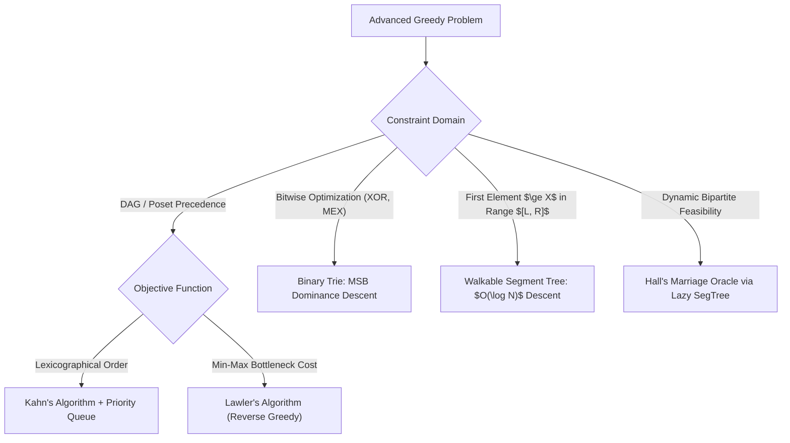
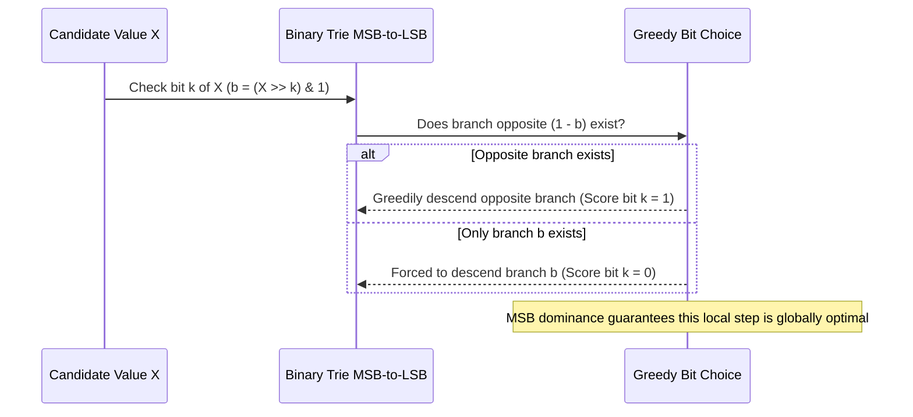

# Antimatroids, Posets & Advanced Greedy Oracles

> **Section:** §19 Greedy Fundamentals & Invariants  
> **Phase:** Phase 1 — Range Queries & Sweeps  
> **Contest ROI:** S-tier | **Rating Range:** 1800–2600 | **Frequency:** Common  
> **Prerequisites:** Topological sorting, Binary Tries, Segment trees, Posets and DAGs

---

## 1. Contest Payoff & Why It Matters

When problems involve precedence constraints (DAGs), bitwise arithmetic, or dynamic feasibility checks, standard greedy fails without specialized oracle data structures.
Mastering this topic unlocks:
1. **Lawler's Algorithm & Reverse Poset Greedy:** Solving scheduling problems with arbitrary precedence constraints and non-linear penalties by scheduling backwards from the finish line.
2. **Lexicographical Kahn's Algorithm:** Finding the lexicographically smallest topological sort via min-heap event queues.
3. **The MSB Dominance Principle & Binary Tries:** Exploiting $2^k > \sum_{i < k} 2^i$ to maximize XOR sums and maintain dynamic MEX in $O(\text{Bits})$ time.
4. **Walkable Segment Trees:** Replacing $O(\log^2 N)$ binary-search-over-query with $O(\log N)$ single-pass greedy tree descents.
5. **Hall's Marriage Oracle:** Using a Lazy Segment Tree to dynamically verify whether incoming greedy requests maintain a valid bipartite matching.

---

## 2. Theoretical Deep-Dive & Mathematical Mechanics

### Overview

While matroids model systems where subsets can be extended in any order, **Antimatroids** model systems where elements can only be selected along valid causal chains (precedence orders). Furthermore, when greedy decisions require checking future feasibility in real-time, we embed data structures (Tries, Walkable SegTrees) directly as **Greedy Oracles**.



### Fundamental Theorems & Invariants

#### Theorem 1 (Lawler's Reverse Greedy Algorithm for Posets)
Given $N$ jobs with processing times $p_i$, precedence constraints $i \to j$ forming a DAG, and arbitrary non-decreasing penalty functions $f_i(t)$. We wish to schedule jobs on a single machine to minimize the bottleneck penalty:
$$\min \max_{1 \le i \le N} f_i(C_i)$$
*Algorithm:*
Work **backwards** from the final completion time $T = \sum_{i=1}^N p_i$.
1. At time $t$, identify the set $\mathcal{S}$ of all unscheduled jobs that have **no outgoing precedence constraints** to other unscheduled jobs (i.e. jobs that can legally finish last).
2. Greedily select the job $j^* \in \mathcal{S}$ that minimizes $f_j(t)$:
$$j^* = \arg\min_{j \in \mathcal{S}} f_j(t)$$
3. Schedule $j^*$ to finish at time $t$. Set $t \leftarrow t - p_{j^*}$, remove $j^*$ from the DAG, and repeat until all jobs are scheduled.

*Proof of Optimality:*
Any valid schedule must finish with some job $k \in \mathcal{S}$ completing at time $T$. The penalty incurred by the final job will be $f_k(T)$. Because $f_i$ are non-decreasing, and $j^*$ minimizes $f_j(T)$ over all candidate terminal jobs, scheduling $j^*$ last ensures that the maximum penalty at time $T$ is as small as mathematically possible. By induction on the remaining DAG, Lawler's reverse greedy schedule minimizes the bottleneck cost globally.

#### Theorem 2 (The MSB Dominance Principle in Bitwise Greedy)
For any non-negative integer $k$:
$$2^k > \sum_{i=0}^{k-1} 2^i = 2^k - 1$$
*Corollary:* In bitwise maximization (e.g. $\max (X \oplus A_i)$), securing a bit $1$ at position $k$ is strictly superior to setting all lower bits $0, 1, \dots, k-1$ to $1$.
Therefore, bitwise greedy algorithms must process bits **strictly from Most Significant Bit (MSB) to Least Significant Bit (LSB)**.



#### Theorem 3 (Walk on Segment Tree Invariant)
To find the first index $i \in [l, r]$ satisfying predicate $P(A_i)$ (e.g. $A_i \ge x$):
Instead of binary searching the index $mid$ and performing a range query in $O(\log^2 N)$, descend the Segment Tree directly:
1. If the current segment $[tl, tr]$ lies outside $[l, r]$ or the segment aggregate cannot satisfy $P$, return $-1$.
2. If $[tl, tr]$ is a leaf, return $tl$.
3. Recursively check the **left child**. If the left child returns a valid index, return it.
4. Otherwise, recursively search the **right child**.
*Complexity:* At most $O(\log N)$ nodes are visited.

---

## 3. Core Intuition & Problem Framing

### Hall's Marriage Oracle via Lazy Segment Tree
Consider matching $N$ intervals $[L_i, R_i]$ to discrete slots on a line.
By Hall's Marriage Theorem, a valid matching exists if and only if for all subsets of intervals $S$:
$$|N(S)| \ge |S| \iff \text{Slots available} \ge \text{Intervals demand}$$
On a 1D timeline, Hall's condition simplifies: for all subsegments $[j, k]$, the number of available slots minus the number of intervals contained in $[j, k]$ must be $\ge 0$.
By storing $D[j] = (\text{capacity up to } j) - (\text{demand up to } j)$ in a Lazy Segment Tree, adding an interval $[L_i, R_i]$ corresponds to a range subtraction $-1$ on $[R_i, \text{Max}]$.
The greedy oracle can test in $O(\log N)$ if $\min_{j} D[j] \ge 0$. If valid, accept the interval; if it drops below 0, reject it.

---

## 4. Proof Sketches & Recurrences

### Dilworth's Theorem for Poset Chain Decompositions
Let $P = (X, \le)$ be a finite partially ordered set.
- A **chain** is a subset where all elements are mutually comparable.
- An **antichain** is a subset where no two elements are comparable.
- *Theorem (Dilworth):* The minimum number of disjoint chains needed to cover all elements of $X$ is equal to the maximum size of an antichain in $X$.
- *Reduction to Bipartite Matching:* Create bipartite graph with vertices $X_{\text{out}}$ and $X_{\text{in}}$. Add directed edge $u \to v$ if $u < v$. Maximum matching $M$ gives minimum chain cover of size $|X| - |M|$.

---

## 5. Contest-Ready Implementation Templates

### Operational Complexity Reference
- **Kahn's Lexicographical TopSort:** Time $O(V \log V + E)$, Space $O(V + E)$
- **Binary Trie MSB Descent:** Time $O(\text{Bits})$ per query, Space $O(N \cdot \text{Bits})$
- **Walkable Segment Tree:** Time $O(\log N)$ per search, Space $O(N)$
- **Hall's Lazy Segment Tree Oracle:** Time $O(\log N)$ per query/update, Space $O(N)$

---

### C++17 Implementation Template

```cpp
#include <bits/stdc++.h>
using namespace std;

namespace AdvancedGreedyOracles {

vector<int> lexicographicalTopSort(int n, const vector<vector<int>>& adj) {
    vector<int> in_degree(n + 1, 0);
    for (int u = 1; u <= n; ++u) {
        for (int v : adj[u]) in_degree[v]++;
    }

    priority_queue<int, vector<int>, greater<int>> pq;
    for (int i = 1; i <= n; ++i) {
        if (in_degree[i] == 0) pq.push(i);
    }

    vector<int> order;
    while (!pq.empty()) {
        int u = pq.top();
        pq.pop();
        order.push_back(u);

        for (int v : adj[u]) {
            in_degree[v]--;
            if (in_degree[v] == 0) pq.push(v);
        }
    }

    return (int)order.size() == n ? order : vector<int>();
}

class BinaryTrie {
    static constexpr int BITS = 30;
    struct Node {
        int ch[2] = {0, 0};
        int sz = 0;
    };
    vector<Node> tree;

public:
    BinaryTrie(int max_nodes = 2000000) {
        tree.reserve(max_nodes);
        tree.push_back(Node());
    }

    void insert(int val) {
        int u = 0;
        tree[u].sz++;
        for (int b = BITS - 1; b >= 0; --b) {
            int bit = (val >> b) & 1;
            if (!tree[u].ch[bit]) {
                tree[u].ch[bit] = tree.size();
                tree.push_back(Node());
            }
            u = tree[u].ch[bit];
            tree[u].sz++;
        }
    }

    int queryMaxXOR(int val) const {
        int u = 0;
        int result = 0;
        for (int b = BITS - 1; b >= 0; --b) {
            int bit = (val >> b) & 1;
            int preferred = 1 - bit;
            if (tree[u].ch[preferred] && tree[tree[u].ch[preferred]].sz > 0) {
                result |= (1 << b);
                u = tree[u].ch[preferred];
            } else {
                u = tree[u].ch[bit];
            }
        }
        return result;
    }

    int getMEX(int xor_tag) const {
        int u = 0;
        int mex = 0;
        for (int b = BITS - 1; b >= 0; --b) {
            int bit = (xor_tag >> b) & 1;
            int left_child = tree[u].ch[bit];
            int full_size = 1 << b;

            if (left_child && tree[left_child].sz == full_size) {
                mex |= (1 << b);
                u = tree[u].ch[1 - bit];
            } else {
                u = left_child;
            }
            if (!u) break;
        }
        return mex;
    }
};

class WalkableSegTree {
    int n;
    vector<long long> tree;

    void build(const vector<long long>& data, int v, int tl, int tr) {
        if (tl == tr) {
            tree[v] = data[tl];
        } else {
            int tm = tl + (tr - tl) / 2;
            build(data, v * 2, tl, tm);
            build(data, v * 2 + 1, tm + 1, tr);
            tree[v] = max(tree[v * 2], tree[v * 2 + 1]);
        }
    }

public:
    WalkableSegTree(int n, const vector<long long>& data) : n(n), tree(4 * n) {
        build(data, 1, 0, n - 1);
    }

    int findFirst(int v, int tl, int tr, int l, int r, long long x) {
        if (tl > r || tr < l || tree[v] < x) return -1;
        if (tl == tr) return tl;

        int tm = tl + (tr - tl) / 2;
        int left_res = findFirst(v * 2, tl, tm, l, r, x);
        if (left_res != -1) return left_res;
        return findFirst(v * 2 + 1, tm + 1, tr, l, r, x);
    }

    int queryFirst(int l, int r, long long x) {
        return findFirst(1, 0, n - 1, l, r, x);
    }
};

} // namespace AdvancedGreedyOracles
```

---

### Python 3 Implementation Template

```python
import sys
import heapq

# 1. Lexicographical Kahn's Algorithm
def lexicographical_topsort(n: int, edges: list[tuple[int, int]]) -> list[int]:
    adj = {i: [] for i in range(1, n + 1)}
    in_degree = [0] * (n + 1)
    
    for u, v in edges:
        adj[u].append(v)
        in_degree[v] += 1
        
    pq = [i for i in range(1, n + 1) if in_degree[i] == 0]
    heapq.heapify(pq)
    
    order = []
    while pq:
        u = heapq.heappop(pq)
        order.append(u)
        for v in adj[u]:
            in_degree[v] -= 1
            if in_degree[v] == 0:
                heapq.heappush(pq, v)
                
    return order if len(order) == n else []

# 2. Binary Trie with MSB Greedy Descent
class BinaryTrie:
    def __init__(self, bit_len: int = 30):
        self.bit_len = bit_len
        self.trie = [[0, 0]]
        self.sz = [0]
        
    def insert(self, val: int):
        u = 0
        self.sz[u] += 1
        for b in range(self.bit_len - 1, -1, -1):
            bit = (val >> b) & 1
            if not self.trie[u][bit]:
                self.trie[u][bit] = len(self.trie)
                self.trie.append([0, 0])
                self.sz.append(0)
            u = self.trie[u][bit]
            self.sz[u] += 1
            
    def max_xor(self, val: int) -> int:
        u = 0
        ans = 0
        for b in range(self.bit_len - 1, -1, -1):
            bit = (val >> b) & 1
            pref = 1 - bit
            if self.trie[u][pref] and self.sz[self.trie[u][pref]] > 0:
                ans |= (1 << b)
                u = self.trie[u][pref]
            else:
                u = self.trie[u][bit]
        return ans

# 3. Walkable Segment Tree
class WalkableSegTree:
    def __init__(self, data: list[int]):
        self.n = len(data)
        self.tree = [0] * (4 * self.n)
        self._build(data, 1, 0, self.n - 1)
        
    def _build(self, data, v, tl, tr):
        if tl == tr:
            self.tree[v] = data[tl]
        else:
            tm = (tl + tr) // 2
            self._build(data, v * 2, tl, tm)
            self._build(data, v * 2 + 1, tm + 1, tr)
            self.tree[v] = max(self.tree[v * 2], self.tree[v * 2 + 1])
            
    def find_first(self, v, tl, tr, l, r, x) -> int:
        if tl > r or tr < l or self.tree[v] < x:
            return -1
        if tl == tr:
            return tl
        tm = (tl + tr) // 2
        res = self.find_first(v * 2, tl, tm, l, r, x)
        if res != -1:
            return res
        return self.find_first(v * 2 + 1, tm + 1, tr, l, r, x)
        
    def query(self, l: int, r: int, x: int) -> int:
        return self.find_first(1, 0, self.n - 1, l, r, x)
```

---

## 6. Recognition Trigger Signals & Heuristics

1. **"Find lexicographically smallest valid topological order":** Kahn's algorithm with a min-heap priority queue.
2. **"Find a pair $(i, j)$ maximizing $A_i \oplus A_j$":** Binary Trie MSB-to-LSB greedy search.
3. **"Find first element $\ge X$ with index in $[L, R]$":** Walkable Segment Tree. Descend left branch first.
4. **"Schedule tasks with DAG prerequisites to minimize maximum lateness":** Lawler's Reverse Greedy algorithm.

---

## 7. Contest WA / TLE / RE Traps

- **Python Recursion Limit on Deep Tries/SegTrees:** A 30-bit Trie with recursion can hit Python's `sys.setrecursionlimit`. Always implement Trie insertion and queries iteratively.
- **Topological Cycle Deadlock:** If the input graph has a cycle, `len(order) < n`. Failing to check `len(order) == n` causes outputting truncated arrays or infinite loops.
- **SegTree Walk Range Pruning:** Forgetting `if (tl > r || tr < l) return -1;` allows the descent to wander into invalid subtrees, destroying the $O(\log N)$ bound and giving incorrect out-of-range indices.

---

## 8. Curated Practice Problem Bank

| Platform | ID | Problem Name | Rating | Tags | Key Strategic Insight | Link |
|---|---|---|---|---|---|---|
| CSES | CSES-1680 | Longest Flight Route | 1500 | DAG, TopSort, DP | Topological sort order DP on DAG. | [Solve Problem](https://cses.fi/problemset/task/1680) |
| Codeforces | CF-845G | Shortest Path Problem? | 2300 | XOR Basis, DFS Tree | Graph spanning tree cycles + XOR linear basis minimization. | [Solve Problem](https://codeforces.com/contest/845/problem/G) |
| Codeforces | CF-1416C | XOR Inverse | 2000 | Binary Trie, Divide & Conquer | Trie bit inversion counting to choose optimal XOR bitmask. | [Solve Problem](https://codeforces.com/contest/1416/problem/C) |
| Codeforces | CF-484E | Sign on Fence | 2600 | Persistent SegTree, Walk | Walkable persistent segment tree on thresholded intervals. | [Solve Problem](https://codeforces.com/contest/484/problem/E) |
| AtCoder | ABC-216D | Pair of Balls | 1200 | Kahn's Algorithm, Queue | Directed dependency resolution using in-degree queues. | [Solve Problem](https://atcoder.jp/contests/abc216/tasks/abc216_d) |

---

## 9. External Theory & Deep-Dive References

- **[CP-Algorithms]** [Topological Sorting and Kahn's Algorithm](https://cp-algorithms.com/graph/topological_sort.html)
- **[USACO Guide]** [Platinum: Segment Trees with Binary Search (Walk on SegTree)](https://usaco.guide/plat/segtree-ext)
- **[Algorithmica]** [Tries and Bitwise Optimizations](https://en.algorithmica.org/cs/data-structures/trie/)

---

## 10. Algorithmic Variants & Advanced Extensions

- **0-1 Persistent SegTree Walking:** Answering queries on history versions or range frequency bounds by walking down two persistent SegTree roots simultaneously in $O(\log N)$ (e.g. Range Kth Smallest).
- **Persistent Binary Trie with XOR Shift:** Answering dynamic MEX and XOR queries after applying a global XOR tag $X$ to all elements by flipping child pointers dynamically.

---

## 11. Typical Problem Archetypes

1. **Topological Pipeline:** Process interdependent jobs in optimal dictionary order $\implies$ Kahn's + PQ.
2. **XOR Query Engine:** Fast pairwise XOR maximization $\implies$ Binary Trie.
3. **First-Fit Searcher:** Find first valid memory block or height $\implies$ Walkable SegTree.

---

## 12. Recognition & Identification Drills

1. *Scenario:* You need to find a path in a DAG from $1$ to $N$ with the maximum XOR sum.  
   *Diagnosis:* Find any path; XOR with cycles formed by back-edges inserted into an XOR Linear Basis.
2. *Scenario:* Given array $A$, answer queries: "What is the smallest index $i \ge L$ such that $A_i \ge V$?"  
   *Diagnosis:* Walkable Segment Tree with range constraint $[L, N-1]$.
3. *Scenario:* Jobs have dependencies. Completing job $i$ at time $t$ incurs penalty $\max(0, t - d_i)^2$. Minimize max penalty.  
   *Diagnosis:* Lawler's Reverse Greedy algorithm.

---

## 13. Fast-Lookup Cheat Sheet

- **MSB Dominance:** $2^k > \sum_{i < k} 2^i$. Always greedy-match bits from $29$ down to $0$.
- **Kahn's TopSort:** In-degree 0 nodes enter priority queue. Pop smallest, decrement children.
- **Walk on SegTree:** If left child maximum $\ge x$, descend left; else descend right. Total time $O(\log N)$.
- **Lawler's Scheduling:** Work backward from $T = \sum p_i$. Pick eligible job with minimal penalty at $T$.
