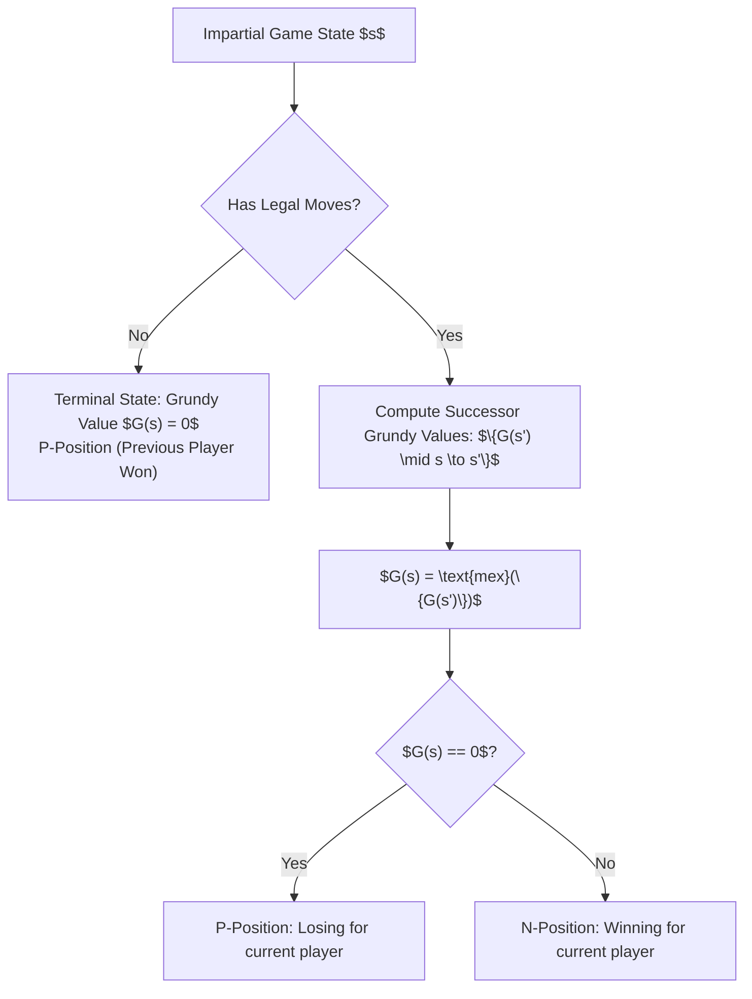
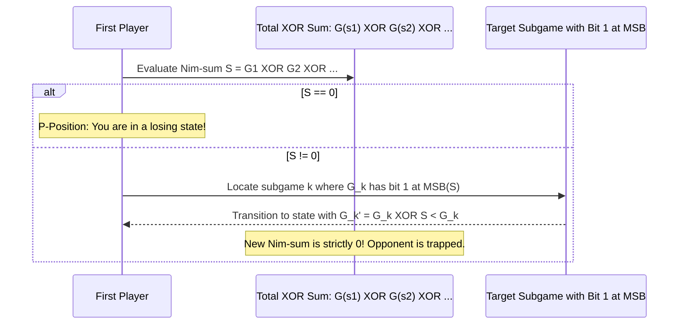

# Impartial Games, Sprague-Grundy & Periodic Invariants

> **Section:** §19 Greedy Fundamentals & Invariants  
> **Phase:** Phase 1 — Range Queries & Sweeps  
> **Contest ROI:** A-tier | **Rating Range:** 1600–2400 | **Frequency:** Common  
> **Prerequisites:** Dynamic Programming, Bitwise XOR properties, Hash tables / Floyd's Cycle-Finding

---

## 1. Contest Payoff & Why It Matters

Impartial game theory problems are frequently featured in Division 1/2 Codeforces contests and ICPC regionals. Because these problems present as combinatorial puzzle rules, competitors often waste hours trying to find ad-hoc win/loss patterns.

Mastery of this topic gives you:
1. **The Sprague-Grundy Reduction:** A universal mathematical reduction that translates *any* finite impartial game under normal play into an equivalent single heap of **Nim**.
2. **The Subgame Superposition Principle:** Decomposing games that split into independent subgames via the bitwise XOR sum rule: $G(A + B) = G(A) \oplus G(B)$.
3. **Periodicity Detection:** Discovering repeating Grundy sequences in $O(\text{Period})$ time, enabling instantaneous $O(1)$ queries for queries where $N \le 10^{18}$.

---

## 2. Theoretical Deep-Dive & Mathematical Mechanics

### Overview

An **Impartial Game** satisfies:
1. Two players alternate turns under perfect information.
2. From any state $s$, the set of legal moves $\{s \to s'\}$ is **identical** regardless of whose turn it is.
3. The game must terminate in a finite number of steps (no infinite loops / DAG state graph).
4. **Normal Play Convention:** The player who makes the last move wins (i.e. a player facing a state with no legal moves loses).



### Fundamental Theorems & Invariants

#### Theorem 1 (Bouton's Theorem for the Game of Nim)
In the standard Game of Nim with $k$ heaps of sizes $x_1, x_2, \dots, x_k$, a position is a second-player winning position (P-position) **if and only if** the bitwise XOR sum (Nim-sum) of all heap sizes is zero:
$$\bigoplus_{i=1}^k x_i = 0$$
*Proof of Invariant Maintenance:*
1. **Terminal Condition:** The terminal state is $(0, 0, \dots, 0)$, whose Nim-sum is $0$ (the player facing it has lost).
2. **Transition from Zero to Non-Zero:** If $\bigoplus x_i = 0$, changing any single heap $x_j \to x_j'$ strictly alters the XOR sum: $\left(\bigoplus x_i\right) \oplus x_j \oplus x_j' = 0 \oplus (x_j \oplus x_j') \neq 0$ because $x_j' < x_j$.
3. **Transition from Non-Zero to Zero:** If $S = \bigoplus x_i \neq 0$, let $b$ be the most significant bit of $S$. There exists at least one heap $x_m$ whose $b$-th bit is 1.
Setting $x_m' = x_m \oplus S < x_m$ reduces heap $x_m$ legally while setting the new total XOR sum to $S \oplus x_m \oplus x_m' = 0$.

#### Theorem 2 (The Sprague-Grundy Theorem)
Every impartial game state $s$ under the normal play convention is equivalent to a single Nim heap of size $G(s)$, where $G(s)$ is the **Grundy value** (or nim-value) defined recursively:
$$G(s) = \text{mex}\big(\{G(s') \mid s \to s'\}\big)$$
where $\text{mex}(S) = \min \{k \in \mathbb{N}_{\ge 0} \mid k \notin S\}$ denotes the Minimum Excluded non-negative integer.

#### Theorem 3 (The Subgame Superposition Rule)
If a move decomposes a game into two or more completely independent subgames $s_1, s_2, \dots, s_k$ (where a player chooses one subgame and makes a move within it, leaving the others untouched):
$$G(s_1 + s_2 + \dots + s_k) = G(s_1) \oplus G(s_2) \oplus \dots \oplus G(s_k)$$



---

## 3. Core Intuition & Problem Framing

### The MEX Invariant
Why MEX?
Because a state with $G(s) = g$ can transition to states with Grundy values $0, 1, \dots, g-1$.
This mirrors a Nim heap of size $g$, which can be reduced to any size from $0$ up to $g-1$.
Since the transitions available from $s$ precisely match or exceed the downward transitions of a Nim heap of size $g$, the game state behaves identically to a Nim heap of size $g$.

### Periodicity in Subtraction Games
In games where a player can subtract $a \in \mathcal{S} = \{s_1, s_2, \dots, s_k\}$ from a single pile of size $N$:
Because $G(N)$ depends only on $\{G(N - s_1), \dots, G(N - s_k)\}$, the sequence of the last $\max(s_i)$ Grundy values forms a finite state space. Since the state space is finite, the sequence **must eventually become strictly periodic**.
Finding pre-period $p_0$ and cycle length $L$ allows calculating $G(N)$ for $N = 10^{18}$ in $O(1)$:
$$\text{If } N \ge p_0: \quad G(N) = G\left(p_0 + (N - p_0) \pmod L\right)$$

---

## 4. Proof Sketches & Recurrences

### The Periodicity Invariant
Let $M = \max_{s \in \mathcal{S}} s$. The state vector at position $n$ is:
$$\mathbf{V}_n = (G(n), G(n-1), \dots, G(n - M + 1))$$
Because $G(n) \le |\mathcal{S}|$, there are at most $(|\mathcal{S}| + 1)^M$ distinct vectors $\mathbf{V}_n$. By the Pigeonhole Principle, there exist indices $i < j$ such that $\mathbf{V}_i = \mathbf{V}_j$.
Because each subsequent vector is uniquely determined by the previous vector:
$$\mathbf{V}_{i+1} = \mathbf{V}_{j+1}, \quad \mathbf{V}_{i+2} = \mathbf{V}_{j+2}, \quad \dots$$
Thus, the Grundy sequence is periodic with period $L = j - i$ for all $n \ge i$.

---

## 5. Contest-Ready Implementation Templates

### Operational Complexity Reference
- **MEX Computation & Grundy DP:** Time $O(N \cdot |\text{moves}|)$, Space $O(N)$
- **Periodicity Detector:** Time $O(\text{Pre-period} + \text{Cycle Length})$, Space $O(\text{State Space})$
- **Nim Move Reconstructor:** Time $O(K)$, Space $O(1)$ auxiliary

---

### C++17 Implementation Template

```cpp
#include <bits/stdc++.h>
using namespace std;

namespace GameTheoryGreedy {

// 1. Efficient MEX Calculation
int computeMEX(const vector<int>& values) {
    int n = values.size();
    vector<bool> present(n + 2, false);
    for (int v : values) {
        if (v <= n + 1) present[v] = true;
    }
    for (int i = 0; i <= n + 1; ++i) {
        if (!present[i]) return i;
    }
    return n + 2;
}

// 2. Grundy DP Engine for Subtraction Games
vector<int> computeGrundyTable(int max_val, const vector<int>& allowed_moves) {
    vector<int> G(max_val + 1, 0);

    for (int state = 1; state <= max_val; ++state) {
        vector<int> next_states;
        for (int move : allowed_moves) {
            if (state >= move) {
                next_states.push_back(G[state - move]);
            }
        }
        G[state] = computeMEX(next_states);
    }
    return G;
}

// 3. Automated Periodicity Detector for Large N (N <= 10^18)
struct PeriodResult {
    long long pre_period;
    long long cycle_length;
    vector<int> grundy_history;

    int query(long long N) const {
        if (N < pre_period) return grundy_history[N];
        long long offset = (N - pre_period) % cycle_length;
        return grundy_history[pre_period + offset];
    }
};

PeriodResult findPeriodicity(const vector<int>& moves) {
    int max_move = *max_element(moves.begin(), moves.end());
    vector<int> G;
    map<vector<int>, int> seen_states;

    int n = 0;
    while (true) {
        vector<int> transitions;
        for (int m : moves) {
            if (n >= m) transitions.push_back(G[n - m]);
        }
        int g_val = computeMEX(transitions);
        G.push_back(g_val);

        if (n >= max_move) {
            vector<int> current_window(G.end() - max_move, G.end());
            if (seen_states.count(current_window)) {
                int prev_n = seen_states[current_window];
                long long cycle_length = n - prev_n;
                long long pre_period = prev_n - max_move + 1;
                return {pre_period, cycle_length, G};
            }
            seen_states[current_window] = n;
        }
        n++;
    }
}

// 4. Nim Game Strategy Runner
// Given heap sizes, finds which heap to reduce and to what size to guarantee a win
struct WinningMove {
    int heap_index;
    long long target_size;
};

optional<WinningMove> findWinningMove(const vector<long long>& heaps) {
    long long total_xor = 0;
    for (long long h : heaps) total_xor ^= h;

    if (total_xor == 0) {
        return nullopt; // P-position: No winning move exists
    }

    // Find the highest bit set in total_xor
    int msb = 63 - __builtin_clzll(total_xor);

    for (int i = 0; i < (int)heaps.size(); ++i) {
        if ((heaps[i] >> msb) & 1) {
            long long target = heaps[i] ^ total_xor;
            return WinningMove{i, target};
        }
    }
    return nullopt;
}

} // namespace GameTheoryGreedy
```

---

### Python 3 Implementation Template

```python
import sys

# 1. MEX Function
def mex(seen: set[int]) -> int:
    m = 0
    while m in seen:
        m += 1
    return m

# 2. Grundy DP Engine
def compute_grundy(max_n: int, moves: list[int]) -> list[int]:
    G = [0] * (max_n + 1)
    for state in range(1, max_n + 1):
        transitions = set()
        for m in moves:
            if state >= m:
                transitions.add(G[state - m])
        G[state] = mex(transitions)
    return G

# 3. Periodicity Detector for N up to 10^18
class PeriodDetector:
    def __init__(self, moves: list[int]):
        self.moves = moves
        self.max_move = max(moves)
        self.G = []
        self.pre_period = 0
        self.cycle_len = 0
        self._detect()
        
    def _detect(self):
        seen = {}
        n = 0
        while True:
            transitions = set()
            for m in self.moves:
                if n >= m:
                    transitions.add(self.G[n - m])
            g_val = mex(transitions)
            self.G.append(g_val)
            
            if n >= self.max_move:
                window = tuple(self.G[-self.max_move:])
                if window in seen:
                    prev_n = seen[window]
                    self.cycle_len = n - prev_n
                    self.pre_period = prev_n - self.max_move + 1
                    break
                seen[window] = n
            n += 1
            
    def query(self, N: int) -> int:
        if N < self.pre_period:
            return self.G[N]
        offset = (N - self.pre_period) % self.cycle_len
        return self.G[self.pre_period + offset]
```

---

## 6. Recognition Trigger Signals & Heuristics

1. **"Two players take turns; last player to move wins; games consist of multiple tokens/heaps":** Sprague-Grundy theorem. Compute Grundy value for 1 component, XOR across all components.
2. **"Game rule allows splitting a heap into two non-empty piles":** Subgame split rule. $G(\text{state}) = \text{mex}(\{G(a) \oplus G(b) \mid a + b = \text{state}\})$.
3. **"Heap sizes $N \le 10^{18}$, but choices are fixed small integers $S = \{1, 3, 4\}$":** Periodicity in Grundy sequences. Detect cycle length and query $N \pmod L$.

---

## 7. Contest WA / TLE / RE Traps

- **Normal vs Misère Play Convention:** Misère play (last player to move LOSES) breaks standard Sprague-Grundy for general games. In Misère Nim, follow normal Nim until all remaining heaps have size 1; then leave an odd number of size-1 heaps.
- **Forgetting that 0 is a Valid Grundy Value:** Grundy values are non-negative integers ($0, 1, 2, \dots$). 0 means a P-position (losing). Do not initialize DP with 0 if 0 is a reachable Grundy value.
- **Window Length in Periodicity Detection:** The state window size MUST be at least $\max(\text{moves})$. Using a smaller window can trigger a false positive match before true periodicity is established.

---

## 8. Curated Practice Problem Bank

| Platform | ID | Problem Name | Rating | Tags | Key Strategic Insight | Link |
|---|---|---|---|---|---|---|
| CSES | CSES-1738 | Nim Game I | 1100 | Game Theory, Nim | Classic Nim: XOR sum of heaps. Non-zero means first player wins. | [Solve Problem](https://cses.fi/problemset/task/1738) |
| CSES | CSES-1739 | Nim Game II | 1200 | Game Theory, Modulo | Nim with bounded removals ($x \pmod 4$). | [Solve Problem](https://cses.fi/problemset/task/1739) |
| CSES | CSES-2207 | Grundy's Game | 1600 | Sprague-Grundy, Split Rule | Split pile into two unequal piles. Grundy sequence becomes 0 for $N > 1222$. | [Solve Problem](https://cses.fi/problemset/task/2207) |
| Codeforces | CF-1383B | GameGame | 1600 | Game Theory, Bitwise | Bitwise independent games. First player checks highest bit parity. | [Solve Problem](https://codeforces.com/contest/1383/problem/B) |
| Codeforces | CF-15C | Industrial Nim | 1900 | Game Theory, XOR Sum | Consecutive integer XOR prefix sums in $O(1)$ to evaluate huge Nim heaps. | [Solve Problem](https://codeforces.com/contest/15/problem/C) |

---

## 9. External Theory & Deep-Dive References

- **[CP-Algorithms]** [Sprague-Grundy Theorem & Nim](https://cp-algorithms.com/game_theory/sprague-grundy-theorem.html)
- **[Winning Ways for your Mathematical Plays]** Berlekamp, Conway, and Guy (The foundational text on combinatorial games)
- **[TopCoder Tutorial]** [Algorithm Games: Sprague-Grundy](https://www.topcoder.com/thrive/articles/Algorithm%20Games)

---

## 10. Algorithmic Variants & Advanced Extensions

- **Green Hackenbush & The Colon Principle:** Impartial games on rooted trees. Branches can be replaced with a single stalk whose length is the XOR sum of the branch Grundy values.
- **Staircase Nim:** Moving coins down stairs. Coins on odd steps form a standard Nim game; moves from even steps can be mirrored by the second player.

---

## 11. Typical Problem Archetypes

1. **Stone Removal:** Remove from 1 pile $\implies$ Nim / Subtraction Grundy.
2. **Pile Splitting:** Divide token pile into smaller parts $\implies$ MEX of XOR sums.
3. **Graph Token Chasing:** Tokens on DAG $\implies G(u) = \text{mex}(\{G(v) \mid u \to v\})$.

---

## 12. Recognition & Identification Drills

1. *Scenario:* Two players take turns removing 1, 2, or 5 stones from a pile of size $N \le 10^9$.  
   *Diagnosis:* Subtraction game. Compute Grundy table for first 50 values; find period; query $N \pmod L$.
2. *Scenario:* Players take turns moving a token on a DAG. When a token reaches a sink, it cannot move.  
   *Diagnosis:* Standard Grundy on DAG via DFS/topological sort.
3. *Scenario:* Players choose a number and divide it by a prime factor.  
   *Diagnosis:* Factorize $N = p_1^{a_1} p_2^{a_2} \dots p_k^{a_k}$. Each prime factor exponent $a_i$ is an independent Nim heap! Total game is Nim with heaps $(a_1, \dots, a_k)$.

---

## 13. Fast-Lookup Cheat Sheet

- **Bouton's Rule:** $\bigoplus x_i = 0 \iff$ Second player wins (P-position).
- **Grundy Value:** $G(s) = \text{mex}(\{G(s') \mid s \to s'\})$.
- **Subgame Split:** $G(A \cup B) = G(A) \oplus G(B)$.
- **Periodicity Window:** Window size must equal $\max(\text{moves})$.
