# Section §19: Greedy Fundamentals & Invariants

> **Module ID:** `sec-19`  
> **Phase:** Phase 1 — Range Queries & Sweeps  
> **Topic Count:** 11  

**Module Summary:** The complete masterclass on Greedy Algorithms, Structural Invariants, and Convex Duality: from Exchange Arguments and Regret/Undo Heaps to Slope Trick, Matroid Intersection, and Sprague-Grundy Game Theory.

---

## Topics in this Section

| # | Topic Title | ROI | Rating | Frequency | Markdown Guide |
|---|---|---|---|---|---|
| 1 | Greedy Foundations, Proof Paradigms & The Exchange Argument | `S-tier` | 1400–2400 | Very Common | [01-19-greedy-foundations-and-exchange-arguments.md](./01-19-greedy-foundations-and-exchange-arguments.md) |
| 2 | Interval Scheduling, Coverage & Lexicographical Greedy | `S-tier` | 1300–2100 | Very Common | [02-19-interval-scheduling-coverage-and-lexicographical-greedy.md](./02-19-interval-scheduling-coverage-and-lexicographical-greedy.md) |
| 3 | Sorting Criteria, Custom Comparators & Partitioned Greedy | `S-tier` | 1500–2300 | Common | [03-19-sorting-criteria-custom-comparators-and-partitioned-greedy.md](./03-19-sorting-criteria-custom-comparators-and-partitioned-greedy.md) |
| 4 | Sweep-Line Invariants, Active Sets & Constructive Greedy | `S-tier` | 1400–2200 | Very Common | [04-19-sweep-line-invariants-active-sets-and-constructive-greedy.md](./04-19-sweep-line-invariants-active-sets-and-constructive-greedy.md) |
| 5 | Priority Queue Regret & Buy-Now-Refund-Later Heuristics | `S-tier` | 1600–2400 | Common | [05-19-priority-queue-regret-and-undo-maintenance.md](./05-19-priority-queue-regret-and-undo-maintenance.md) |
| 6 | Axis Decoupling, Median Invariants & 1D/2D Sweeps | `S-tier` | 1400–2200 | Common | [06-19-axis-decoupling-median-invariants-and-sweeps.md](./06-19-axis-decoupling-median-invariants-and-sweeps.md) |
| 7 | Convex Optimization, Slope Trick & WQS Binary Search | `A-tier` | 2000–2800 | Occasional | [07-19-convex-optimization-slope-trick-and-wqs-binary-search.md](./07-19-convex-optimization-slope-trick-and-wqs-binary-search.md) |
| 8 | Greedy on Graphs & Trees (Dijkstra, MST, Centroid, Tree DP) | `S-tier` | 1400–2300 | Very Common | [08-19-greedy-on-graphs-and-trees.md](./08-19-greedy-on-graphs-and-trees.md) |
| 9 | Matroid Theory & Matroid Intersection | `A-tier` | 2200–2800+ | Occasional | [09-19-matroid-theory-and-matroid-intersection.md](./09-19-matroid-theory-and-matroid-intersection.md) |
| 10 | Antimatroids, Posets & Advanced Greedy Oracles (Trie, SegTree, Hall's) | `S-tier` | 1800–2600 | Common | [10-19-antimatroids-posets-and-advanced-greedy-oracles.md](./10-19-antimatroids-posets-and-advanced-greedy-oracles.md) |
| 11 | Impartial Games, Sprague-Grundy & Periodic Invariants | `A-tier` | 1600–2400 | Common | [11-19-impartial-games-sprague-grundy-and-periodic-invariants.md](./11-19-impartial-games-sprague-grundy-and-periodic-invariants.md) |

---

## Master Decision Tree for Greedy Optimization

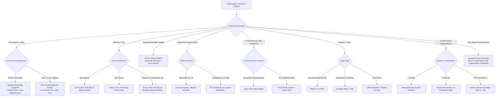

---

## Summary of Core Invariant Equations

| Pattern | Fundamental Equation / Condition | Complexity |
|---|---|---|
| **Smith's Rule** | $w_A \cdot p_B > w_B \cdot p_A \iff A \prec B$ | $O(N \log N)$ |
| **Activity Selection** | $r(g_i) \le r(o_i) \implies \text{Greedy Stays Ahead}$ | $O(N \log N)$ |
| **Partitioned Depletion** | $A_i + B_i > A_j + B_j$ (for negative deltas $B < 0$) | $O(N \log N)$ |
| **Interval Graph Coloring** | $\text{Min Rooms} = \max_{t} \|\mathcal{A}(t)\|$ | $O(N \log N)$ |
| **Potions Regret Invariant** | If $H < 0$: $H \leftarrow H - \min(\mathcal{H})$, pop $\min(\mathcal{H})$ | $O(N \log N)$ |
| **Median Minimization** | $\min_c \sum \|x_i - c\| \implies c = x_{N/2}$ | $O(N \log N)$ |
| **Chebyshev Rotation** | $\max(\|x_1 - x_2\|, \|y_1 - y_2\|) = \frac{1}{2}(\|u_1 - u_2\| + \|v_1 - v_2\|)$ | $O(1)$ |
| **WQS Recovery Formula** | $F(K) = \min_x (f(x) - \lambda^* \cdot \text{count}(x)) + K \cdot \lambda^*$ | $O(N \log V)$ |
| **Rado-Edmonds Greedy** | Greedy optimal $\iff (E, \mathcal{I})$ satisfies Matroid Augmentation Axiom | $O(N \log N + N \cdot T_{\text{oracle}})$ |
| **Bouton's Nim Theorem** | P-position (Second Player Win) $\iff \bigoplus_{i=1}^k x_i = 0$ | $O(K)$ |

---

## Complete Section Content Deep-Dives

<a id="topic-1"></a>

# Greedy Foundations, Proof Paradigms & The Exchange Argument

> **Section:** §19 Greedy Fundamentals & Invariants  
> **Phase:** Phase 1 — Range Queries & Sweeps  
> **Contest ROI:** S-tier | **Rating Range:** 1400–2400 | **Frequency:** Very Common  
> **Prerequisites:** Sorting algorithms, Strict Weak Ordering, Binary Search on Monotonic Predicates, Basic Dynamic Programming

---

## 1. Contest Payoff & Why It Matters

Greedy algorithms are among the most deceptive topics in competitive programming. At lower ratings (1200–1600), greedy problems appear intuitive; at candidate master and master levels (1900–2400+), intuition without formal proof is the single greatest cause of wrong answers, wasted time, and failed contest ratings.

Mastery of this domain grants three decisive contest advantages:
1. **The Exchange Argument Blueprint:** A rigorous, mechanical proof technique that eliminates guesswork and verifies whether a proposed sorting order is globally optimal in under 3 minutes.
2. **Failure Identification:** The ability to immediately identify *non-local dependencies* and *choice entanglement*, allowing you to abandon false greedy paths and pivot to Dynamic Programming, Matroids, or Network Flows before burning contest time.
3. **Greedy Feasibility Predicates:** Pairing greedy decision-making with binary search over the answer ($O(N \log V)$), converting complex constrained optimization into simple verification sweeps.

---

## 2. Theoretical Deep-Dive & Mathematical Mechanics

### Overview

A greedy algorithm constructs a solution step-by-step, making the locally optimal choice at each stage under the assumption that local optimality guarantees global optimality. For a greedy approach to yield an optimal solution, the problem structure must satisfy two fundamental mathematical pillars:
1. **Greedy Choice Property:** A globally optimal solution can be arrived at by making a locally optimal choice without needing to reconsider or backtrack.
2. **Optimal Substructure:** An optimal solution to the overall problem contains within it optimal solutions to its subproblems.

When these properties hold, problems exhibit a matroidal or polymatroidal geometry. When they fail—typically because a choice consumed resources that constrain future steps in a non-linear or non-additive manner—greedy degenerates into a heuristic, requiring DP, min-cost flow, or branch-and-bound.

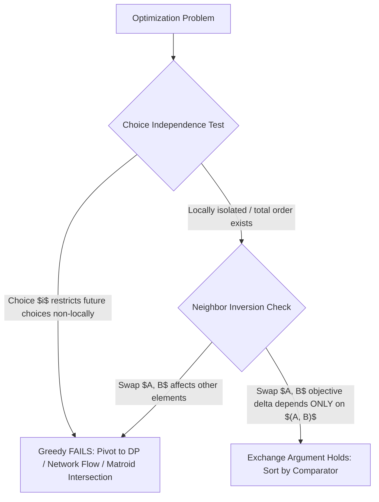

### Fundamental Theorems & Invariants

#### Theorem 1 (The Adjacent Exchange Theorem)
Let $S = (x_1, x_2, \dots, x_n)$ be an ordered sequence of elements forming a candidate solution, and let $f(S)$ be a scalar objective function. Suppose there exists a strict weak ordering $\prec$ such that for any adjacent inversion where $x_i \succ x_{i+1}$, swapping them strictly improves or maintains the objective:
$$f(\dots, x_{i+1}, x_i, \dots) \le f(\dots, x_i, x_{i+1}, \dots) \quad (\text{for minimization})$$
Then the sequence sorted according to $\prec$ is globally optimal.

*Proof Mechanism:* Any permutation can be transformed into the sorted permutation via a finite sequence of adjacent swaps (equivalent to Bubble Sort). If every swap of an inversion decreases (or maintains) the cost, the sorted sequence must have minimal cost.

#### Theorem 2 (Smith's Rule for Single-Machine Scheduling)
Given $n$ jobs, each with processing time $p_i > 0$ and weight $w_i > 0$, to be processed on a single machine without preemption. The completion time of job $i$ scheduled at position $k$ is $C_k = \sum_{j=1}^k p_{(j)}$. To minimize the sum of weighted completion times:
$$\min \sum_{k=1}^n w_{(k)} C_k$$
It is strictly optimal to process jobs in descending order of the ratio $\frac{w_i}{p_i}$ (or equivalently, ascending order of $\frac{p_i}{w_i}$).

### Algorithmic Execution Blueprint

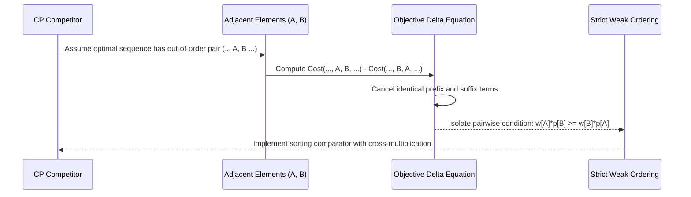

1. **Setup Adjacent Inversion:** Consider an arbitrary optimal permutation $P = (\dots, A, B, \dots)$ where $A$ immediately precedes $B$, but $A$ and $B$ violate the proposed sorting criterion.
2. **Compute Objective Delta:** Form the alternative permutation $P' = (\dots, B, A, \dots)$ by swapping $A$ and $B$.
3. **Cancel Invariant Invariants:** Elements preceding $A$ finish at the exact same times in both $P$ and $P'. Elements succeeding $B$ begin at $T_{\text{prefix}} + p_A + p_B$ in both configurations, so their completion times are completely unchanged.
4. **Isolate Local Delta:** The difference in objective $\Delta = \text{Cost}(P') - \text{Cost}(P)$ depends exclusively on $A$ and $B$. Solve $\Delta \le 0$ to derive the comparator.
5. **Enforce Strict Weak Ordering:** Verify irreflexivity ($x \not\prec x$), asymmetry, and transitivity ($x \prec y \land y \prec z \implies x \prec z$).

### Closed-Form Invariant Equations

For Smith's Rule:
$$\text{Cost}(A \text{ before } B) = w_A (T + p_A) + w_B (T + p_A + p_B)$$
$$\text{Cost}(B \text{ before } A) = w_B (T + p_B) + w_A (T + p_B + p_A)$$
Subtracting yields the local delta:
$$\Delta = \text{Cost}(A \text{ before } B) - \text{Cost}(B \text{ before } A) = w_B p_A - w_A p_B$$
To minimize cost, we require $\Delta \le 0 \iff w_B p_A \le w_A p_B \iff \frac{w_A}{p_A} \ge \frac{w_B}{p_B}$.

$$\text{Cross-Multiplication Comparator}: \quad A \prec B \iff w_A \cdot p_B > w_B \cdot p_A$$

### Structural Edge Cases & Assumptions

- **Zero Values:** If $p_i = 0$ or $w_i = 0$, floating-point division $\frac{w_i}{p_i}$ results in division-by-zero or precision degradation. Always use integer cross-multiplication $w_A p_B > w_B p_A$.
- **Strict Weak Ordering Violation:** If using `std::sort` in C++, returning `true` when two elements are equal causes undefined behavior (segmentation faults due to out-of-bounds pointer walk). Comparators must return `false` for identical elements ($a \not\prec a$).
- **Non-Local State Mutation:** If choosing $A$ alters the internal processing time or cost of remaining jobs non-additively (e.g. dependent job precedence graphs or nonlinear resource degradation), the pairwise exchange argument fails and requires Dynamic Programming on DAGs or Branch & Bound.

---

## 3. Core Intuition & Problem Framing

A helpful mental model for the exchange argument is **Bubble Sort Inversion Elimination**:
Imagine you claim a specific order $\pi^*$ is optimal. Suppose a skeptic hands you a distinct optimal order $\pi$. Because $\pi \neq \pi^*$, $\pi$ must contain at least one adjacent pair of elements $(A, B)$ where $A$ precedes $B$ in $\pi$ but $B$ precedes $A$ in $\pi^*$.
If you can prove that swapping this single adjacent pair $(A, B)$ cannot worsen the total score, you can repeatedly apply adjacent swaps—reducing the number of inversions by 1 each time—until $\pi$ transforms into your proposed $\pi^*$, with the total score never degrading. Thus, your proposed order is guaranteed to be optimal.

---

## 4. Proof Sketches & Recurrences

### Huffman Coding: "Deepen the Light, Shallow the Heavy"
Consider building an optimal prefix-free binary tree for symbols with frequencies $f_1 \le f_2 \le \dots \le f_n$. The cost is $\sum f_i \cdot d_i$, where $d_i$ is the depth of symbol $i$.
- *Lemma:* The two symbols with the lowest frequencies $f_1, f_2$ must be siblings at maximum depth in an optimal tree.
- *Proof:* If they are not at the maximum depth, let $x, y$ be siblings at maximum depth. Swapping $f_1$ with $x$ and $f_2$ with $y$ cannot increase the cost, because $(f_x - f_1)(d_x - d_1) \ge 0$.
- *Recurrence:* Merge $f_1$ and $f_2$ into a composite node with weight $f_1 + f_2$. By induction, the problem on $n$ symbols reduces to an optimal tree on $n - 1$ symbols. Total merge cost is maintained via a priority queue in $O(N \log N)$.

### When Greedy Fails: The Choice Independence Test
Consider the 0-1 Knapsack problem with capacity $W = 5$ and items:
- Item 1: Value $v_1 = 6$, Weight $w_1 = 2$ (Ratio $3.0$)
- Item 2: Value $v_2 = 10$, Weight $w_2 = 3$ (Ratio $3.33$)
- Item 3: Value $v_3 = 12$, Weight $w_3 = 4$ (Ratio $3.0$)

Greedy picks Item 2 (weight 3, value 10). Remaining capacity is 2, so it picks Item 1 (weight 2, value 6), achieving total value $16$.
However, if $W = 6$, items $(v=10, w=5)$ [ratio 2] and two items $(v=6, w=3)$ [ratio 2]: Greedy picks $(10, 5)$ leaving 1 capacity, total value 10, whereas the two items give $6 + 6 = 12$.
The reason greedy fails is that capacity is discrete and non-divisible: an item's choice consumes space in a non-substitutable way.

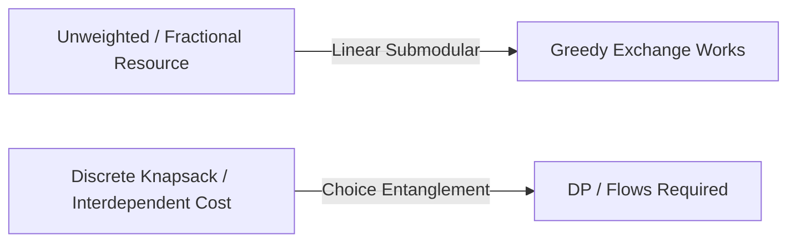

---

## 5. Contest-Ready Implementation Templates

### Operational Complexity Reference
- **Smith's Rule Sorting:** Time $O(N \log N)$, Space $O(N)$
- **Huffman / Merge Priority Queue:** Time $O(N \log N)$, Space $O(N)$
- **Binary Search on Greedy Predicate:** Time $O(N \log(\text{Range}))$, Space $O(1)$
- **DP Fallback (Weighted Interval Scheduling):** Time $O(N \log N)$, Space $O(N)$

---

### C++17 Implementation Template

```cpp
#include <bits/stdc++.h>
using namespace std;

namespace GreedyFoundations {

// 1. Smith's Rule for Weighted Completion Times
struct Job {
    int id;
    long long weight;
    long long time;
};

// Strict Weak Ordering via Cross-Multiplication
bool compareJobs(const Job& a, const Job& b) {
    long long lhs = a.weight * b.time;
    long long rhs = b.weight * a.time;
    if (lhs != rhs) {
        return lhs > rhs;
    }
    return a.id < b.id;
}

long long solveSmithRule(vector<Job>& jobs) {
    sort(jobs.begin(), jobs.end(), compareJobs);
    long long current_time = 0;
    long long total_weighted_time = 0;
    for (const auto& job : jobs) {
        current_time += job.time;
        total_weighted_time += job.weight * current_time;
    }
    return total_weighted_time;
}

// 2. Binary Search on Greedy Feasibility Predicate (e.g. Median Maximization)
long long maximizeMedian(vector<long long> a, long long k) {
    sort(a.begin(), a.end());
    int n = a.size();
    int mid = n / 2;

    auto check = [&](long long target) -> bool {
        long long ops_needed = 0;
        for (int i = mid; i < n; ++i) {
            if (a[i] < target) {
                ops_needed += (target - a[i]);
                if (ops_needed > k) return false;
            }
        }
        return ops_needed <= k;
    };

    long long low = a[mid], high = a[mid] + k, best = low;
    while (low <= high) {
        long long m = low + (high - low) / 2;
        if (check(m)) {
            best = m;
            low = m + 1;
        } else {
            high = m - 1;
        }
    }
    return best;
}

// 3. Fallback: Weighted Interval Scheduling via DP + Binary Search
struct Interval {
    long long start, end, weight;
};

long long solveWeightedIntervals(vector<Interval>& intervals) {
    sort(intervals.begin(), intervals.end(), [](const Interval& a, const Interval& b) {
        return a.end < b.end;
    });

    int n = intervals.size();
    vector<long long> end_times(n);
    for (int i = 0; i < n; ++i) end_times[i] = intervals[i].end;

    vector<long long> dp(n + 1, 0);
    for (int i = 1; i <= n; ++i) {
        long long skip = dp[i - 1];
        auto it = upper_bound(end_times.begin(), end_times.begin() + (i - 1), intervals[i - 1].start);
        int last_idx = distance(end_times.begin(), it);
        long long take = intervals[i - 1].weight + dp[last_idx];
        dp[i] = max(skip, take);
    }
    return dp[n];
}

} // namespace GreedyFoundations
```

---

### Python 3 Implementation Template

```python
import sys
from functools import cmp_to_key
from bisect import bisect_right
import heapq

# 1. Smith's Rule with Cross-Multiplication
class Job:
    __slots__ = ("id", "weight", "time")
    def __init__(self, id_: int, weight: int, time: int):
        self.id = id_
        self.weight = weight
        self.time = time

def solve_smith_rule(jobs: list[Job]) -> int:
    def compare(a: Job, b: Job) -> int:
        lhs = a.weight * b.time
        rhs = b.weight * a.time
        if lhs > rhs:
            return -1
        elif lhs < rhs:
            return 1
        return -1 if a.id < b.id else (1 if a.id > b.id else 0)

    jobs.sort(key=cmp_to_key(compare))
    curr_time = 0
    total_weighted_time = 0
    for j in jobs:
        curr_time += j.time
        total_weighted_time += j.weight * curr_time
    return total_weighted_time

# 2. Binary Search on Greedy Feasibility Predicate (Median Maximization)
def maximize_median(a: list[int], k: int) -> int:
    a.sort()
    n = len(a)
    mid = n // 2
    relevant = a[mid:]

    def check(target: int) -> bool:
        ops = 0
        for val in relevant:
            if val < target:
                ops += target - val
                if ops > k:
                    return False
        return ops <= k

    low = a[mid]
    high = a[mid] + k
    ans = low
    while low <= high:
        m = (low + high) // 2
        if check(m):
            ans = m
            low = m + 1
        else:
            high = m - 1
    return ans

# 3. Huffman Merge Cost Pattern (Stick Merging)
def huffman_merge_cost(weights: list[int]) -> int:
    heapq.heapify(weights)
    total_cost = 0
    while len(weights) > 1:
        w1 = heapq.heappop(weights)
        w2 = heapq.heappop(weights)
        cost = w1 + w2
        total_cost += cost
        heapq.heappush(weights, cost)
    return total_cost

# 4. Fallback: Weighted Interval Scheduling DP
def solve_weighted_intervals(intervals: list[tuple[int, int, int]]) -> int:
    intervals.sort(key=lambda x: x[1])
    n = len(intervals)
    ends = [inv[1] for inv in intervals]
    dp = [0] * (n + 1)

    for i in range(1, n + 1):
        s_i, e_i, w_i = intervals[i - 1]
        skip = dp[i - 1]
        j = bisect_right(ends, s_i, 0, i - 1)
        take = w_i + dp[j]
        dp[i] = max(skip, take)
    return dp[n]
```

---

## 6. Recognition Trigger Signals & Heuristics

1. **Permutation / Ordering Optimization:** If the problem asks for an ordering of $N$ items to minimize cumulative sum or bottleneck delay, immediate trigger: **Adjacent Exchange Argument**.
2. **Ratio Comparisons:** If items have two competing scalar parameters (e.g., gain vs loss, weight vs time, probability vs cost), formulate the swap equation; it will almost always yield a ratio condition ($w_i / p_i$).
3. **Threshold / Feasibility Monotonicity:** If the query is "maximize minimum $X$" or "minimize operations to reach threshold", decouple the decision by binary searching on $X$ and verifying via a single greedy pass.
4. **Greedy Traps:** If elements have weights and cannot be freely reordered (e.g. general subsegment sums, non-divisible knapsack), abort greedy and build a DP table.

---

## 7. Contest WA / TLE / RE Traps

- **Floating Point Comparator Error:** Doing `return (double)w1/p1 > (double)w2/p2` loses precision on 64-bit integers and causes false sortings. Always cross-multiply: `w1 * p2 > w2 * p1`.
- **Strict Weak Ordering RE:** In C++ `std::sort`, writing `return a.val >= b.val` violates `cmp(x, x) == false`. This leads to out-of-bounds memory corruption and runtime errors on large inputs.
- **Ignoring Transitivity:** If $A \prec B$ and $B \prec C$ does not imply $A \prec C$, the comparator is invalid and `std::sort` will produce an arbitrary sequence. Always verify cycle-freedom.
- **Premature Greedy in Weighted Problems:** Assuming unweighted greedy interval scheduling (sort by end time) works for weighted intervals. It fails completely; weighted intervals require DP ($O(N \log N)$).

---

## 8. Curated Practice Problem Bank

| Platform | ID | Problem Name | Rating | Tags | Key Strategic Insight | Link |
|---|---|---|---|---|---|---|
| Codeforces | CF-1203E | Boxers | 1200 | Greedy, Sorting | Process elements ascending; greedily move each boxer to $x-1$, then $x$, then $x+1$. | [Solve Problem](https://codeforces.com/contest/1203/problem/E) |
| Codeforces | CF-1201C | Maximum Median | 1400 | Binary Search, Greedy | Sort array; binary search on target median; verify greedy cost on upper half. | [Solve Problem](https://codeforces.com/contest/1201/problem/C) |
| Codeforces | CF-1157C2 | Increasing Subsequence | 1700 | Two Pointers, Greedy | Two-pointer greedy pick; on tie, compute strictly longer run on both sides. | [Solve Problem](https://codeforces.com/contest/1157/problem/C2) |
| Codeforces | CF-1526C2 | Potions (Hard Version) | 1600 | Regret Heap, Greedy | Optimistically drink potion; if health drops $< 0$, refund the most toxic potion. | [Solve Problem](https://codeforces.com/contest/1526/problem/C2) |
| CSES | CSES-1629 | Movie Festival | 1200 | Greedy, Intervals | Sort by ending time; select next non-overlapping interval (Greedy Stays Ahead). | [Solve Problem](https://cses.fi/problemset/task/1629) |
| AtCoder | ABC-131D | Megalomania | 1300 | Exchange Argument | Sort jobs by deadline ascending (Smith's rule variant for feasibility). | [Solve Problem](https://atcoder.jp/contests/abc131/tasks/abc131_d) |

---

## 9. External Theory & Deep-Dive References

- **[Codeforces Tutorial]** [Errichto: Greedy Exchange Arguments & Sorting Criteria](https://codeforces.com/blog/entry/66734)
- **[Algorithm Design (Kleinberg & Tardos)]** Chapter 4: Greedy Algorithms (Interval Scheduling, Stays-Ahead, Exchange Arguments)
- **[USACO Guide]** [Silver: Introduction to Greedy Sorting](https://usaco.guide/silver/greedy-sorting)

---

## 10. Algorithmic Variants & Advanced Extensions

- **Two-Dimensional Tie-Breaking:** When ratio comparisons yield equality ($w_i p_j = w_j p_i$), introduce a strict tie-breaker (e.g. index $i < j$ or secondary parameter) to maintain determinism.
- **Multi-Machine Dispatching:** For $M > 1$ machines, simple ratio sorting does not yield exact optimality (NP-hard partition problem), but yields 4/3-approximation algorithms (Graham's List Scheduling / LPT).
- **Greedy with Oracle Lookahead:** Using a dynamic data structure (Segment Tree or Fenwick Tree) as an oracle to evaluate greedy step feasibility in $O(\log N)$ time.

---

## 11. Typical Problem Archetypes

1. **The Single-Resource Scheduler:** $N$ tasks competing for a single processor with varying durations, deadlines, and penalties. Apply adjacent exchange to find the invariant sorting metric.
2. **Bottleneck Capacity Maximizer:** Maximizing minimum survival time or fuel across an expedition. Sort candidate resources by consumption rate or threshold.
3. **Lexicographical String / Array Reconstruction:** Building the smallest sequence subject to frequency or reachability constraints.

---

## 12. Recognition & Identification Drills

1. *Scenario:* You are given $N$ files of size $S_i$. Compressing two files of sizes $A$ and $B$ takes time $A + B$ and produces a file of size $A + B$.  
   *Diagnosis:* Huffman Merge Pattern. Min-heap, repeatedly combine two smallest ($O(N \log N)$).
2. *Scenario:* You are given $N$ quests. Quest $i$ requires $R_i$ experience to attempt and grants $G_i$ experience.  
   *Diagnosis:* Partitioned exchange argument. Partition into $G_i \ge 0$ (sort by requirement $R_i$) and $G_i < 0$ (sort by $R_i + G_i$ descending).
3. *Scenario:* You need to select intervals to maximize total weight, where intervals overlap arbitrarily and weights are positive integers.  
   *Diagnosis:* Greedy fails due to non-uniform weights. Use Weighted Interval Scheduling DP ($O(N \log N)$).

---

## 13. Fast-Lookup Cheat Sheet

- **Exchange Argument Step:** Compare $(\dots, A, B, \dots)$ vs $(\dots, B, A, \dots)$. Cross-multiply, cancel common terms, isolate comparator.
- **Strict Weak Ordering Rule:** `cmp(a, a)` MUST evaluate to `false`. Always use strict inequality (`<` or `>`), never `<=` or `>=`.
- **Smith's Rule:** Minimize $\sum w_i C_i \implies$ sort by $\frac{w_i}{p_i}$ descending $\implies w_A p_B > w_B p_A$.
- **Median Maximizer:** Binary search the answer $X \in [A_{\min}, A_{\max} + K]$; greedy check takes $O(N)$ by summing $\max(0, X - A_i)$.


---

<a id="topic-2"></a>

# Interval Scheduling, Coverage & Lexicographical Greedy

> **Section:** §19 Greedy Fundamentals & Invariants  
> **Phase:** Phase 1 — Range Queries & Sweeps  
> **Contest ROI:** S-tier | **Rating Range:** 1300–2100 | **Frequency:** Very Common  
> **Prerequisites:** Sorting by multiple keys, Two-pointer techniques, String hashing basics

---

## 1. Contest Payoff & Why It Matters

Interval problems and lexicographical greedy optimizations are recurring patterns on Codeforces (Div. 2 C/D, Div. 1 A) and ICPC regionals.
Mastery provides:
1. **The "Greedy Stays Ahead" Proof Paradigm:** A structural inductive argument that guarantees correctness without brute-force search.
2. **Three Canonical Interval Archetypes:** Instant identification between *Disjoint Selection* (sort by end time), *Interval Piercing* (sort by end time), and *Segment Coverage* (sort by start time, maximize reach).
3. **Tie-Breaking Acceleration:** Resolving lexicographical ambiguity using two-pointer scans and rolling hashes, reducing $O(N^2)$ naive string comparisons to $O(N \log N)$ or $O(N)$.

---

## 2. Theoretical Deep-Dive & Mathematical Mechanics

### Overview

In interval optimization, we are given a set of $N$ intervals $\mathcal{I} = \{[l_i, r_i]\}_{i=1}^N$. We classify interval problems into three fundamental archetypes based on their objective and sorting direction:

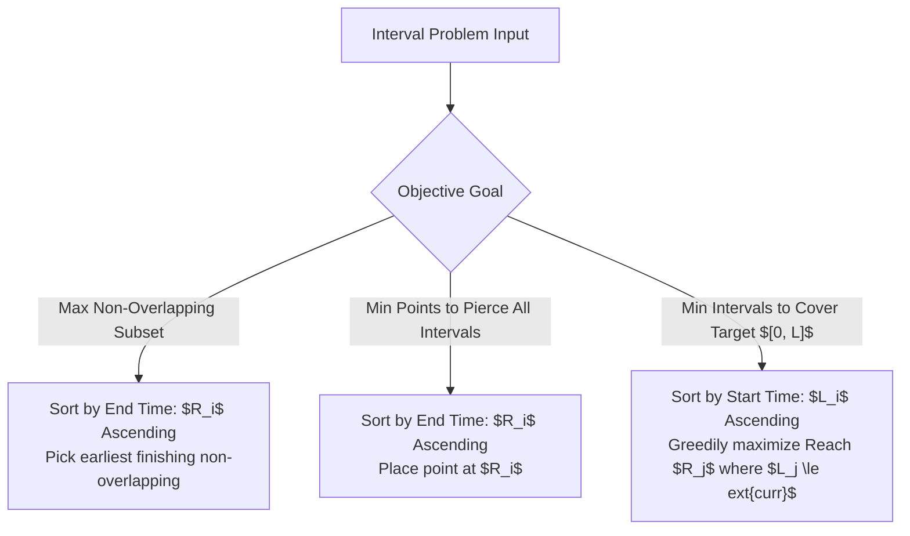

### Fundamental Theorems & Invariants

#### Theorem 1 (Greedy Stays Ahead for Interval Scheduling)
Let $G = (g_1, g_2, \dots, g_k)$ be the sequence of intervals selected by the earliest-finish-time greedy algorithm, sorted such that $r(g_1) \le r(g_2) \le \dots \le r(g_k)$. Let $O = (o_1, o_2, \dots, o_m)$ be any valid non-overlapping set of intervals sorted by start time.
Then for all $1 \le i \le k$, we have:
$$r(g_i) \le r(o_i)$$
Consequently, $k \ge m$, meaning the greedy solution is globally optimal.

*Proof by Induction:*
- **Base Case ($i = 1$):** By definition, the greedy algorithm selects an interval with the minimal finishing time among all available candidates. Hence, $r(g_1) \le r(o_1)$.
- **Inductive Step:** Assume $r(g_{i-1}) \le r(o_{i-1})$. Since $O$ is a disjoint set, $l(o_i) \ge r(o_{i-1})$.
  Because $r(g_{i-1}) \le r(o_{i-1})$, it follows that $l(o_i) \ge r(g_{i-1})$.
  Thus, interval $o_i$ was a valid candidate available to the greedy algorithm when selecting $g_i$.
  Since greedy chose $g_i$ to minimize finishing time among all available candidates, $r(g_i) \le r(o_i)$.
- **Conclusion:** If $m > k$, interval $o_{k+1}$ would be validly available after $g_k$, allowing greedy to select at least $k + 1$ intervals, a contradiction. Hence $k = m$.

#### Theorem 2 (Segment Coverage Invariant)
To cover a continuous target interval $[0, L]$ with the minimum number of intervals:
Given current covered prefix $[0, 	ext{curr}]$, all available intervals with $l_i \le 	ext{curr}$ can extend the coverage. To minimize the total interval count, the optimal choice is strictly the candidate that maximizes $r_i$.

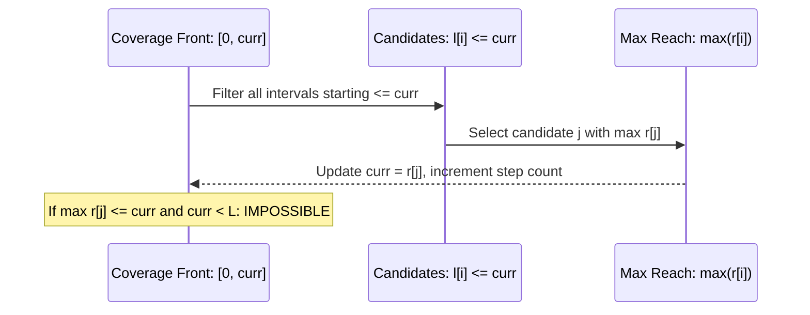

---

## 3. Core Intuition & Problem Framing

### Lexicographical Greedy & The Reachability Test
When building a sequence of characters or numbers to be **lexicographically smallest**, the greedy rule is:
> At each step, choose the smallest possible value that still permits a valid completion.

If there is a tie between choosing from two endpoints (e.g. deque or string reversal problems like *Best Cow Line*), comparing only the immediate characters is insufficient. If $S[	ext{left}] == S[	ext{right}]$, look ahead into the string: compare the substring starting at `left` with the reversed substring ending at `right`. The side whose forward run is lexicographically smaller should be consumed first.

---

## 4. Proof Sketches & Recurrences

### Minimum Interval Piercing Points
Given $N$ intervals, find the minimum number of points such that every interval contains at least one point.
- **Algorithm:** Sort intervals by right endpoint $r_i$ ascending.
- **Greedy Choice:** Place a point at $p = r_1$. Discard all intervals that contain $p$ (i.e. all $j$ where $l_j \le p \le r_j$). Repeat on the remaining intervals.
- **Proof:** Interval 1 must be covered. To cover interval 1 while maximizing the probability of covering other intervals, the point must be placed as far right as possible within interval 1, which is exactly $r_1$. Any point $x < r_1$ covers a subset of intervals covered by $r_1$ that begin before $x$. Therefore, placing at $r_1$ is strictly dominant.

---

## 5. Contest-Ready Implementation Templates

### Operational Complexity Reference
- **Interval Scheduling (Max Disjoint):** Time $O(N \log N)$, Space $O(N)$
- **Continuous Segment Coverage $[0, L]$:** Time $O(N \log N)$, Space $O(1)$ auxiliary
- **Lexicographical String (Two-Pointer):** Time $O(N^2)$ direct slicing, $O(N)$ with Rolling Hash / Suffix Array

---

### C++17 Implementation Template

```cpp
#include <bits/stdc++.h>
using namespace std;

namespace IntervalAndLexicographical {

struct Interval {
    long long l, r;
    int id;
};

// 1. Maximum Disjoint Intervals (Activity Selection)
int maxDisjointIntervals(vector<Interval>& intervals) {
    sort(intervals.begin(), intervals.end(), [](const Interval& a, const Interval& b) {
        if (a.r != b.r) return a.r < b.r;
        return a.l < b.l;
    });

    int count = 0;
    long long last_end = -4e18;

    for (const auto& inv : intervals) {
        if (inv.l >= last_end) {
            count++;
            last_end = inv.r;
        }
    }
    return count;
}

// 2. Minimum Intervals to Cover Target Range [0, L]
int minIntervalsToCover(vector<Interval>& intervals, long long L) {
    sort(intervals.begin(), intervals.end(), [](const Interval& a, const Interval& b) {
        if (a.l != b.l) return a.l < b.l;
        return a.r > b.r;
    });

    int n = intervals.size();
    long long curr_reach = 0;
    int count = 0;
    int i = 0;

    while (curr_reach < L) {
        long long best_reach = curr_reach;
        while (i < n && intervals[i].l <= curr_reach) {
            best_reach = max(best_reach, intervals[i].r);
            i++;
        }

        if (best_reach == curr_reach) {
            return -1;
        }

        curr_reach = best_reach;
        count++;
    }
    return count;
}

// 3. Lexicographically Smallest Sequence with Lookahead (Best Cow Line pattern)
string lexicographicallySmallestString(const string& s) {
    int n = s.size();
    int left = 0, right = n - 1;
    string result = "";
    result.reserve(n);

    while (left <= right) {
        bool choose_left = false;
        for (int i = 0; left + i <= right - i; ++i) {
            if (s[left + i] < s[right - i]) {
                choose_left = true;
                break;
            } else if (s[left + i] > s[right - i]) {
                choose_left = false;
                break;
            }
        }

        if (choose_left) {
            result.push_back(s[left++]);
        } else {
            result.push_back(s[right--]);
        }
    }
    return result;
}

} // namespace IntervalAndLexicographical
```

---

### Python 3 Implementation Template

```python
import sys

# 1. Maximum Disjoint Intervals
def max_disjoint_intervals(intervals: list[tuple[int, int]]) -> int:
    intervals.sort(key=lambda x: x[1])
    count = 0
    last_end = -float('inf')
    
    for start, end in intervals:
        if start >= last_end:
            count += 1
            last_end = end
    return count

# 2. Continuous Segment Coverage [0, L]
def min_intervals_to_cover(intervals: list[tuple[int, int]], L: int) -> int:
    intervals.sort(key=lambda x: (x[0], -x[1]))
    n = len(intervals)
    curr_reach = 0
    count = 0
    i = 0
    
    while curr_reach < L:
        best_reach = curr_reach
        while i < n and intervals[i][0] <= curr_reach:
            if intervals[i][1] > best_reach:
                best_reach = intervals[i][1]
            i += 1
            
        if best_reach == curr_reach:
            return -1
            
        curr_reach = best_reach
        count += 1
        
    return count

# 3. Lexicographical Greedy with Tie-Breaker Lookahead
def solve_best_cow_line(s: str) -> str:
    left = 0
    right = len(s) - 1
    res = []
    
    while left <= right:
        if s[left:right+1] <= s[left:right+1][::-1]:
            res.append(s[left])
            left += 1
        else:
            res.append(s[right])
            right -= 1
            
    return "".join(res)
```

---

## 6. Recognition Trigger Signals & Heuristics

1. **"Select maximum number of non-overlapping events":** Sort by right endpoint ($r_i$ ascending). Greedy Stays Ahead holds.
2. **"Find minimum number of sensors / guards to cover all intervals":** Sort by right endpoint ($r_i$ ascending). Place sensor at $r_i$.
3. **"Completely tile / cover segment $[A, B]$ with minimum resources":** Sort by left endpoint ($l_i$ ascending). Greedily pick the maximum right reach among available intervals starting $\le 	ext{curr}$.
4. **"Construct lexicographically smallest permutation or string":** At each index, pick the smallest available candidate that maintains validity. If symmetry or two-pointer choice occurs, use forward lookahead or tie-breaker comparisons.

---

## 7. Contest WA / TLE / RE Traps

- **Sorting by Left Endpoint in Activity Selection:** Classic bug is sorting disjoint intervals by $l_i$ ascending. Counterexample: `[1, 100], [2, 3], [4, 5]`. Always sort by $r_i$ ascending.
- **Strict vs Non-Strict Overlap:** Check whether touching endpoints are permitted: `start >= last_end` vs `start > last_end`.
- **Segment Coverage Gap Detection:** Forgetting to check `best_reach == curr_reach` leads to infinite loops when reaching $L$ is impossible.
- **$O(N^2)$ Slicing TLE in Python:** For $N > 10^5$, slicing causes TLE. Use Double Hashing with binary search on LCP to compare substrings in $O(\log N)$ time.

---

## 8. Curated Practice Problem Bank

| Platform | ID | Problem Name | Rating | Tags | Key Strategic Insight | Link |
|---|---|---|---|---|---|---|
| CSES | CSES-1629 | Movie Festival | 1200 | Greedy, Intervals | Classic maximum disjoint intervals. Sort by finish time. | [Solve Problem](https://cses.fi/problemset/task/1629) |
| Codeforces | CF-1029B | Creating the Contest | 1200 | Greedy, Two Pointers | Maintain longest valid run satisfying $a[i] \le 2 \cdot a[i-1]$. | [Solve Problem](https://codeforces.com/contest/1029/problem/B) |
| USACO | USACO-363 | Best Cow Line | 1500 | Greedy, Two Pointers | Lexicographical two-pointer with lookahead tie-breaking. | [Solve Problem](https://usaco.org/index.php?page=viewproblem2&cpid=363) |
| Codeforces | CF-1157C2 | Increasing Subsequence (hard) | 1700 | Greedy, Deque | Greedy pick smaller end; if tied, simulate max run on both sides. | [Solve Problem](https://codeforces.com/contest/1157/problem/C2) |
| Codeforces | CF-1249D2 | Too Many Segments (hard) | 1900 | Greedy, Sweep Line | Sweep left to right. When overlap $> K$, greedily drop interval with max $R$. | [Solve Problem](https://codeforces.com/contest/1249/problem/D2) |
| AtCoder | ABC-214E | Packing Under Range Regulations | 2000 | Greedy, Priority Queue | Intervals as slots: sweep coordinates, greedily pick interval with smallest $R_i$. | [Solve Problem](https://atcoder.jp/contests/abc214/tasks/abc214_e) |

---

## 9. External Theory & Deep-Dive References

- **[USACO Guide]** [Silver: Greedy Algorithms with Sorting](https://usaco.guide/silver/greedy-sorting)
- **[Introduction to Algorithms (CLRS)]** Chapter 16.1: An activity-selection problem
- **[CP-Algorithms]** [Schedule events with minimum resource usage](https://cp-algorithms.com/)

---

## 10. Algorithmic Variants & Advanced Extensions

- **$K$-Capacity Interval Scheduling:** Assigning intervals to $K$ machines using priority queue of ending times.
- **Dropping Excess Overlaps (CF 1249D2):** When at most $K$ intervals can cover any coordinate, sweep and drop the interval with maximum $R$ upon violation.

---

## 11. Typical Problem Archetypes

1. **Activity Selection:** Maximize mutually compatible tasks on 1 machine $\implies$ sort by $R_i$.
2. **Point Piercing / Dart Board:** Pierce all target segments with minimum arrows $\implies$ sort by $R_i$, shoot at $R_i$.
3. **Bridge / Coverage Construction:** Cover road $[0, L]$ with minimum street lights $\implies$ sort by $L_i$, maximize $R_i$ reach.
4. **Lexicographical Deque Drainage:** Drain elements from left or right to make output string smallest $\implies$ lookahead string comparison.

---

## 12. Recognition & Identification Drills

1. *Scenario:* You are given $N$ intervals. You must select the minimum number of intervals such that every integer from $1$ to $M$ is covered.  
   *Diagnosis:* Continuous Segment Coverage. Sort by $L_i$ ascending; greedily maximize $R_i$ among reachable intervals.
2. *Scenario:* You have $N$ meetings. What is the minimum number of conference rooms needed so that no two meetings overlap in the same room?  
   *Diagnosis:* Interval Coloring / Sweep Line. Min-heap of ending times.
3. *Scenario:* A string $S$ is given. You can delete at most $K$ digits to make the resulting number as small as possible.  
   *Diagnosis:* Monotonic stack lexicographical greedy.

---

## 13. Fast-Lookup Cheat Sheet

- **Max Disjoint Intervals:** Sort by $R_i$ ascending. Iterate; if $L_i \ge 	ext{last\_}R$, pick and set $	ext{last\_}R = R_i$.
- **Min Piercing Points:** Sort by $R_i$ ascending. Place point at $R_i$; skip all subsequent intervals where $L_j \le R_i$.
- **Min Coverage of $[0, L]$:** Sort by $L_i$ ascending. While $	ext{reach} < L$, find $\max R_j$ among all $L_j \le 	ext{reach}$. If $\max R_j \le 	ext{reach}$, abort.
- **Lexicographical Tie:** If $S[	ext{left}] == S[	ext{right}]$, compare forward string with reverse string.


---

<a id="topic-3"></a>

# Sorting Criteria, Custom Comparators & Partitioned Greedy

> **Section:** §19 Greedy Fundamentals & Invariants  
> **Phase:** Phase 1 — Range Queries & Sweeps  
> **Contest ROI:** S-tier | **Rating Range:** 1500–2300 | **Frequency:** Common  
> **Prerequisites:** Exchange arguments, Strict Weak Ordering, `std::sort` comparator mechanics, `functools.cmp_to_key`

---

## 1. Contest Payoff & Why It Matters

In competitive programming, many greedy problems cannot be solved by simply sorting by a single obvious attribute like weight or deadline. Instead, the optimal ordering is dictated by an algebraic interaction between multiple parameters (e.g. $A_i \cdot B_j - A_j \cdot B_i$), or requires **partitioning elements into distinct directional regimes** before sorting each regime with completely different criteria.

Mastering this topic guarantees:
1. **Deriving Non-Trivial Comparators:** Solving complex multi-variable ordering problems mechanically via algebraic neighbor swaps.
2. **The Two-Phase Partition Paradigm:** Conquering resource-accumulation problems (like the RPG "Monster Problem") where items either grant net profit or net loss, recognizing why single-comparator sorting fails mathematically.
3. **Robust Transitivity Hygiene:** Eliminating insidious runtime errors (`SIGSEGV` in C++) caused by non-transitive or non-strict comparators.

---

## 2. Theoretical Deep-Dive & Mathematical Mechanics

### Overview

When an ordering $\pi$ of $N$ items dictates the final score or feasibility, we evaluate the cost difference between adjacent elements $i$ and $j$. If the condition for $i$ to precede $j$ depends *only* on the parameters of $i$ and $j$ and forms a strict weak order, the problem can be solved in $O(N \log N)$ by sorting.

However, if the system undergoes a regime change—such as a player's resource pool transitioning from monotonically growing to monotonically shrinking—a single total order does not exist across the entire set. In such cases, the universe of items must be partitioned into disjoint subsets, each governed by its own independent sorting invariant.

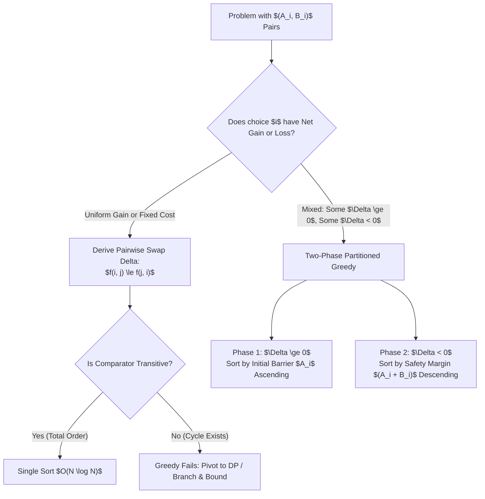

### Fundamental Theorems & Invariants

#### Theorem 1 (The Concatenation Comparator & Transitivity)
Given strings $S_1, S_2, \dots, S_n$, we wish to concatenate them to form the lexicographically largest (or smallest) string.
Define the binary relation $\prec$ by:
$$S_i \prec S_j \iff S_i + S_j < S_j + S_i$$
Then $\prec$ is a strict weak ordering (specifically, it is irreflexive, asymmetric, and transitive). Sorting strings under $\prec$ yields the globally optimal concatenation.

*Proof of Transitivity:*
Let strings be interpreted as numbers in base $B$ with lengths $|x|, |y|, |z|$.
Then $x + y$ corresponds to $x \cdot B^{|y|} + y$.
The relation $x + y > y + x$ is equivalent to:
$$x \cdot B^{|y|} + y > y \cdot B^{|x|} + x \iff x(B^{|y|} - 1) > y(B^{|x|} - 1) \iff rac{x}{B^{|x|} - 1} > rac{y}{B^{|y|} - 1}$$
Because each string maps to a real scalar value $\phi(x) = rac{x}{B^{|x|} - 1}$, the relation is a total ordering induced by standard inequality on real numbers. Transitivity holds unconditionally.

#### Theorem 2 (The Two-Phase Resource Partition Principle)
In a resource survival problem, an agent starts with health $H$. Encountering task $i$ requires minimum health $A_i$ and applies delta $B_i$ (so $H \ge A_i$ is required, and after completion $H \leftarrow H + B_i$).
To determine if all tasks can be completed:
1. Partition tasks into two sets:
   $$\mathcal{P}^+ = \{i \mid B_i \ge 0\}, \quad \mathcal{P}^- = \{i \mid B_i < 0\}$$
2. **Phase 1 ($\mathcal{P}^+$):** Process all tasks in $\mathcal{P}^+$ before any task in $\mathcal{P}^-$. Within $\mathcal{P}^+$, sort in ascending order of required barrier $A_i$:
   $$i \prec j \iff A_i < A_j$$
3. **Phase 2 ($\mathcal{P}^-$):** Within $\mathcal{P}^-$, sort in descending order of $A_i + B_i$:
   $$i \prec j \iff A_i + B_i > A_j + B_j$$

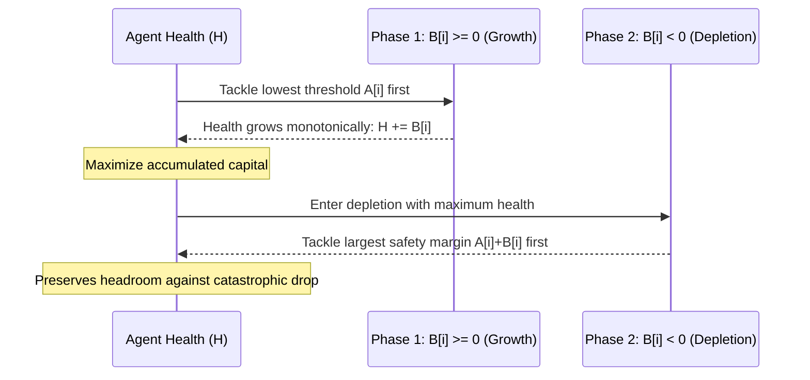

*Proof for Phase 1:*
In $\mathcal{P}^+$, every completed task increases or maintains health ($B_i \ge 0$). Completing task $i$ only makes it easier to complete subsequent tasks. To unlock tasks that require higher barriers, we should greedily complete the task with the lowest requirement $A_i$ first.

*Proof for Phase 2:*
In $\mathcal{P}^-$, every completed task decreases health ($B_i < 0$). Consider two adjacent tasks $i$ and $j$.
If we execute $i$ then $j$, the initial health $H$ before these two tasks must satisfy:
$$H \ge A_i \quad 	ext{and} \quad H + B_i \ge A_j \iff H \ge \max(A_i, A_j - B_i)$$
If we execute $j$ then $i$, the requirement is:
$$H \ge \max(A_j, A_i - B_j)$$
We prefer $i$ then $j$ if and only if:
$$\max(A_i, A_j - B_i) \le \max(A_j, A_i - B_j)$$
Adding $B_i + B_j$ (which is negative) and simplifying:
Since $B_i < 0$, $A_j - B_i > A_j$. Thus the condition simplifies to:
$$A_j - B_i \le A_i - B_j \iff A_j + B_j \le A_i + B_i \iff A_i + B_i \ge A_j + B_j$$
Thus, sorting descending by $A_i + B_i$ strictly minimizes the necessary health at every adjacent step.

---

## 3. Core Intuition & Problem Framing

### Why One Sort Fails
Why can we not merge $\mathcal{P}^+$ and $\mathcal{P}^-$ into a single comparator?
Consider the condition $\max(A_i, A_j - B_i) \le \max(A_j, A_i - B_j)$.
- When $B_i \ge 0$ and $B_j < 0$: $A_i$ is relatively small, while $A_j - B_i$ is much larger because $B_i \ge 0$ while $-B_j > 0$.
The relation between a positive-delta item and a negative-delta item depends on the absolute value of $H$, not just the pairwise attributes! A positive-delta item should **always** be performed before a negative-delta item because positive items expand the reachable set, whereas negative items shrink it. Mixing them into `std::sort` violates transitivity, leading to cycles: $X \prec Y$, $Y \prec Z$, but $Z \prec X$.

---

## 4. Proof Sketches & Recurrences

### The Cross-Multiplication Algebra
When minimizing $\sum C_i$ with cost function interaction:
$$	ext{Cost}(i 	ext{ then } j) = lpha_i + eta_i \cdot \gamma_j$$
$$	ext{Cost}(j 	ext{ then } i) = lpha_j + eta_j \cdot \gamma_i$$
The adjacent exchange delta is:
$$\Delta = (lpha_i + eta_i \cdot \gamma_j) - (lpha_j + eta_j \cdot \gamma_i)$$
If $lpha_i = lpha_j$, we isolate $eta_i \cdot \gamma_j \le eta_j \cdot \gamma_i \iff rac{eta_i}{\gamma_i} \le rac{eta_j}{\gamma_j}$.
Always compute the sorting key using cross-multiplication:
`lhs = beta[i] * gamma[j]`, `rhs = beta[j] * gamma[i]`.

---

## 5. Contest-Ready Implementation Templates

### Operational Complexity Reference
- **Concatenation Sorting:** Time $O(N \log N \cdot L)$, Space $O(N \cdot L)$ where $L$ is max string length.
- **Two-Phase Partitioned Greedy:** Time $O(N \log N)$, Space $O(N)$ auxiliary.
- **Custom Comparator via Cross-Multiplication:** Time $O(N \log N)$, Space $O(1)$ auxiliary.

---

### C++17 Implementation Template

```cpp
#include <bits/stdc++.h>
using namespace std;

namespace CustomComparatorsAndPartition {

// 1. Concatenation Sorting ("Largest Number")
string largestConcatenatedNumber(vector<string>& nums) {
    sort(nums.begin(), nums.end(), [](const string& a, const string& b) {
        return a + b > b + a;
    });

    if (nums.empty() || nums[0] == "0") return "0";

    string result = "";
    for (const auto& s : nums) result += s;
    return result;
}

// 2. Two-Phase Partitioned Greedy (The Monster / RPG Problem)
struct Quest {
    int id;
    long long req;  // A_i: Health required to attempt
    long long gain; // B_i: Net health delta (can be negative)
};

bool solveMonsterGame(vector<Quest>& quests, long long initial_health) {
    vector<Quest> pos;
    vector<Quest> neg;

    for (const auto& q : quests) {
        if (q.gain >= 0) {
            pos.push_back(q);
        } else {
            neg.push_back(q);
        }
    }

    // Phase 1: Net positive gain. Sort by requirement ascending.
    sort(pos.begin(), pos.end(), [](const Quest& a, const Quest& b) {
        if (a.req != b.req) return a.req < b.req;
        return a.gain > b.gain;
    });

    // Phase 2: Net negative gain. Sort by (req + gain) descending.
    sort(neg.begin(), neg.end(), [](const Quest& a, const Quest& b) {
        long long sum_a = a.req + a.gain;
        long long sum_b = b.req + b.gain;
        if (sum_a != sum_b) return sum_a > sum_b;
        return a.req > b.req;
    });

    long long current_health = initial_health;

    for (const auto& q : pos) {
        if (current_health < q.req) return false;
        current_health += q.gain;
    }

    for (const auto& q : neg) {
        if (current_health < q.req) return false;
        current_health += q.gain;
        if (current_health < 0) return false;
    }

    return true;
}

// 3. Generic Cross-Multiplication Ratio Comparator
struct Item {
    long long x, y;
};

void sortItemsByCrossMultiplication(vector<Item>& items) {
    sort(items.begin(), items.end(), [](const Item& a, const Item& b) {
        long long lhs = a.x * b.y;
        long long rhs = b.x * a.y;
        return lhs < rhs;
    });
}

} // namespace CustomComparatorsAndPartition
```

---

### Python 3 Implementation Template

```python
import sys
from functools import cmp_to_key

# 1. Concatenation Sorting ("Largest Number")
def largest_number(nums: list[int]) -> str:
    str_nums = [str(x) for x in nums]
    
    def compare(a: str, b: str) -> int:
        if a + b > b + a:
            return -1
        elif a + b < b + a:
            return 1
        return 0
        
    str_nums.sort(key=cmp_to_key(compare))
    result = "".join(str_nums)
    return "0" if result[0] == "0" else result

# 2. Two-Phase Partitioned Greedy (RPG Quests)
class Quest:
    __slots__ = ("req", "gain", "id")
    def __init__(self, req: int, gain: int, id_: int):
        self.req = req
        self.gain = gain
        self.id = id_

def solve_monster_game(quests: list[Quest], initial_health: int) -> bool:
    pos = [q for q in quests if q.gain >= 0]
    neg = [q for q in quests if q.gain < 0]
    
    pos.sort(key=lambda q: (q.req, -q.gain))
    neg.sort(key=lambda q: (-(q.req + q.gain), -q.req))
    
    curr = initial_health
    for q in pos:
        if curr < q.req:
            return False
        curr += q.gain
        
    for q in neg:
        if curr < q.req:
            return False
        curr += q.gain
        if curr < 0:
            return False
            
    return True

# 3. Cross-Multiplication Rule with cmp_to_key
def sort_jobs_cross_mult(jobs: list[tuple[int, int]]) -> list[tuple[int, int]]:
    def compare(a, b):
        lhs = a[0] * b[1]
        rhs = b[0] * a[1]
        if lhs > rhs:
            return -1
        elif lhs < rhs:
            return 1
        return 0

    return sorted(jobs, key=cmp_to_key(compare))
```

---

## 6. Recognition Trigger Signals & Heuristics

1. **String / Permutation Concatenation:** "Form the smallest/largest concatenated string or number." Use the adjacent concatenation test: $A + B$ vs $B + A$.
2. **Asymmetric Resource Requirements:** Tasks have both a prerequisite threshold ($A_i$) and an impact ($\Delta_i$). If $\Delta_i$ can be either positive or negative, immediately partition into $\Delta \ge 0$ and $\Delta < 0$.
3. **Multi-Parameter Exchange Equations:** When calculating the effect of adjacent elements, if cross terms like $A_i B_j$ arise, isolate coefficients to deduce the ratio metric.

---

## 7. Contest WA / TLE / RE Traps

- **C++ Strict Weak Ordering Crash:** In C++ `std::sort`, returning `true` when two elements are equivalent violates irreflexivity ($x \prec x$ must be false). This causes internal quicksort partitioners to walk off the ends of the vector, producing unexpected `SIGSEGV`.
- **Mixing Positive and Negative Items in a Single Sort:** Attempting to sort all quests with a single comparator like `a.req + a.gain > b.req + b.gain`. This comparator fails transitivity when comparing a positive item to a negative item, resulting in bogus orderings.
- **Python `cmp_to_key` Overhead:** `cmp_to_key` invokes a Python function wrapper for every comparison ($O(N \log N)$ calls). For $N \ge 2 \cdot 10^5$, this can cause TLE in Python. Where possible, transform the comparison into a direct tuple key: `key=lambda x: (x.req, ...)`.

---

## 8. Curated Practice Problem Bank

| Platform | ID | Problem Name | Rating | Tags | Key Strategic Insight | Link |
|---|---|---|---|---|---|---|
| LeetCode | LC-179 | Largest Number | Medium | Sorting, Strings | Sort strings by $A + B > B + A$. Transitive total order. | [Solve Problem](https://leetcode.com/problems/largest-number/) |
| Codeforces | CF-1203F1 | Complete the Projects (easy) | 1800 | Greedy, Two-Phase Partition | Partition into $\Delta \ge 0$ (sort by req) and $\Delta < 0$ (sort by req + delta). | [Solve Problem](https://codeforces.com/contest/1203/problem/F1) |
| Codeforces | CF-1203F2 | Complete the Projects (hard) | 2100 | Greedy + DP, Knapsack | Phase 1 greedy; Phase 2 knapsack DP using the sorted order from F1. | [Solve Problem](https://codeforces.com/contest/1203/problem/F2) |
| AtCoder | ABC-219C | Neo-lexicographic Ordering | 1000 | Custom Comparators | Map custom alphabet to 0..25; sort by translated rank. | [Solve Problem](https://atcoder.jp/contests/abc219/tasks/abc219_c) |
| CSES | CSES-1621 | Distinct Numbers | 1000 | Sorting, Strict Weak Order | Clean sorting invariants and deduplication. | [Solve Problem](https://cses.fi/problemset/task/1621) |

---

## 9. External Theory & Deep-Dive References

- **[Codeforces Tutorial]** [Errichto: Custom Comparators and Two-Phase Greedy](https://codeforces.com/blog/entry/66734)
- **[Codeforces Editorial]** [CF Round 579 Div 3: Complete the Projects](https://codeforces.com/blog/entry/69108)
- **[CppReference]** [Strict Weak Ordering Requirements for `std::sort`](https://en.cppreference.com/w/cpp/named_req/Compare)

---

## 10. Algorithmic Variants & Advanced Extensions

- **Partitioned Greedy with Subset Selection (Knapsack DP on Sorted Items):** If you are not required to complete *all* negative projects, but want to maximize the count of completed projects (as in CF 1203F2):
  1. Greedily complete all feasible positive projects.
  2. Sort the negative projects using the Phase 2 comparator ($A_i + B_i$ descending).
  3. Run 0-1 Knapsack DP where $DP[j]$ is the maximum remaining health after completing $j$ projects. Because the items are pre-sorted in the only valid relative order, the DP state transitions are guaranteed to be optimal!

---

## 11. Typical Problem Archetypes

1. **Concatenation Extremum:** Assemble tokens or digit blocks into an extremum number $\implies A+B$ vs $B+A$.
2. **Two-Phase Adventure / RPG:** Gaining resources and expending resources against level-gated obstacles $\implies$ partition by sign of delta.
3. **Multi-Attribute Priority Dispatch:** Optimizing response times or fuel burns with non-linear penalties $\implies$ derive cross-multiplication invariant.

---

## 12. Recognition & Identification Drills

1. *Scenario:* You need to concatenate words so the resulting dictionary word is lexicographically smallest.  
   *Diagnosis:* Concatenation sort. Comparator `a + b < b + a`.
2. *Scenario:* You have $N$ machines that produce power (+watts) and $M$ machines that consume power (-watts), each requiring a minimum baseline power to start.  
   *Diagnosis:* Two-phase partitioned greedy. Positive machines sorted by `req` ascending; negative machines sorted by `req + delta` descending.
3. *Scenario:* Comparator $A \prec B$ is true if $A$ beats $B$ in rock-paper-scissors.  
   *Diagnosis:* Non-transitive cycle ($R \prec P \prec S \prec R$). Cannot use `std::sort`.

---

## 13. Fast-Lookup Cheat Sheet

- **Concatenation Comparator:** `a + b > b + a` (descending) or `a + b < b + a` (ascending).
- **Two-Phase Partition:**
  - $\Delta \ge 0$: Sort by $A_i$ (requirement) ascending.
  - $\Delta < 0$: Sort by $A_i + \Delta_i$ descending.
- **Cross-Multiplication:** For ratios $w_A / p_A > w_B / p_B$, compute $w_A \cdot p_B > w_B \cdot p_A$.
- **Strict Weak Ordering Guard:** Never write `<=` or `>=` inside `std::sort` lambda; always use strict `<` or `>`.


---

<a id="topic-4"></a>

# Sweep-Line Invariants, Active Sets & Constructive Greedy

> **Section:** §19 Greedy Fundamentals & Invariants  
> **Phase:** Phase 1 — Range Queries & Sweeps  
> **Contest ROI:** S-tier | **Rating Range:** 1400–2200 | **Frequency:** Very Common  
> **Prerequisites:** Event Sorting, Coordinate Compression, Priority Queues / Balanced BSTs, 2D Grid Parity

---

## 1. Contest Payoff & Why It Matters

Sweep-line algorithms and constructive greedy methods turn dynamic spatial or multi-variable problems into disciplined, sequential event streams.
Mastery gives you:
1. **Dimensional Reduction:** Transforming complex 2D geometric and interval overlap questions into 1D point queries over an evolving *Active Set*.
2. **Resource-Optimal Allocation:** Solving interval coloring, meeting room scheduling, and capacity bottleneck problems in $O(N \log N)$.
3. **Constructive Invariant Design:** The ability to construct valid combinatorial matrices, graphs, and permutations by strictly maintaining parity, snake traversals, and degree invariants.

---

## 2. Theoretical Deep-Dive & Mathematical Mechanics

### Overview

The Sweep-Line paradigm converts static geometric entities into a temporal sequence of discrete events:
- **Arrival Events:** An interval starts, entering the system.
- **Departure Events:** An interval ends, relinquishing its resource.

At any instant of sweep time $t$, the state of the system is encapsulated in an **Active Set** $\mathcal{A}(t)$. As the sweep-line advances, greedy choices are made based exclusively on the current contents of $\mathcal{A}(t)$.

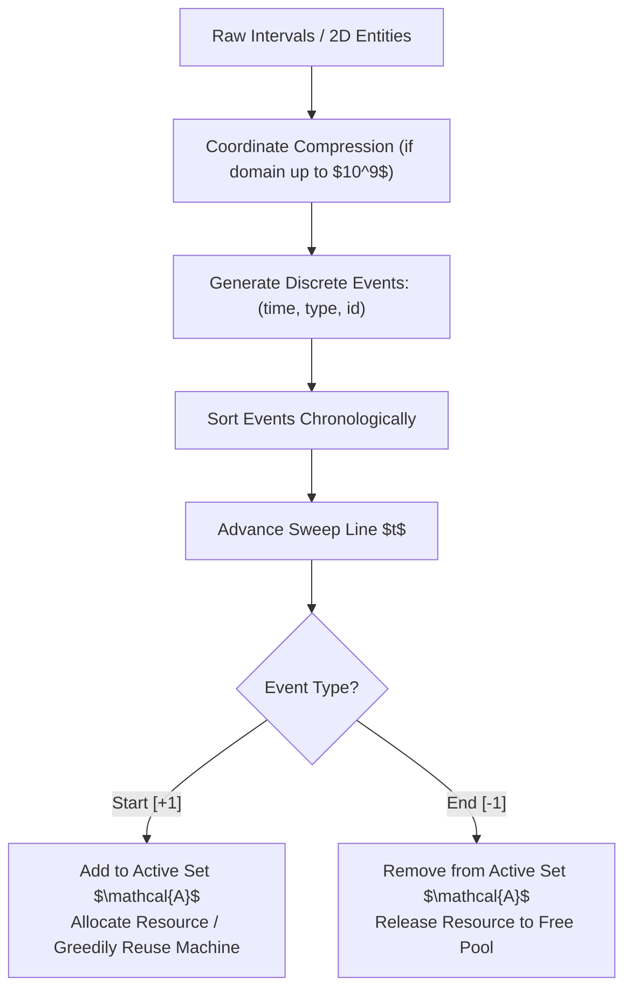

### Fundamental Theorems & Invariants

#### Theorem 1 (Dilworth's Theorem for Interval Graphs — Meeting Rooms Invariant)
The minimum number of rooms (or color classes) required to schedule $N$ intervals such that no two overlapping intervals share the same room is equal to the **maximum clique size** of the interval graph, which is precisely the maximum number of mutually overlapping intervals at any single point in time:
$$\chi(G) = \omega(G) = \max_{t} |\mathcal{A}(t)|$$

*Greedy Invariant:* Maintaining a min-heap of room availability times allows the greedy assignment of intervals to rooms in $O(N \log N)$, guaranteeing both minimal room count and zero overlap.

#### Theorem 2 (The Bipartite Grid Parity Invariant)
On a 2D grid with dimensions $R \times C$, color cell $(r, c)$ with parity $(r + c) \pmod 2$.
Any step (up, down, left, right) strictly alternates parity:
$$\text{Parity}(r_1, c_1) \neq \text{Parity}(r_2, c_2) \iff |r_1 - r_2| + |c_1 - c_2| = 1$$
Consequently, any closed Hamiltonian cycle on a grid requires $|V_{\text{even}}| = |V_{\text{odd}}|$, which is possible if and only if $R \cdot C$ is even. For construction problems requiring continuous traversals without self-intersections, a **Snake Traversal** alternates direction along rows, preserving contiguous adjacency.

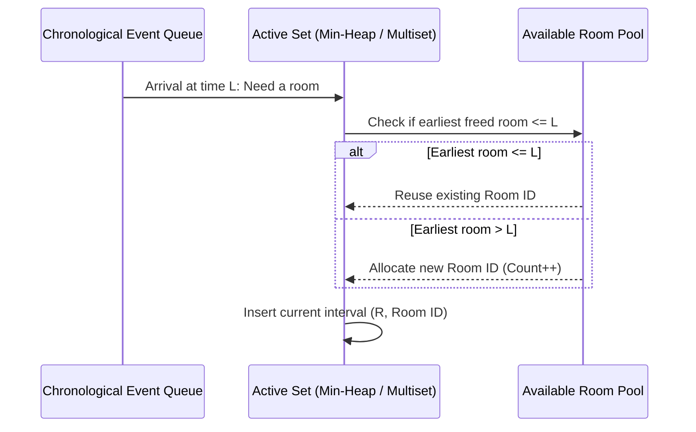

---

## 3. Core Intuition & Problem Framing

### Coordinate Compression: Shrinking Infinite Real Space
In competitive programming, coordinates $x_i, y_i$ often range up to $10^9$, making direct array indexing impossible. However, $N$ intervals define at most $2N$ distinct coordinates of interest.
By collecting all endpoints, removing duplicates, and sorting, we establish a bijection:
$$\phi: \{x_1, \dots, x_{2N}\} \to \{0, 1, \dots, M-1\} \quad \text{where } M \le 2N$$
The topological ordering is preserved ($x_i < x_j \iff \phi(x_i) < \phi(x_j)$), enabling the deployment of Fenwick trees, Segment trees, and difference arrays.

### Constructive Greedy: The "Checklist Method"
In constructive problems ("Build a grid / graph satisfying conditions $C_1, \dots, C_k$"):
1. Identify the most constrained global invariant (e.g. degrees, parity, sum).
2. Establish a canonical layout (e.g. Snake traversal, diagonal filling, spiraling).
3. Fill cells greedily from small to large or along the snake, verifying that each placement preserves invariant feasibility for all remaining cells.

---

## 4. Proof Sketches & Recurrences

### Greedy Room Reuse with Min-Heap
Let intervals be sorted by start time: $I_1, I_2, \dots, I_N$.
Maintain a min-heap storing the end times of active rooms.
- For interval $I_k = [l_k, r_k]$:
  If the top of the heap has $\text{end\_time} \le l_k$, that room is currently idle. We pop it, update its end time to $r_k$, and push it back.
  If the top of the heap has $\text{end\_time} > l_k$, all currently open rooms are occupied at time $l_k$. Therefore, at least $\text{heap.size}() + 1$ rooms are mathematically required. We allocate a new room with end time $r_k$.
- *Proof:* Because intervals are sorted by start time, any room with $\text{end\_time} \le l_k$ will never be needed by any earlier interval. Reusing the room with the earliest end time leaves rooms with later end times available for other requests, preserving maximal flexibility.

---

## 5. Contest-Ready Implementation Templates

### Operational Complexity Reference
- **Meeting Rooms / Interval Coloring:** Time $O(N \log N)$, Space $O(N)$
- **Coordinate Compression:** Time $O(N \log N)$, Space $O(N)$
- **Snake Grid Traversal:** Time $O(R \cdot C)$, Space $O(R \cdot C)$

---

### C++17 Implementation Template

```cpp
#include <bits/stdc++.h>
using namespace std;

namespace SweepAndConstructive {

// 1. Meeting Rooms II / Interval Coloring
struct Interval {
    int id;
    long long l, r;
};

struct RoomAllocation {
    int total_rooms;
    vector<int> room_assigned;
};

RoomAllocation solveMeetingRooms(vector<Interval>& intervals) {
    int n = intervals.size();
    vector<int> order(n);
    iota(order.begin(), order.end(), 0);
    sort(order.begin(), order.end(), [&](int i, int j) {
        if (intervals[i].l != intervals[j].l) return intervals[i].l < intervals[j].l;
        return intervals[i].r < intervals[j].r;
    });

    priority_queue<pair<long long, int>, vector<pair<long long, int>>, greater<>> pq;
    vector<int> assigned(n, 0);
    int room_counter = 0;

    for (int idx : order) {
        long long start = intervals[idx].l;
        long long end = intervals[idx].r;

        if (!pq.empty() && pq.top().first <= start) {
            auto [freed_time, room_id] = pq.top();
            pq.pop();
            assigned[intervals[idx].id] = room_id;
            pq.push({end, room_id});
        } else {
            room_counter++;
            assigned[intervals[idx].id] = room_counter;
            pq.push({end, room_counter});
        }
    }

    return {room_counter, assigned};
}

// 2. Coordinate Compression Utility
class CoordinateCompressor {
    vector<long long> coords;
    bool built = false;
public:
    void add(long long x) { coords.push_back(x); }

    void build() {
        sort(coords.begin(), coords.end());
        coords.erase(unique(coords.begin(), coords.end()), coords.end());
        built = true;
    }

    int get(long long x) const {
        return lower_bound(coords.begin(), coords.end(), x) - coords.begin();
    }

    int size() const { return coords.size(); }
    long long original(int rank) const { return coords[rank]; }
};

// 3. Constructive Snake Traversal on Grid
vector<pair<int, int>> generateSnakeTraversal(int R, int C) {
    vector<pair<int, int>> path;
    path.reserve(R * C);

    for (int r = 0; r < R; ++r) {
        if (r % 2 == 0) {
            for (int c = 0; c < C; ++c) path.push_back({r, c});
        } else {
            for (int c = C - 1; c >= 0; --c) path.push_back({r, c});
        }
    }
    return path;
}

} // namespace SweepAndConstructive
```

---

### Python 3 Implementation Template

```python
import sys
import heapq

# 1. Meeting Rooms / Interval Coloring Invariant
def solve_meeting_rooms(intervals: list[tuple[int, int, int]]) -> tuple[int, list[int]]:
    intervals.sort(key=lambda x: (x[0], x[1]))
    n = len(intervals)
    assigned = [0] * n
    room_counter = 0
    pq = []
    
    for start, end, orig_id in intervals:
        if pq and pq[0][0] <= start:
            freed_time, room_id = heapq.heappop(pq)
            assigned[orig_id] = room_id
            heapq.heappush(pq, (end, room_id))
        else:
            room_counter += 1
            assigned[orig_id] = room_counter
            heapq.heappush(pq, (end, room_counter))
            
    return room_counter, assigned

# 2. Coordinate Compression
class CoordinateCompressor:
    def __init__(self, raw_coords: list[int]):
        self.coords = sorted(list(set(raw_coords)))
        self.mapping = {x: i for i, x in enumerate(self.coords)}
        
    def get(self, x: int) -> int:
        return self.mapping[x]
        
    def original(self, rank: int) -> int:
        return self.coords[rank]
        
    def __len__(self) -> int:
        return len(self.coords)

# 3. Snake Grid Construction Pattern
def build_snake_grid(R: int, C: int, values: list[int]) -> list[list[int]]:
    grid = [[0] * C for _ in range(R)]
    val_idx = 0
    
    for r in range(R):
        cols = range(C) if r % 2 == 0 else range(C - 1, -1, -1)
        for c in cols:
            if val_idx < len(values):
                grid[r][c] = values[val_idx]
                val_idx += 1
    return grid
```

---

## 6. Recognition Trigger Signals & Heuristics

1. **"Find minimum rooms, tracks, or resources to avoid overlap":** Dilworth interval graph coloring. Sort by start time, maintain end times in a min-heap.
2. **"Coordinates span up to $10^9$, but queries/elements $N \le 2 \cdot 10^5$":** Coordinate compression is mandatory before Fenwick/SegTree range updates.
3. **"Fill grid such that adjacent cells differ by at most/least $K$":** Constructive parity/snake. A snake traversal guarantees that cell $k$ and cell $k+1$ are always Manhattan adjacent.

---

## 7. Contest WA / TLE / RE Traps

- **Event Ordering Tie-Breaking:** When intervals touch at endpoints (e.g. $[1, 5]$ and $[5, 10]$):
  - If sharing an endpoint is allowed: process **End Events (-1)** before **Start Events (+1)** at the same coordinate $x$.
  - If sharing an endpoint is forbidden (instant conflict): process **Start Events (+1)** before **End Events (-1)**.
- **Off-by-One in Coordinate Compression Intervals:** When compressing interval endpoints $[L_i, R_i]$, sometimes you must also insert $R_i + 1$ into the compressor to preserve gaps between non-touching intervals.
- **Snake Direction Flip Bug:** Forgetting to alternate columns on odd rows (`C - 1 down to 0`), accidentally producing a cylindrical wrap-around instead of a planar snake.

---

## 8. Curated Practice Problem Bank

| Platform | ID | Problem Name | Rating | Tags | Key Strategic Insight | Link |
|---|---|---|---|---|---|---|
| CSES | CSES-1164 | Room Allocation | 1400 | Greedy, Min-Heap, Sweep | Classic interval coloring: sort by start time, min-heap for room reuse. | [Solve Problem](https://cses.fi/problemset/task/1164) |
| CSES | CSES-1619 | Restaurant Customers | 1100 | Sweep Line, Prefix Sums | Event sorting (+1 arrival, -1 departure); track running prefix max. | [Solve Problem](https://cses.fi/problemset/task/1619) |
| Codeforces | CF-1366D | Two Divisors | 1600 | Number Theory, Greedy | Construct coprime divisors using smallest prime factors. | [Solve Problem](https://codeforces.com/contest/1366/problem/D) |
| Codeforces | CF-1108E2 | Array and Segments (hard) | 2000 | Sweep Line, Segment Tree | Sweep across array points; maintain active set of excluded intervals. | [Solve Problem](https://codeforces.com/contest/1108/problem/E2) |
| AtCoder | ABC-221D | Online Games | 1200 | Coordinate Compression, Sweep | Event delta sweep across days to count exact concurrent players. | [Solve Problem](https://atcoder.jp/contests/abc221/tasks/abc221_d) |

---

## 9. External Theory & Deep-Dive References

- **[USACO Guide]** [Silver: Sweep-Line Algorithms & Event Processing](https://usaco.guide/silver/sweep-line)
- **[TopCoder Tutorial]** [Line Sweep Algorithms: Theory and Practice](https://www.topcoder.com/thrive/articles/Line%20Sweep%20Algorithms)
- **[CP-Algorithms]** [Finding intersections with sweep line](https://cp-algorithms.com/geometry/intersecting_segments.html)

---

## 10. Algorithmic Variants & Advanced Extensions

- **2D Sweep with Persistent Trees:** When queries ask for the number of active intervals in a 2D bounding box $[x_1, x_2] \times [y_1, y_2]$, sweep along $x$ and persist the Segment Tree along $y$, converting 2D queries into $O(\log N)$ range queries.
- **Bipartite Matching on Interval Graphs:** Because interval graphs are chordal and perfect, maximum weight independent set and coloring are solvable greedily without general maximum flow algorithms.

---

## 11. Typical Problem Archetypes

1. **Capacity Peak Detector:** Count max concurrent visitors $\implies$ event sweep with $+1 / -1$ deltas.
2. **Resource Reuser:** Assign tasks to minimum physical machines $\implies$ sort by start time, priority queue of end times.
3. **Snake Grid Constructor:** Connect all grid cells in a contiguous path without crossing $\implies$ snake serpentine path.

---

## 12. Recognition & Identification Drills

1. *Scenario:* You are given $N$ intervals. You need to assign each to one of $K$ colors so that no two intersecting intervals share a color.  
   *Diagnosis:* Interval graph coloring. Min-heap of available colors.
2. *Scenario:* You have $N$ points in 2D with coordinates up to $10^9$. You must count pairs $(i, j)$ with $x_i < x_j$ and $y_i < y_j$.  
   *Diagnosis:* 2D point dominance. Coordinate compress $y$, sort by $x$ ascending, query Fenwick tree over $y$.
3. *Scenario:* Construct a permutation of $1 \dots N$ where $|P_i - P_{i+1}| \ge 2$ for all $i$.  
   *Diagnosis:* Constructive parity split. Place all evens $2, 4, 6 \dots$, then all odds $1, 3, 5 \dots$.

---

## 13. Fast-Lookup Cheat Sheet

- **Interval Coloring Invariant:** Sort by start time. Min-heap of `(end_time, room_id)`. If `heap.top().end_time <= start`, reuse room; else create new room.
- **Sweep Event Structure:** `tuple(time, event_type, id)`. If endpoints touch cleanly, process departures before arrivals.
- **Coordinate Compression Boilerplate:** `coords = sorted(set(raw)); mapping = {x: i for i, x in enumerate(coords)}`.
- **Grid Parity Rule:** Cell $(r, c)$ has color $(r + c) \pmod 2$. Adjacent steps always change color.


---

<a id="topic-5"></a>

# Priority Queue Regret & Buy-Now-Refund-Later Heuristics

> **Section:** §19 Greedy Fundamentals & Invariants  
> **Phase:** Phase 1 — Range Queries & Sweeps  
> **Contest ROI:** S-tier | **Rating Range:** 1600–2400 | **Frequency:** Common  
> **Prerequisites:** Priority Queues (`std::priority_queue` / `heapq`), Exchange Arguments, Invariant Design

---

## 1. Contest Payoff & Why It Matters

Standard greedy algorithms fail when a decision made early prevents a vastly superior choice later. The classical solution was dynamic programming, which often scales as $O(N^2)$ or $O(N \cdot W)$—too slow for $N = 2 \cdot 10^5$.

The **Priority Queue Regret (Undo Heap)** technique bridges this gap. It enables an algorithm to make choices *optimistically* and later *refund or substitute* sub-optimal choices in $O(\log N)$ time, achieving an optimal $O(N \log N)$ running time.
Mastering this paradigm unlocks:
1. **The "Buy Now, Refund Later" Invariant:** Turning NP-hard-looking sequential constraints into simple priority queue pops.
2. **The "Two-Push" Stock Trading Strategy:** Decomposing complex transaction-matching problems into virtual buys and sells.
3. **The Gateway to Convex Optimization:** Understanding the mechanics of regret heaps provides the direct bridge to **Slope Trick** and **WQS Binary Search**.

---

## 2. Theoretical Deep-Dive & Mathematical Mechanics

### Overview

In many sequential optimization problems, decisions are irreversible under standard greedy frameworks. If taking item $i$ later causes constraint violation, standard greedy is stuck.

The **Regret Paradigm** modifies the greedy protocol:
1. **Optimistic Commitment:** Accept every candidate item greedily as long as possible.
2. **Active Pool Maintenance:** Maintain all accepted items inside a priority queue configured to expose the **worst** accepted choice at the top (min-heap of benefits or max-heap of costs).
3. **Retrospective Eviction:** The moment a constraint is violated, locate the single worst accepted choice in the priority queue, pop it, and reverse its effect on the constraint.

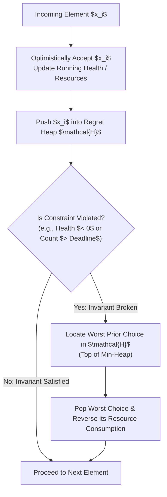

### Fundamental Theorems & Invariants

#### Theorem 1 (The Potions Problem Invariant — Maximum Non-Negative Prefix Sum Subset)
Given an array $A = (a_1, a_2, \dots, a_n)$, find the maximum size subset of indices $S \subseteq \{1, \dots, n\}$ such that for all prefixes $1 \le k \le n$, the cumulative sum of chosen elements satisfies:
$$\sum_{i \in S, i \le k} a_i \ge 0$$
*Algorithm:*
Iterate $i$ from $1$ to $n$. Add $a_i$ to running sum $H$. If $a_i < 0$, insert $a_i$ into min-heap $\mathcal{H}$.
If $H < 0$:
$$\text{worst} = \mathcal{H}.\text{top}(), \quad \mathcal{H}.\text{pop}(), \quad H \leftarrow H - \text{worst}$$
*Proof of Optimality:*
Suppose at step $k$, health $H$ drops below 0. We must discard at least one chosen element with index $\le k$. Discarding any chosen element $x$ restores health by $|x|$ and reduces the count of chosen elements by 1.
To maximize future survivability, we should maximize the health restored per discarded element. Thus, we must pick the element $x \in \mathcal{H}$ with maximum $|x|$ (i.e. minimum algebraic value $x$).
Since $x$ had already contributed to the prefix sum before step $k$, removing it strictly increases all prefix sums from the position of $x$ up to $k$ by $|x|$, restoring feasibility without altering the validity of any choice prior to $x$. Hence, the greedy regret choice is globally optimal.

#### Theorem 2 (The Two-Push Stock Trading Invariant)
Given daily stock prices $P_1, P_2, \dots, P_n$. You may buy and sell shares with no transaction fee. Maximize total profit.
*Algorithm:*
Maintain a min-heap $\mathcal{H}$ of buying opportunities. For day $i$ with price $P_i$:
- If $\mathcal{H}$ is not empty and $P_i > \mathcal{H}.\text{top}()$:
  $$\text{buy} = \mathcal{H}.\text{pop}()$$
  $$\text{profit} \leftarrow \text{profit} + (P_i - \text{buy})$$
  Push $P_i$ into $\mathcal{H}$ (Undo Token: allows a future higher price $P_j$ to claim $P_j - P_i$).
  Push $P_i$ into $\mathcal{H}$ (Normal Buy Opportunity: allows buying at $P_i$ for a future price $P_j$).
- Else:
  Push $P_i$ into $\mathcal{H}$ (Normal Buy Opportunity).

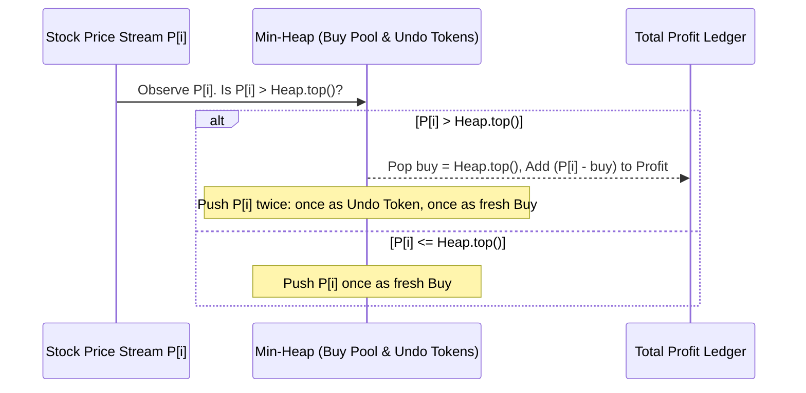

*Algebraic Justification of the Undo Token:*
If a share was bought at $P_a$ and sold at $P_i$, the profit realized is $P_i - P_a$.
If on a subsequent day $j > i$ the price rises to $P_j > P_i$, it would have been superior to pair $P_a$ with $P_j$, realizing $P_j - P_a$.
Notice that:
$$(P_j - P_a) = (P_i - P_a) + (P_j - P_i)$$
By pushing $P_i$ into the heap, if day $j$ pops $P_i$, the ledger receives $(P_j - P_i)$. Summed with the previously banked $(P_i - P_a)$, the net result is $(P_j - P_a)$—effectively transferring the original buy to the higher peak while incurring zero penalty!

---

## 3. Core Intuition & Problem Framing

Think of the regret heap as an **insurance policy with instant cashback**:
In classical greedy, you must be 100% certain before taking an action. In regret greedy, you take every marginally positive action immediately. You store your decisions in an insurance ledger (priority queue). When bankruptcy looms (constraint violation), you file an insurance claim on your single worst past mistake, instantly recovering the maximal possible budget.

---

## 4. Proof Sketches & Recurrences

### Job Scheduling with Deadlines (Unit Time Tasks)
Given $N$ jobs with deadlines $d_i$ and profits $w_i$, each requiring 1 unit of time.
- Sort jobs by deadline ascending: $d_1 \le d_2 \le \dots \le d_N$.
- Maintain accepted jobs in a min-heap keyed by profit $w_i$.
- For job $i$:
  Push $w_i$ to heap.
  If $\text{heap.size}() > d_i$:
    Pop the job with minimal profit from the heap.
- *Proof:* Because jobs are sorted by deadline, at time $d_i$, we can schedule at most $d_i$ jobs from $\{1, \dots, i\}$. If we have accepted $d_i + 1$ jobs, one must be dropped. Dropping the job with minimum profit leaves the remaining $d_i$ jobs having maximum possible total profit. By matroid theory, the greedy regret sequence produces the maximum weight independent set.

---

## 5. Contest-Ready Implementation Templates

### Operational Complexity Reference
- **Potions Problem (Undo Min-Heap):** Time $O(N \log N)$, Space $O(N)$
- **Job Scheduling with Deadlines:** Time $O(N \log N)$, Space $O(N)$
- **Stock Trading (Two-Push Strategy):** Time $O(N \log N)$, Space $O(N)$

---

### C++17 Implementation Template

```cpp
#include <bits/stdc++.h>
using namespace std;

namespace RegretGreedy {

// 1. Potions (Hard Version) — CF 1526C2
int solvePotions(const vector<long long>& a) {
    long long health = 0;
    priority_queue<long long, vector<long long>, greater<long long>> pq;

    for (long long val : a) {
        health += val;
        if (val < 0) {
            pq.push(val);
        }

        if (health < 0) {
            long long worst = pq.top();
            pq.pop();
            health -= worst;
        }
    }

    int non_neg_count = 0;
    for (long long val : a) if (val >= 0) non_neg_count++;
    return non_neg_count + (int)pq.size();
}

// 2. Job Scheduling with Deadlines (Unit Time Tasks)
struct Job {
    int id;
    long long deadline;
    long long profit;
};

long long solveJobScheduling(vector<Job>& jobs) {
    sort(jobs.begin(), jobs.end(), [](const Job& a, const Job& b) {
        return a.deadline < b.deadline;
    });

    priority_queue<long long, vector<long long>, greater<long long>> pq;
    long long total_profit = 0;

    for (const auto& job : jobs) {
        pq.push(job.profit);
        total_profit += job.profit;

        if ((long long)pq.size() > job.deadline) {
            total_profit -= pq.top();
            pq.pop();
        }
    }

    return total_profit;
}

// 3. Stock Trading Buy-Sell with Undo (CF 865D / Two-Push Strategy)
long long maxStockProfit(const vector<long long>& prices) {
    priority_queue<long long, vector<long long>, greater<long long>> pq;
    long long total_profit = 0;

    for (long long price : prices) {
        if (!pq.empty() && price > pq.top()) {
            long long buy_price = pq.top();
            pq.pop();
            total_profit += (price - buy_price);
            pq.push(price);
        }
        pq.push(price);
    }

    return total_profit;
}

} // namespace RegretGreedy
```

---

### Python 3 Implementation Template

```python
import sys
import heapq

# 1. Potions (Hard Version) — CF 1526C2
def solve_potions(a: list[int]) -> int:
    health = 0
    pq = []
    drunk_count = 0
    
    for val in a:
        health += val
        drunk_count += 1
        if val < 0:
            heapq.heappush(pq, val)
            
        if health < 0:
            worst = heapq.heappop(pq)
            health -= worst
            drunk_count -= 1
            
    return drunk_count

# 2. Optimal Job Scheduling with Deadlines
def solve_job_scheduling(jobs: list[tuple[int, int]]) -> int:
    jobs.sort(key=lambda x: x[0])
    pq = []
    total_profit = 0
    
    for deadline, profit in jobs:
        heapq.heappush(pq, profit)
        total_profit += profit
        
        if len(pq) > deadline:
            worst = heapq.heappop(pq)
            total_profit -= worst
            
    return total_profit

# 3. Stock Trading Buy/Sell with Undo (Two-Push Strategy)
def solve_stock_trading(prices: list[int]) -> int:
    pq = []
    total_profit = 0
    
    for price in prices:
        if pq and price > pq[0]:
            buy_price = heapq.heappop(pq)
            total_profit += price - buy_price
            heapq.heappush(pq, price)
        heapq.heappush(pq, price)
        
    return total_profit
```

---

## 6. Recognition Trigger Signals & Heuristics

1. **"Sequential process where budget/health cannot drop below 0":** Potions archetype. Drink everything; regret worst negatives via min-heap.
2. **"Deadlines with unit execution time, maximize profit":** Sort by deadline; maintain chosen profits in a min-heap; evict if heap size exceeds current deadline.
3. **"Match buys and sells over a timeline to maximize profit":** Two-push regret heap. If $P_i > \text{top}$, claim profit and push $P_i$ twice.
4. **"Dynamic constraint prevents greedy, but cost of undoing any element is independent":** Undo priority queue pattern.

---

## 7. Contest WA / TLE / RE Traps

- **Sorting Jobs by Profit Instead of Deadline:** In deadline scheduling, sorting by profit descending and placing greedily in the latest available slot with a DSU runs in $O(N \alpha(N))$, but requires $D \le N$. When deadlines are up to $10^9$, that DSU approach fails. The regret heap on deadlines ascending runs in $O(N \log N)$ regardless of deadline magnitude.
- **Forgetting the Undo Token in Stock Trading:** If you push $P_i$ only once, you miss the opportunity to chain transactions. The undo token allows upgrading the sell to a higher peak.
- **Negating Min-Heap in Python:** In Python, `heapq` is a min-heap. To store negative numbers and evict the most negative, push the negative number directly!

---

## 8. Curated Practice Problem Bank

| Platform | ID | Problem Name | Rating | Tags | Key Strategic Insight | Link |
|---|---|---|---|---|---|---|
| Codeforces | CF-1526C2 | Potions (Hard Version) | 1600 | Regret Heap, Greedy | Optimistically drink; pop most negative potion when health $< 0$. | [Solve Problem](https://codeforces.com/contest/1526/problem/C2) |
| Codeforces | CF-865D | Buy Low Sell High | 2400 | Regret Heap, Slope Trick | The canonical two-push stock trading regret problem. | [Solve Problem](https://codeforces.com/contest/865/problem/D) |
| Codeforces | CF-730I | Olympiad in Programming | 2200 | Greedy, Regret Heap, Flows | Two categories of assignments; maintain regret transitions with heaps. | [Solve Problem](https://codeforces.com/contest/730/problem/I) |
| CSES | CSES-1164 | Room Allocation | 1400 | Priority Queue, Sweep | Active resource recycling using priority queue invariants. | [Solve Problem](https://cses.fi/problemset/task/1164) |
| AtCoder | ABC-249F | Ignore Operations | 1700 | Regret Heap, Reverse Sweep | Work backwards from end; regret negative addition operations via max-heap. | [Solve Problem](https://atcoder.jp/contests/abc249/tasks/abc249_f) |

---

## 9. External Theory & Deep-Dive References

- **[Codeforces Tutorial]** [CF 1526C2: Potions Editorial & Regret Heaps](https://codeforces.com/blog/entry/91230)
- **[USACO Guide]** [Gold: Priority Queue Regret / Undo Heaps](https://usaco.guide/gold/pq-regret)
- **[Codeforces Blog]** [Stock Buy & Sell (CF 865D) and its connection to Slope Trick](https://codeforces.com/blog/entry/77298)

---

## 10. Algorithmic Variants & Advanced Extensions

- **Reverse Regret (Working Backwards):** In problems like ABC-249F, operations include "set $x = V$" and "add $x += V$". By sweeping backwards from the final state, any "set" operation fixes the baseline, and you regret the most negative additions using a heap of past additions.
- **Bi-Directional Regret (CF 730I):** When allocating $P$ programmers and $S$ athletes, swapping a student from programmer to athlete while promoting a fresh athlete can be managed using three priority queues tracking swap incentives.

---

## 11. Typical Problem Archetypes

1. **Survival with Poison / Penalties:** Drink potions / absorb damage $\implies$ min-heap of negative impacts.
2. **Deadline Profit Maximizer:** Unit jobs with deadlines $\implies$ sort by deadline, min-heap of accepted profits.
3. **Continuous Stock Market:** Buy and sell with replacement $\implies$ two-push regret heap.

---

## 12. Recognition & Identification Drills

1. *Scenario:* You are driving a car across a desert. There are gas stations along the road, each with limited fuel. You want to reach the destination with minimum stops.  
   *Diagnosis:* Standard greedy max-heap. When out of fuel, regret not stopping at the highest-capacity station previously passed.
2. *Scenario:* You play an RPG where defeating monster $i$ costs $C_i$ gold and earns $X_i$ XP. You want to maximize XP without debt.  
   *Diagnosis:* Potions variant. Take monsters optimistically; refund highest-cost monster if debt occurs.
3. *Scenario:* You can execute at most $K$ operations, but each operation can undo a previously committed action.  
   *Diagnosis:* Regret queue with capacity bounded by $K$.

---

## 13. Fast-Lookup Cheat Sheet

- **Potions Invariant:** `health += a[i]`. If `health < 0`: `health -= pq.pop()`.
- **Deadline Job Invariant:** Sort by deadline. `pq.push(profit)`. If `len(pq) > deadline`: `pq.pop()`.
- **Two-Push Stock Rule:** If `price > pq.top()`: `profit += price - pq.pop()`, `pq.push(price)`. Then always `pq.push(price)`.
- **When to Use:** Online sequential decisions with discrete, independent penalties and strict capacity bounds.


---

<a id="topic-6"></a>

# Axis Decoupling, Median Invariants & 1D/2D Sweeps

> **Section:** §19 Greedy Fundamentals & Invariants  
> **Phase:** Phase 1 — Range Queries & Sweeps  
> **Contest ROI:** S-tier | **Rating Range:** 1400–2200 | **Frequency:** Common  
> **Prerequisites:** Sorting, Binary Search, Two Heaps Pattern, Manhattan & Chebyshev Metrics

---

## 1. Contest Payoff & Why It Matters

In high-dimensional geometric and cost-minimization problems, the curse of dimensionality often obscures simple, elegant solutions.
Mastery of this topic delivers:
1. **The Additive Independence Principle:** Instantly decoupling 2D grid and spatial problems into two completely independent 1D problems, dropping complexity from $O(N^2)$ to $O(N \log N)$.
2. **The Median Invariant:** Proving why the median strictly minimizes total absolute deviation $\sum |x_i - c|$, and extending this to **Weighted Medians**.
3. **The Chebyshev $\leftrightarrow$ Manhattan Coordinate Rotation:** Converting $L_\infty$ distance into $L_1$ distance via a $45^\circ$ algebraic coordinate shift.
4. **Dynamic Sliding Window Median:** Maintaining medians and absolute deviations dynamically in $O(\log K)$ per insertion/deletion via a balanced Two-Heap engine.

---

## 2. Theoretical Deep-Dive & Mathematical Mechanics

### Overview

When an objective function decomposes as a separable sum over coordinate axes:
$$F(X, Y) = \sum_{i=1}^N \left( |x_i - X| + |y_i - Y| \right) = \sum_{i=1}^N |x_i - X| + \sum_{i=1}^N |y_i - Y| = f(X) + g(Y)$$
The optimal point $(X^*, Y^*)$ can be obtained by optimizing $f(X)$ over $x$-coordinates alone and $g(Y)$ over $y$-coordinates alone.

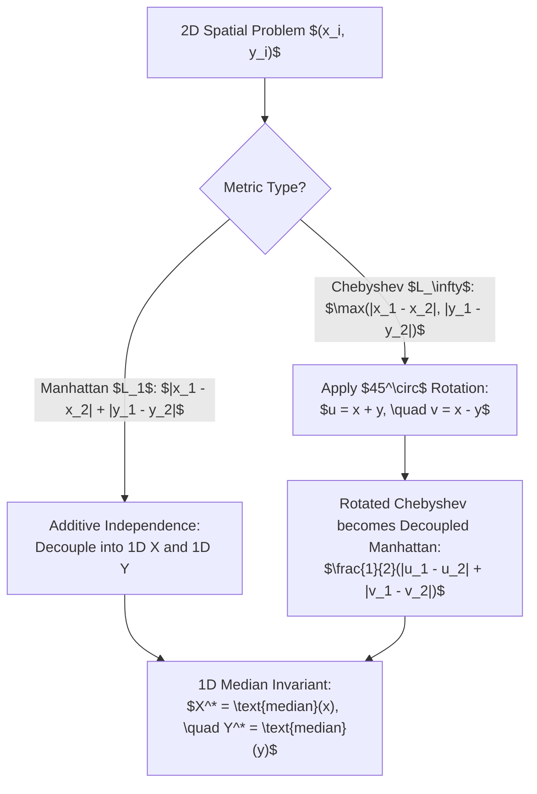

### Fundamental Theorems & Invariants

#### Theorem 1 (The 1D Median Invariant for $L_1$ Minimization)
Given real numbers $x_1 \le x_2 \le \dots \le x_n$, the scalar $c$ that minimizes the total absolute distance:
$$f(c) = \sum_{i=1}^n |x_i - c|$$
is the median of the set:
- If $n$ is odd, the unique optimal choice is $c = x_{(n+1)/2}$.
- If $n$ is even, any point $c \in [x_{n/2}, x_{n/2 + 1}]$ achieves the identical minimum cost.

*Proof via Subgradient Analysis:*
The derivative (subgradient) of $f(c)$ with respect to $c$ for $c \notin \{x_1, \dots, x_n\}$ is:
$$f'''(c) = \sum_{i=1}^n \text{sgn}(c - x_i) = |\{i \mid x_i < c\}| - |\{i \mid x_i > c\}|$$
- When $c < x_{\text{median}}$, more points lie to the right than to the left, so $f'''(c) < 0$. Moving $c$ to the right strictly decreases $f(c)$.
- When $c > x_{\text{median}}$, more points lie to the left than to the right, so $f'''(c) > 0$. Moving $c$ to the left strictly decreases $f(c)$.
- At $c = x_{\text{median}}$, $f'''(c) = 0$. Hence, the median is the global minimum.

#### Theorem 2 (The Weighted Median Invariant)
Given points $x_1 \le x_2 \le \dots \le x_n$ with positive weights $w_i > 0$, to minimize:
$$f_w(c) = \sum_{i=1}^n w_i |x_i - c|$$
The minimum occurs at the point $x_k$ such that the cumulative weight first crosses half of the total weight:
$$\sum_{i=1}^{k-1} w_i < \frac{1}{2} \sum_{i=1}^n w_i \quad \text{and} \quad \sum_{i=1}^k w_i \ge \frac{1}{2} \sum_{i=1}^n w_i$$

#### Theorem 3 (The Chebyshev to Manhattan Transformation)
For any two points $P_1 = (x_1, y_1)$ and $P_2 = (x_2, y_2)$:
$$\max(|x_1 - x_2|, |y_1 - y_2|) = \frac{1}{2} \left( |(x_1 + y_1) - (x_2 + y_2)| + |(x_1 - y_1) - (x_2 - y_2)| \right)$$
*Definition of Coordinate Transform:*
$$u = x + y, \quad v = x - y \iff x = \frac{u + v}{2}, \quad y = \frac{u - v}{2}$$
Under this transformation, the Chebyshev distance in $(x, y)$ space equals half the Manhattan distance in $(u, v)$ space:
$$d_\infty(P_1, P_2) = \frac{1}{2} d_1((u_1, v_1), (u_2, v_2)) = \frac{1}{2} \left( |u_1 - u_2| + |v_1 - v_2| \right)$$

---

## 3. Core Intuition & Problem Framing

### The Tug-of-War Analogy
Imagine $n$ people standing along a line at coordinates $x_i$, all pulling on a central meeting tent at coordinate $c$ with ropes of unit tension.
- If $c$ is placed to the left of the median, more people are pulling to the right than to the left. The net force pulls the tent rightward.
- If $c$ is placed to the right of the median, the net force pulls the tent leftward.
- Equilibrium is achieved only when an equal number of people pull in both directions—which occurs precisely at the **median**.

---

## 4. Proof Sketches & Recurrences

### Dynamic Two-Heap Median Invariant
To maintain the running median of a data stream:
- Partition elements into two heaps:
  - `max_heap` $\mathcal{L}$: stores the smaller half of elements.
  - `min_heap` $\mathcal{R}$: stores the larger half of elements.
- **Invariants:**
  1. $\max(\mathcal{L}) \le \min(\mathcal{R})$ at all times.
  2. Size Balance: $|\mathcal{L}| \in \{|\mathcal{R}|, |\mathcal{R}| + 1\}$.
- **Median Extraction:**
  - If $|\mathcal{L}| > |\mathcal{R}|$, the median is $\mathcal{L}.\text{top}()$.
  - If $|\mathcal{L}| == |\mathcal{R}|$, the median is $\frac{\mathcal{L}.\text{top}() + \mathcal{R}.\text{top}()}{2}$ (or $\mathcal{L}.\text{top}()$ for lower median).
- Maintaining cumulative sums $S_\mathcal{L} = \sum_{x \in \mathcal{L}} x$ and $S_\mathcal{R} = \sum_{x \in \mathcal{R}} x$ allows computing $\sum |x_i - \text{median}|$ in $O(1)$:
$$\text{Cost} = (|\mathcal{L}| \cdot \text{median} - S_\mathcal{L}) + (S_\mathcal{R} - |\mathcal{R}| \cdot \text{median})$$

---

## 5. Contest-Ready Implementation Templates

### Operational Complexity Reference
- **2D Manhattan Meeting Point:** Time $O(N \log N)$, Space $O(N)$
- **Weighted Median:** Time $O(N \log N)$, Space $O(N)$
- **Dynamic Two-Heap Median:** Time $O(\log N)$ per insertion/deletion, $O(1)$ query, Space $O(N)$
- **Prefix-Suffix Sweep Arrays:** Time $O(N)$, Space $O(N)$

---

### C++17 Implementation Template

```cpp
#include <bits/stdc++.h>
using namespace std;

namespace DecoupledMedians {

struct Point {
    long long x, y;
};

pair<Point, long long> optimalManhattanMeetingPoint(vector<Point>& points) {
    int n = points.size();
    vector<long long> xs(n), ys(n);
    for (int i = 0; i < n; ++i) {
        xs[i] = points[i].x;
        ys[i] = points[i].y;
    }

    sort(xs.begin(), xs.end());
    sort(ys.begin(), ys.end());

    long long opt_x = xs[n / 2];
    long long opt_y = ys[n / 2];

    long long total_dist = 0;
    for (int i = 0; i < n; ++i) {
        total_dist += abs(points[i].x - opt_x) + abs(points[i].y - opt_y);
    }

    return {{opt_x, opt_y}, total_dist};
}

class DynamicMedian {
    priority_queue<long long> max_heap;
    priority_queue<long long, vector<long long>, greater<long long>> min_heap;
    long long sum_left = 0;
    long long sum_right = 0;

public:
    void insert(long long x) {
        if (max_heap.empty() || x <= max_heap.top()) {
            max_heap.push(x);
            sum_left += x;
        } else {
            min_heap.push(x);
            sum_right += x;
        }
        rebalance();
    }

    void rebalance() {
        while (max_heap.size() > min_heap.size() + 1) {
            long long val = max_heap.top();
            max_heap.pop();
            sum_left -= val;
            min_heap.push(val);
            sum_right += val;
        }
        while (min_heap.size() > max_heap.size()) {
            long long val = min_heap.top();
            min_heap.pop();
            sum_right -= val;
            max_heap.push(val);
            sum_left += val;
        }
    }

    long long getMedian() const {
        return max_heap.top();
    }

    long long getTotalCost() const {
        long long med = getMedian();
        long long left_cost = (long long)max_heap.size() * med - sum_left;
        long long right_cost = sum_right - (long long)min_heap.size() * med;
        return left_cost + right_cost;
    }
};

long long maxChebyshevDistance(vector<Point>& points) {
    long long min_u = 4e18, max_u = -4e18;
    long long min_v = 4e18, max_v = -4e18;

    for (const auto& p : points) {
        long long u = p.x + p.y;
        long long v = p.x - p.y;
        min_u = min(min_u, u);
        max_u = max(max_u, u);
        min_v = min(min_v, v);
        max_v = max(max_v, v);
    }

    return max(max_u - min_u, max_v - min_v);
}

} // namespace DecoupledMedians
```

---

### Python 3 Implementation Template

```python
import sys
import heapq

# 1. 2D Optimal Manhattan Meeting Point
def solve_2d_meeting_point(points: list[tuple[int, int]]) -> tuple[tuple[int, int], int]:
    xs = sorted([p[0] for p in points])
    ys = sorted([p[1] for p in points])
    n = len(points)
    
    med_x = xs[n // 2]
    med_y = ys[n // 2]
    
    total_dist = sum(abs(p[0] - med_x) + abs(p[1] - med_y) for p in points)
    return (med_x, med_y), total_dist

# 2. Dynamic Two-Heap Median with Absolute Cost Maintenance
class DynamicMedian:
    def __init__(self):
        self.max_heap = []
        self.min_heap = []
        self.sum_left = 0
        self.sum_right = 0
        
    def insert(self, x: int):
        if not self.max_heap or x <= -self.max_heap[0]:
            heapq.heappush(self.max_heap, -x)
            self.sum_left += x
        else:
            heapq.heappush(self.min_heap, x)
            self.sum_right += x
        self._rebalance()
        
    def _rebalance(self):
        while len(self.max_heap) > len(self.min_heap) + 1:
            val = -heapq.heappop(self.max_heap)
            self.sum_left -= val
            heapq.heappush(self.min_heap, val)
            self.sum_right += val
            
        while len(self.min_heap) > len(self.max_heap):
            val = heapq.heappop(self.min_heap)
            self.sum_right -= val
            heapq.heappush(self.max_heap, -val)
            self.sum_left += val
            
    def get_median(self) -> int:
        return -self.max_heap[0]
        
    def get_total_cost(self) -> int:
        med = self.get_median()
        left_cost = len(self.max_heap) * med - self.sum_left
        right_cost = self.sum_right - len(self.min_heap) * med
        return left_cost + right_cost

# 3. Prefix-Suffix Sweep Middle-Man Toolkit
def prefix_suffix_excluding_one(arr: list[int]) -> list[int]:
    import math
    n = len(arr)
    pref = [0] * (n + 1)
    suff = [0] * (n + 1)
    
    for i in range(n):
        pref[i + 1] = math.gcd(pref[i], arr[i])
    for i in range(n - 1, -1, -1):
        suff[i] = math.gcd(suff[i + 1], arr[i])
        
    best_without = [math.gcd(pref[i], suff[i + 1]) for i in range(n)]
    return best_without
```

---

## 6. Recognition Trigger Signals & Heuristics

1. **"Minimize sum of distances $|x_i - X| + |y_i - Y|$ on a grid":** Axis decoupling. Sort $X$ and $Y$ independently, find their medians.
2. **"Minimize maximum distance $\max(|x_i - x_j|, |y_i - y_j|)$ between any pair":** Chebyshev metric. Apply $45^\circ$ rotation $(u=x+y, v=x-y)$, find $\max(\Delta u, \Delta v)$.
3. **"Sliding window of size $K$, continuously output median / cost":** Balanced two heaps with lazy deletion, or Fenwick tree over coordinate-compressed ranks.
4. **"Answer queries where exactly one element $i$ is removed":** Prefix-suffix middle-man precomputation.

---

## 7. Contest WA / TLE / RE Traps

- **Integer Division in Rotated Chebyshev:** When rotating $(u, v) = (x+y, x-y)$, the distance is $\frac{1}{2}(|u_1 - u_2| + |v_1 - v_2|)$. If you forget the $\frac{1}{2}$ factor, your distances are doubled.
- **Even $N$ Median Off-by-One:** When $N$ is even, any point between $x_{N/2}$ and $x_{N/2 + 1}$ gives the same cost. However, if the target must be an integer, picking $x_{N/2}$ is always optimal and safe.
- **Two Heaps Desynchronization:** Forgetting to update `sum_left` and `sum_right` during heap rebalancing causes silent WA in total cost queries.

---

## 8. Curated Practice Problem Bank

| Platform | ID | Problem Name | Rating | Tags | Key Strategic Insight | Link |
|---|---|---|---|---|---|---|
| CSES | CSES-1074 | Stick Lengths | 1000 | Sorting, Median Invariant | Sort array; pick median element; sum absolute differences. | [Solve Problem](https://cses.fi/problemset/task/1074) |
| CSES | CSES-1076 | Sliding Window Median | 1400 | Two Heaps, PBDS | Maintain running median over window of size $K$. | [Solve Problem](https://cses.fi/problemset/task/1076) |
| CSES | CSES-1077 | Sliding Window Cost | 1500 | Two Heaps, Math | Two heaps tracking sum of elements to query $\sum |x_i - \text{med}|$. | [Solve Problem](https://cses.fi/problemset/task/1077) |
| Codeforces | CF-1486B | Eastern Exhibition | 1400 | Geometry, Decoupling, Median | Decouple 2D Manhattan; count valid optimal medians in $[x_{n/2}, x_{n/2+1}]$. | [Solve Problem](https://codeforces.com/contest/1486/problem/B) |
| AtCoder | ABC-178E | Dist Max | 1400 | Chebyshev, Coordinate Rotation | Maximize $|x_i - x_j| + |y_i - y_j|$ by rotating to Chebyshev axes. | [Solve Problem](https://atcoder.jp/contests/abc178/tasks/abc178_e) |

---

## 9. External Theory & Deep-Dive References

- **[CP-Algorithms]** [Manhattan and Chebyshev Distance Transformations](https://cp-algorithms.com/)
- **[USACO Guide]** [Silver: More Operations on Sorted Sets](https://usaco.guide/silver/more-ops)
- **[Wikipedia]** [Chebyshev Distance and Isometric Rotation](https://en.wikipedia.org/wiki/Chebyshev_distance)

---

## 10. Algorithmic Variants & Advanced Extensions

- **Weighted Median on Trees:** Find a vertex $v$ that minimizes $\sum w_u \cdot \text{dist}(u, v)$. The optimal vertex is the **weighted centroid** of the tree.
- **Higher Dimensions ($K$-Dimensions):** For any $L_1$ metric in $\mathbb{R}^d$, the optimal meeting point is the Cartesian product of the 1D medians: $(\text{med}(x_1), \text{med}(x_2), \dots, \text{med}(x_d))$.

---

## 11. Typical Problem Archetypes

1. **Warehouse Location:** Place a logistics hub to minimize total truck delivery distance $\implies$ Manhattan 2D median.
2. **Maximum Spread:** Find pair of points with maximum Manhattan distance $\implies$ rotate coordinates, track $\max(u) - \min(u)$ and $\max(v) - \min(v)$.
3. **Equalize Array:** Minimize operations to make all array elements equal $\implies$ sort and choose median.

---

## 12. Recognition & Identification Drills

1. *Scenario:* You have $N$ points in 2D. You must select an existing point that minimizes sum of Manhattan distances.  
   *Diagnosis:* Find the true median $(X^*, Y^*)$, then find the nearest existing point or check candidates.
2. *Scenario:* Maximize $|x_i - x_j| + |y_i - y_j|$ over all pairs $(i, j)$.  
   *Diagnosis:* Reverse rotation. Rewrite as $\max((x_i + y_i) - (x_j + y_j), (x_i - y_i) - (x_j - y_j))$. Track min and max of $x+y$ and $x-y$.
3. *Scenario:* You need the median of elements in a sliding window of size $K$.  
   *Diagnosis:* Two heaps with lazy deletion, or GNU C++ PBDS.

---

## 13. Fast-Lookup Cheat Sheet

- **1D Median Minimizer:** $\min_c \sum |x_i - c| \implies c = x_{N/2}$.
- **Manhattan to Chebyshev:** $|x_1 - x_2| + |y_1 - y_2| = \max(|u_1 - u_2|, |v_1 - v_2|)$ where $u = x+y, v = x-y$.
- **Chebyshev to Manhattan:** $\max(|x_1 - x_2|, |y_1 - y_2|) = \frac{1}{2}(|u_1 - u_2| + |v_1 - v_2|)$.
- **Dynamic Cost Formula:** $\text{Cost} = (|\mathcal{L}| \cdot \text{med} - S_\mathcal{L}) + (S_\mathcal{R} - |\mathcal{R}| \cdot \text{med})$.


---

<a id="topic-7"></a>

# Convex Optimization, Slope Trick & WQS Binary Search

> **Section:** §19 Greedy Fundamentals & Invariants  
> **Phase:** Phase 1 — Range Queries & Sweeps  
> **Contest ROI:** A-tier | **Rating Range:** 2000–2800 | **Frequency:** Occasional (Grandmaster Weapon)  
> **Prerequisites:** Priority Queues, Binary Search, Dynamic Programming, Discrete Convexity

---

## 1. Contest Payoff & Why It Matters

At the 2000–2800 rating frontier, standard DP solutions that run in $O(N \cdot K)$ are deliberately bottlenecked by tight time limits where $N, K \le 2 \cdot 10^5$.
Mastery of this topic grants:
1. **WQS Binary Search (Aliens Trick):** Eliminating the $K$ dimension entirely, transforming an $O(N \cdot K)$ DP into an unconstrained $O(N \log(\text{Range}))$ binary search via Lagrangian penalty relaxation.
2. **The Slope Trick Engine:** Maintaining an entire continuous convex piecewise-linear function using two priority queues, supporting function additions, infimal convolutions, and prefix-minimum squashes in $O(\log N)$ time.
3. **The Geometric Triad Synthesis:** Recognizing that **Regret Heaps**, **Slope Trick**, and **WQS Binary Search** are three perspectives of the exact same mathematical phenomenon: **Convex Duality**.

---

## 2. Theoretical Deep-Dive & Mathematical Mechanics

### Overview

A real-valued discrete function $F(k)$ defined on integers is **convex** if its second discrete difference is non-negative:
$$\Delta^2 F(k) = F(k+1) - 2F(k) + F(k-1) \ge 0 \iff F(k+1) - F(k) \ge F(k) - F(k-1)$$
This means each additional unit of resource yields non-decreasing marginal cost (or diminishing marginal returns).

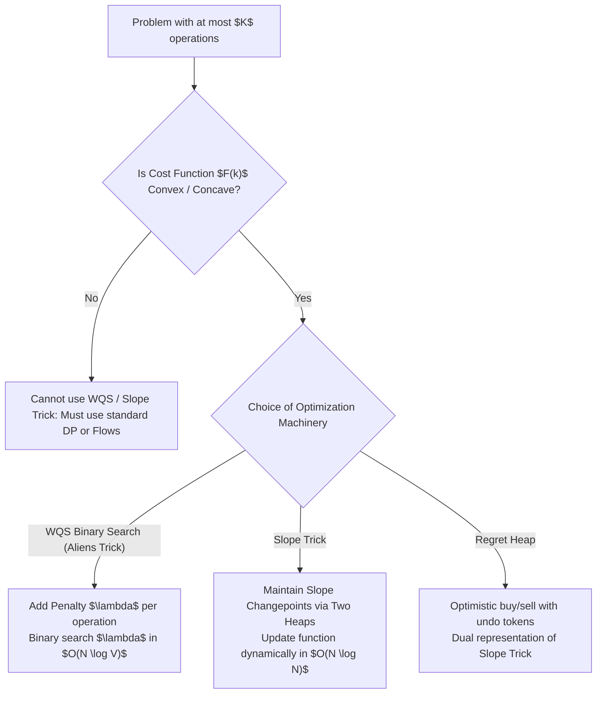

### Fundamental Theorems & Invariants

#### Theorem 1 (Lagrangian Relaxation & The WQS Binary Search Theorem)
Let $F(k)$ be the minimum cost of achieving a goal using *exactly* $k$ operations. If $F(k)$ is strictly convex, consider the penalized objective function with penalty parameter $\lambda$:
$$g(\lambda) = \min_{k} \big( F(k) - \lambda \cdot k \big)$$
Geometrically, $g(\lambda)$ represents the $y$-intercept of the supporting tangent line of slope $\lambda$ to the convex curve $(k, F(k))$.
1. For any fixed $\lambda$, $g(\lambda)$ can be found in $O(N)$ time by running an unconstrained optimization where each operation incurs an additional penalty of $-\lambda$.
2. Because $F(k)$ is convex, the optimal operation count $k^*(\lambda)$ is monotonically non-decreasing with respect to $\lambda$.
3. We can binary search for $\lambda^* \in [-V, V]$ such that the unconstrained solver selects exactly $k^*(\lambda^*) = K$.
4. The true constrained optimum is recovered by:
$$F(K) = g(\lambda^*) + K \cdot \lambda^*$$

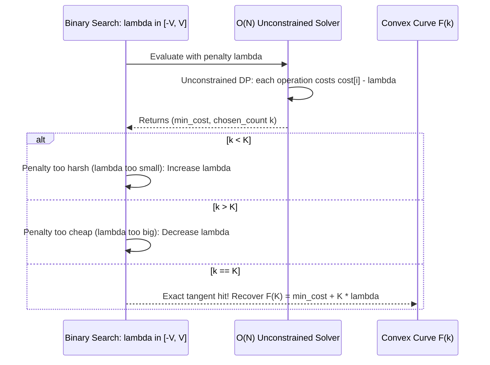

#### Theorem 2 (The Slope Trick Two-Heap Representation)
Any continuous, piecewise-linear convex function $f(x)$ whose slopes are all integers can be uniquely characterized by:
1. The minimum value $y_{\min} = \min_{x} f(x)$.
2. An interval $[L_{\min}, R_{\min}]$ where the slope is 0.
3. A multiset $\mathcal{L}$ of points where the slope increases by 1 (for $x \le L_{\min}$).
4. A multiset $\mathcal{R}$ of points where the slope increases by 1 (for $x \ge R_{\min}$).

*Data Structure:*
- $\mathcal{L}$ is stored in a **Max-Heap** (top is $L_{\min}$).
- $\mathcal{R}$ is stored in a **Min-Heap** (top is $R_{\min}$).

---

## 3. Core Intuition & Problem Framing

### Slope Trick Operation Mechanics

When adding $|x - a|$ to $f(x)$:
- **Case 1 ($a < L_{\min}$):** The changepoint lies in the negative slope region. The minimum value increases by $L_{\min} - a$. The point $a$ is added twice to $\mathcal{L}$, and the previous peak $L_{\min}$ is popped and transferred to $\mathcal{R}$ to restore balance.
- **Case 2 ($a > R_{\min}$):** The changepoint lies in the positive slope region. The minimum value increases by $a - R_{\min}$. The point $a$ is added twice to $\mathcal{R}$, and the smallest point in $\mathcal{R}$ is transferred to $\mathcal{L}$.
- **Case 3 ($L_{\min} \le a \le R_{\min}$):** $a$ falls within the optimal flat basin. The minimum value $y_{\min}$ is unchanged. $a$ is pushed once into $\mathcal{L}$ and once into $\mathcal{R}$.

### The Prefix Minimum Transformation: $f(x) \leftarrow \min_{y \le x} f(y)$
In problems where you can choose any $y \le x$ (e.g. non-decreasing sequence construction $A_1 \le A_2 \le \dots \le A_N$ as in CF 713C):
For all $x > R_{\min}$, the prefix minimum clamps the function to $y_{\min}$.
*Slope Trick Execution:* Simply **clear the entire min-heap $\mathcal{R}$**! All slopes $> 0$ are flattened to 0.

---

## 4. Proof Sketches & Recurrences

### Handling Collinear Segments in WQS (Linear Interpolation / LIP)
What happens if multiple values of $k$ have the exact same marginal cost, creating a flat facet on the lower convex hull of $F$?
Then for that critical slope $\lambda^*$, the unconstrained solver will find multiple optimal solutions with different operation counts $k_{\min} \le K \le k_{\max}$.
- *Rule:* Always prefer either the maximum or minimum number of operations during tie-breaking.
- If we prefer maximum operations: binary search finds the smallest integer $\lambda$ such that $k^*(\lambda) \ge K$.
- By linear interpolation along the flat segment, the formula:
$$F(K) = g(\lambda^*) + K \cdot \lambda^*$$
remains **exact**, because on a straight line segment, the tangent touches every point $(k, F(k))$ simultaneously!

---

## 5. Contest-Ready Implementation Templates

### Operational Complexity Reference
- **WQS Binary Search (Aliens Trick):** Time $O(N \log(\text{Range}))$, Space $O(N)$
- **Slope Trick (Two Heaps):** Time $O(N \log N)$, Space $O(N)$
- **Regret Heap Dual:** Time $O(N \log N)$, Space $O(N)$

---

### C++17 Implementation Template

```cpp
#include <bits/stdc++.h>
using namespace std;

namespace ConvexOptimization {

class SlopeTrick {
    priority_queue<long long> L;
    priority_queue<long long, vector<long long>, greater<long long>> R;
    long long min_val = 0;
    long long tag_L = 0;
    long long tag_R = 0;

public:
    long long getMin() const { return min_val; }

    void addAbs(long long a) {
        if (!L.empty() && a < L.top() + tag_L) {
            long long l_top = L.top() + tag_L;
            min_val += l_top - a;
            L.pop();
            L.push(a - tag_L);
            L.push(a - tag_L);
            R.push(l_top - tag_R);
        } else if (!R.empty() && a > R.top() + tag_R) {
            long long r_top = R.top() + tag_R;
            min_val += a - r_top;
            R.pop();
            R.push(a - tag_R);
            R.push(a - tag_R);
            L.push(r_top - tag_L);
        } else {
            L.push(a - tag_L);
            R.push(a - tag_R);
        }
    }

    void addReluRight(long long a) {
        if (!L.empty() && a < L.top() + tag_L) {
            long long l_top = L.top() + tag_L;
            min_val += l_top - a;
            L.pop();
            L.push(a - tag_L);
            R.push(l_top - tag_R);
        } else {
            R.push(a - tag_R);
        }
    }

    void shift(long long c) {
        tag_L += c;
        tag_R += c;
    }

    void prefixMin() {
        while (!R.empty()) R.pop();
    }
};

struct WQSResult {
    long long cost;
    int count;
};

WQSResult solveUnconstrained(const vector<long long>& a, long long lambda) {
    int n = a.size();
    vector<pair<long long, int>> dp(n + 1, {4e18, 0});
    dp[0] = {0, 0};

    for (int i = 1; i <= n; ++i) {
        long long current_val = a[i - 1];
        long long cost_take = dp[i - 1].first + current_val - lambda;
        int count_take = dp[i - 1].second + 1;

        if (cost_take < dp[i].first || (cost_take == dp[i].first && count_take < dp[i].second)) {
            dp[i] = {cost_take, count_take};
        }
    }
    return {dp[n].first, dp[n].second};
}

long long solveWQS(const vector<long long>& a, int K) {
    long long low = 0, high = 2e9;
    long long best_lambda = 0;

    while (low <= high) {
        long long mid = low + (high - low) / 2;
        WQSResult res = solveUnconstrained(a, mid);
        if (res.count <= K) {
            best_lambda = mid;
            low = mid + 1;
        } else {
            high = mid - 1;
        }
    }

    WQSResult optimal_res = solveUnconstrained(a, best_lambda);
    return optimal_res.cost + (long long)K * best_lambda;
}

} // namespace ConvexOptimization
```

---

### Python 3 Implementation Template

```python
import sys
import heapq

# 1. Slope Trick Full Class
class SlopeTrick:
    def __init__(self):
        self.L = []
        self.R = []
        self.min_val = 0
        self.tag_L = 0
        self.tag_R = 0
        
    def add_abs(self, a: int):
        l_top = -self.L[0] + self.tag_L if self.L else -float('inf')
        r_top = self.R[0] + self.tag_R if self.R else float('inf')
        
        if self.L and a < l_top:
            self.min_val += l_top - a
            heapq.heappop(self.L)
            heapq.heappush(self.L, -(a - self.tag_L))
            heapq.heappush(self.L, -(a - self.tag_L))
            heapq.heappush(self.R, l_top - self.tag_R)
        elif self.R and a > r_top:
            self.min_val += a - r_top
            heapq.heappop(self.R)
            heapq.heappush(self.R, a - self.tag_R)
            heapq.heappush(self.R, a - self.tag_R)
            heapq.heappush(self.L, -(r_top - self.tag_L))
        else:
            heapq.heappush(self.L, -(a - self.tag_L))
            heapq.heappush(self.R, a - self.tag_R)
            
    def prefix_min(self):
        self.R.clear()
        
    def shift(self, c: int):
        self.tag_L += c
        self.tag_R += c

# 2. Three-Way Synthesis: Solving CF 865D Stock Trading Three Ways
def solve_stock_regret(prices: list[int]) -> int:
    pq = []
    profit = 0
    for p in prices:
        if pq and p > pq[0]:
            buy = heapq.heappop(pq)
            profit += p - buy
            heapq.heappush(pq, p)
        heapq.heappush(pq, p)
    return profit

def solve_stock_slope_trick(prices: list[int]) -> int:
    st = SlopeTrick()
    for p in prices:
        st.add_abs(p)
        st.prefix_min()
    return st.min_val
```

---

## 6. Recognition Trigger Signals & Heuristics

1. **"At most $K$ operations" with $K \le N \le 2 \cdot 10^5$:** WQS Binary Search. Check if plotting optimal cost vs $k$ produces a convex curve.
2. **"Make array non-decreasing with $\min \sum |A_i - B_i|$" (CF 713C):** Slope Trick. Add $|x - A_i|$, apply `prefix_min()`.
3. **"Continuous function is sum of absolute distances and ReLU penalties":** Slope Trick two-heap representation.

---

## 7. Contest WA / TLE / RE Traps

- **Non-Convexity Trap:** Applying WQS binary search when $F(k)$ is not convex. If the problem has fixed activation fees or non-concave returns, WQS will miss the optimal tangent point.
- **WQS Binary Search Direction Inversion:** In minimization problems, increasing penalty $\lambda$ encourages fewer operations. In maximization problems, increasing reward $\lambda$ encourages more operations.
- **Forgetting Linear Interpolation in Integer Arithmetic:** When $K$ falls on a flat facet of the convex hull, the unconstrained solver will jump over $K$. The binary search must stop when the slope interval contains the target, and evaluate the recovery formula at $K$.

---

## 8. Curated Practice Problem Bank

| Platform | ID | Problem Name | Rating | Tags | Key Strategic Insight | Link |
|---|---|---|---|---|---|---|
| Codeforces | CF-713C | Sonya and Problem Wihtout a Legend | 2300 | Slope Trick, DP | Strict to non-decreasing reduction $A_i' = A_i - i$; Slope trick prefix min. | [Solve Problem](https://codeforces.com/contest/713/problem/C) |
| Codeforces | CF-865D | Buy Low Sell High | 2400 | Slope Trick, Regret Heap | Dual representation: two-push regret heap is equivalent to slope trick. | [Solve Problem](https://codeforces.com/contest/865/problem/D) |
| IOI | IOI-2016 | Aliens | 2800 | WQS Binary Search, CHT | The namesake of the Aliens Trick. Convex penalty binary search + CHT. | [Solve Problem](https://oj.uz/problem/view/IOI16_aliens) |
| Codeforces | CF-1270G | Subset with Zero Sum | 2600 | Functional Graph, Invariants | Structural invariant on directed functional graph cycle detection. | [Solve Problem](https://codeforces.com/contest/1270/problem/G) |
| AtCoder | ABC-217H | Snaketoy | 2800 | Slope Trick, Deque | 2D dynamic slope trick with time-expanding slope transitions. | [Solve Problem](https://atcoder.jp/contests/abc217/tasks/abc217_h) |

---

## 9. External Theory & Deep-Dive References

- **[Codeforces Tutorial]** [Slope Trick Explained: From Basics to Advanced](https://codeforces.com/blog/entry/77298)
- **[Codeforces Tutorial]** [The Aliens Trick / WQS Binary Search Comprehensive Guide](https://codeforces.com/blog/entry/67634)
- **[IOI 2016 Aliens Solution]** [Official IOI 2016 Aliens Analysis](https://ioinformatics.org/files/ioi2016solutions.pdf)

---

## 10. Algorithmic Variants & Advanced Extensions

- **Slope Trick with Non-Unit Slopes:** When $|x - a|$ is multiplied by integer weight $w_i$, push $a$ with multiplicity $w_i$. If $w_i$ is large ($10^9$), maintain intervals in a `std::map<long long, long long>` storing `(changepoint, slope_delta)`.
- **Higher Dimensions: Discrete Convex Analysis:** Extending slope trick to trees via submodular function minimization and mergeable balanced heaps.

---

## 11. Typical Problem Archetypes

1. **Constrained Subarray Split:** Partition into exactly $K$ segments with convex cost $\implies$ WQS Binary Search.
2. **Optimal Monotone Sequence:** Minimize $\sum |A_i - B_i|$ with $B_1 \le B_2 \le \dots \le B_N \implies$ Slope trick with `prefix_min`.
3. **Transaction Market:** Buy and sell with transaction limits $\implies$ WQS binary search on trade count or two-push regret heap.

---

## 12. Recognition & Identification Drills

1. *Scenario:* You need to choose exactly $K$ disjoint subsegments of an array to maximize total sum. $N \le 2 \cdot 10^5, K \le N$.  
   *Diagnosis:* WQS Binary Search. Each chosen segment incurs penalty $\lambda$. Unconstrained problem solved via Kadane'''s in $O(N)$.
2. *Scenario:* You are given $A_1, \dots, A_N$. You want to find non-decreasing $B_1 \le \dots \le B_N$ minimizing $\sum |A_i - B_i|$.  
   *Diagnosis:* Slope trick. Maintain left changepoint heap; pop when $A_i < \text{top}$.
3. *Scenario:* A graph has red and blue edges. Find a spanning tree with exactly $K$ red edges of minimum weight.  
   *Diagnosis:* WQS Binary Search on red edge weight bonus $\lambda$. Matroid exchange property guarantees strict convexity.

---

## 13. Fast-Lookup Cheat Sheet

- **WQS Formula:** $F(K) = \min_x (f(x) - \lambda^* \cdot \text{count}(x)) + K \cdot \lambda^*$.
- **Slope Trick Representation:** Max-heap $\mathcal{L}$ ($x \le L_{\min}$), Min-heap $\mathcal{R}$ ($x \ge R_{\min}$), offset tags $\text{tag}_L, \text{tag}_R$.
- **Prefix Min Rule:** `R.clear()`. Drops all slopes $> 0$ to 0.
- **Stock Dual:** Regret heap pushing twice $\equiv$ Slope trick adding absolute value and prefix min.


---

<a id="topic-8"></a>

# Greedy on Graphs & Trees

> **Section:** §19 Greedy Fundamentals & Invariants  
> **Phase:** Phase 1 — Range Queries & Sweeps  
> **Contest ROI:** S-tier | **Rating Range:** 1400–2300 | **Frequency:** Very Common  
> **Prerequisites:** Graph representations (Adjacency lists), BFS/DFS, Disjoint Set Union (DSU), Priority Queues

---

## 1. Contest Payoff & Why It Matters

Graph theory and tree algorithms are deeply rooted in greedy choices. The most celebrated algorithms in computer science—**Dijkstra's Shortest Path**, **Kruskal's & Prim's MST**, and **2-BFS Tree Diameter**—are pure greedy algorithms whose correctness is guaranteed by underlying matroidal and topological invariants.
Mastery gives you:
1. **The Frontier Invariant:** Recognizing why Dijkstra works strictly with non-negative edges, and implementing **0-1 BFS** to compute shortest paths in linear $O(V + E)$ time.
2. **The Cut and Cycle Properties:** Proving correctness for Minimum Spanning Trees and DSU-based clusterings.
3. **Tree Extremum Locators:** Finding the **Tree Diameter** in 2 BFS passes and the **Tree Centroid** via greedy subtree descent.
4. **Leaf-to-Root Tree DP:** Solving independent set, vertex cover, and edge matching on trees greedily from the leaves upward.

---

## 2. Theoretical Deep-Dive & Mathematical Mechanics

### Overview

When a graph or tree exhibits topological acyclicity or non-negative weight monotonicity, local decisions become globally optimal.

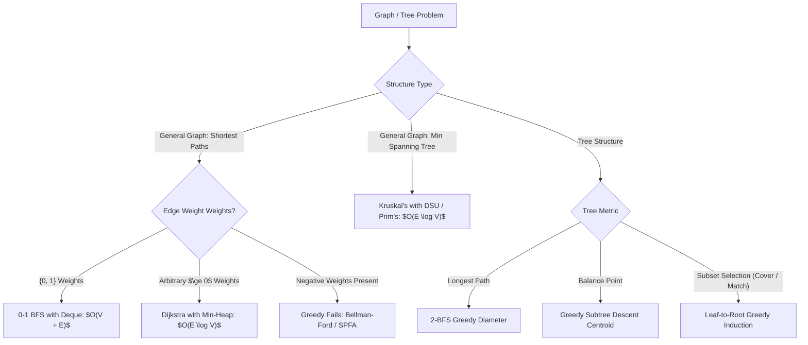

### Fundamental Theorems & Invariants

#### Theorem 1 (Correctness of Dijkstra's Algorithm via the Non-Negative Frontier Invariant)
In a directed graph with edge weights $w(u, v) \ge 0$, when a vertex $u$ is extracted from the priority queue with minimal tentative distance $d[u]$, $d[u]$ is **strictly equal to the true shortest path distance** $\delta(s, u)$.

*Proof by Contradiction:*
Let $u$ be the first vertex popped from the priority queue such that $d[u] > \delta(s, u)$.
Consider the true shortest path from $s$ to $u$: $P = (s = v_0, v_1, \dots, v_k = u)$.
Let $v_i$ be the first unvisited vertex along $P$, and let $v_{i-1}$ be its visited predecessor.
Since $v_{i-1}$ was visited earlier and relaxed, $d[v_i] = \delta(s, v_i)$.
Because all edge weights are non-negative:
$$\delta(s, v_i) \le \delta(s, u) < d[u]$$
Therefore, $d[v_i] < d[u]$.
This implies that $v_i$ must have had a smaller distance key in the priority queue than $u$.
Consequently, the priority queue would have extracted $v_i$ before $u$, contradicting the assumption that $u$ was extracted first. Thus, $d[u] = \delta(s, u)$.

#### Theorem 2 (The Cut Property for Minimum Spanning Trees)
Let $G = (V, E)$ be a connected graph, and let $S \subset V$ define a cut $(S, V \setminus S)$.
If edge $e = (u, v)$ is the strictly lightest edge crossing the cut $(u \in S, v \in V \setminus S)$, then $e$ **must belong to every Minimum Spanning Tree** of $G$.

*Proof by Exchange:*
Suppose an MST $T$ does not contain $e$. Adding $e$ to $T$ creates a unique cycle $C$. Because $u \in S$ and $v \in V \setminus S$, the cycle must cross the cut at least once more via an edge $e''' \neq e$.
Removing $e'''$ breaks the cycle and restores a spanning tree $T''' = T \cup \{e\} \setminus \{e'''\}$.
The weight change is $w(T''') = w(T) + w(e) - w(e''').$
Since $e$ is the strictly lightest edge crossing the cut, $w(e) < w(e'''),$ so $w(T''') < w(T)$, contradicting the optimality of $T$. Hence, $e \in T$.

#### Theorem 3 (The 2-BFS Tree Diameter Invariant)
On any unweighted or positive-edge weighted tree:
1. From an arbitrary vertex $u \in V$, the vertex $v$ that maximizes $\text{dist}(u, v)$ is an endpoint of a diameter.
2. From vertex $v$, the vertex $w$ that maximizes $\text{dist}(v, w)$ is the opposite endpoint of the diameter, and $\text{dist}(v, w) = \text{Diameter}(T)$.

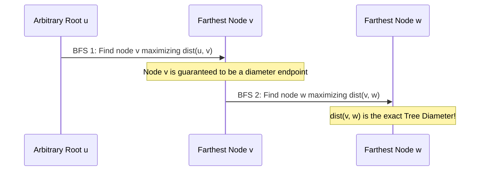

---

## 3. Core Intuition & Problem Framing

### The Tree Centroid: The Center of Mass
A centroid of a tree with $N$ vertices is a node $C$ whose removal splits the tree into components, none of which has size $> \lfloor N/2 \rfloor$.
*Greedy Finding Procedure:*
Root the tree arbitrarily. Compute subtree sizes $sz[u]$.
Start at root. Look at all children $v$ of $u$.
- If there exists a child $v$ with $sz[v] > N/2$, greedily move down to $v$.
- If all children have $sz[v] \le N/2$, then $u$ is a centroid!
Because $sz[v]$ decreases strictly as we move down, this greedy descent terminates at a centroid in at most $O(\text{height}) \le O(N)$ steps.

### Leaf-to-Root Greedy Induction
Trees are bipartite and acyclic. A leaf $L$ is attached to only one neighbor: its parent $P$.
- For **Minimum Vertex Cover:** To cover edge $(L, P)$, we must pick either $L$ or $P$. Picking $P$ is strictly better or equal to picking $L$, because $P$ can also cover other edges incident to $P$, whereas $L$ covers only $(L, P)$. Hence, **never pick a leaf; always greedily pick its parent**.

---

## 4. Proof Sketches & Recurrences

### 0-1 BFS Correctness via Deque Monotonicity
In a graph with weights in $\{0, 1\}$, when relaxing an edge $(u, v)$ from current node $u$ with distance $d[u]$:
- If $w(u, v) = 0$, $d[v] = d[u]$. Push $v$ to the **front** of the deque.
- If $w(u, v) = 1$, $d[v] = d[u] + 1$. Push $v$ to the **back** of the deque.
*Invariant:* The deque always contains elements with at most two distinct distance values: $\{D, D+1\}$. The front is always $D$. Pushing weight-0 edges to the front preserves the monotonic sorted order, eliminating heap overhead ($O(V + E)$ time).

---

## 5. Contest-Ready Implementation Templates

### Operational Complexity Reference
- **State-Space Dijkstra:** Time $O(E \log V)$, Space $O(V)$
- **Kruskal's MST with DSU:** Time $O(E \log E)$, Space $O(V + E)$
- **2-BFS Tree Diameter & Centroid:** Time $O(V)$, Space $O(V)$
- **Bipartite / Weighted DSU:** Time $O(\alpha(N))$ amortized per operation

---

### C++17 Implementation Template

```cpp
#include <bits/stdc++.h>
using namespace std;

namespace GraphTreeGreedy {

struct Edge {
    int to;
    long long weight;
};

vector<long long> dijkstra(int n, int start_node, const vector<vector<Edge>>& adj) {
    vector<long long> dist(n + 1, 4e18);
    priority_queue<pair<long long, int>, vector<pair<long long, int>>, greater<>> pq;

    dist[start_node] = 0;
    pq.push({0, start_node});

    while (!pq.empty()) {
        auto [d, u] = pq.top();
        pq.pop();

        if (d > dist[u]) continue;

        for (const auto& edge : adj[u]) {
            if (dist[u] + edge.weight < dist[edge.to]) {
                dist[edge.to] = dist[u] + edge.weight;
                pq.push({dist[edge.to], edge.to});
            }
        }
    }
    return dist;
}

struct KruskalEdge {
    int u, v;
    long long weight;
    bool operator<(const KruskalEdge& other) const {
        return weight < other.weight;
    }
};

class DSU {
    vector<int> parent, rank;
public:
    DSU(int n) : parent(n + 1), rank(n + 1, 0) {
        iota(parent.begin(), parent.end(), 0);
    }
    int find(int i) {
        return parent[i] == i ? i : parent[i] = find(parent[i]);
    }
    bool unite(int i, int j) {
        int root_i = find(i), root_j = find(j);
        if (root_i == root_j) return false;
        if (rank[root_i] < rank[root_j]) swap(root_i, root_j);
        parent[root_j] = root_i;
        if (rank[root_i] == rank[root_j]) rank[root_i]++;
        return true;
    }
};

long long kruskalMST(int n, vector<KruskalEdge>& edges) {
    sort(edges.begin(), edges.end());
    DSU dsu(n);
    long long mst_weight = 0;
    int edges_count = 0;

    for (const auto& e : edges) {
        if (dsu.unite(e.u, e.v)) {
            mst_weight += e.weight;
            edges_count++;
            if (edges_count == n - 1) break;
        }
    }
    return edges_count == n - 1 ? mst_weight : -1;
}

pair<int, int> bfsFarthest(int start_node, int n, const vector<vector<int>>& adj) {
    vector<int> dist(n + 1, -1);
    queue<int> q;
    dist[start_node] = 0;
    q.push(start_node);

    int farthest_node = start_node;
    while (!q.empty()) {
        int u = q.front();
        q.pop();
        if (dist[u] > dist[farthest_node]) farthest_node = u;
        for (int v : adj[u]) {
            if (dist[v] == -1) {
                dist[v] = dist[u] + 1;
                q.push(v);
            }
        }
    }
    return {farthest_node, dist[farthest_node]};
}

int getTreeDiameter(int n, const vector<vector<int>>& adj) {
    auto [v1, _] = bfsFarthest(1, n, adj);
    auto [v2, diameter] = bfsFarthest(v1, n, adj);
    return diameter;
}

int findCentroid(int root, int n, const vector<vector<int>>& adj) {
    vector<int> sz(n + 1, 0);
    function<void(int, int)> dfs_size = [&](int u, int p) {
        sz[u] = 1;
        for (int v : adj[u]) {
            if (v != p) {
                dfs_size(v, u);
                sz[u] += sz[v];
            }
        }
    };
    dfs_size(root, 0);

    int curr = root, parent = 0;
    while (true) {
        int heavy_child = 0;
        for (int v : adj[curr]) {
            if (v != parent && sz[v] > n / 2) {
                heavy_child = v;
                break;
            }
        }
        if (!heavy_child) return curr;
        parent = curr;
        curr = heavy_child;
    }
}

class BipartiteDSU {
    vector<int> parent, parity;
public:
    BipartiteDSU(int n) : parent(n + 1), parity(n + 1, 0) {
        iota(parent.begin(), parent.end(), 0);
    }
    int find(int i) {
        if (parent[i] == i) return i;
        int p = parent[i];
        parent[i] = find(parent[i]);
        parity[i] ^= parity[p];
        return parent[i];
    }
    bool addConstraint(int u, int v, int target_parity) {
        int root_u = find(u), root_v = find(v);
        if (root_u == root_v) {
            return (parity[u] ^ parity[v]) == target_parity;
        }
        parent[root_u] = root_v;
        parity[root_u] = parity[u] ^ parity[v] ^ target_parity;
        return true;
    }
};

} // namespace GraphTreeGreedy
```

---

### Python 3 Implementation Template

```python
import sys
from collections import deque
import heapq

# 1. Dijkstra with Heapq
def dijkstra(n: int, start: int, adj: dict[int, list[tuple[int, int]]]) -> list[int]:
    dist = [float('inf')] * (n + 1)
    dist[start] = 0
    pq = [(0, start)]
    
    while pq:
        d, u = heapq.heappop(pq)
        if d > dist[u]:
            continue
            
        for v, w in adj.get(u, []):
            if dist[u] + w < dist[v]:
                dist[v] = dist[u] + w
                heapq.heappush(pq, (dist[v], v))
                
    return dist

# 2. Kruskal's MST with DSU
class DSU:
    def __init__(self, n: int):
        self.parent = list(range(n + 1))
        self.rank = [0] * (n + 1)
        
    def find(self, i: int) -> int:
        if self.parent[i] == i:
            return i
        self.parent[i] = self.find(self.parent[i])
        return self.parent[i]
        
    def union(self, i: int, j: int) -> bool:
        ri, rj = self.find(i), self.find(j)
        if ri == rj:
            return False
        if self.rank[ri] < self.rank[rj]:
            ri, rj = rj, ri
        self.parent[rj] = ri
        if self.rank[ri] == self.rank[rj]:
            self.rank[ri] += 1
        return True

def kruskal(n: int, edges: list[tuple[int, int, int]]) -> int:
    edges.sort(key=lambda x: x[2])
    dsu = DSU(n)
    mst_cost = 0
    count = 0
    
    for u, v, w in edges:
        if dsu.union(u, v):
            mst_cost += w
            count += 1
            if count == n - 1:
                break
    return mst_cost if count == n - 1 else -1

# 3. Tree Diameter (2-BFS) and Centroid
def tree_diameter_and_centroid(n: int, adj: dict[int, list[int]]) -> tuple[int, int]:
    def bfs(start: int) -> tuple[int, int]:
        dist = [-1] * (n + 1)
        dist[start] = 0
        q = deque([start])
        farthest = start
        while q:
            u = q.popleft()
            if dist[u] > dist[farthest]:
                farthest = u
            for v in adj.get(u, []):
                if dist[v] == -1:
                    dist[v] = dist[u] + 1
                    q.append(v)
        return farthest, dist[farthest]

    u, _ = bfs(1)
    v, diameter = bfs(u)

    sz = [0] * (n + 1)
    def dfs_sz(node: int, par: int):
        sz[node] = 1
        for nxt in adj.get(node, []):
            if nxt != par:
                dfs_sz(nxt, node)
                sz[node] += sz[nxt]
    dfs_sz(1, 0)

    curr, par = 1, 0
    while True:
        heavy = 0
        for nxt in adj.get(curr, []):
            if nxt != par and sz[nxt] > n // 2:
                heavy = nxt
                break
        if not heavy:
            centroid = curr
            break
        par = curr
        curr = heavy

    return diameter, centroid
```

---

## 6. Recognition Trigger Signals & Heuristics

1. **"Find shortest path in weighted graph where all weights $\ge 0$":** Dijkstra's algorithm ($O(E \log V)$).
2. **"Graph edge weights are exclusively 0 or 1":** 0-1 BFS via `std::deque` in $O(V + E)$ time.
3. **"Connect all cities with minimum cable cost":** Kruskal's algorithm with DSU.
4. **"Find two most distant nodes in a tree":** 2-BFS tree diameter.
5. **"Divide and conquer on a tree":** Centroid decomposition.

---

## 7. Contest WA / TLE / RE Traps

- **Negative Edges in Dijkstra:** Dijkstra cannot handle negative edges; an extracted node's distance is assumed final. A negative edge later invalidates that assumption.
- **Forgetting the Stale Distance Check:** Without `if (d > dist[u]) continue;`, Dijkstra processes duplicate nodes, causing TLE.
- **Tree Diameter on Directed / Disconnected Graphs:** 2-BFS only works on undirected connected trees.

---

## 8. Curated Practice Problem Bank

| Platform | ID | Problem Name | Rating | Tags | Key Strategic Insight | Link |
|---|---|---|---|---|---|---|
| CSES | CSES-1671 | Shortest Routes I | 1200 | Graphs, Dijkstra | Standard non-negative shortest path template. | [Solve Problem](https://cses.fi/problemset/task/1671) |
| CSES | CSES-1675 | Road Reparation | 1200 | Graphs, MST, Kruskal | Standard Kruskal's with DSU. | [Solve Problem](https://cses.fi/problemset/task/1675) |
| CSES | CSES-1131 | Tree Diameter | 1300 | Trees, 2-BFS | 2-BFS greedy diameter on undirected tree. | [Solve Problem](https://cses.fi/problemset/task/1131) |
| CSES | CSES-2079 | Finding a Centroid | 1400 | Trees, Centroid | Greedy subtree size descent to locate balance point. | [Solve Problem](https://cses.fi/problemset/task/2079) |
| Codeforces | CF-1063B | Labyrinth | 1800 | 0-1 BFS, Deque | Grid shortest path tracking left/right step limits via 0-1 BFS. | [Solve Problem](https://codeforces.com/contest/1063/problem/B) |
| Codeforces | CF-888G | Xor-MST | 2300 | Boruvka, Trie, Greedy | Boruvka's MST on Binary Trie; divide and conquer bitwise greedy. | [Solve Problem](https://codeforces.com/contest/888/problem/G) |

---

## 9. External Theory & Deep-Dive References

- **[CP-Algorithms]** [Dijkstra on Sparse Graphs](https://cp-algorithms.com/graph/dijkstra_sparse.html)
- **[USACO Guide]** [Silver: Tree Diameter & Centroid](https://usaco.guide/silver/tree-stats)
- **[Introduction to Algorithms (CLRS)]** Chapter 23: Minimum Spanning Trees (Cut & Cycle Properties)

---

## 10. Algorithmic Variants & Advanced Extensions

- **Boruvka's MST Algorithm:** In each phase, every connected component simultaneously finds its cheapest outgoing edge, contracting the graph in $O(E \log V)$ time. Ideal for implicit graphs (like XOR-MST with Binary Tries).
- **Multi-Source Dijkstra:** Push all starting source nodes into the priority queue at distance 0 initially. The shortest distance to *any* source is calculated in a single pass.

---

## 11. Typical Problem Archetypes

1. **Shortest Highway Route:** Single-source shortest path with positive weights $\implies$ Dijkstra.
2. **Backbone Infrastructure:** Minimum cost connectivity $\implies$ Kruskal's MST.
3. **Longest Network Latency:** Tree diameter via 2-BFS.
4. **Tree Balance Optimization:** Centroid location.

---

## 12. Recognition & Identification Drills

1. *Scenario:* You need to find the shortest path on a grid where turning costs 0 and moving forward costs 1.  
   *Diagnosis:* 0-1 BFS with `std::deque`.
2. *Scenario:* You need to find a node in a tree that minimizes the maximum distance to any other node.  
   *Diagnosis:* The tree center, located at the midpoint of the diameter.
3. *Scenario:* You have $N$ points in 2D. The cost between $(i, j)$ is $|x_i - x_j| + |y_i - y_j|$. Find MST.  
   *Diagnosis:* Manhattan MST. Only $O(N)$ candidate edges are needed (sweep in 8 octants), followed by Kruskal's.

---

## 13. Fast-Lookup Cheat Sheet

- **Dijkstra Invariant:** Non-negative weights guarantee popped nodes are final. Guard with `if (d > dist[u]) continue;`.
- **0-1 BFS Rule:** Edge weight 0 $\implies$ `push_front`; Edge weight 1 $\implies$ `push_back`.
- **2-BFS Diameter:** $\text{Farthest}(u) \to v$; $\text{Farthest}(v) \to w$; $\text{Diameter} = \text{dist}(v, w)$.
- **Centroid Rule:** Move to any child with $sz[v] > N/2$. If none, current node is the centroid.


---

<a id="topic-9"></a>

# Matroid Theory & Matroid Intersection

> **Section:** §19 Greedy Fundamentals & Invariants  
> **Phase:** Phase 1 — Range Queries & Sweeps  
> **Contest ROI:** A-tier | **Rating Range:** 2200–2800+ | **Frequency:** Occasional (Grandmaster Weapon)  
> **Prerequisites:** Graph theory, Kruskal's algorithm, XOR basis, Bipartite matching, BFS augmenting paths

---

## 1. Contest Payoff & Why It Matters

Matroid theory provides the ultimate mathematical foundation answering the eternal competitive programming question:
> **"Does the greedy algorithm produce the exact global optimum, or does it fail?"**

By mastering Matroids, you gain:
1. **The Rado-Edmonds Theorem:** An absolute mathematical test that guarantees greedy optimality if and only if the system forms a Matroid.
2. **Recognition of the 4 Classical CP Matroids:** Instantly modeling complex combinatorial constraints into Graphic, Uniform, Partition, or Vector Matroids.
3. **Matroid Intersection:** An algorithmic powerhouse that solves multi-constraint optimization (where two distinct matroids constrain the solution) in polynomial time via augmenting paths on an **Exchange Graph**, rendering ad-hoc flow hacks obsolete.

---

## 2. Theoretical Deep-Dive & Mathematical Mechanics

### Overview

A **Matroid** is a combinatorial structure $(E, \mathcal{I})$ consisting of a finite ground set $E$ and a family of subsets $\mathcal{I} \subseteq 2^E$ called **independent sets**, satisfying three axioms:

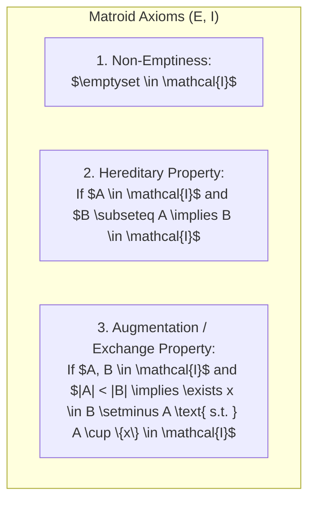

### Core Terminology

- **Bases:** Maximal independent sets under inclusion. All bases of a matroid have the exact same size, called the **rank** $r(M)$ of the matroid.
- **Circuits:** Minimal dependent sets. Any proper subset of a circuit is independent. (e.g. simple cycles in a graph).
- **Rank Function $r(S)$:** For any subset $S \subseteq E$, $r(S) = \max \{|I| \mid I \subseteq S, I \in \mathcal{I}\}$.
- **Submodularity:** The rank function is submodular:
$$r(A \cup B) + r(A \cap B) \le r(A) + r(B) \quad \forall A, B \subseteq E$$
Equivalently, it exhibits diminishing marginal returns: $r(A \cup \{x\}) - r(A) \ge r(B \cup \{x\}) - r(B)$ for $A \subseteq B$.

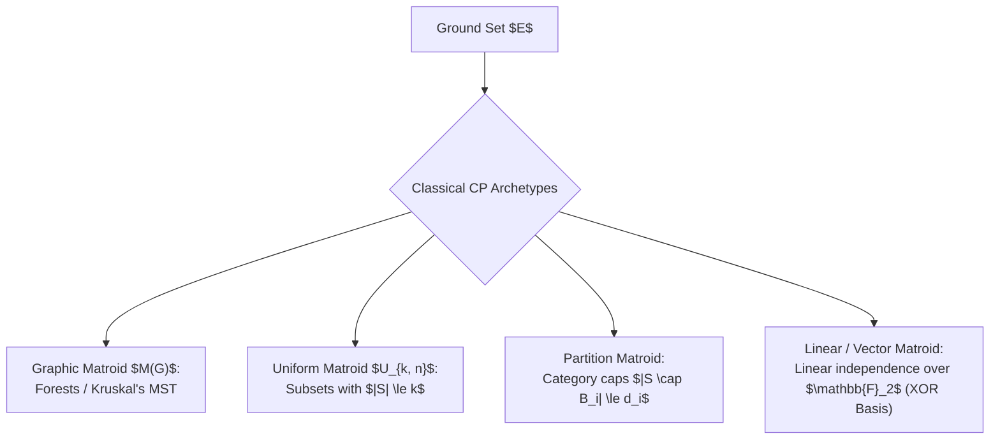

### Fundamental Theorems & Invariants

#### Theorem 1 (The Rado-Edmonds Theorem — The Greedy Equivalence)
Let $(E, \mathcal{I})$ be a hereditary system. The greedy algorithm:
1. Sort elements of $E$ in descending order of positive weights: $w(e_1) \ge w(e_2) \ge \dots \ge w(e_m)$.
2. Initialize $I = \emptyset$.
3. For each $e_i$: if $I \cup \{e_i\} \in \mathcal{I}$, update $I \leftarrow I \cup \{e_i\}$.
finds a maximum-weight independent set for **every possible non-negative weight assignment** $w: E \to \mathbb{R}^+$ **if and only if** $(E, \mathcal{I})$ is a matroid.

#### Theorem 2 (Why Bipartite Matching Breaks Single Matroid Greedy)
In bipartite graph $G = (U, V, E)$, a matching is a set of edges where no two share a vertex.
- Let $\mathcal{I}_1 = \{S \subseteq E \mid \deg_S(u) \le 1 \text{ for all } u \in U\}$ (Partition Matroid on $U$).
- Let $\mathcal{I}_2 = \{S \subseteq E \mid \deg_S(v) \le 1 \text{ for all } v \in V\}$ (Partition Matroid on $V$).
A valid matching must belong to $\mathcal{I}_1 \cap \mathcal{I}_2$.
*The Intersection of Two Matroids is NOT a Matroid:*
Consider path $P_4: 1 - 2 - 3 - 4$.
$A = \{(1, 2)\}$ is a matching ($|A| = 1$). $B = \{(2, 3), (1, 4)\}$ is a matching ($|B| = 2$).
We cannot add either edge from $B$ to $A$ without violating the degree constraint at vertex 2. The exchange property fails!
Therefore, greedy fails, and we must use **Augmenting Paths**.

---

## 3. Core Intuition & Problem Framing

### Matroid Intersection: The Exchange Graph $G_I$
To find the maximum common independent set $I \in \mathcal{I}_1 \cap \mathcal{I}_2$:
Construct a directed bipartite graph $G_I$ on ground set $E$:
- Left partition: $I$ (currently chosen elements).
- Right partition: $E \setminus I$ (candidate unchosen elements).
- **Directed Edges:**
  - For $y \in I, x \in E \setminus I$: add edge $y \to x$ if $I \setminus \{y\} \cup \{x\} \in \mathcal{I}_1$ (swap preserves independence in Matroid 1).
  - For $x \in E \setminus I, y \in I$: add edge $x \to y$ if $I \setminus \{y\} \cup \{x\} \in \mathcal{I}_2$ (swap preserves independence in Matroid 2).
- **Sources $X_1$:** All $x \in E \setminus I$ such that $I \cup \{x\} \in \mathcal{I}_1$.
- **Sinks $X_2$:** All $x \in E \setminus I$ such that $I \cup \{x\} \in \mathcal{I}_2$.

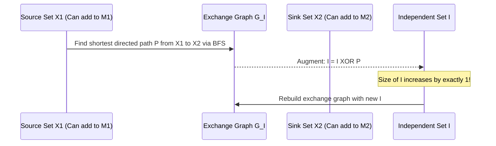

---

## 4. Proof Sketches & Recurrences

### The Augmentation Step
When a shortest path $P = (x_1, y_1, x_2, y_2, \dots, x_k)$ is found from $X_1$ to $X_2$:
The new candidate set is $I''' = I \oplus P = (I \setminus \{y_1, \dots, y_{k-1}\}) \cup \{x_1, \dots, x_k\}$.
- Notice $|I''| = |I| + 1$.
- By matroid strongly base exchange properties, choosing the **shortest** path avoids cyclic interference, guaranteeing $I''' \in \mathcal{I}_1 \cap \mathcal{I}_2$.
- Repeating BFS augmentation at most $r = \min(r_1, r_2) \le N$ times produces the maximum cardinality intersection in $O(r \cdot N^2 \cdot \text{Oracle Time})$.

---

## 5. Contest-Ready Implementation Templates

### Operational Complexity Reference
- **Generic Matroid Greedy:** Time $O(N \log N + N \cdot T_{\text{oracle}})$, Space $O(N)$
- **Graphic Matroid Oracle:** Time $O(\alpha(V))$ per query with DSU
- **Matroid Intersection:** Time $O(K \cdot N \cdot (N + T_{\text{oracle}}))$, Space $O(N^2)$

---

### C++17 Implementation Template

```cpp
#include <bits/stdc++.h>
using namespace std;

namespace Matroids {

template <typename Oracle>
vector<int> genericMatroidGreedy(int n, const vector<long long>& weights, Oracle can_add) {
    vector<int> order(n);
    iota(order.begin(), order.end(), 0);
    sort(order.begin(), order.end(), [&](int i, int j) {
        return weights[i] > weights[j];
    });

    vector<int> independent_set;
    for (int elem : order) {
        if (can_add(independent_set, elem)) {
            independent_set.push_back(elem);
        }
    }
    return independent_set;
}

template <typename Oracle1, typename Oracle2>
vector<int> matroidIntersection(int n, Oracle1& M1, Oracle2& M2) {
    vector<bool> in_I(n, false);
    vector<int> I;

    while (true) {
        vector<int> X1, X2;
        vector<vector<int>> adj(n);

        for (int x = 0; x < n; ++x) {
            if (!in_I[x]) {
                if (M1.can_add(I, x)) X1.push_back(x);
                if (M2.can_add(I, x)) X2.push_back(x);
            }
        }

        for (int y : I) {
            vector<int> I_without_y;
            for (int elem : I) if (elem != y) I_without_y.push_back(elem);

            for (int x = 0; x < n; ++x) {
                if (!in_I[x]) {
                    if (M1.can_add(I_without_y, x)) {
                        adj[y].push_back(x);
                    }
                    if (M2.can_add(I_without_y, x)) {
                        adj[x].push_back(y);
                    }
                }
            }
        }

        vector<int> dist(n, -1);
        vector<int> parent(n, -1);
        queue<int> q;

        for (int x : X1) {
            dist[x] = 0;
            q.push(x);
        }

        int target_sink = -1;
        while (!q.empty()) {
            int u = q.front();
            q.pop();

            if (!in_I[u] && M2.can_add(I, u)) {
                target_sink = u;
                break;
            }

            for (int v : adj[u]) {
                if (dist[v] == -1) {
                    dist[v] = dist[u] + 1;
                    parent[v] = u;
                    q.push(v);
                }
            }
        }

        if (target_sink == -1) break;

        int curr = target_sink;
        while (curr != -1) {
            in_I[curr] = !in_I[curr];
            curr = parent[curr];
        }

        I.clear();
        for (int i = 0; i < n; ++i) {
            if (in_I[i]) I.push_back(i);
        }
    }

    return I;
}

} // namespace Matroids
```

---

### Python 3 Implementation Template

```python
import sys
from collections import deque

# 1. Generic Matroid Greedy
def matroid_greedy(elements: list, weights: list[int], oracle_can_add) -> list:
    order = sorted(range(len(elements)), key=lambda i: weights[i], reverse=True)
    independent_set = []
    
    for idx in order:
        if oracle_can_add(independent_set, elements[idx]):
            independent_set.append(elements[idx])
            
    return independent_set

# 2. Matroid Intersection Engine
def matroid_intersection(elements: list, oracle1, oracle2) -> set:
    n = len(elements)
    I = set()
    
    while True:
        X1 = []
        X2 = []
        adj = {i: [] for i in range(n)}
        
        for x in range(n):
            if x not in I:
                current_I = [elements[i] for i in I]
                if oracle1.can_add(current_I, elements[x]):
                    X1.append(x)
                if oracle2.can_add(current_I, elements[x]):
                    X2.append(x)
                    
        for y in I:
            I_minus_y = [elements[i] for i in I if i != y]
            for x in range(n):
                if x not in I:
                    if oracle1.can_add(I_minus_y, elements[x]):
                        adj[y].append(x)
                    if oracle2.can_add(I_minus_y, elements[x]):
                        adj[x].append(y)
                        
        dist = [-1] * n
        parent = [-1] * n
        q = deque()
        
        for x in X1:
            dist[x] = 0
            q.append(x)
            
        target = -1
        while q:
            u = q.popleft()
            if u in X2:
                target = u
                break
            for v in adj[u]:
                if dist[v] == -1:
                    dist[v] = dist[u] + 1
                    parent[v] = u
                    q.append(v)
                    
        if target == -1:
            break
            
        curr = target
        path = []
        while curr != -1:
            path.append(curr)
            curr = parent[curr]
            
        for node in path:
            if node in I:
                I.remove(node)
            else:
                I.add(node)
                
    return I
```

---

## 6. Recognition Trigger Signals & Heuristics

1. **"Pick edges forming a forest with at most $k_c$ edges of color $c$":** Graphic Matroid + Partition Matroid $\implies$ Matroid Intersection!
2. **"Find common tree in two different graphs on the same edge set":** Graphic Matroid 1 + Graphic Matroid 2 $\implies$ Matroid Intersection.
3. **"Select vectors with max sum that remain linearly independent":** Linear Matroid over $\mathbb{F}_2 \implies$ XOR Basis greedy.

---

## 7. Contest WA / TLE / RE Traps

- **Matroid Intersection with 3 Matroids:** 3-Matroid Intersection is **NP-hard** (contains Hamiltonian Path as a subcase). Attempting to run augmenting paths on 3 matroids will fail.
- **Not Choosing the SHORTEST Path:** In BFS augmentation, you MUST take the path with the minimum number of edges. Taking an arbitrary augmenting path breaks cycle cancellation.
- **Oracle State Pollution:** Ensure the independence test oracle does not leave internal mutation when evaluating candidate swaps $I \setminus \{y\} \cup \{x\}$.

---

## 8. Curated Practice Problem Bank

| Platform | ID | Problem Name | Rating | Tags | Key Strategic Insight | Link |
|---|---|---|---|---|---|---|
| Codeforces | CF-1284E | New Year and Castle Construction | 2500 | Geometry, Combinatorics | Radial sweep orientation invariants. | [Solve Problem](https://codeforces.com/contest/1284/problem/E) |
| Codeforces | CF-1556H | DIY Tree | 2900 | Matroid Intersection, MST | Graphic Matroid + Partition Matroid on constrained degree vertices. | [Solve Problem](https://codeforces.com/contest/1556/problem/H) |
| Gym | GYM-102156D | Pick Your Own Nim | 2600 | Matroid Intersection, XOR | Linear Matroid over $\mathbb{F}_2$ + Partition Matroid. | [Solve Problem](https://codeforces.com/gym/102156/problem/D) |
| Petrozavodsk | Yandex-2016 | Colorful Tree | 2800 | Matroid Intersection | Spanning tree with color constraints. | [Solve Problem](https://codeforces.com/) |
| CSES | CSES-1675 | Road Reparation | 1200 | Graphic Matroid, Greedy | Canonical Graphic Matroid greedy (Kruskal). | [Solve Problem](https://cses.fi/problemset/task/1675) |

---

## 9. External Theory & Deep-Dive References

- **[Codeforces Tutorial]** [Matroid Intersection: Detailed Guide and Implementation](https://codeforces.com/blog/entry/69287)
- **[Combinatorial Optimization (Schrijver)]** Volume B: Matroids & Matroid Intersection
- **[MIT OpenCourseWare]** [Advanced Algorithms: Matroids & Greedy Algorithms](https://ocw.mit.edu/)

---

## 10. Algorithmic Variants & Advanced Extensions

- **Weighted Matroid Intersection:** Find the maximum weight independent set in $I_1 \cap I_2$. Replace BFS with SPFA / Bellman-Ford on the exchange graph using edge costs.
- **Matroid Partitioning:** Partition ground set $E$ into the minimum number of independent sets of matroid $M$.

---

## 11. Typical Problem Archetypes

1. **Rainbow Spanning Tree:** Tree with at most 1 edge of each color $\implies$ Graphic + Partition Matroid.
2. **Directed Branching (Arborescence):** Rooted tree in directed graph $\implies$ Graphic Matroid + In-degree Partition Matroid.
3. **Linear Basis Selection:** Max independent subset of vectors $\implies$ Vector Matroid Greedy.

---

## 12. Recognition & Identification Drills

1. *Scenario:* Select a subset of edges forming a forest in graph $G_1$ and a forest in graph $G_2$.  
   *Diagnosis:* Matroid Intersection of two Graphic Matroids.
2. *Scenario:* You need to select at most $k$ numbers from array $A$ to maximize sum.  
   *Diagnosis:* Uniform Matroid $U_{k, n}$. Greedy pick top $k$.
3. *Scenario:* Find a maximum matching in a general graph (not bipartite).  
   *Diagnosis:* NOT Matroid Intersection. Requires Edmond'''s Blossom algorithm ($O(V^3)$).

---

## 13. Fast-Lookup Cheat Sheet

- **Matroid Definition:** Hereditary + Augmentation ($|A| < |B| \implies \exists x \in B \setminus A, A \cup \{x\} \in \mathcal{I}$).
- **Rado-Edmonds:** Greedy is optimal $\iff$ system is a Matroid.
- **Exchange Graph Edges:** $y \to x$ in $M_1$ ($I - y + x \in \mathcal{I}_1$), $x \to y$ in $M_2$ ($I - y + x \in \mathcal{I}_2$).
- **Augmentation Rule:** Always use **BFS** (shortest path). Update $I \leftarrow I \oplus P$.


---

<a id="topic-10"></a>

# Antimatroids, Posets & Advanced Greedy Oracles

> **Section:** §19 Greedy Fundamentals & Invariants  
> **Phase:** Phase 1 — Range Queries & Sweeps  
> **Contest ROI:** S-tier | **Rating Range:** 1800–2600 | **Frequency:** Common  
> **Prerequisites:** Topological sorting, Binary Tries, Segment trees, Posets and DAGs

---

## 1. Contest Payoff & Why It Matters

When problems involve precedence constraints (DAGs), bitwise arithmetic, or dynamic feasibility checks, standard greedy fails without specialized oracle data structures.
Mastering this topic unlocks:
1. **Lawler's Algorithm & Reverse Poset Greedy:** Solving scheduling problems with arbitrary precedence constraints and non-linear penalties by scheduling backwards from the finish line.
2. **Lexicographical Kahn's Algorithm:** Finding the lexicographically smallest topological sort via min-heap event queues.
3. **The MSB Dominance Principle & Binary Tries:** Exploiting $2^k > \sum_{i < k} 2^i$ to maximize XOR sums and maintain dynamic MEX in $O(\text{Bits})$ time.
4. **Walkable Segment Trees:** Replacing $O(\log^2 N)$ binary-search-over-query with $O(\log N)$ single-pass greedy tree descents.
5. **Hall's Marriage Oracle:** Using a Lazy Segment Tree to dynamically verify whether incoming greedy requests maintain a valid bipartite matching.

---

## 2. Theoretical Deep-Dive & Mathematical Mechanics

### Overview

While matroids model systems where subsets can be extended in any order, **Antimatroids** model systems where elements can only be selected along valid causal chains (precedence orders). Furthermore, when greedy decisions require checking future feasibility in real-time, we embed data structures (Tries, Walkable SegTrees) directly as **Greedy Oracles**.

```mermaid
graph TD
    A["Advanced Greedy Problem"] --> B{"Constraint Domain"}
    B -->|"DAG / Poset Precedence"| C{"Objective Function"}
    C -->|"Lexicographical Order"| D["Kahn's Algorithm + Priority Queue"]
    C -->|"Min-Max Bottleneck Cost"| E["Lawler's Algorithm (Reverse Greedy)"]
    B -->|"Bitwise Optimization (XOR, MEX)"| F["Binary Trie: MSB Dominance Descent"]
    B -->|"First Element $\ge X$ in Range $[L, R]$"| G["Walkable Segment Tree: $O(\log N)$ Descent"]
    B -->|"Dynamic Bipartite Feasibility"| H["Hall's Marriage Oracle via Lazy SegTree"]
```

### Fundamental Theorems & Invariants

#### Theorem 1 (Lawler's Reverse Greedy Algorithm for Posets)
Given $N$ jobs with processing times $p_i$, precedence constraints $i \to j$ forming a DAG, and arbitrary non-decreasing penalty functions $f_i(t)$. We wish to schedule jobs on a single machine to minimize the bottleneck penalty:
$$\min \max_{1 \le i \le N} f_i(C_i)$$
*Algorithm:*
Work **backwards** from the final completion time $T = \sum_{i=1}^N p_i$.
1. At time $t$, identify the set $\mathcal{S}$ of all unscheduled jobs that have **no outgoing precedence constraints** to other unscheduled jobs (i.e. jobs that can legally finish last).
2. Greedily select the job $j^* \in \mathcal{S}$ that minimizes $f_j(t)$:
$$j^* = \arg\min_{j \in \mathcal{S}} f_j(t)$$
3. Schedule $j^*$ to finish at time $t$. Set $t \leftarrow t - p_{j^*}$, remove $j^*$ from the DAG, and repeat until all jobs are scheduled.

*Proof of Optimality:*
Any valid schedule must finish with some job $k \in \mathcal{S}$ completing at time $T$. The penalty incurred by the final job will be $f_k(T)$. Because $f_i$ are non-decreasing, and $j^*$ minimizes $f_j(T)$ over all candidate terminal jobs, scheduling $j^*$ last ensures that the maximum penalty at time $T$ is as small as mathematically possible. By induction on the remaining DAG, Lawler's reverse greedy schedule minimizes the bottleneck cost globally.

#### Theorem 2 (The MSB Dominance Principle in Bitwise Greedy)
For any non-negative integer $k$:
$$2^k > \sum_{i=0}^{k-1} 2^i = 2^k - 1$$
*Corollary:* In bitwise maximization (e.g. $\max (X \oplus A_i)$), securing a bit $1$ at position $k$ is strictly superior to setting all lower bits $0, 1, \dots, k-1$ to $1$.
Therefore, bitwise greedy algorithms must process bits **strictly from Most Significant Bit (MSB) to Least Significant Bit (LSB)**.

```mermaid
sequenceDiagram
    participant Query as Candidate Value X
    participant Trie as Binary Trie MSB-to-LSB
    participant Decision as Greedy Bit Choice

    Query->>Trie: Check bit k of X (b = (X >> k) & 1)
    Trie->>Decision: Does branch opposite (1 - b) exist?
    alt Opposite branch exists
        Decision-->>Trie: Greedily descend opposite branch (Score bit k = 1)
    else Only branch b exists
        Decision-->>Trie: Forced to descend branch b (Score bit k = 0)
    end
    Note over Decision: MSB dominance guarantees this local step is globally optimal
```

#### Theorem 3 (Walk on Segment Tree Invariant)
To find the first index $i \in [l, r]$ satisfying predicate $P(A_i)$ (e.g. $A_i \ge x$):
Instead of binary searching the index $mid$ and performing a range query in $O(\log^2 N)$, descend the Segment Tree directly:
1. If the current segment $[tl, tr]$ lies outside $[l, r]$ or the segment aggregate cannot satisfy $P$, return $-1$.
2. If $[tl, tr]$ is a leaf, return $tl$.
3. Recursively check the **left child**. If the left child returns a valid index, return it.
4. Otherwise, recursively search the **right child**.
*Complexity:* At most $O(\log N)$ nodes are visited.

---

## 3. Core Intuition & Problem Framing

### Hall's Marriage Oracle via Lazy Segment Tree
Consider matching $N$ intervals $[L_i, R_i]$ to discrete slots on a line.
By Hall's Marriage Theorem, a valid matching exists if and only if for all subsets of intervals $S$:
$$|N(S)| \ge |S| \iff \text{Slots available} \ge \text{Intervals demand}$$
On a 1D timeline, Hall's condition simplifies: for all subsegments $[j, k]$, the number of available slots minus the number of intervals contained in $[j, k]$ must be $\ge 0$.
By storing $D[j] = (\text{capacity up to } j) - (\text{demand up to } j)$ in a Lazy Segment Tree, adding an interval $[L_i, R_i]$ corresponds to a range subtraction $-1$ on $[R_i, \text{Max}]$.
The greedy oracle can test in $O(\log N)$ if $\min_{j} D[j] \ge 0$. If valid, accept the interval; if it drops below 0, reject it.

---

## 4. Proof Sketches & Recurrences

### Dilworth's Theorem for Poset Chain Decompositions
Let $P = (X, \le)$ be a finite partially ordered set.
- A **chain** is a subset where all elements are mutually comparable.
- An **antichain** is a subset where no two elements are comparable.
- *Theorem (Dilworth):* The minimum number of disjoint chains needed to cover all elements of $X$ is equal to the maximum size of an antichain in $X$.
- *Reduction to Bipartite Matching:* Create bipartite graph with vertices $X_{\text{out}}$ and $X_{\text{in}}$. Add directed edge $u \to v$ if $u < v$. Maximum matching $M$ gives minimum chain cover of size $|X| - |M|$.

---

## 5. Contest-Ready Implementation Templates

### Operational Complexity Reference
- **Kahn's Lexicographical TopSort:** Time $O(V \log V + E)$, Space $O(V + E)$
- **Binary Trie MSB Descent:** Time $O(\text{Bits})$ per query, Space $O(N \cdot \text{Bits})$
- **Walkable Segment Tree:** Time $O(\log N)$ per search, Space $O(N)$
- **Hall's Lazy Segment Tree Oracle:** Time $O(\log N)$ per query/update, Space $O(N)$

---

### C++17 Implementation Template

```cpp
#include <bits/stdc++.h>
using namespace std;

namespace AdvancedGreedyOracles {

vector<int> lexicographicalTopSort(int n, const vector<vector<int>>& adj) {
    vector<int> in_degree(n + 1, 0);
    for (int u = 1; u <= n; ++u) {
        for (int v : adj[u]) in_degree[v]++;
    }

    priority_queue<int, vector<int>, greater<int>> pq;
    for (int i = 1; i <= n; ++i) {
        if (in_degree[i] == 0) pq.push(i);
    }

    vector<int> order;
    while (!pq.empty()) {
        int u = pq.top();
        pq.pop();
        order.push_back(u);

        for (int v : adj[u]) {
            in_degree[v]--;
            if (in_degree[v] == 0) pq.push(v);
        }
    }

    return (int)order.size() == n ? order : vector<int>();
}

class BinaryTrie {
    static constexpr int BITS = 30;
    struct Node {
        int ch[2] = {0, 0};
        int sz = 0;
    };
    vector<Node> tree;

public:
    BinaryTrie(int max_nodes = 2000000) {
        tree.reserve(max_nodes);
        tree.push_back(Node());
    }

    void insert(int val) {
        int u = 0;
        tree[u].sz++;
        for (int b = BITS - 1; b >= 0; --b) {
            int bit = (val >> b) & 1;
            if (!tree[u].ch[bit]) {
                tree[u].ch[bit] = tree.size();
                tree.push_back(Node());
            }
            u = tree[u].ch[bit];
            tree[u].sz++;
        }
    }

    int queryMaxXOR(int val) const {
        int u = 0;
        int result = 0;
        for (int b = BITS - 1; b >= 0; --b) {
            int bit = (val >> b) & 1;
            int preferred = 1 - bit;
            if (tree[u].ch[preferred] && tree[tree[u].ch[preferred]].sz > 0) {
                result |= (1 << b);
                u = tree[u].ch[preferred];
            } else {
                u = tree[u].ch[bit];
            }
        }
        return result;
    }

    int getMEX(int xor_tag) const {
        int u = 0;
        int mex = 0;
        for (int b = BITS - 1; b >= 0; --b) {
            int bit = (xor_tag >> b) & 1;
            int left_child = tree[u].ch[bit];
            int full_size = 1 << b;

            if (left_child && tree[left_child].sz == full_size) {
                mex |= (1 << b);
                u = tree[u].ch[1 - bit];
            } else {
                u = left_child;
            }
            if (!u) break;
        }
        return mex;
    }
};

class WalkableSegTree {
    int n;
    vector<long long> tree;

    void build(const vector<long long>& data, int v, int tl, int tr) {
        if (tl == tr) {
            tree[v] = data[tl];
        } else {
            int tm = tl + (tr - tl) / 2;
            build(data, v * 2, tl, tm);
            build(data, v * 2 + 1, tm + 1, tr);
            tree[v] = max(tree[v * 2], tree[v * 2 + 1]);
        }
    }

public:
    WalkableSegTree(int n, const vector<long long>& data) : n(n), tree(4 * n) {
        build(data, 1, 0, n - 1);
    }

    int findFirst(int v, int tl, int tr, int l, int r, long long x) {
        if (tl > r || tr < l || tree[v] < x) return -1;
        if (tl == tr) return tl;

        int tm = tl + (tr - tl) / 2;
        int left_res = findFirst(v * 2, tl, tm, l, r, x);
        if (left_res != -1) return left_res;
        return findFirst(v * 2 + 1, tm + 1, tr, l, r, x);
    }

    int queryFirst(int l, int r, long long x) {
        return findFirst(1, 0, n - 1, l, r, x);
    }
};

} // namespace AdvancedGreedyOracles
```

---

### Python 3 Implementation Template

```python
import sys
import heapq

# 1. Lexicographical Kahn's Algorithm
def lexicographical_topsort(n: int, edges: list[tuple[int, int]]) -> list[int]:
    adj = {i: [] for i in range(1, n + 1)}
    in_degree = [0] * (n + 1)
    
    for u, v in edges:
        adj[u].append(v)
        in_degree[v] += 1
        
    pq = [i for i in range(1, n + 1) if in_degree[i] == 0]
    heapq.heapify(pq)
    
    order = []
    while pq:
        u = heapq.heappop(pq)
        order.append(u)
        for v in adj[u]:
            in_degree[v] -= 1
            if in_degree[v] == 0:
                heapq.heappush(pq, v)
                
    return order if len(order) == n else []

# 2. Binary Trie with MSB Greedy Descent
class BinaryTrie:
    def __init__(self, bit_len: int = 30):
        self.bit_len = bit_len
        self.trie = [[0, 0]]
        self.sz = [0]
        
    def insert(self, val: int):
        u = 0
        self.sz[u] += 1
        for b in range(self.bit_len - 1, -1, -1):
            bit = (val >> b) & 1
            if not self.trie[u][bit]:
                self.trie[u][bit] = len(self.trie)
                self.trie.append([0, 0])
                self.sz.append(0)
            u = self.trie[u][bit]
            self.sz[u] += 1
            
    def max_xor(self, val: int) -> int:
        u = 0
        ans = 0
        for b in range(self.bit_len - 1, -1, -1):
            bit = (val >> b) & 1
            pref = 1 - bit
            if self.trie[u][pref] and self.sz[self.trie[u][pref]] > 0:
                ans |= (1 << b)
                u = self.trie[u][pref]
            else:
                u = self.trie[u][bit]
        return ans

# 3. Walkable Segment Tree
class WalkableSegTree:
    def __init__(self, data: list[int]):
        self.n = len(data)
        self.tree = [0] * (4 * self.n)
        self._build(data, 1, 0, self.n - 1)
        
    def _build(self, data, v, tl, tr):
        if tl == tr:
            self.tree[v] = data[tl]
        else:
            tm = (tl + tr) // 2
            self._build(data, v * 2, tl, tm)
            self._build(data, v * 2 + 1, tm + 1, tr)
            self.tree[v] = max(self.tree[v * 2], self.tree[v * 2 + 1])
            
    def find_first(self, v, tl, tr, l, r, x) -> int:
        if tl > r or tr < l or self.tree[v] < x:
            return -1
        if tl == tr:
            return tl
        tm = (tl + tr) // 2
        res = self.find_first(v * 2, tl, tm, l, r, x)
        if res != -1:
            return res
        return self.find_first(v * 2 + 1, tm + 1, tr, l, r, x)
        
    def query(self, l: int, r: int, x: int) -> int:
        return self.find_first(1, 0, self.n - 1, l, r, x)
```

---

## 6. Recognition Trigger Signals & Heuristics

1. **"Find lexicographically smallest valid topological order":** Kahn's algorithm with a min-heap priority queue.
2. **"Find a pair $(i, j)$ maximizing $A_i \oplus A_j$":** Binary Trie MSB-to-LSB greedy search.
3. **"Find first element $\ge X$ with index in $[L, R]$":** Walkable Segment Tree. Descend left branch first.
4. **"Schedule tasks with DAG prerequisites to minimize maximum lateness":** Lawler's Reverse Greedy algorithm.

---

## 7. Contest WA / TLE / RE Traps

- **Python Recursion Limit on Deep Tries/SegTrees:** A 30-bit Trie with recursion can hit Python's `sys.setrecursionlimit`. Always implement Trie insertion and queries iteratively.
- **Topological Cycle Deadlock:** If the input graph has a cycle, `len(order) < n`. Failing to check `len(order) == n` causes outputting truncated arrays or infinite loops.
- **SegTree Walk Range Pruning:** Forgetting `if (tl > r || tr < l) return -1;` allows the descent to wander into invalid subtrees, destroying the $O(\log N)$ bound and giving incorrect out-of-range indices.

---

## 8. Curated Practice Problem Bank

| Platform | ID | Problem Name | Rating | Tags | Key Strategic Insight | Link |
|---|---|---|---|---|---|---|
| CSES | CSES-1680 | Longest Flight Route | 1500 | DAG, TopSort, DP | Topological sort order DP on DAG. | [Solve Problem](https://cses.fi/problemset/task/1680) |
| Codeforces | CF-845G | Shortest Path Problem? | 2300 | XOR Basis, DFS Tree | Graph spanning tree cycles + XOR linear basis minimization. | [Solve Problem](https://codeforces.com/contest/845/problem/G) |
| Codeforces | CF-1416C | XOR Inverse | 2000 | Binary Trie, Divide & Conquer | Trie bit inversion counting to choose optimal XOR bitmask. | [Solve Problem](https://codeforces.com/contest/1416/problem/C) |
| Codeforces | CF-484E | Sign on Fence | 2600 | Persistent SegTree, Walk | Walkable persistent segment tree on thresholded intervals. | [Solve Problem](https://codeforces.com/contest/484/problem/E) |
| AtCoder | ABC-216D | Pair of Balls | 1200 | Kahn's Algorithm, Queue | Directed dependency resolution using in-degree queues. | [Solve Problem](https://atcoder.jp/contests/abc216/tasks/abc216_d) |

---

## 9. External Theory & Deep-Dive References

- **[CP-Algorithms]** [Topological Sorting and Kahn's Algorithm](https://cp-algorithms.com/graph/topological_sort.html)
- **[USACO Guide]** [Platinum: Segment Trees with Binary Search (Walk on SegTree)](https://usaco.guide/plat/segtree-ext)
- **[Algorithmica]** [Tries and Bitwise Optimizations](https://en.algorithmica.org/cs/data-structures/trie/)

---

## 10. Algorithmic Variants & Advanced Extensions

- **0-1 Persistent SegTree Walking:** Answering queries on history versions or range frequency bounds by walking down two persistent SegTree roots simultaneously in $O(\log N)$ (e.g. Range Kth Smallest).
- **Persistent Binary Trie with XOR Shift:** Answering dynamic MEX and XOR queries after applying a global XOR tag $X$ to all elements by flipping child pointers dynamically.

---

## 11. Typical Problem Archetypes

1. **Topological Pipeline:** Process interdependent jobs in optimal dictionary order $\implies$ Kahn's + PQ.
2. **XOR Query Engine:** Fast pairwise XOR maximization $\implies$ Binary Trie.
3. **First-Fit Searcher:** Find first valid memory block or height $\implies$ Walkable SegTree.

---

## 12. Recognition & Identification Drills

1. *Scenario:* You need to find a path in a DAG from $1$ to $N$ with the maximum XOR sum.  
   *Diagnosis:* Find any path; XOR with cycles formed by back-edges inserted into an XOR Linear Basis.
2. *Scenario:* Given array $A$, answer queries: "What is the smallest index $i \ge L$ such that $A_i \ge V$?"  
   *Diagnosis:* Walkable Segment Tree with range constraint $[L, N-1]$.
3. *Scenario:* Jobs have dependencies. Completing job $i$ at time $t$ incurs penalty $\max(0, t - d_i)^2$. Minimize max penalty.  
   *Diagnosis:* Lawler's Reverse Greedy algorithm.

---

## 13. Fast-Lookup Cheat Sheet

- **MSB Dominance:** $2^k > \sum_{i < k} 2^i$. Always greedy-match bits from $29$ down to $0$.
- **Kahn's TopSort:** In-degree 0 nodes enter priority queue. Pop smallest, decrement children.
- **Walk on SegTree:** If left child maximum $\ge x$, descend left; else descend right. Total time $O(\log N)$.
- **Lawler's Scheduling:** Work backward from $T = \sum p_i$. Pick eligible job with minimal penalty at $T$.


---

<a id="topic-11"></a>

# Impartial Games, Sprague-Grundy & Periodic Invariants

> **Section:** §19 Greedy Fundamentals & Invariants  
> **Phase:** Phase 1 — Range Queries & Sweeps  
> **Contest ROI:** A-tier | **Rating Range:** 1600–2400 | **Frequency:** Common  
> **Prerequisites:** Dynamic Programming, Bitwise XOR properties, Hash tables / Floyd's Cycle-Finding

---

## 1. Contest Payoff & Why It Matters

Impartial game theory problems are frequently featured in Division 1/2 Codeforces contests and ICPC regionals. Because these problems present as combinatorial puzzle rules, competitors often waste hours trying to find ad-hoc win/loss patterns.

Mastery of this topic gives you:
1. **The Sprague-Grundy Reduction:** A universal mathematical reduction that translates *any* finite impartial game under normal play into an equivalent single heap of **Nim**.
2. **The Subgame Superposition Principle:** Decomposing games that split into independent subgames via the bitwise XOR sum rule: $G(A + B) = G(A) \oplus G(B)$.
3. **Periodicity Detection:** Discovering repeating Grundy sequences in $O(\text{Period})$ time, enabling instantaneous $O(1)$ queries for queries where $N \le 10^{18}$.

---

## 2. Theoretical Deep-Dive & Mathematical Mechanics

### Overview

An **Impartial Game** satisfies:
1. Two players alternate turns under perfect information.
2. From any state $s$, the set of legal moves $\{s \to s'\}$ is **identical** regardless of whose turn it is.
3. The game must terminate in a finite number of steps (no infinite loops / DAG state graph).
4. **Normal Play Convention:** The player who makes the last move wins (i.e. a player facing a state with no legal moves loses).

```mermaid
graph TD
    A["Impartial Game State $s$"] --> B{"Has Legal Moves?"}
    B -->|"No"| C["Terminal State: Grundy Value $G(s) = 0$<br/>P-Position (Previous Player Won)"]
    B -->|"Yes"| D["Compute Successor Grundy Values: $\{G(s') \mid s \to s'\}$"]
    D --> E["$G(s) = \text{mex}(\{G(s')\})$"]
    E --> F{"$G(s) == 0$?"}
    F -->|"Yes"| G["P-Position: Losing for current player"]
    F -->|"No"| H["N-Position: Winning for current player"]
```

### Fundamental Theorems & Invariants

#### Theorem 1 (Bouton's Theorem for the Game of Nim)
In the standard Game of Nim with $k$ heaps of sizes $x_1, x_2, \dots, x_k$, a position is a second-player winning position (P-position) **if and only if** the bitwise XOR sum (Nim-sum) of all heap sizes is zero:
$$\bigoplus_{i=1}^k x_i = 0$$
*Proof of Invariant Maintenance:*
1. **Terminal Condition:** The terminal state is $(0, 0, \dots, 0)$, whose Nim-sum is $0$ (the player facing it has lost).
2. **Transition from Zero to Non-Zero:** If $\bigoplus x_i = 0$, changing any single heap $x_j \to x_j'$ strictly alters the XOR sum: $\left(\bigoplus x_i\right) \oplus x_j \oplus x_j' = 0 \oplus (x_j \oplus x_j') \neq 0$ because $x_j' < x_j$.
3. **Transition from Non-Zero to Zero:** If $S = \bigoplus x_i \neq 0$, let $b$ be the most significant bit of $S$. There exists at least one heap $x_m$ whose $b$-th bit is 1.
Setting $x_m' = x_m \oplus S < x_m$ reduces heap $x_m$ legally while setting the new total XOR sum to $S \oplus x_m \oplus x_m' = 0$.

#### Theorem 2 (The Sprague-Grundy Theorem)
Every impartial game state $s$ under the normal play convention is equivalent to a single Nim heap of size $G(s)$, where $G(s)$ is the **Grundy value** (or nim-value) defined recursively:
$$G(s) = \text{mex}\big(\{G(s') \mid s \to s'\}\big)$$
where $\text{mex}(S) = \min \{k \in \mathbb{N}_{\ge 0} \mid k \notin S\}$ denotes the Minimum Excluded non-negative integer.

#### Theorem 3 (The Subgame Superposition Rule)
If a move decomposes a game into two or more completely independent subgames $s_1, s_2, \dots, s_k$ (where a player chooses one subgame and makes a move within it, leaving the others untouched):
$$G(s_1 + s_2 + \dots + s_k) = G(s_1) \oplus G(s_2) \oplus \dots \oplus G(s_k)$$

```mermaid
sequenceDiagram
    participant Player as First Player
    participant NimSum as Total XOR Sum: G(s1) XOR G(s2) XOR ...
    participant Subgame as Target Subgame with Bit 1 at MSB

    Player->>NimSum: Evaluate Nim-sum S = G1 XOR G2 XOR ...
    alt S == 0
        Note over Player: P-Position: You are in a losing state!
    else S != 0
        Player->>Subgame: Locate subgame k where G_k has bit 1 at MSB(S)
        Subgame-->>Player: Transition to state with G_k' = G_k XOR S < G_k
        Note over NimSum: New Nim-sum is strictly 0! Opponent is trapped.
    end
```

---

## 3. Core Intuition & Problem Framing

### The MEX Invariant
Why MEX?
Because a state with $G(s) = g$ can transition to states with Grundy values $0, 1, \dots, g-1$.
This mirrors a Nim heap of size $g$, which can be reduced to any size from $0$ up to $g-1$.
Since the transitions available from $s$ precisely match or exceed the downward transitions of a Nim heap of size $g$, the game state behaves identically to a Nim heap of size $g$.

### Periodicity in Subtraction Games
In games where a player can subtract $a \in \mathcal{S} = \{s_1, s_2, \dots, s_k\}$ from a single pile of size $N$:
Because $G(N)$ depends only on $\{G(N - s_1), \dots, G(N - s_k)\}$, the sequence of the last $\max(s_i)$ Grundy values forms a finite state space. Since the state space is finite, the sequence **must eventually become strictly periodic**.
Finding pre-period $p_0$ and cycle length $L$ allows calculating $G(N)$ for $N = 10^{18}$ in $O(1)$:
$$\text{If } N \ge p_0: \quad G(N) = G\left(p_0 + (N - p_0) \pmod L\right)$$

---

## 4. Proof Sketches & Recurrences

### The Periodicity Invariant
Let $M = \max_{s \in \mathcal{S}} s$. The state vector at position $n$ is:
$$\mathbf{V}_n = (G(n), G(n-1), \dots, G(n - M + 1))$$
Because $G(n) \le |\mathcal{S}|$, there are at most $(|\mathcal{S}| + 1)^M$ distinct vectors $\mathbf{V}_n$. By the Pigeonhole Principle, there exist indices $i < j$ such that $\mathbf{V}_i = \mathbf{V}_j$.
Because each subsequent vector is uniquely determined by the previous vector:
$$\mathbf{V}_{i+1} = \mathbf{V}_{j+1}, \quad \mathbf{V}_{i+2} = \mathbf{V}_{j+2}, \quad \dots$$
Thus, the Grundy sequence is periodic with period $L = j - i$ for all $n \ge i$.

---

## 5. Contest-Ready Implementation Templates

### Operational Complexity Reference
- **MEX Computation & Grundy DP:** Time $O(N \cdot |\text{moves}|)$, Space $O(N)$
- **Periodicity Detector:** Time $O(\text{Pre-period} + \text{Cycle Length})$, Space $O(\text{State Space})$
- **Nim Move Reconstructor:** Time $O(K)$, Space $O(1)$ auxiliary

---

### C++17 Implementation Template

```cpp
#include <bits/stdc++.h>
using namespace std;

namespace GameTheoryGreedy {

// 1. Efficient MEX Calculation
int computeMEX(const vector<int>& values) {
    int n = values.size();
    vector<bool> present(n + 2, false);
    for (int v : values) {
        if (v <= n + 1) present[v] = true;
    }
    for (int i = 0; i <= n + 1; ++i) {
        if (!present[i]) return i;
    }
    return n + 2;
}

// 2. Grundy DP Engine for Subtraction Games
vector<int> computeGrundyTable(int max_val, const vector<int>& allowed_moves) {
    vector<int> G(max_val + 1, 0);

    for (int state = 1; state <= max_val; ++state) {
        vector<int> next_states;
        for (int move : allowed_moves) {
            if (state >= move) {
                next_states.push_back(G[state - move]);
            }
        }
        G[state] = computeMEX(next_states);
    }
    return G;
}

// 3. Automated Periodicity Detector for Large N (N <= 10^18)
struct PeriodResult {
    long long pre_period;
    long long cycle_length;
    vector<int> grundy_history;

    int query(long long N) const {
        if (N < pre_period) return grundy_history[N];
        long long offset = (N - pre_period) % cycle_length;
        return grundy_history[pre_period + offset];
    }
};

PeriodResult findPeriodicity(const vector<int>& moves) {
    int max_move = *max_element(moves.begin(), moves.end());
    vector<int> G;
    map<vector<int>, int> seen_states;

    int n = 0;
    while (true) {
        vector<int> transitions;
        for (int m : moves) {
            if (n >= m) transitions.push_back(G[n - m]);
        }
        int g_val = computeMEX(transitions);
        G.push_back(g_val);

        if (n >= max_move) {
            vector<int> current_window(G.end() - max_move, G.end());
            if (seen_states.count(current_window)) {
                int prev_n = seen_states[current_window];
                long long cycle_length = n - prev_n;
                long long pre_period = prev_n - max_move + 1;
                return {pre_period, cycle_length, G};
            }
            seen_states[current_window] = n;
        }
        n++;
    }
}

// 4. Nim Game Strategy Runner
// Given heap sizes, finds which heap to reduce and to what size to guarantee a win
struct WinningMove {
    int heap_index;
    long long target_size;
};

optional<WinningMove> findWinningMove(const vector<long long>& heaps) {
    long long total_xor = 0;
    for (long long h : heaps) total_xor ^= h;

    if (total_xor == 0) {
        return nullopt; // P-position: No winning move exists
    }

    // Find the highest bit set in total_xor
    int msb = 63 - __builtin_clzll(total_xor);

    for (int i = 0; i < (int)heaps.size(); ++i) {
        if ((heaps[i] >> msb) & 1) {
            long long target = heaps[i] ^ total_xor;
            return WinningMove{i, target};
        }
    }
    return nullopt;
}

} // namespace GameTheoryGreedy
```

---

### Python 3 Implementation Template

```python
import sys

# 1. MEX Function
def mex(seen: set[int]) -> int:
    m = 0
    while m in seen:
        m += 1
    return m

# 2. Grundy DP Engine
def compute_grundy(max_n: int, moves: list[int]) -> list[int]:
    G = [0] * (max_n + 1)
    for state in range(1, max_n + 1):
        transitions = set()
        for m in moves:
            if state >= m:
                transitions.add(G[state - m])
        G[state] = mex(transitions)
    return G

# 3. Periodicity Detector for N up to 10^18
class PeriodDetector:
    def __init__(self, moves: list[int]):
        self.moves = moves
        self.max_move = max(moves)
        self.G = []
        self.pre_period = 0
        self.cycle_len = 0
        self._detect()
        
    def _detect(self):
        seen = {}
        n = 0
        while True:
            transitions = set()
            for m in self.moves:
                if n >= m:
                    transitions.add(self.G[n - m])
            g_val = mex(transitions)
            self.G.append(g_val)
            
            if n >= self.max_move:
                window = tuple(self.G[-self.max_move:])
                if window in seen:
                    prev_n = seen[window]
                    self.cycle_len = n - prev_n
                    self.pre_period = prev_n - self.max_move + 1
                    break
                seen[window] = n
            n += 1
            
    def query(self, N: int) -> int:
        if N < self.pre_period:
            return self.G[N]
        offset = (N - self.pre_period) % self.cycle_len
        return self.G[self.pre_period + offset]
```

---

## 6. Recognition Trigger Signals & Heuristics

1. **"Two players take turns; last player to move wins; games consist of multiple tokens/heaps":** Sprague-Grundy theorem. Compute Grundy value for 1 component, XOR across all components.
2. **"Game rule allows splitting a heap into two non-empty piles":** Subgame split rule. $G(\text{state}) = \text{mex}(\{G(a) \oplus G(b) \mid a + b = \text{state}\})$.
3. **"Heap sizes $N \le 10^{18}$, but choices are fixed small integers $S = \{1, 3, 4\}$":** Periodicity in Grundy sequences. Detect cycle length and query $N \pmod L$.

---

## 7. Contest WA / TLE / RE Traps

- **Normal vs Misère Play Convention:** Misère play (last player to move LOSES) breaks standard Sprague-Grundy for general games. In Misère Nim, follow normal Nim until all remaining heaps have size 1; then leave an odd number of size-1 heaps.
- **Forgetting that 0 is a Valid Grundy Value:** Grundy values are non-negative integers ($0, 1, 2, \dots$). 0 means a P-position (losing). Do not initialize DP with 0 if 0 is a reachable Grundy value.
- **Window Length in Periodicity Detection:** The state window size MUST be at least $\max(\text{moves})$. Using a smaller window can trigger a false positive match before true periodicity is established.

---

## 8. Curated Practice Problem Bank

| Platform | ID | Problem Name | Rating | Tags | Key Strategic Insight | Link |
|---|---|---|---|---|---|---|
| CSES | CSES-1738 | Nim Game I | 1100 | Game Theory, Nim | Classic Nim: XOR sum of heaps. Non-zero means first player wins. | [Solve Problem](https://cses.fi/problemset/task/1738) |
| CSES | CSES-1739 | Nim Game II | 1200 | Game Theory, Modulo | Nim with bounded removals ($x \pmod 4$). | [Solve Problem](https://cses.fi/problemset/task/1739) |
| CSES | CSES-2207 | Grundy's Game | 1600 | Sprague-Grundy, Split Rule | Split pile into two unequal piles. Grundy sequence becomes 0 for $N > 1222$. | [Solve Problem](https://cses.fi/problemset/task/2207) |
| Codeforces | CF-1383B | GameGame | 1600 | Game Theory, Bitwise | Bitwise independent games. First player checks highest bit parity. | [Solve Problem](https://codeforces.com/contest/1383/problem/B) |
| Codeforces | CF-15C | Industrial Nim | 1900 | Game Theory, XOR Sum | Consecutive integer XOR prefix sums in $O(1)$ to evaluate huge Nim heaps. | [Solve Problem](https://codeforces.com/contest/15/problem/C) |

---

## 9. External Theory & Deep-Dive References

- **[CP-Algorithms]** [Sprague-Grundy Theorem & Nim](https://cp-algorithms.com/game_theory/sprague-grundy-theorem.html)
- **[Winning Ways for your Mathematical Plays]** Berlekamp, Conway, and Guy (The foundational text on combinatorial games)
- **[TopCoder Tutorial]** [Algorithm Games: Sprague-Grundy](https://www.topcoder.com/thrive/articles/Algorithm%20Games)

---

## 10. Algorithmic Variants & Advanced Extensions

- **Green Hackenbush & The Colon Principle:** Impartial games on rooted trees. Branches can be replaced with a single stalk whose length is the XOR sum of the branch Grundy values.
- **Staircase Nim:** Moving coins down stairs. Coins on odd steps form a standard Nim game; moves from even steps can be mirrored by the second player.

---

## 11. Typical Problem Archetypes

1. **Stone Removal:** Remove from 1 pile $\implies$ Nim / Subtraction Grundy.
2. **Pile Splitting:** Divide token pile into smaller parts $\implies$ MEX of XOR sums.
3. **Graph Token Chasing:** Tokens on DAG $\implies G(u) = \text{mex}(\{G(v) \mid u \to v\})$.

---

## 12. Recognition & Identification Drills

1. *Scenario:* Two players take turns removing 1, 2, or 5 stones from a pile of size $N \le 10^9$.  
   *Diagnosis:* Subtraction game. Compute Grundy table for first 50 values; find period; query $N \pmod L$.
2. *Scenario:* Players take turns moving a token on a DAG. When a token reaches a sink, it cannot move.  
   *Diagnosis:* Standard Grundy on DAG via DFS/topological sort.
3. *Scenario:* Players choose a number and divide it by a prime factor.  
   *Diagnosis:* Factorize $N = p_1^{a_1} p_2^{a_2} \dots p_k^{a_k}$. Each prime factor exponent $a_i$ is an independent Nim heap! Total game is Nim with heaps $(a_1, \dots, a_k)$.

---

## 13. Fast-Lookup Cheat Sheet

- **Bouton's Rule:** $\bigoplus x_i = 0 \iff$ Second player wins (P-position).
- **Grundy Value:** $G(s) = \text{mex}(\{G(s') \mid s \to s'\})$.
- **Subgame Split:** $G(A \cup B) = G(A) \oplus G(B)$.
- **Periodicity Window:** Window size must equal $\max(\text{moves})$.


---

