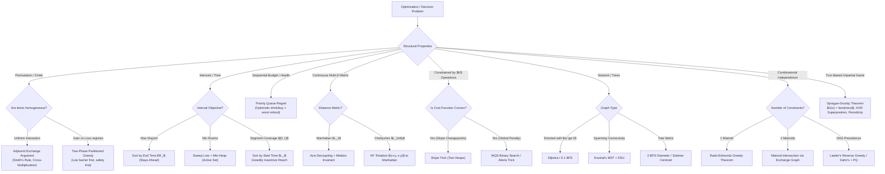

# Section §19: Greedy Fundamentals & Invariants

> **Module ID:** `sec-19`  
> **Phase:** Phase 1 — Range Queries & Sweeps  
> **Topic Count:** 11  

**Module Summary:** The complete masterclass on Greedy Algorithms, Structural Invariants, and Convex Duality: from Exchange Arguments and Regret/Undo Heaps to Slope Trick, Matroid Intersection, and Sprague-Grundy Game Theory.

---

## Topics in this Section

| # | Topic Title | ROI | Rating | Frequency | Markdown Guide |
|---|---|---|---|---|---|
| 1 | Greedy Foundations, Proof Paradigms & The Exchange Argument | `S-tier` | 1400–2400 | Very Common | [01-19-greedy-foundations-and-exchange-arguments.md](./01-19-greedy-foundations-and-exchange-arguments.md) |
| 2 | Interval Scheduling, Coverage & Lexicographical Greedy | `S-tier` | 1300–2100 | Very Common | [02-19-interval-scheduling-coverage-and-lexicographical-greedy.md](./02-19-interval-scheduling-coverage-and-lexicographical-greedy.md) |
| 3 | Sorting Criteria, Custom Comparators & Partitioned Greedy | `S-tier` | 1500–2300 | Common | [03-19-sorting-criteria-custom-comparators-and-partitioned-greedy.md](./03-19-sorting-criteria-custom-comparators-and-partitioned-greedy.md) |
| 4 | Sweep-Line Invariants, Active Sets & Constructive Greedy | `S-tier` | 1400–2200 | Very Common | [04-19-sweep-line-invariants-active-sets-and-constructive-greedy.md](./04-19-sweep-line-invariants-active-sets-and-constructive-greedy.md) |
| 5 | Priority Queue Regret & Buy-Now-Refund-Later Heuristics | `S-tier` | 1600–2400 | Common | [05-19-priority-queue-regret-and-undo-maintenance.md](./05-19-priority-queue-regret-and-undo-maintenance.md) |
| 6 | Axis Decoupling, Median Invariants & 1D/2D Sweeps | `S-tier` | 1400–2200 | Common | [06-19-axis-decoupling-median-invariants-and-sweeps.md](./06-19-axis-decoupling-median-invariants-and-sweeps.md) |
| 7 | Convex Optimization, Slope Trick & WQS Binary Search | `A-tier` | 2000–2800 | Occasional | [07-19-convex-optimization-slope-trick-and-wqs-binary-search.md](./07-19-convex-optimization-slope-trick-and-wqs-binary-search.md) |
| 8 | Greedy on Graphs & Trees (Dijkstra, MST, Centroid, Tree DP) | `S-tier` | 1400–2300 | Very Common | [08-19-greedy-on-graphs-and-trees.md](./08-19-greedy-on-graphs-and-trees.md) |
| 9 | Matroid Theory & Matroid Intersection | `A-tier` | 2200–2800+ | Occasional | [09-19-matroid-theory-and-matroid-intersection.md](./09-19-matroid-theory-and-matroid-intersection.md) |
| 10 | Antimatroids, Posets & Advanced Greedy Oracles (Trie, SegTree, Hall's) | `S-tier` | 1800–2600 | Common | [10-19-antimatroids-posets-and-advanced-greedy-oracles.md](./10-19-antimatroids-posets-and-advanced-greedy-oracles.md) |
| 11 | Impartial Games, Sprague-Grundy & Periodic Invariants | `A-tier` | 1600–2400 | Common | [11-19-impartial-games-sprague-grundy-and-periodic-invariants.md](./11-19-impartial-games-sprague-grundy-and-periodic-invariants.md) |

---

## Master Decision Tree for Greedy Optimization

---

## Summary of Core Invariant Equations

| Pattern | Fundamental Equation / Condition | Complexity |
|---|---|---|
| **Smith's Rule** | $w_A \cdot p_B > w_B \cdot p_A \iff A \prec B$ | $O(N \log N)$ |
| **Activity Selection** | $r(g_i) \le r(o_i) \implies \text{Greedy Stays Ahead}$ | $O(N \log N)$ |
| **Partitioned Depletion** | $A_i + B_i > A_j + B_j$ (for negative deltas $B < 0$) | $O(N \log N)$ |
| **Interval Graph Coloring** | $\text{Min Rooms} = \max_{t} \|\mathcal{A}(t)\|$ | $O(N \log N)$ |
| **Potions Regret Invariant** | If $H < 0$: $H \leftarrow H - \min(\mathcal{H})$, pop $\min(\mathcal{H})$ | $O(N \log N)$ |
| **Median Minimization** | $\min_c \sum \|x_i - c\| \implies c = x_{N/2}$ | $O(N \log N)$ |
| **Chebyshev Rotation** | $\max(\|x_1 - x_2\|, \|y_1 - y_2\|) = \frac{1}{2}(\|u_1 - u_2\| + \|v_1 - v_2\|)$ | $O(1)$ |
| **WQS Recovery Formula** | $F(K) = \min_x (f(x) - \lambda^* \cdot \text{count}(x)) + K \cdot \lambda^*$ | $O(N \log V)$ |
| **Rado-Edmonds Greedy** | Greedy optimal $\iff (E, \mathcal{I})$ satisfies Matroid Augmentation Axiom | $O(N \log N + N \cdot T_{\text{oracle}})$ |
| **Bouton's Nim Theorem** | P-position (Second Player Win) $\iff \bigoplus_{i=1}^k x_i = 0$ | $O(K)$ |
